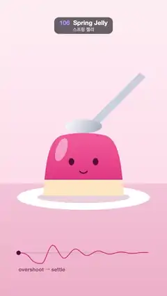

# 106 · Spring Jelly · 스프링 젤리



**EN** A spoon presses a pink jelly down and lets go; it bounces with overshoot and settles, its top swaying, while a graph plots the spring.  
**KO** 숟가락이 분홍 젤리를 눌렀다 놓으면 젤리가 오버슈트하며 출렁이다 가라앉고 윗부분이 흔들리며, 아래 그래프가 그 스프링 곡선을 그린다.

[Video (mp4)](../videos/106-spring-jelly.mp4) · [Code](../effects/106-spring-jelly.js) · Animation principles · 애니메이션 원리

## Prompt (English)

```text
Create a "Spring Jelly" motion effect: a spoon presses a cute jelly down and lets go; the jelly's height then follows a damped spring (overshoot, undershoot, settle) while its top sways on a second, slower spring. A graph under it plots one cycle of the spring with a dot at "now" and the label "overshoot → settle", so the viewer connects the wobble to the curve.

Look
- Background: vertical gradient #FFF0F4 → #FFE0EA down to 62 % of the height (y 1190), then a table #F7C9D8 → #F2B6C9.
- Jelly, plate and spoon are drawn 1.3× around the plate point (540, 1270).
- Plate: white ellipse at (540, 1278), radii 330·(1 − 0.3·s) × 62, with a pink shadow rgba(180, 80, 120, 0.25), 230·(1 − 0.5·s) × 30, on top of it.
- Jelly rest shape (relative to (540, 1270), y up is negative): a dome from (−200, 0) up through Bézier curves with control points (−190, −150), (−178, −275), (−112, −300), then (−40, −318), (40, −318), (112, −300), then (178, −275), (190, −150), (200, 0), closed along the bottom.
- Fill inside the shape: vertical gradient #FF6F9C (top) → #E8407A, a creamy bottom layer #FFE7C2 below the deformed line y = −80, and a white 45 % highlight ellipse (26 × 60·(1 + s)) at the deformed point (−110, −230), tilted 0.35 rad plus the sway. Face drawn on the deformed shape: eyes #5A1630 (14 × 18·(1 + s) radii) at (±60, −170) and a 6 px smile arc (radius 22) at (0, −135).
- Spoon: a handle quad #C9CFDD going up and right from the bowl, and a bowl ellipse 92 × 34 at (540, y − 32) with gradient #F4F6FB → #AAB2C5.
- Graph below: baseline from x 120 to 960 at y 1640, 3 px rgba(120, 40, 70, 0.25); the curve of one cycle, x across 840 px, y = 1640 − 230·s, 5 px #E8407A; a dot #5A1630 radius 14 at the current time; label "overshoot → settle" in bold 34 px rgba(90, 22, 48, 0.6), left aligned at (120, 1760).

Motion (0–5 s)
- Two identical cycles of 2.5 s; τ = t mod 2.5.
- Squash/stretch s(τ): press for 0.45 s, s = −0.3·easeInOut(τ / 0.45); after release (u = τ − 0.45), s = −0.3·exp(−ζω₀u)·cos(ω₀·√(1 − ζ²)·u) with ω₀ = 2π·2.3 and ζ = 0.11.
- Sway sh(τ) = 0.16·exp(−1.6u)·sin(2π·1.4u) after release, 0 before.
- Deform every point (x, y) of the rest shape: h = −y / 310 (0 at the base, 1 at the top); x′ = 540 + x·(1 − 0.65·s·(0.3 + 0.7h)) + sh·h²·310 and y′ = 1270 + y·(1 + s). Squashing widens the jelly (volume kept, more at the top) and the top sways most.
- Spoon y: while pressing it rides the jelly's top (y = 1270 − 315·(1 + s)); after release it lifts from 1270 − 0.7·315 to the hover height 1270 − 560 over 0.3 s (ease-out); during 2.05–2.5 s it comes down (ease-in-out) to the top again for the next press.

Technique
- Canvas 2D, full repaint. Build the outline from deformed Bézier control points, clip to it to paint the gradient, cream layer and highlight. Everything is analytic in t.

Output and rules
- One self-contained HTML file with no external assets (three.js from a CDN is fine if you use it), drawing on a 1080 × 1920 canvas (9:16) scaled to fit the window.
- Write a function renderFrame(t) that draws the frame for time t in seconds, and preview it with requestAnimationFrame. Everything must be a pure function of t and fixed seeds: no Math.random(), Date or state carried between frames, so frame i = renderFrame(i / 30) can be exported to a 30 fps video.
- Loop seamlessly every 5 seconds: renderFrame(5) must look exactly like renderFrame(0).
- No flicker of any kind: no noise or grain that changes from frame to frame, no strobing or blinking, no z-fighting, no shimmering 1 px lines. Any grain or texture stays fixed to the screen or to the object.
- Keep the top 280 px free of important content (a title label goes there) and fill the whole frame with a designed background.
```

## 프롬프트 (한국어)

```text
"스프링 젤리" 모션 효과를 만들어 줘: 숟가락이 귀여운 젤리를 눌렀다 놓으면, 젤리 높이가 감쇠 스프링(오버슈트, 언더슈트, 가라앉기)을 따르고 윗부분은 더 느린 두 번째 스프링으로 흔들린다. 아래 그래프가 스프링 한 주기를 그리고 "지금" 위치에 점을 찍으며 "overshoot → settle" 라벨을 달아, 출렁임과 곡선을 이어서 보게 한다.

모양
- 배경: 높이의 62 %(y 1190)까지 세로 그라디언트 #FFF0F4 → #FFE0EA, 그 아래는 탁자 #F7C9D8 → #F2B6C9.
- 젤리·접시·숟가락은 접시 점 (540, 1270)을 기준으로 1.3배로 그린다.
- 접시: (540, 1278)의 흰 타원, 반지름 330·(1 − 0.3·s) × 62, 그 위에 분홍 그림자 rgba(180, 80, 120, 0.25), 230·(1 − 0.5·s) × 30.
- 젤리 기본 모양((540, 1270) 기준, 위쪽이 음수): (−200, 0)에서 시작하는 돔. 베지에 조절점 (−190, −150), (−178, −275), (−112, −300), 다음 (−40, −318), (40, −318), (112, −300), 다음 (178, −275), (190, −150), (200, 0), 아래는 직선으로 닫는다.
- 모양 안 채우기: 세로 그라디언트 #FF6F9C(위) → #E8407A, 변형된 y = −80 선 아래에 크림층 #FFE7C2, 변형된 점 (−110, −230)에 흰색 45 % 하이라이트 타원(26 × 60·(1 + s)), 0.35 rad + 흔들림만큼 기울임. 얼굴도 변형된 모양 위에: 눈 #5A1630(반지름 14 × 18·(1 + s))을 (±60, −170)에, 6px 미소 호(반지름 22)를 (0, −135)에.
- 숟가락: 볼에서 오른쪽 위로 뻗는 손잡이 사각형 #C9CFDD, 그리고 (540, y − 32)의 92 × 34 볼 타원, 그라디언트 #F4F6FB → #AAB2C5.
- 아래 그래프: y 1640에 x 120–960 기준선 3px rgba(120, 40, 70, 0.25). 한 주기 곡선은 가로 840px, y = 1640 − 230·s, 5px #E8407A. 지금 시각에 반지름 14 점 #5A1630. 라벨 "overshoot → settle" 굵은 34px rgba(90, 22, 48, 0.6), (120, 1760)에 왼쪽 정렬.

움직임 (0–5초)
- 2.5초짜리 같은 주기 두 번. τ = t mod 2.5.
- 찌그러짐/늘어남 s(τ): 0.45초 동안 누르기, s = −0.3·easeInOut(τ / 0.45). 놓은 뒤(u = τ − 0.45) s = −0.3·exp(−ζω₀u)·cos(ω₀·√(1 − ζ²)·u), ω₀ = 2π·2.3, ζ = 0.11.
- 흔들림 sh(τ) = 놓은 뒤 0.16·exp(−1.6u)·sin(2π·1.4u), 그 전에는 0.
- 기본 모양의 모든 점 (x, y)를 변형: h = −y / 310(바닥 0, 꼭대기 1). x′ = 540 + x·(1 − 0.65·s·(0.3 + 0.7h)) + sh·h²·310, y′ = 1270 + y·(1 + s). 찌그러지면 옆으로 퍼지고(부피 유지, 위쪽일수록 더), 꼭대기가 가장 많이 흔들린다.
- 숟가락 y: 누르는 동안 젤리 꼭대기를 따라간다(y = 1270 − 315·(1 + s)). 놓은 뒤 0.3초 동안 1270 − 0.7·315에서 대기 높이 1270 − 560으로 올라가고(ease-out), 2.05–2.5초에 다시 꼭대기로 내려온다(ease-in-out). 다음 누르기 준비.

기법
- Canvas 2D, 매 프레임 전체를 다시 칠한다. 변형된 베지에 조절점으로 윤곽을 만들고, 그 모양으로 clip해 그라디언트·크림층·하이라이트를 칠한다. 모든 것이 t의 해석적 함수다.

출력과 규칙
- 외부 파일 없는 HTML 파일 하나(three.js를 쓴다면 CDN은 괜찮다). 1080 × 1920(9:16) 캔버스에 그리고 창 크기에 맞춰 보이게 한다.
- 시간 t(초)의 프레임을 그리는 renderFrame(t) 함수를 만들고, 미리보기는 requestAnimationFrame으로 돌린다. 모든 것은 t와 고정 시드만으로 정해진다: Math.random(), Date, 프레임 사이에 쌓이는 상태 금지. 그래야 i번째 프레임 = renderFrame(i / 30)으로 30fps 영상을 뽑을 수 있다.
- 5초마다 끊김 없이 반복: renderFrame(5)는 renderFrame(0)과 똑같아 보여야 한다.
- 어떤 깜빡임도 금지: 프레임마다 바뀌는 노이즈·그레인, 번쩍임·깜빡임, z-fighting, 반짝이며 떨리는 1px 선 모두 금지. 그레인·질감은 화면이나 물체에 고정한다.
- 위쪽 280px에는 중요한 내용을 두지 않고(제목 라벨 자리), 화면 전체를 디자인된 배경으로 채운다.
```
