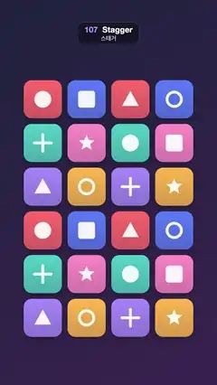

# 107 · Stagger · 스태거



**EN** A 4 × 6 grid of coloured icon tiles shrinks away in a diagonal wave, leaving empty slots, then pops back in the same order.  
**KO** 색색의 아이콘 타일 4 × 6 격자가 대각선 물결처럼 차례로 작아지며 사라져 빈칸만 남았다가, 같은 순서로 통통 튀어나오며 돌아온다.

[Video (mp4)](https://sueun-dev.github.io/motion-effects/videos/107-stagger.mp4) · [Code](../effects/107-stagger.js) · Animation principles · 애니메이션 원리

## Prompt (English)

```text
Create a "Stagger" motion effect: every tile of a grid plays exactly the same pop-out / pop-in animation, only delayed by its diagonal index, so the grid cascades out and back in like a wave. The viewer should see that a simple per-item delay turns one animation into a flowing sequence.

Look
- Background: diagonal gradient from the top left #20233F to the bottom right #3A2550.
- Grid: 4 columns × 6 rows of 190 px tiles with 28 px gaps (844 px wide, centred, x 118–962), starting at y 400 (to y 1680).
- Every slot always shows an empty outline: rounded rectangle inset 4 px, radius 40, 3 px stroke, white at 12 %.
- Tile: 190 × 190 rounded square (radius 40), vertical gradient from its colour to the same colour at 80 % opacity, drop shadow rgba(0, 0, 0, 0.3), blur 24, offset y 12. Colour = palette[(2·row + 3·col) mod 6] with palette #FF6B6B, #FFB84C, #4ECDC4, #5B7CFA, #A78BFA, #FF8FC7.
- White icon (92 %) in the centre, size about 84 px, kind = (4·row + col) mod 6: filled circle, rounded square, triangle, ring (14 px stroke), plus sign (14 px, round caps), five-point star.

Motion (0–5 s)
- Delay d = (row + col) × 0.1 s, so the wave runs from the top-left tile to the bottom-right (0 to 0.8 s).
- Exit: during 0.6 + d to 1.1 + d s, k = 1 − easeIn(progress) with cubic ease-in; the tile shrinks to nothing, drops up to 60 px and turns up to +0.5 rad. All tiles are gone by 1.9 s, leaving only the empty slots.
- Entrance: during 2.3 + d to 2.9 + d s, k = easeOutBack(progress) (overshoot constant 1.70158), so each tile pops slightly past full size and settles, while it un-twists from −0.4 rad with (1 − progress)².
- Use the exit branch for t < 2.1 s and the entrance branch after. Hold the full grid from 3.7 s to the end and from 0 to 0.6 s.
- Opacity = min(1, 1.5·k); skip tiles with k ≈ 0.

Technique
- Canvas 2D, full repaint; for each tile translate to its centre, rotate, scale by k, draw the tile and its icon.

Output and rules
- One self-contained HTML file with no external assets (three.js from a CDN is fine if you use it), drawing on a 1080 × 1920 canvas (9:16) scaled to fit the window.
- Write a function renderFrame(t) that draws the frame for time t in seconds, and preview it with requestAnimationFrame. Everything must be a pure function of t and fixed seeds: no Math.random(), Date or state carried between frames, so frame i = renderFrame(i / 30) can be exported to a 30 fps video.
- Loop seamlessly every 5 seconds: renderFrame(5) must look exactly like renderFrame(0).
- No flicker of any kind: no noise or grain that changes from frame to frame, no strobing or blinking, no z-fighting, no shimmering 1 px lines. Any grain or texture stays fixed to the screen or to the object.
- Keep the top 280 px free of important content (a title label goes there) and fill the whole frame with a designed background.
```

## 프롬프트 (한국어)

```text
"스태거" 모션 효과를 만들어 줘: 격자의 모든 타일이 똑같은 사라지기 / 나타나기 애니메이션을 재생하는데, 대각선 순번만큼만 늦게 시작한다. 그래서 격자 전체가 물결처럼 차례로 빠졌다가 다시 들어온다. 항목마다 지연 하나만 주면 같은 애니메이션이 흐르는 연속 동작이 된다는 것을 보여 준다.

모양
- 배경: 왼쪽 위 #20233F에서 오른쪽 아래 #3A2550으로 가는 대각선 그라디언트.
- 격자: 190px 타일 4열 × 6행, 간격 28px(폭 844px, 가운데 정렬, x 118–962), y 400에서 시작(y 1680까지).
- 칸마다 빈 윤곽선이 늘 보인다: 4px 안쪽으로 들인 둥근 사각형, 반지름 40, 3px 선, 흰색 12 %.
- 타일: 190 × 190 둥근 정사각형(반지름 40), 자기 색에서 같은 색 80 % 불투명도로 가는 세로 그라디언트, 그림자 rgba(0, 0, 0, 0.3), 블러 24, 아래로 12. 색 = 팔레트[(2·행 + 3·열) mod 6], 팔레트 #FF6B6B, #FFB84C, #4ECDC4, #5B7CFA, #A78BFA, #FF8FC7.
- 가운데 흰 아이콘(92 %), 크기 약 84px, 종류 = (4·행 + 열) mod 6: 채운 원, 둥근 사각형, 삼각형, 고리(14px 선), 더하기(14px, 둥근 끝), 오각별.

움직임 (0–5초)
- 지연 d = (행 + 열) × 0.1초. 물결이 왼쪽 위 타일에서 오른쪽 아래로 간다(0–0.8초).
- 퇴장: (0.6 + d)–(1.1 + d)초에 k = 1 − easeIn(진행도), cubic ease-in. 타일이 0까지 작아지며 최대 60px 아래로 떨어지고 +0.5 rad까지 돈다. 1.9초에는 모두 사라지고 빈칸만 남는다.
- 등장: (2.3 + d)–(2.9 + d)초에 k = easeOutBack(진행도)(오버슈트 상수 1.70158). 타일마다 원래 크기를 살짝 넘었다가 자리 잡고, 동시에 −0.4 rad에서 (1 − 진행도)²로 비틀림이 풀린다.
- t < 2.1초에는 퇴장 식, 그 뒤에는 등장 식을 쓴다. 3.7초부터 끝까지, 그리고 0–0.6초에는 격자가 가득 찬 채 머문다.
- 불투명도 = min(1, 1.5·k). k ≈ 0이면 그리지 않는다.

기법
- Canvas 2D, 매 프레임 전체를 다시 칠한다. 타일마다 중심으로 옮기고, 돌리고, k만큼 크기를 바꾼 뒤 타일과 아이콘을 그린다.

출력과 규칙
- 외부 파일 없는 HTML 파일 하나(three.js를 쓴다면 CDN은 괜찮다). 1080 × 1920(9:16) 캔버스에 그리고 창 크기에 맞춰 보이게 한다.
- 시간 t(초)의 프레임을 그리는 renderFrame(t) 함수를 만들고, 미리보기는 requestAnimationFrame으로 돌린다. 모든 것은 t와 고정 시드만으로 정해진다: Math.random(), Date, 프레임 사이에 쌓이는 상태 금지. 그래야 i번째 프레임 = renderFrame(i / 30)으로 30fps 영상을 뽑을 수 있다.
- 5초마다 끊김 없이 반복: renderFrame(5)는 renderFrame(0)과 똑같아 보여야 한다.
- 어떤 깜빡임도 금지: 프레임마다 바뀌는 노이즈·그레인, 번쩍임·깜빡임, z-fighting, 반짝이며 떨리는 1px 선 모두 금지. 그레인·질감은 화면이나 물체에 고정한다.
- 위쪽 280px에는 중요한 내용을 두지 않고(제목 라벨 자리), 화면 전체를 디자인된 배경으로 채운다.
```
