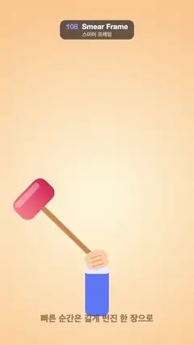

# 108 · Smear Frame · 스미어 프레임



**EN** A hand whips a red mallet from side to side; during each fast swing the head is drawn as one long smeared arc with speed lines.  
**KO** 손이 빨간 망치를 좌우로 휘두르고, 빠르게 휘두르는 순간마다 망치 머리가 속도선과 함께 길게 번진 호 하나로 그려진다.

[Video (mp4)](https://sueun-dev.github.io/motion-effects/videos/108-smear-frame.mp4) · [Code](../effects/108-smear-frame.js) · Animation principles · 애니메이션 원리

## Prompt (English)

```text
Create a "Smear Frame" motion effect: a cartoon fist swings a mallet. When the swing is faster than the eye can follow, the frame does not show a sharp mallet jumping; it draws the head stretched along the whole arc it covered, tapering behind, plus a faint fan for the handle and two speed lines. The caption reads "빠른 순간은 길게 번진 한 장으로" ("a fast moment becomes one long smeared drawing").

Look
- Background: radial gradient centred at (540, 1100), #FFF3D6 in the middle to #FFC98F at radius 1100.
- Pivot (the fist) at (540, 1450). Mallet in its own rotated frame: handle #C98B52, 28 px wide and 490 px long with round ends, pointing up; head at the end, a 240 × 140 rounded rectangle (radius 46) centred 490 px from the pivot, horizontal gradient #FF8A8F → #E03A52, with a white 35 % highlight strip (180 × 34) near its top.
- Arm: a blue sleeve #5B7CFA (132 × 280, radius 34) from y 1480 down, a light cuff #E9EEFF (144 × 44); a fist #FFCFA3 (124 × 104, radius 40) at the pivot with three finger lines rgba(170, 100, 60, 0.45), turning 0.35× the handle angle.
- Caption "빠른 순간은 길게 번진 한 장으로", heavy 50 px, rgba(90, 50, 30, 0.6), centred at y 1790.

Motion (0–5 s)
- Handle angle θ from straight up (positive = to the right), all moves with cubic ease-in-out unless noted:
  - Rest at −0.8 rad (leaning left).
  - 0.45–0.87 s wind up further to −1.0.
  - 0.87–1.07 s whip across to +0.92 in 0.2 s (an overshoot of 0.12).
  - 1.07–1.45 s settle back to +0.8 (ease-out). Hold.
  - 2.85–3.27 s wind up to +1.0; 3.27–3.47 s whip to −0.92; 3.47–3.85 s settle to −0.8 (ease-out). Hold to the end.
- The smear appears only while the swing is fast: compare θ(t) with θ(t − 1.5/30) (a little more than one frame, the cartoon exaggeration). If the difference is more than 0.03 rad, extend the start angle another 0.1 rad backwards and draw, before the mallet:
  - The handle fan: a pie wedge from the pivot to radius 420 between the start angle and θ, rgba(201, 139, 82, 0.35).
  - The stretched head: 40 slices along the arc at radius 490, each slice's radial half-thickness 70·(0.25 + 0.75u) and colour rgba(240, 70, 90, 0.25 + 0.65u), where u goes from 0 at the back to 1 at the mallet: thin and faint behind, full at the front.
  - Two speed lines at radii 600 and 640, 6 px, white at 80 %, covering 20–90 % of that arc, round caps.
- The slower wind-ups and settles cross the threshold only near their fastest point and leave a short, faint smear; at rest nothing is drawn, so the mallet reads sharp.

Technique
- Canvas 2D, full repaint; the smear is computed from two samples of the same angle function, so it is a pure function of t.

Output and rules
- One self-contained HTML file with no external assets (three.js from a CDN is fine if you use it), drawing on a 1080 × 1920 canvas (9:16) scaled to fit the window.
- Write a function renderFrame(t) that draws the frame for time t in seconds, and preview it with requestAnimationFrame. Everything must be a pure function of t and fixed seeds: no Math.random(), Date or state carried between frames, so frame i = renderFrame(i / 30) can be exported to a 30 fps video.
- Loop seamlessly every 5 seconds: renderFrame(5) must look exactly like renderFrame(0).
- No flicker of any kind: no noise or grain that changes from frame to frame, no strobing or blinking, no z-fighting, no shimmering 1 px lines. Any grain or texture stays fixed to the screen or to the object.
- Keep the top 280 px free of important content (a title label goes there) and fill the whole frame with a designed background.
```

## 프롬프트 (한국어)

```text
"스미어 프레임" 모션 효과를 만들어 줘: 만화 주먹이 망치를 휘두른다. 눈이 못 따라갈 만큼 빠르게 휘두를 때 프레임은 또렷한 망치가 툭 건너뛰는 모습이 아니라, 망치 머리가 지나간 호 전체에 길게 늘어나 뒤로 갈수록 가늘어지는 모습을, 손잡이의 옅은 부채꼴과 속도선 두 줄과 함께 그린다. 자막은 "빠른 순간은 길게 번진 한 장으로".

모양
- 배경: (540, 1100) 중심 방사형 그라디언트, 가운데 #FFF3D6에서 반지름 1100의 #FFC98F로.
- 회전축(주먹)은 (540, 1450). 망치는 자기 회전 좌표계에서: 손잡이 #C98B52, 폭 28px, 길이 490px, 끝이 둥글고 위를 향한다. 끝에 머리: 회전축에서 490px 떨어진 곳을 중심으로 한 240 × 140 둥근 사각형(반지름 46), 가로 그라디언트 #FF8A8F → #E03A52, 윗부분에 흰색 35 % 하이라이트 띠(180 × 34).
- 팔: y 1480부터 아래로 파란 소매 #5B7CFA(132 × 280, 반지름 34), 밝은 소맷부리 #E9EEFF(144 × 44). 회전축에 주먹 #FFCFA3(124 × 104, 반지름 40), 손가락 선 셋 rgba(170, 100, 60, 0.45), 손잡이 각도의 0.35배만큼 함께 돈다.
- 자막 "빠른 순간은 길게 번진 한 장으로", 아주 굵은 50px, rgba(90, 50, 30, 0.6), y 1790 가운데.

움직임 (0–5초)
- 손잡이 각도 θ는 수직 위 기준(오른쪽이 +). 따로 적지 않으면 모두 cubic ease-in-out:
  - 쉬는 자세 −0.8 rad(왼쪽으로 기움).
  - 0.45–0.87초 더 뒤로 −1.0까지 젖힌다.
  - 0.87–1.07초 0.2초 만에 +0.92까지 휘두른다(0.12 넘침).
  - 1.07–1.45초 +0.8로 되돌아와 자리 잡는다(ease-out). 멈춤.
  - 2.85–3.27초 +1.0으로 젖히고, 3.27–3.47초 −0.92로 휘두르고, 3.47–3.85초 −0.8로 자리 잡는다(ease-out). 끝까지 멈춤.
- 번짐은 빠를 때만: θ(t)와 θ(t − 1.5/30)를 비교한다(한 프레임보다 조금 길게, 만화식 과장). 차이가 0.03 rad보다 크면 시작 각을 0.1 rad 더 뒤로 늘리고, 망치보다 먼저 다음을 그린다:
  - 손잡이 부채꼴: 회전축에서 반지름 420까지, 시작 각과 θ 사이의 부채꼴, rgba(201, 139, 82, 0.35).
  - 늘어난 머리: 반지름 490의 호를 따라 40조각. 조각마다 반지름 방향 반두께 70·(0.25 + 0.75u), 색 rgba(240, 70, 90, 0.25 + 0.65u). u는 뒤쪽 0에서 망치 쪽 1: 뒤는 가늘고 옅고, 앞은 꽉 찬다.
  - 속도선 둘: 반지름 600과 640, 6px, 흰색 80 %, 그 호의 20–90 % 구간, 둥근 끝.
- 느린 젖히기와 자리 잡기는 가장 빠른 순간에만 문턱을 넘어 짧고 옅은 번짐을 남긴다. 쉬고 있을 때는 아무것도 그리지 않아 망치가 또렷하게 읽힌다.

기법
- Canvas 2D, 매 프레임 전체를 다시 칠한다. 번짐은 같은 각도 함수를 두 번 샘플해 계산하니 t의 순수 함수다.

출력과 규칙
- 외부 파일 없는 HTML 파일 하나(three.js를 쓴다면 CDN은 괜찮다). 1080 × 1920(9:16) 캔버스에 그리고 창 크기에 맞춰 보이게 한다.
- 시간 t(초)의 프레임을 그리는 renderFrame(t) 함수를 만들고, 미리보기는 requestAnimationFrame으로 돌린다. 모든 것은 t와 고정 시드만으로 정해진다: Math.random(), Date, 프레임 사이에 쌓이는 상태 금지. 그래야 i번째 프레임 = renderFrame(i / 30)으로 30fps 영상을 뽑을 수 있다.
- 5초마다 끊김 없이 반복: renderFrame(5)는 renderFrame(0)과 똑같아 보여야 한다.
- 어떤 깜빡임도 금지: 프레임마다 바뀌는 노이즈·그레인, 번쩍임·깜빡임, z-fighting, 반짝이며 떨리는 1px 선 모두 금지. 그레인·질감은 화면이나 물체에 고정한다.
- 위쪽 280px에는 중요한 내용을 두지 않고(제목 라벨 자리), 화면 전체를 디자인된 배경으로 채운다.
```
