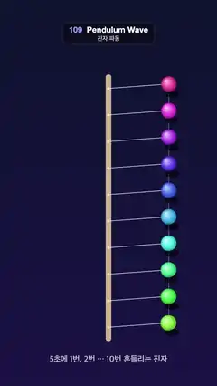

# 109 · Pendulum Wave · 진자 파동



**EN** Ten pendulums seen from above swing 1 to 10 times per loop, so the row snakes, splits into several lines and lines up again.  
**KO** 위에서 내려다본 진자 10개가 한 루프에 1번부터 10번까지 흔들려, 줄이 뱀처럼 꿈틀대다 여러 줄로 갈라지고 다시 한 줄로 선다.

[Video (mp4)](https://sueun-dev.github.io/motion-effects/videos/109-pendulum-wave.mp4) · [Code](../effects/109-pendulum-wave.js) · Animation principles · 애니메이션 원리

## Prompt (English)

```text
Create a "Pendulum Wave" motion effect, seen from directly above: ten pendulums hang from one bar; pendulum k swings exactly 1 + k times in 5 seconds, so neighbours drift apart by one swing per loop. The row snakes, splits into two, three, four interleaved lines and lines up again at t = 5. The caption reads "5초에 1번, 2번 … 10번 흔들리는 진자" ("pendulums that swing 1, 2 … 10 times in 5 seconds").

Look
- Background: vertical gradient #0E1430 → #1B1446.
- Faint ruler lines of the swing: 7 vertical lines at x = 540 + i·100 (i = −3..3), 2 px, white at 5 %, from y 380 to 1688.
- Pivot bar: a rounded vertical bar #C9B48A, 28 px wide, centred at x 540, from y 370 to 1698 (radius 14). Pivots on it at y = 440 + 132·k (k = 0..9), small dots #E9DDBE of radius 7 drawn on top.
- Ball k: x = 540 + 300·s, y = 440 + 132·k − 22·s², where s = cos(2π·(1 + k)·t / 5). The −22·s² lifts the ball a little at the ends of its swing, a hint of the arc seen from above.
- String: a 3 px line from the pivot to the ball, rgba(230, 235, 255, 0.55).
- Ball: radius 38, radial gradient from (−0.35R, −0.4R) of hsl(h, 100 %, 88 %) → hsl(h, 85 %, 62 %) at 60 % → hsl(h, 70 %, 42 %), hue h = 330 − 26·k (pink through violet, blue and cyan to green). A soft shadow ellipse 0.95R × 0.5R, rgba(0, 0, 0, 0.28), offset 16 px right of the ball and 26 px below its pivot row.
- A smooth curve through all ten balls (quadratic curves through the midpoints), 4 px, rgba(190, 210, 255, 0.35), drawn under the bar, so the wave shape is easy to read.
- Caption "5초에 1번, 2번 … 10번 흔들리는 진자", semi-bold 40 px, white at 70 %, centred at y 1800.

Motion (0–5 s)
- At t = 0 (and 5) every s = 1: all balls line up on the right at x 840. The fastest ball (10 swings per loop) moves up to about 3,800 px/s.
- At t = 2.5 s the odd and even pendulums are on opposite sides (two lines); at other simple fractions of the loop three or four lines appear; in between, the row is a snake.

Technique
- Canvas 2D, full repaint.
- Sub-frame motion blur, needed to avoid strobing on the fast balls: draw each string, shadow and ball 10 times at times t − j/600 (j = 0..9, spread across half a frame, a 180° shutter), each with globalAlpha = 1 − 0.02^(1/10) ≈ 0.32, so 10 layers stack to about 98 % where the ball is still and fan into a soft streak where it is fast. The curve and the pivots are drawn once.

Output and rules
- One self-contained HTML file with no external assets (three.js from a CDN is fine if you use it), drawing on a 1080 × 1920 canvas (9:16) scaled to fit the window.
- Write a function renderFrame(t) that draws the frame for time t in seconds, and preview it with requestAnimationFrame. Everything must be a pure function of t and fixed seeds: no Math.random(), Date or state carried between frames, so frame i = renderFrame(i / 30) can be exported to a 30 fps video.
- Loop seamlessly every 5 seconds: renderFrame(5) must look exactly like renderFrame(0).
- No flicker of any kind: no noise or grain that changes from frame to frame, no strobing or blinking, no z-fighting, no shimmering 1 px lines. Any grain or texture stays fixed to the screen or to the object.
- Keep the top 280 px free of important content (a title label goes there) and fill the whole frame with a designed background.
```

## 프롬프트 (한국어)

```text
"진자 파동" 모션 효과를 바로 위에서 내려다본 모습으로 만들어 줘: 막대 하나에 진자 10개가 매달려 있고, k번째 진자는 5초에 정확히 1 + k번 흔들린다. 그래서 이웃끼리 루프마다 한 번씩 어긋난다. 줄이 뱀처럼 꿈틀대다 두·세·네 줄로 엇갈려 갈라지고, t = 5에 다시 한 줄로 선다. 자막은 "5초에 1번, 2번 … 10번 흔들리는 진자".

모양
- 배경: 세로 그라디언트 #0E1430 → #1B1446.
- 흔들림 눈금선: x = 540 + i·100(i = −3..3)에 세로선 7개, 2px, 흰색 5 %, y 380부터 1688까지.
- 회전축 막대: x 540 가운데의 둥근 세로 막대 #C9B48A, 폭 28px, y 370–1698(반지름 14). 그 위 y = 440 + 132·k(k = 0..9)에 회전축 점 #E9DDBE(반지름 7)를 맨 위에 그린다.
- k번째 공: x = 540 + 300·s, y = 440 + 132·k − 22·s², s = cos(2π·(1 + k)·t / 5). −22·s² 때문에 흔들림 끝에서 공이 살짝 올라가, 위에서 본 호의 느낌이 난다.
- 줄: 회전축에서 공까지 3px 선, rgba(230, 235, 255, 0.55).
- 공: 반지름 38, (−0.35R, −0.4R)에서 시작하는 방사형 그라디언트 hsl(h, 100 %, 88 %) → 60 %에 hsl(h, 85 %, 62 %) → hsl(h, 70 %, 42 %). 색상 h = 330 − 26·k(분홍에서 보라·파랑·하늘색을 지나 초록). 부드러운 그림자 타원 0.95R × 0.5R, rgba(0, 0, 0, 0.28), 공보다 오른쪽으로 16px, 자기 회전축 줄보다 26px 아래.
- 열 개 공을 모두 지나는 매끄러운 곡선(중점을 지나는 2차 곡선), 4px, rgba(190, 210, 255, 0.35)를 막대 아래에 그려 파동 모양이 잘 읽히게 한다.
- 자막 "5초에 1번, 2번 … 10번 흔들리는 진자", 세미볼드 40px, 흰색 70 %, y 1800 가운데.

움직임 (0–5초)
- t = 0(그리고 5)에서 모든 s = 1: 공이 모두 오른쪽 x 840에 한 줄로 선다. 가장 빠른 공(루프당 10번)은 초속 약 3,800px까지 움직인다.
- t = 2.5초에는 홀수·짝수 진자가 반대편에 있어 두 줄. 루프의 다른 간단한 분수 시점에는 세 줄, 네 줄이 나타나고, 그 사이에는 뱀 모양이다.

기법
- Canvas 2D, 매 프레임 전체를 다시 칠한다.
- 빠른 공이 끊겨 보이지(스트로브) 않도록 프레임 안 모션 블러: 줄·그림자·공을 t − j/600(j = 0..9, 반 프레임에 퍼짐, 180° 셔터)에서 10번 그리고, 각각 globalAlpha = 1 − 0.02^(1/10) ≈ 0.32. 그러면 공이 멈춰 있는 곳에서는 10겹이 쌓여 약 98 %가 되고, 빠른 곳에서는 부드러운 꼬리로 퍼진다. 곡선과 회전축 점은 한 번만 그린다.

출력과 규칙
- 외부 파일 없는 HTML 파일 하나(three.js를 쓴다면 CDN은 괜찮다). 1080 × 1920(9:16) 캔버스에 그리고 창 크기에 맞춰 보이게 한다.
- 시간 t(초)의 프레임을 그리는 renderFrame(t) 함수를 만들고, 미리보기는 requestAnimationFrame으로 돌린다. 모든 것은 t와 고정 시드만으로 정해진다: Math.random(), Date, 프레임 사이에 쌓이는 상태 금지. 그래야 i번째 프레임 = renderFrame(i / 30)으로 30fps 영상을 뽑을 수 있다.
- 5초마다 끊김 없이 반복: renderFrame(5)는 renderFrame(0)과 똑같아 보여야 한다.
- 어떤 깜빡임도 금지: 프레임마다 바뀌는 노이즈·그레인, 번쩍임·깜빡임, z-fighting, 반짝이며 떨리는 1px 선 모두 금지. 그레인·질감은 화면이나 물체에 고정한다.
- 위쪽 280px에는 중요한 내용을 두지 않고(제목 라벨 자리), 화면 전체를 디자인된 배경으로 채운다.
```
