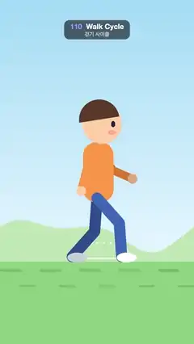

# 110 · Walk Cycle · 걷기 사이클



**EN** A cartoon walker strides in place with IK-bent knees and swinging arms while the ground and hills slide past under its feet.  
**KO** 만화 캐릭터가 IK로 굽는 무릎과 반대로 흔드는 팔로 제자리걸음을 하고, 발밑의 땅과 언덕이 뒤로 흘러간다.

[Video (mp4)](https://sueun-dev.github.io/motion-effects/videos/110-walk-cycle.mp4) · [Code](../effects/110-walk-cycle.js) · Animation principles · 애니메이션 원리

## Prompt (English)

```text
Create a "Walk Cycle" motion effect: a side-view cartoon character walks to the right on the spot, forever. Each foot follows a loop (flat on the ground pushing back, then lifted forward), two-bone IK finds the knees, the arms swing against the legs, and the body dips at each contact. The ground moves at exactly the speed of a planted foot, so the feet never slide. The dotted foot path shows the viewer the shape of a walk.

Look
- Sky: vertical gradient #9FD8F5 → #E6F6FF down to the ground line at y 1460. Far hills #BFE3B4: y = 1300 − 70·sin(u) − 40·sin(2u + 1) with u = 2π·(x + shift)/1080.
- Ground #8CCB7E below y 1460, with darker #76B86A rounded dashes every 220 px: 120 × 18 at y 1500 and 90 × 14 at y 1590 (offset 110 px).
- The walker is drawn 1.25× around (540, 1460), facing right. Hip at (540, 1164 + bob). Thigh and shin 150 px each, 50 px round strokes: near leg #3E66B8, far leg #2E4C8C. Shoes: ellipses 44 × 22 at the foot, shifted 22 px forward, white (near) and #C9CED8 (far).
- Torso #FF9A45: rounded rectangle 136 × 270 (radius 60) above the hip. Head #FFCFA6, radius 88, centred 330 px above the hip and 22 px forward; brown #5B3A29 hair as the upper half-disc (radius 90, from 0.95π to 1.95π); eye #2A1D3A (9 × 14) at the front; blush rgba(255, 120, 120, 0.4).
- Arms from the shoulder (552, hip − 210): upper arm 105 px, forearm 95 px, 36 px strokes, near #FF9A45 / far #D9772E, hands radius 22, #FFCFA6 / #E0A880. Upper-arm angle = swing (from straight down), elbow angle = swing + 0.35 + 0.35·max(0, swing).
- Foot path: 40 small white dots (radius 5, 70 %) tracing the foot loop relative to the hip, a D shape with a flat bottom and a 70 px arch.
- Draw order: far arm, far leg, torso and head, near leg, near arm.

Motion (0–5 s)
- Cycle T = 1.25 s (4 cycles, 8 steps per loop), p = t / T. Stride 220 px; ground speed = 220 / 0.625 = 352 px/s.
- Foot x, y relative to the hip for cycle position u: stance (u < 0.5), x goes linearly from +110 to −110 on the ground; swing (u ≥ 0.5), x = −110 + 220·easeInOut(k), lifted by 70·sin(πk), k = (u − 0.5)/0.5. Near leg u = p, far leg u = p + 0.5. The foot sits 22 px above the ground line.
- Knee by the law of cosines from hip, foot and the two 150 px bones, bending forward.
- Body bob = 12·cos(2·2π·p): the hip is lowest at each contact.
- Arms: near arm swing = −0.6·cos(2πp), far arm +0.6·cos(2πp), opposite to the legs.
- Scroll left: ground dashes by 352·t px (wrapped every 220 px), hills by 1080 px per 5 s.

Technique
- Canvas 2D, full repaint. Limbs are polylines hip → knee → foot (and shoulder → elbow → hand) stroked with round caps and joins.

Output and rules
- One self-contained HTML file with no external assets (three.js from a CDN is fine if you use it), drawing on a 1080 × 1920 canvas (9:16) scaled to fit the window.
- Write a function renderFrame(t) that draws the frame for time t in seconds, and preview it with requestAnimationFrame. Everything must be a pure function of t and fixed seeds: no Math.random(), Date or state carried between frames, so frame i = renderFrame(i / 30) can be exported to a 30 fps video.
- Loop seamlessly every 5 seconds: renderFrame(5) must look exactly like renderFrame(0).
- No flicker of any kind: no noise or grain that changes from frame to frame, no strobing or blinking, no z-fighting, no shimmering 1 px lines. Any grain or texture stays fixed to the screen or to the object.
- Keep the top 280 px free of important content (a title label goes there) and fill the whole frame with a designed background.
```

## 프롬프트 (한국어)

```text
"걷기 사이클" 모션 효과를 만들어 줘: 옆에서 본 만화 캐릭터가 오른쪽을 향해 제자리에서 끝없이 걷는다. 발마다 고리를 따라가고(땅에 붙어 뒤로 밀다가, 들어 올려 앞으로), 두 뼈 IK가 무릎을 찾고, 팔은 다리와 반대로 흔들리고, 발이 닿을 때마다 몸이 살짝 내려앉는다. 땅은 디딘 발과 정확히 같은 속도로 움직여 발이 절대 미끄러지지 않는다. 점으로 그린 발 경로가 걸음의 모양을 보여 준다.

모양
- 하늘: 땅선 y 1460까지 세로 그라디언트 #9FD8F5 → #E6F6FF. 먼 언덕 #BFE3B4: y = 1300 − 70·sin(u) − 40·sin(2u + 1), u = 2π·(x + shift)/1080.
- y 1460 아래는 땅 #8CCB7E, 220px마다 진한 #76B86A 둥근 줄: y 1500에 120 × 18, y 1590에 90 × 14(110px 옆으로 밀어서).
- 캐릭터는 (540, 1460)을 기준으로 1.25배, 오른쪽을 향한다. 엉덩이 (540, 1164 + 출렁임). 허벅지와 정강이 각 150px, 50px 둥근 선: 앞다리 #3E66B8, 뒷다리 #2E4C8C. 신발: 발 위치에서 22px 앞으로 옮긴 44 × 22 타원, 흰색(앞)과 #C9CED8(뒤).
- 몸통 #FF9A45: 엉덩이 위 136 × 270 둥근 사각형(반지름 60). 머리 #FFCFA6, 반지름 88, 엉덩이에서 330px 위·22px 앞. 갈색 #5B3A29 머리카락은 위쪽 반원(반지름 90, 0.95π–1.95π). 앞쪽에 눈 #2A1D3A(9 × 14), 볼터치 rgba(255, 120, 120, 0.4).
- 팔은 어깨 (552, 엉덩이 − 210)에서: 위팔 105px, 아래팔 95px, 36px 선, 앞 #FF9A45 / 뒤 #D9772E, 손 반지름 22, #FFCFA6 / #E0A880. 위팔 각도 = swing(수직 아래 기준), 팔꿈치 각도 = swing + 0.35 + 0.35·max(0, swing).
- 발 경로: 엉덩이 기준 발 고리를 따라 작은 흰 점 40개(반지름 5, 70 %). 바닥이 평평하고 70px 솟은 D자 모양.
- 그리는 순서: 뒷팔, 뒷다리, 몸통과 머리, 앞다리, 앞팔.

움직임 (0–5초)
- 주기 T = 1.25초(루프에 4주기, 8걸음), p = t / T. 보폭 220px, 땅 속도 = 220 / 0.625 = 352px/s.
- 주기 위치 u에서 엉덩이 기준 발 x, y: 디딤(u < 0.5)은 땅 위에서 x가 +110에서 −110으로 선형. 휘두름(u ≥ 0.5)은 x = −110 + 220·easeInOut(k), 70·sin(πk)만큼 들림, k = (u − 0.5)/0.5. 앞다리 u = p, 뒷다리 u = p + 0.5. 발은 땅선보다 22px 위.
- 무릎은 엉덩이·발과 150px 뼈 두 개로 코사인 법칙을 써서 구하고, 앞쪽으로 굽힌다.
- 몸 출렁임 = 12·cos(2·2π·p): 발이 닿을 때마다 엉덩이가 가장 낮다.
- 팔: 앞팔 swing = −0.6·cos(2πp), 뒷팔 +0.6·cos(2πp), 다리와 반대로.
- 왼쪽으로 흐르기: 땅 줄무늬는 352·t px(220px마다 되풀이), 언덕은 5초에 1080px.

기법
- Canvas 2D, 매 프레임 전체를 다시 칠한다. 팔다리는 엉덩이 → 무릎 → 발(어깨 → 팔꿈치 → 손) 꺾은선을 둥근 끝·둥근 이음으로 긋는다.

출력과 규칙
- 외부 파일 없는 HTML 파일 하나(three.js를 쓴다면 CDN은 괜찮다). 1080 × 1920(9:16) 캔버스에 그리고 창 크기에 맞춰 보이게 한다.
- 시간 t(초)의 프레임을 그리는 renderFrame(t) 함수를 만들고, 미리보기는 requestAnimationFrame으로 돌린다. 모든 것은 t와 고정 시드만으로 정해진다: Math.random(), Date, 프레임 사이에 쌓이는 상태 금지. 그래야 i번째 프레임 = renderFrame(i / 30)으로 30fps 영상을 뽑을 수 있다.
- 5초마다 끊김 없이 반복: renderFrame(5)는 renderFrame(0)과 똑같아 보여야 한다.
- 어떤 깜빡임도 금지: 프레임마다 바뀌는 노이즈·그레인, 번쩍임·깜빡임, z-fighting, 반짝이며 떨리는 1px 선 모두 금지. 그레인·질감은 화면이나 물체에 고정한다.
- 위쪽 280px에는 중요한 내용을 두지 않고(제목 라벨 자리), 화면 전체를 디자인된 배경으로 채운다.
```
