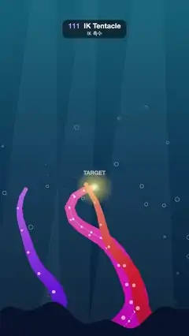

# 111 · IK Tentacle · IK 촉수



**EN** Three tentacles rise from dark seabed rocks and reach for a glowing target on a looping path; the middle one shows its IK joints.  
**KO** 어두운 해저 바위에서 자란 촉수 세 개가 고리 경로를 도는 빛나는 목표점을 향해 뻗고, 가운데 촉수에는 IK 관절이 보인다.

[Video (mp4)](../videos/111-ik-tentacle.mp4) · [Code](../effects/111-ik-tentacle.js) · Animation principles · 애니메이션 원리

## Prompt (English)

```text
Create an "IK Tentacle" motion effect: underwater, three tentacles grow from rocks at the bottom of the frame and chase a glowing target with inverse kinematics (FABRIK). The main tentacle shows its joint chain, so the viewer sees that the shape is solved from the target back to the base, while a small travelling wave makes the tentacles look alive.

Look
- Water: vertical gradient #0F5C7A → #0B3556 (50 %) → #071A33. Three still light shafts from the surface (pale cyan at 5 %, slanted trapezoids from the top edge to the bottom).
- 26 seeded bubbles: stroked circles (radius 4–12, 3 px, rgba(200, 240, 255)), each rising from the bottom to y 300 once or twice per loop, swaying 20 px, alpha 0.5·sin(π·u) so they fade in and out and never pop.
- Target: moves on x = 540 + 280·sin(2a), y = 900 + 300·sin(a + 0.6), a = 2π·t / 5 (a looping figure-of-eight). Its whole path is shown as a faint dotted line (round 3 px dots, 18 px gaps, rgba(255, 240, 160, 0.18), 4 px). The target is a glow, a radial gradient of radius 110 from rgba(255, 246, 190, 1) through rgba(255, 220, 120, 0.6) to transparent, with "TARGET" in bold 32 px white at 60 %, 70 px above it.
- Tentacles (bases below the frame at y 1990):
  - Main: base x 540, 20 joints, length 1250, root half-width 84, hue 300 (magenta), aims at the target itself.
  - Left: base x 150, 16 joints, length 1050, width 50, hue 250 (violet), aims 170 px left of and 120 px below the target, 0.35 s late.
  - Right: base x 930, 16 joints, length 1050, width 50, hue 345 (red), aims 170 px right of and 120 px below the target, 0.7 s late.
- Each tentacle is a tapered tube of overlapping discs, 4 per segment, radius width·(1 − 0.85u) + 4 at u = 0 (root) .. 1 (tip), colour hsl(hue + 30u, 70 %, 38 + 30u %). Suckers on one side at every second joint: pink rgba(255, 214, 236, 0.75) dots, radius 4 + 10·(1 − u), offset 0.55 of the local width.
- On the main tentacle only, the IK skeleton: a 3 px polyline through the joints, white at 35 %, and joint dots of radius 6, white at 85 %.
- Seabed rocks #06122A in front of the bases: a silhouette along y = 1800 − 60·sin(x/140) − 30·sin(x/47 + 1) down to the bottom. Then the target glow on top of everything.

Motion (0–5 s)
- Each frame, solve every tentacle from the same curled start pose (joint s = i/n at x = base + side·260·sin(1.4π·s), y = base − 0.7·length·s; side is −1 for the right tentacle): 24 FABRIK iterations, each pulling the tip to the goal and walking back to keep segment lengths, then pinning the root to the base and walking forward again. Starting from the same pose every frame keeps the result deterministic and smooth.
- Add a sideways ripple after solving: offset each joint along its normal by 28·sin(π·s)·sin(2π·(2s − w)), w = 3·t/5 + 0.3·j (j = tentacle index), which is zero at both ends, so the tip still touches the target. The ripple runs 3 times per loop.

Technique
- Canvas 2D, full repaint. Draw order: water, shafts, bubbles, target path, tentacles (main first, then left, then right), rocks, target glow and label.

Output and rules
- One self-contained HTML file with no external assets (three.js from a CDN is fine if you use it), drawing on a 1080 × 1920 canvas (9:16) scaled to fit the window.
- Write a function renderFrame(t) that draws the frame for time t in seconds, and preview it with requestAnimationFrame. Everything must be a pure function of t and fixed seeds: no Math.random(), Date or state carried between frames, so frame i = renderFrame(i / 30) can be exported to a 30 fps video.
- Loop seamlessly every 5 seconds: renderFrame(5) must look exactly like renderFrame(0).
- No flicker of any kind: no noise or grain that changes from frame to frame, no strobing or blinking, no z-fighting, no shimmering 1 px lines. Any grain or texture stays fixed to the screen or to the object.
- Keep the top 280 px free of important content (a title label goes there) and fill the whole frame with a designed background.
```

## 프롬프트 (한국어)

```text
"IK 촉수" 모션 효과를 만들어 줘: 물속에서 화면 아래 바위에서 자란 촉수 세 개가 역운동학(FABRIK)으로 빛나는 목표점을 쫓는다. 가운데 촉수는 관절 사슬을 보여 줘서, 모양이 목표점에서 뿌리 쪽으로 거꾸로 풀린다는 것을 알게 하고, 작은 물결이 지나가 촉수가 살아 있는 것처럼 보이게 한다.

모양
- 물: 세로 그라디언트 #0F5C7A → #0B3556(50 %) → #071A33. 수면에서 내려오는 움직이지 않는 빛줄기 셋(옅은 하늘색 5 %, 위 가장자리에서 아래까지 비스듬한 사다리꼴).
- 시드 고정 거품 26개: 선으로 그린 원(반지름 4–12, 3px, rgba(200, 240, 255)), 각각 루프마다 한두 번 바닥에서 y 300까지 떠오르며 20px 흔들리고, 알파 0.5·sin(π·u)로 나타났다 사라지니 툭 튀지 않는다.
- 목표점: x = 540 + 280·sin(2a), y = 900 + 300·sin(a + 0.6), a = 2π·t / 5(되풀이되는 8자 고리). 전체 경로를 옅은 점선(둥근 3px 점, 간격 18px, rgba(255, 240, 160, 0.18), 4px)으로 보여 준다. 목표점은 반지름 110의 방사형 빛: rgba(255, 246, 190, 1)에서 rgba(255, 220, 120, 0.6)을 지나 투명으로. 70px 위에 굵은 32px 흰색 60 % "TARGET".
- 촉수(뿌리는 화면 아래 y 1990):
  - 가운데: 뿌리 x 540, 관절 20개, 길이 1250, 뿌리 반폭 84, 색상 300(자홍), 목표점 자체를 노린다.
  - 왼쪽: 뿌리 x 150, 관절 16개, 길이 1050, 폭 50, 색상 250(보라), 목표점보다 왼쪽 170px·아래 120px을 0.35초 늦게 노린다.
  - 오른쪽: 뿌리 x 930, 관절 16개, 길이 1050, 폭 50, 색상 345(빨강), 목표점보다 오른쪽 170px·아래 120px을 0.7초 늦게 노린다.
- 촉수마다 겹친 원으로 만든 가늘어지는 관: 구간마다 원 4개, 반지름 폭·(1 − 0.85u) + 4(u는 뿌리 0 .. 끝 1), 색 hsl(색상 + 30u, 70 %, 38 + 30u %). 한쪽 옆으로 관절 두 개마다 빨판: 분홍 rgba(255, 214, 236, 0.75) 점, 반지름 4 + 10·(1 − u), 그 자리 폭의 0.55만큼 옆으로.
- 가운데 촉수에만 IK 뼈대: 관절을 잇는 3px 꺾은선(흰색 35 %)과 반지름 6 관절 점(흰색 85 %).
- 뿌리 앞을 가리는 해저 바위 #06122A: y = 1800 − 60·sin(x/140) − 30·sin(x/47 + 1)을 따라 아래까지 채운 실루엣. 그 위 맨 앞에 목표점 빛.

움직임 (0–5초)
- 매 프레임 촉수마다 같은 말린 시작 자세(관절 s = i/n에서 x = 뿌리 + side·260·sin(1.4π·s), y = 뿌리 − 0.7·길이·s, 오른쪽 촉수는 side = −1)에서 푼다: FABRIK 24회. 한 회마다 끝을 목표로 당기고 마디 길이를 지키며 뿌리 쪽으로 거슬러 간 다음, 뿌리를 제자리에 고정하고 다시 끝 쪽으로 간다. 매 프레임 같은 자세에서 시작하니 결과가 결정적이고 부드럽다.
- 푼 뒤 옆 물결을 더한다: 관절마다 법선 방향으로 28·sin(π·s)·sin(2π·(2s − w))만큼, w = 3·t/5 + 0.3·j(j는 촉수 번호). 양끝에서 0이라 끝은 여전히 목표점에 닿는다. 물결은 루프에 3번 지나간다.

기법
- Canvas 2D, 매 프레임 전체를 다시 칠한다. 그리는 순서: 물, 빛줄기, 거품, 목표 경로, 촉수(가운데, 왼쪽, 오른쪽 순), 바위, 목표점 빛과 라벨.

출력과 규칙
- 외부 파일 없는 HTML 파일 하나(three.js를 쓴다면 CDN은 괜찮다). 1080 × 1920(9:16) 캔버스에 그리고 창 크기에 맞춰 보이게 한다.
- 시간 t(초)의 프레임을 그리는 renderFrame(t) 함수를 만들고, 미리보기는 requestAnimationFrame으로 돌린다. 모든 것은 t와 고정 시드만으로 정해진다: Math.random(), Date, 프레임 사이에 쌓이는 상태 금지. 그래야 i번째 프레임 = renderFrame(i / 30)으로 30fps 영상을 뽑을 수 있다.
- 5초마다 끊김 없이 반복: renderFrame(5)는 renderFrame(0)과 똑같아 보여야 한다.
- 어떤 깜빡임도 금지: 프레임마다 바뀌는 노이즈·그레인, 번쩍임·깜빡임, z-fighting, 반짝이며 떨리는 1px 선 모두 금지. 그레인·질감은 화면이나 물체에 고정한다.
- 위쪽 280px에는 중요한 내용을 두지 않고(제목 라벨 자리), 화면 전체를 디자인된 배경으로 채운다.
```
