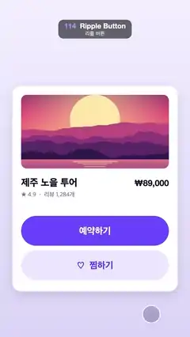

# 114 · Ripple Button · 리플 버튼



**EN** A finger taps two pill buttons on a tour card; from each touch point a ripple circle spreads to fill the button, then fades.  
**KO** 투어 카드의 알약 버튼 두 개를 손가락이 누르면, 닿은 지점에서 물결 원이 퍼져 버튼을 채운 뒤 사라진다.

[Video (mp4)](../videos/114-ripple-button.mp4) · [Code](../effects/114-ripple-button.js) · UI & interaction · UI·인터랙션

## Prompt (English)

```text
Create a "Ripple Button" motion effect: a Material-style ripple. A finger presses two buttons on a booking card; from each touch point a circle grows, clipped to the button, then fades after release.

Look
- Background: vertical gradient #F3F0FF to #DCD6F7.
- A white card 940 × 1170 at (70, 490), corner radius 48, shadow rgba(60,40,140,0.16) blur 60 offset y 20.
- Photo 840 × 420 at (120, 540), radius 32: a flat-illustration sunset (big pale-yellow sun with a glow, violet-to-pink-to-orange sky, layered magenta and purple mountain ridges, a lake with horizontal sun-reflection stripes).
- Title "제주 노을 투어" (Apple SD Gothic Neo 800, 56 px, #17142B) at x 120, baseline 1060; "★ 4.9  ·  리뷰 1,284개" (500, 34 px, #7C7891) baseline 1120; price "₩89,000" (Helvetica Neue 800, 48 px, #17142B) right-aligned at x 960, baseline 1060.
- Button A: 840 × 170 pill (radius 85) at (120, 1230), fill #6B4CFF, label "예약하기" white, 700, 52 px, centred. Button B: same size at (120, 1426), fill #ECE7FF, label "♡  찜하기" in #5B3DF0.
- The finger: a translucent touch circle r 50, fill rgba(40,24,90,0.22), soft shadow (blur 24, offset y 8), 5 px white ring at 95 %.

Motion (0–5 s)
- Finger path with ease-in-out cubic between keys: rest (860, 1790) at 0 s → (380, 1315) on button A by 0.6 s, hold until 1.5 s → (690, 1508) on button B by 2.6 s, hold until 3.5 s → back to rest by 4.7 s.
- Press A at 0.65 s, release at 1.0 s; press B at 2.65 s, release at 3.0 s. press = smoothstep(down, down + 0.08) × (1 − smoothstep(up, up + 0.12)).
- While pressed: the button scales to 98.5 %, a state layer darkens it (rgba(20,0,80,0.12) on A, rgba(91,61,240,0.12) on B), the finger circle shrinks to r 42, gets darker (alpha 0.34) and its shadow drops to 0.
- Ripple: a circle centred on the touch point, radius from 0 to the distance to the farthest button corner, ease-out cubic over 0.65 s; colour white on A and rgba(91,61,240) on B at 34 % opacity; it fades out from release + 0.2 s to release + 0.75 s. Clip it to the pill; draw the label on top.

Technique
- Canvas 2D. Pre-render the sunset picture once to an off-screen canvas.

Output and rules
- One self-contained HTML file with no external assets (three.js from a CDN is fine if you use it), drawing on a 1080 × 1920 canvas (9:16) scaled to fit the window.
- Write a function renderFrame(t) that draws the frame for time t in seconds, and preview it with requestAnimationFrame. Everything must be a pure function of t and fixed seeds: no Math.random(), Date or state carried between frames, so frame i = renderFrame(i / 30) can be exported to a 30 fps video.
- Loop seamlessly every 5 seconds: renderFrame(5) must look exactly like renderFrame(0).
- No flicker of any kind: no noise or grain that changes from frame to frame, no strobing or blinking, no z-fighting, no shimmering 1 px lines. Any grain or texture stays fixed to the screen or to the object.
- Keep the top 280 px free of important content (a title label goes there) and fill the whole frame with a designed background.
```

## 프롬프트 (한국어)

```text
"리플 버튼" 모션 효과를 만들어 줘: 머티리얼 스타일 물결. 손가락이 예약 카드의 버튼 두 개를 누르면, 닿은 지점에서 원이 버튼 안에서만 커지고 손을 뗀 뒤 사라지는 효과.

모양
- 배경: 세로 그라디언트 #F3F0FF → #DCD6F7.
- 흰 카드 940 × 1170, (70, 490), 모서리 반지름 48, 그림자 rgba(60,40,140,0.16) 흐림 60 y 오프셋 20.
- 사진 840 × 420, (120, 540), 반지름 32: 플랫 일러스트 노을(빛이 번지는 크고 옅은 노란 해, 보라→분홍→주황 하늘, 마젠타·보라 산 능선 여러 겹, 햇빛이 가로 줄무늬로 비치는 호수).
- 제목 "제주 노을 투어"(Apple SD Gothic Neo 800, 56 px, #17142B) x 120, 기준선 1060. "★ 4.9  ·  리뷰 1,284개"(500, 34 px, #7C7891) 기준선 1120. 가격 "₩89,000"(Helvetica Neue 800, 48 px, #17142B) x 960에 오른쪽 정렬, 기준선 1060.
- 버튼 A: 840 × 170 알약(반지름 85), (120, 1230), 채움 #6B4CFF, 라벨 "예약하기" 흰색 700, 52 px 가운데. 버튼 B: 같은 크기 (120, 1426), 채움 #ECE7FF, 라벨 "♡  찜하기" #5B3DF0.
- 손가락: 반투명 터치 원 반지름 50, 채움 rgba(40,24,90,0.22), 부드러운 그림자(흐림 24, y 오프셋 8), 95 % 흰색 5 px 테두리.

움직임 (0–5초)
- 손가락 경로, 키 사이는 ease-in-out cubic: 0초 대기 위치 (860, 1790) → 0.6초까지 버튼 A 위 (380, 1315), 1.5초까지 멈춤 → 2.6초까지 버튼 B 위 (690, 1508), 3.5초까지 멈춤 → 4.7초까지 대기 위치로 돌아온다.
- A는 0.65초에 누르고 1.0초에 뗀다. B는 2.65초에 누르고 3.0초에 뗀다. press = smoothstep(down, down + 0.08) × (1 − smoothstep(up, up + 0.12)).
- 누르는 동안: 버튼이 98.5 %로 작아지고, 상태 레이어가 어둡게 덮는다(A는 rgba(20,0,80,0.12), B는 rgba(91,61,240,0.12)). 손가락 원은 반지름 42로 줄고 더 진해지며(알파 0.34) 그림자가 0이 된다.
- 물결: 터치 지점이 중심인 원, 반지름은 0에서 버튼의 가장 먼 모서리까지의 거리로 0.65초 동안 ease-out cubic. 색은 A에서 흰색, B에서 rgba(91,61,240), 불투명도 34 %. 뗀 뒤 0.2초부터 0.75초까지 사라진다. 알약 모양으로 클립하고 라벨은 그 위에 그린다.

기법
- Canvas 2D. 노을 그림은 처음에 한 번만 오프스크린 캔버스에 그려 둔다.

출력과 규칙
- 외부 파일 없는 HTML 파일 하나(three.js를 쓴다면 CDN은 괜찮다). 1080 × 1920(9:16) 캔버스에 그리고 창 크기에 맞춰 보이게 한다.
- 시간 t(초)의 프레임을 그리는 renderFrame(t) 함수를 만들고, 미리보기는 requestAnimationFrame으로 돌린다. 모든 것은 t와 고정 시드만으로 정해진다: Math.random(), Date, 프레임 사이에 쌓이는 상태 금지. 그래야 i번째 프레임 = renderFrame(i / 30)으로 30fps 영상을 뽑을 수 있다.
- 5초마다 끊김 없이 반복: renderFrame(5)는 renderFrame(0)과 똑같아 보여야 한다.
- 어떤 깜빡임도 금지: 프레임마다 바뀌는 노이즈·그레인, 번쩍임·깜빡임, z-fighting, 반짝이며 떨리는 1px 선 모두 금지. 그레인·질감은 화면이나 물체에 고정한다.
- 위쪽 280px에는 중요한 내용을 두지 않고(제목 라벨 자리), 화면 전체를 디자인된 배경으로 채운다.
```
