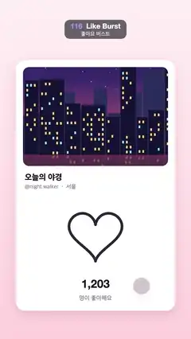

# 116 · Like Burst · 좋아요 버스트



**EN** A tapped outline heart pops back filled red inside a bursting ring and a spray of coloured dots; the like counter rolls up, then down.  
**KO** 탭한 빈 하트가 터지는 고리와 색 점들 속에서 빨갛게 채워져 튀어나오고, 좋아요 수가 올라갔다 내려간다.

[Video (mp4)](../videos/116-like-burst.mp4) · [Code](../effects/116-like-burst.js) · UI & interaction · UI·인터랙션

## Prompt (English)

```text
Create a "Like Burst" motion effect: a social-post like button. On tap a coloured ring bursts open, the heart pops back filled with an overshoot, pairs of dots fly out and shrink, and the counter rolls up. A second tap unlikes. Twice per loop.

Look
- Background: vertical gradient #FFF1F4 to #FFD3DE.
- A white card 900 × 1420 at (90, 340), corner radius 52, shadow rgba(120,30,60,0.15) blur 60 offset y 20.
- Photo 820 × 560 at (130, 380), radius 34: a night city skyline (dark navy towers with many lit yellow and a few cyan windows, a navy-to-violet-to-pink sky with small stars, the city reflected in a dark river at the bottom).
- "오늘의 야경" (Apple SD Gothic Neo 800, 46 px, #1C1626) at (140, 1020); "@night.walker  ·  서울" (500, 32 px, #8D8496) at (140, 1068).
- Heart at (540, 1335): the classic parametric heart x = sin³a, y = (13 cos a − 5 cos 2a − 2 cos 3a − cos 4a) / 16, scaled by 150 px (about 300 px wide). Unliked: 15 px outline #2B2638, round joins. Liked: filled and stroked #FF3B5C.
- Counter "1,203" / "1,204" (Helvetica Neue 800, 64 px, #1C1626) centred at x 540, baseline 1630, inside a one-line clip window (300, 1572, 480 × 72); below it "명이 좋아해요" (500, 34 px, #8D8496) at baseline 1700.
- Finger: a translucent circle r 50, fill rgba(60,20,50,0.2), soft shadow, 5 px white ring.

Motion (0–5 s)
- Taps: like at 0.6 s, unlike at 2.0 s, like at 3.05 s, unlike at 4.45 s. For each tap the finger slides from its rest spot (800, 1620) onto the heart (570, 1375) and back (smoothstep in from tap − 0.4 to tap − 0.05, out from tap + 0.12 to tap + 0.5); at the tap it shrinks to r 41 and the heart squeezes 12 %.
- Like (k = time since tap): the outline heart shrinks to nothing over 0.15 s; a disc grows to r 205 (ease-out, 0.3 s) with a radial gradient #FF7AA8 → #A66BFF, and a hole opens inside it 0.12 s later at the same speed, so it becomes a thinning ring that vanishes. From 0.15 s the filled red heart pops in with ease-out-back over 0.4 s.
- Dots: seven pairs at angles i/7 × 360° − 90° (rotated by the tap time so each burst differs), colours #FF5C8A, #FFC24B, #5ED3F3, #8D6BFF, #4BE3A0, #FF8A4B, #FF5C8A. Each pair: a 20 px dot at radius r and a 14 px dot 0.28 rad further round at 0.8 r, with r = 190 + 200 × easeOut(kp); kp runs 0–1 from 0.12 s to 0.87 s and the dots shrink to 0 by the end.
- Unlike: the heart does a quick 15 % squish (sin over 0.35 s) and the red fill fades back to the outline over 0.25 s.
- Counter: on like the old number slides up 64 px and fades while the new one comes up from below (ease-out 0.3 s); on unlike it rolls the other way.

Technique
- Canvas 2D. Pre-render the city picture once to an off-screen canvas.

Output and rules
- One self-contained HTML file with no external assets (three.js from a CDN is fine if you use it), drawing on a 1080 × 1920 canvas (9:16) scaled to fit the window.
- Write a function renderFrame(t) that draws the frame for time t in seconds, and preview it with requestAnimationFrame. Everything must be a pure function of t and fixed seeds: no Math.random(), Date or state carried between frames, so frame i = renderFrame(i / 30) can be exported to a 30 fps video.
- Loop seamlessly every 5 seconds: renderFrame(5) must look exactly like renderFrame(0).
- No flicker of any kind: no noise or grain that changes from frame to frame, no strobing or blinking, no z-fighting, no shimmering 1 px lines. Any grain or texture stays fixed to the screen or to the object.
- Keep the top 280 px free of important content (a title label goes there) and fill the whole frame with a designed background.
```

## 프롬프트 (한국어)

```text
"좋아요 버스트" 모션 효과를 만들어 줘: SNS 게시물의 좋아요 버튼. 탭하면 색 고리가 터지듯 열리고, 하트가 오버슈트하며 채워져 튀어나오고, 점이 짝지어 날아가며 작아지고, 숫자가 굴러 올라간다. 한 번 더 탭하면 취소. 루프마다 두 번.

모양
- 배경: 세로 그라디언트 #FFF1F4 → #FFD3DE.
- 흰 카드 900 × 1420, (90, 340), 모서리 반지름 52, 그림자 rgba(120,30,60,0.15) 흐림 60 y 오프셋 20.
- 사진 820 × 560, (130, 380), 반지름 34: 밤 도시 스카이라인(노란 창문이 많이, 하늘색 창문이 조금 켜진 짙은 남색 빌딩들, 작은 별이 있는 남색→보라→분홍 하늘, 아래쪽 어두운 강에 비친 도시).
- "오늘의 야경"(Apple SD Gothic Neo 800, 46 px, #1C1626) (140, 1020). "@night.walker  ·  서울"(500, 32 px, #8D8496) (140, 1068).
- 하트 중심 (540, 1335): 고전적인 매개변수 하트 x = sin³a, y = (13 cos a − 5 cos 2a − 2 cos 3a − cos 4a) / 16 을 150 px로 확대(너비 약 300 px). 안 누른 상태: 15 px 외곽선 #2B2638, 둥근 이음. 누른 상태: #FF3B5C로 채움 + 선.
- 숫자 "1,203" / "1,204"(Helvetica Neue 800, 64 px, #1C1626) x 540 가운데, 기준선 1630, 한 줄짜리 클립 창 (300, 1572, 480 × 72) 안. 그 아래 "명이 좋아해요"(500, 34 px, #8D8496) 기준선 1700.
- 손가락: 반투명 원 반지름 50, 채움 rgba(60,20,50,0.2), 부드러운 그림자, 5 px 흰 테두리.

움직임 (0–5초)
- 탭: 좋아요 0.6초, 취소 2.0초, 좋아요 3.05초, 취소 4.45초. 탭마다 손가락이 대기 위치 (800, 1620)에서 하트 위 (570, 1375)로 미끄러졌다 돌아간다(들어올 때 탭 − 0.4 ~ 탭 − 0.05, 나갈 때 탭 + 0.12 ~ 탭 + 0.5 smoothstep). 탭 순간 손가락은 반지름 41로 줄고 하트는 12 % 눌린다.
- 좋아요(k = 탭 이후 시간): 빈 하트가 0.15초 동안 0으로 줄어든다. 원판이 반지름 205까지 커지고(ease-out, 0.3초) 색은 방사형 그라디언트 #FF7AA8 → #A66BFF. 0.12초 뒤 같은 속도로 안쪽에 구멍이 열려 점점 얇아지는 고리가 되어 사라진다. 0.15초부터 빨간 하트가 0.4초 ease-out-back으로 튀어나온다.
- 점: 일곱 쌍, 각도 i/7 × 360° − 90°(탭 시각만큼 돌려 매번 다르게), 색 #FF5C8A, #FFC24B, #5ED3F3, #8D6BFF, #4BE3A0, #FF8A4B, #FF5C8A. 한 쌍 = 반지름 r에 20 px 점 + 0.28 rad 더 돈 0.8 r에 14 px 점. r = 190 + 200 × easeOut(kp), kp는 0.12초부터 0.87초까지 0→1, 끝날 때 점 크기는 0.
- 취소: 하트가 0.35초 동안 15 % 짧게 찌그러지고(sin), 빨간 채움이 0.25초 동안 외곽선으로 돌아간다.
- 숫자: 좋아요 때 이전 숫자가 64 px 위로 올라가며 사라지고 새 숫자가 아래에서 올라온다(ease-out 0.3초). 취소 때는 반대로 굴러 내려간다.

기법
- Canvas 2D. 도시 그림은 처음에 한 번만 오프스크린 캔버스에 그려 둔다.

출력과 규칙
- 외부 파일 없는 HTML 파일 하나(three.js를 쓴다면 CDN은 괜찮다). 1080 × 1920(9:16) 캔버스에 그리고 창 크기에 맞춰 보이게 한다.
- 시간 t(초)의 프레임을 그리는 renderFrame(t) 함수를 만들고, 미리보기는 requestAnimationFrame으로 돌린다. 모든 것은 t와 고정 시드만으로 정해진다: Math.random(), Date, 프레임 사이에 쌓이는 상태 금지. 그래야 i번째 프레임 = renderFrame(i / 30)으로 30fps 영상을 뽑을 수 있다.
- 5초마다 끊김 없이 반복: renderFrame(5)는 renderFrame(0)과 똑같아 보여야 한다.
- 어떤 깜빡임도 금지: 프레임마다 바뀌는 노이즈·그레인, 번쩍임·깜빡임, z-fighting, 반짝이며 떨리는 1px 선 모두 금지. 그레인·질감은 화면이나 물체에 고정한다.
- 위쪽 280px에는 중요한 내용을 두지 않고(제목 라벨 자리), 화면 전체를 디자인된 배경으로 채운다.
```
