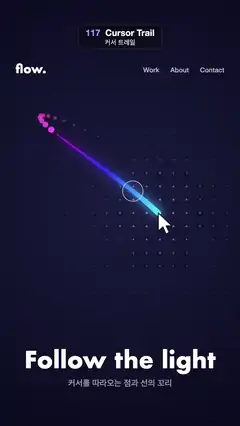

# 117 · Cursor Trail · 커서 트레일



**EN** An arrow cursor loops over a dark landing page, trailing a glowing cyan-to-magenta line that breaks into shrinking dots.  
**KO** 어두운 랜딩 페이지 위를 도는 화살표 커서 뒤로, 하늘색에서 자홍색으로 빛나는 선이 따라오다 작아지는 점으로 끊어진다.

[Video (mp4)](https://sueun-dev.github.io/motion-effects/videos/117-cursor-trail.mp4) · [Code](../effects/117-cursor-trail.js) · UI & interaction · UI·인터랙션

## Prompt (English)

```text
Create a "Cursor Trail" motion effect: a mouse pointer runs a looping path over a dark landing page; behind it a tapering, glowing colour line breaks into shrinking dots, and a thin ring lags behind.

Look
- Background: radial gradient centred at (540, 900), #1A1B3D in the middle (inner radius 100) to #07081A at radius 1300.
- A dot grid every 60 px (x 60–1020, y 420–1500): dots rgba(170,180,255, 0.12 + 0.5 n) with radius 3 + 2 n, where n = exp(−d² / 50000) and d is the distance to the cursor, so the grid brightens around it.
- Page text: logo "flow." (Futura 700, 52 px, white) at (70, 330); nav "Work      About      Contact" (Helvetica Neue 500, 30 px, white 70 %) right-aligned at x 1010, y 326; headline "Follow the light" (Futura 700, 104 px, white) centred at y 1660; subline "커서를 따라오는 점과 선의 꼬리" (Apple SD Gothic Neo 500, 38 px, white 60 %) at y 1740.
- Cursor: a classic white arrow (polygon (0,0), (0,35), (9,27), (15,41), (21,38), (15,25), (26,25), scaled ×2.3, tip at the pointer), with a soft drop shadow (rgba(0,0,0,0.5), blur 12, offset y 4) and a thin #11131F outline.

Motion (0–5 s)
- Pointer path (a Lissajous curve that loops once per 5 s): a = 2π t / 5, x = 540 + 360 sin(3a + 0.5), y = 960 + 440 sin(2a).
- Line tail: the same path sampled back in time, no stored history. 34 segments, segment i from pos(t − i × 0.011) to pos(t − (i − 1) × 0.011); with k = i / 34, colour hsl(185 + 115k, 95 %, 64 − 12k %) (cyan at the head to magenta at the end), width 26 px at the head tapering to 4 px, round caps; draw tail first so the head is on top.
- Glow: draw the line on an off-screen canvas, then composite a blurred copy (blur 22 px, additive "lighter", alpha 0.9) and the sharp copy on top.
- Dots: after the line, 12 dots at pos(t − (37 + 4d) × 0.011), hue 302 + 40k (magenta to purple), 95 %, 64 %, opacity 1 − 0.8k, radius 11 (1 − k) + 3.
- Follower ring: a white 70 % ring, r 46, 3 px stroke, at pos(t − 0.09), so it lags slightly and catches up on the curves.

Technique
- Canvas 2D. Because the tail is computed from the path at earlier times, every frame is a pure function of t and the loop is seamless.

Output and rules
- One self-contained HTML file with no external assets (three.js from a CDN is fine if you use it), drawing on a 1080 × 1920 canvas (9:16) scaled to fit the window.
- Write a function renderFrame(t) that draws the frame for time t in seconds, and preview it with requestAnimationFrame. Everything must be a pure function of t and fixed seeds: no Math.random(), Date or state carried between frames, so frame i = renderFrame(i / 30) can be exported to a 30 fps video.
- Loop seamlessly every 5 seconds: renderFrame(5) must look exactly like renderFrame(0).
- No flicker of any kind: no noise or grain that changes from frame to frame, no strobing or blinking, no z-fighting, no shimmering 1 px lines. Any grain or texture stays fixed to the screen or to the object.
- Keep the top 280 px free of important content (a title label goes there) and fill the whole frame with a designed background.
```

## 프롬프트 (한국어)

```text
"커서 트레일" 모션 효과를 만들어 줘: 마우스 포인터가 어두운 랜딩 페이지 위에서 반복 경로를 돌고, 그 뒤로 끝이 가늘어지며 빛나는 색 선이 작아지는 점으로 끊어지고, 얇은 고리가 조금 늦게 따라오는 효과.

모양
- 배경: (540, 900) 중심 방사형 그라디언트, 가운데(안쪽 반지름 100) #1A1B3D에서 반지름 1300의 #07081A까지.
- 60 px 간격 점 격자(x 60–1020, y 420–1500): 점 색 rgba(170,180,255, 0.12 + 0.5 n), 반지름 3 + 2 n. n = exp(−d² / 50000), d는 커서까지의 거리. 그래서 커서 주변 격자가 밝아진다.
- 페이지 글자: 로고 "flow."(Futura 700, 52 px, 흰색) (70, 330). 메뉴 "Work      About      Contact"(Helvetica Neue 500, 30 px, 70 % 흰색) x 1010 오른쪽 정렬, y 326. 헤드라인 "Follow the light"(Futura 700, 104 px, 흰색) y 1660 가운데. 부제 "커서를 따라오는 점과 선의 꼬리"(Apple SD Gothic Neo 500, 38 px, 60 % 흰색) y 1740.
- 커서: 고전적인 흰 화살표(다각형 (0,0), (0,35), (9,27), (15,41), (21,38), (15,25), (26,25)를 2.3배, 끝이 포인터 위치), 부드러운 그림자(rgba(0,0,0,0.5), 흐림 12, y 오프셋 4)와 얇은 #11131F 외곽선.

움직임 (0–5초)
- 포인터 경로(5초에 한 번 도는 리사주 곡선): a = 2π t / 5, x = 540 + 360 sin(3a + 0.5), y = 960 + 440 sin(2a).
- 선 꼬리: 같은 경로를 과거 시각에서 다시 계산한다(저장된 기록 없음). 34 조각, 조각 i는 pos(t − i × 0.011)에서 pos(t − (i − 1) × 0.011)까지. k = i / 34일 때 색 hsl(185 + 115k, 95 %, 64 − 12k %)(머리는 하늘색, 끝은 자홍색), 두께는 머리 26 px에서 끝 4 px로, 둥근 끝. 꼬리부터 그려서 머리가 위에 오게 한다.
- 빛 번짐: 선을 오프스크린 캔버스에 그린 뒤, 흐린 사본(블러 22 px, 더하기 합성 "lighter", 알파 0.9)을 얹고 그 위에 선명한 사본을 그린다.
- 점: 선 뒤로 점 12개, 위치 pos(t − (37 + 4d) × 0.011), 색상 302 + 40k(자홍→보라), 95 %, 64 %, 불투명도 1 − 0.8k, 반지름 11 (1 − k) + 3.
- 따라오는 고리: 70 % 흰색 고리, 반지름 46, 선 3 px, 위치 pos(t − 0.09). 조금 늦게 따라오다 곡선에서 따라잡는다.

기법
- Canvas 2D. 꼬리를 과거 시각의 경로로 계산하므로 모든 프레임이 t만의 함수이고 루프가 끊김 없다.

출력과 규칙
- 외부 파일 없는 HTML 파일 하나(three.js를 쓴다면 CDN은 괜찮다). 1080 × 1920(9:16) 캔버스에 그리고 창 크기에 맞춰 보이게 한다.
- 시간 t(초)의 프레임을 그리는 renderFrame(t) 함수를 만들고, 미리보기는 requestAnimationFrame으로 돌린다. 모든 것은 t와 고정 시드만으로 정해진다: Math.random(), Date, 프레임 사이에 쌓이는 상태 금지. 그래야 i번째 프레임 = renderFrame(i / 30)으로 30fps 영상을 뽑을 수 있다.
- 5초마다 끊김 없이 반복: renderFrame(5)는 renderFrame(0)과 똑같아 보여야 한다.
- 어떤 깜빡임도 금지: 프레임마다 바뀌는 노이즈·그레인, 번쩍임·깜빡임, z-fighting, 반짝이며 떨리는 1px 선 모두 금지. 그레인·질감은 화면이나 물체에 고정한다.
- 위쪽 280px에는 중요한 내용을 두지 않고(제목 라벨 자리), 화면 전체를 디자인된 배경으로 채운다.
```
