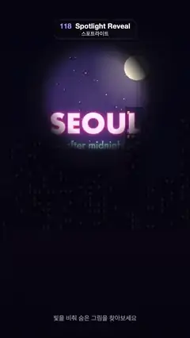

# 118 · Spotlight Reveal · 스포트라이트



**EN** A soft circle of light drifts over a darkened screen, revealing a night city skyline, its moon and a glowing "SEOUL" neon sign.  
**KO** 어두워진 화면 위를 부드러운 빛의 원이 떠다니며 밤 도시 스카이라인과 달, 빛나는 "SEOUL" 네온사인을 드러낸다.

[Video (mp4)](../videos/118-spotlight-reveal.mp4) · [Code](../effects/118-spotlight-reveal.js) · UI & interaction · UI·인터랙션

## Prompt (English)

```text
Create a "Spotlight Reveal" motion effect: a flashlight mask. The whole picture is drawn almost black; a soft-edged circle drifts on a looping path and shows the hidden night city and its neon sign in full colour.

Look
- The hidden picture (full frame): a night city. Sky gradient #0B1030 (top) → #3A2A6E → #E0607E at the horizon (y 1306); about 90 small white stars in the upper part; a moon #FFF1D6, r 72, at (778, 384) with a soft glow; two skyline layers standing on y 1306 — a back row #2A2F5E (260–620 px tall) and a front row #141433 (160–820 px tall, buildings 70–180 px wide) with lit windows 12 × 18 px (mostly #FFD36E yellow, some #9BE7FF cyan); below, a river that mirrors the city in 6 px horizontal strips shifted sideways by ±6 px (ripples) and darkens towards the bottom.
- A neon sign on top: "SEOUL" in Futura 700, 150 px, centred at (540, 720): a 6 px #FF7EC8 outline with a #FF3FA4 glow (blur 40), then a #FFE3F4 fill (glow blur 20); under it "— after midnight —" in Futura 500, 54 px, #C9F6FF with a cyan #3FE0FF glow, at y 830.
- Darkness: draw the picture, then cover it with rgba(4,4,14,0.93) so only faint silhouettes remain.
- Caption at the bottom: "빛을 비춰 숨은 그림을 찾아보세요" (Apple SD Gothic Neo 500, 36 px, white 55 %), centred at y 1820.

Motion (0–5 s)
- Spotlight centre and radius, with a = 2π t / 5: x = 540 + 260 sin a + 90 sin 2a, y = 1000 − 450 cos 2a + 60 sin a, r = 320 + 30 sin 3a. It sweeps from the sign and moon down to the river and back up twice, gently breathing in size.
- Inside the circle the picture shows at full brightness; the edge is soft (mask alpha 1 at the centre, 0.95 at 0.7 r, 0 at r).
- A faint warm bloom: an additive radial gradient rgba(255,230,190,0.12) → 0 out to 1.3 r.

Technique
- Canvas 2D. Render the picture once to an off-screen canvas. Each frame: draw it, darken it, then copy it to a second canvas, apply the radial gradient with "destination-in" to cut out the soft circle, and draw that on top.

Output and rules
- One self-contained HTML file with no external assets (three.js from a CDN is fine if you use it), drawing on a 1080 × 1920 canvas (9:16) scaled to fit the window.
- Write a function renderFrame(t) that draws the frame for time t in seconds, and preview it with requestAnimationFrame. Everything must be a pure function of t and fixed seeds: no Math.random(), Date or state carried between frames, so frame i = renderFrame(i / 30) can be exported to a 30 fps video.
- Loop seamlessly every 5 seconds: renderFrame(5) must look exactly like renderFrame(0).
- No flicker of any kind: no noise or grain that changes from frame to frame, no strobing or blinking, no z-fighting, no shimmering 1 px lines. Any grain or texture stays fixed to the screen or to the object.
- Keep the top 280 px free of important content (a title label goes there) and fill the whole frame with a designed background.
```

## 프롬프트 (한국어)

```text
"스포트라이트" 모션 효과를 만들어 줘: 손전등 마스크. 그림 전체가 거의 검게 덮여 있고, 가장자리가 부드러운 원이 반복 경로로 떠다니며 숨은 밤 도시와 네온사인을 원래 색으로 보여 주는 효과.

모양
- 숨은 그림(화면 전체): 밤 도시. 하늘 그라디언트 #0B1030(위) → #3A2A6E → 지평선(y 1306)의 #E0607E. 위쪽에 작은 흰 별 약 90개. 달 #FFF1D6, 반지름 72, (778, 384), 부드러운 빛무리. y 1306 위에 선 스카이라인 두 겹 — 뒤쪽 #2A2F5E(높이 260–620 px), 앞쪽 #141433(높이 160–820 px, 건물 너비 70–180 px)에 12 × 18 px 창문이 켜져 있다(대부분 노랑 #FFD36E, 일부 하늘색 #9BE7FF). 아래는 도시를 6 px 가로 띠로 비추는 강(띠마다 ±6 px 옆으로 밀려 물결), 아래로 갈수록 어두워진다.
- 그 위 네온사인: "SEOUL" Futura 700, 150 px, (540, 720) 가운데. 6 px #FF7EC8 외곽선에 #FF3FA4 빛(블러 40), 그다음 #FFE3F4 채움(빛 블러 20). 아래에 "— after midnight —" Futura 500, 54 px, #C9F6FF, 하늘색 #3FE0FF 빛, y 830.
- 어둠: 그림을 그린 뒤 rgba(4,4,14,0.93)으로 덮어 희미한 실루엣만 남긴다.
- 아래 설명: "빛을 비춰 숨은 그림을 찾아보세요"(Apple SD Gothic Neo 500, 36 px, 55 % 흰색), y 1820 가운데.

움직임 (0–5초)
- 스포트라이트 중심과 반지름, a = 2π t / 5: x = 540 + 260 sin a + 90 sin 2a, y = 1000 − 450 cos 2a + 60 sin a, r = 320 + 30 sin 3a. 네온사인과 달에서 강까지 내려갔다 올라오기를 두 번 하며 크기가 살짝 숨 쉬듯 바뀐다.
- 원 안에서는 그림이 원래 밝기로 보이고 가장자리는 부드럽다(마스크 알파: 중심 1, 0.7 r에서 0.95, r에서 0).
- 옅은 따뜻한 빛: 더하기 합성 방사형 그라디언트 rgba(255,230,190,0.12) → 0, 반지름 1.3 r까지.

기법
- Canvas 2D. 그림은 오프스크린 캔버스에 한 번만 그린다. 매 프레임: 그림을 그리고 어둡게 덮은 뒤, 두 번째 캔버스에 그림을 복사하고 방사형 그라디언트를 "destination-in"으로 칠해 부드러운 원만 남겨 그 위에 그린다.

출력과 규칙
- 외부 파일 없는 HTML 파일 하나(three.js를 쓴다면 CDN은 괜찮다). 1080 × 1920(9:16) 캔버스에 그리고 창 크기에 맞춰 보이게 한다.
- 시간 t(초)의 프레임을 그리는 renderFrame(t) 함수를 만들고, 미리보기는 requestAnimationFrame으로 돌린다. 모든 것은 t와 고정 시드만으로 정해진다: Math.random(), Date, 프레임 사이에 쌓이는 상태 금지. 그래야 i번째 프레임 = renderFrame(i / 30)으로 30fps 영상을 뽑을 수 있다.
- 5초마다 끊김 없이 반복: renderFrame(5)는 renderFrame(0)과 똑같아 보여야 한다.
- 어떤 깜빡임도 금지: 프레임마다 바뀌는 노이즈·그레인, 번쩍임·깜빡임, z-fighting, 반짝이며 떨리는 1px 선 모두 금지. 그레인·질감은 화면이나 물체에 고정한다.
- 위쪽 280px에는 중요한 내용을 두지 않고(제목 라벨 자리), 화면 전체를 디자인된 배경으로 채운다.
```
