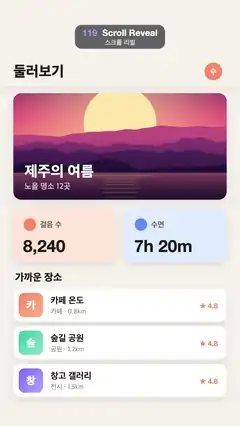

# 119 · Scroll Reveal · 스크롤 리빌



**EN** A finger flicks a travel app page up twice; each card fades up as it enters, then the page refreshes and its top rises back in.  
**KO** 손가락이 여행 앱 페이지를 두 번 밀어 올리면 카드가 들어올 때마다 아래에서 떠오르고, 새로 고침 뒤 맨 위 내용이 다시 올라온다.

[Video (mp4)](https://sueun-dev.github.io/motion-effects/videos/119-scroll-reveal.mp4) · [Code](../effects/119-scroll-reveal.js) · UI & interaction · UI·인터랙션

## Prompt (English)

```text
Create a "Scroll Reveal" motion effect: scroll-triggered fade-ups. A page is flicked up twice; each block waits hidden until its top crosses a line near the bottom of the screen, then fades up. Then the page reloads: it fades out and the top blocks rise in one by one.

Look
- Background #F5F2EC. A fixed header band 0–390 px in the same colour with a soft shadow below (rgba(60,50,30,0.10), blur 30, offset y 8): "둘러보기" (Apple SD Gothic Neo 800, 66 px, #1D1A16) at (60, 345) and an avatar circle #FF8A65, r 40, at (960, 322) with a white "수". Content scrolls under the header (clip it to y ≥ 390).
- Blocks, x 60, width 960, corner radius 36, shadow rgba(60,50,30,0.12) blur 36 offset y 12 (y = top at scroll 0):
  Photo, y 420, 960 × 480: a flat-illustration sunset (big pale-yellow sun, violet-pink-orange sky, layered magenta/purple mountains, a lake with sun-reflection stripes), darkened at the bottom (gradient rgba(10,5,25,0 → 0.75) from 40 % height), with "제주의 여름" (800, 68 px, white) at (110, y + 376) and "노을 명소 12곳" (500, 36 px, white 80 %) at (110, y + 432).
  Two tiles 460 × 240 at y 940: left #FFE6D8 with an orange dot #FF8A65 (r 28), "걸음 수" (600, 34 px, #5E574C) and "8,240" (Helvetica Neue 800, 76 px, #1D1A16); right (x 560) #DDEBFF with a blue dot #5B8CFF, "수면" and "7h 20m".
  Section title "가까운 장소" (800, 46 px) at y 1220.
  Eight white rows 960 × 150, every 170 px from y 1300: a 110 × 110 gradient icon (radius 26) with the name's first letter in white, the name (700, 40 px, #1D1A16), a grey sub-line (500, 30 px, #9A948A) and "★ 4.8" (Helvetica Neue 700, 32 px, #FF8A65) at the right. Rows: 카페 온도 / 카페 · 0.8km (#FF8A65→#FFB38A), 숲길 공원 / 공원 · 1.2km (#2EC4A6→#8BE3C9), 창고 갤러리 / 전시 · 1.5km (#7C6CFF→#B3A8FF), 한강 피크닉존 / 피크닉 · 2.1km (#5B8CFF→#9DBBFF), 루프탑 라운지 / 바 · 2.4km (#FF5C8A→#FF9DB8), 수제화 골목 / 쇼핑 · 2.8km (#FFB938→#FFD98A), 밤도깨비 야시장 / 시장 · 3.0km (#A66BFF→#CDA8FF), 북쪽 전망대 / 전망 · 3.6km (#20B8D8→#88DDEE).

Motion (0–5 s)
- Scroll: two gentle flicks, at 0.3 s and 2.1 s, each moving the page up 300 px with a smoothstep over 1.8 s (short distances so nothing blurs or judders).
- Finger for each flick: a translucent circle r 50, rgba(40,30,20,0.28), 5 px white ring, at x 760 starting at y 1500; it fades in over 0.25 s before the flick, moves up with the page for 0.8 s, then fades out while the page keeps gliding.
- Reveal: blocks whose top is above y 1800 at the start are already shown. Every other block triggers when its on-screen top crosses y 1800 (find that time by bisection on the scroll function), then over 0.6 s (ease-out) its opacity goes 0 → 1 while it slides up from 110 px below.
- Reload: a dark pill toast #1D1A16 420 × 112 (radius 56) at (330, 600) with "새로 고침 중…" (700, 40 px, white) fades and rises in at 3.75–3.92 s and out at 4.35–4.55 s; the page fades out at 3.88–4.08 s; from 4.13 s the page is back at scroll 0 and the initially visible blocks rise in one by one (0.055 s stagger, 0.45 s ease-out each), so t = 5 matches t = 0.

Technique
- Canvas 2D. Pre-render the sunset picture once to an off-screen canvas.

Output and rules
- One self-contained HTML file with no external assets (three.js from a CDN is fine if you use it), drawing on a 1080 × 1920 canvas (9:16) scaled to fit the window.
- Write a function renderFrame(t) that draws the frame for time t in seconds, and preview it with requestAnimationFrame. Everything must be a pure function of t and fixed seeds: no Math.random(), Date or state carried between frames, so frame i = renderFrame(i / 30) can be exported to a 30 fps video.
- Loop seamlessly every 5 seconds: renderFrame(5) must look exactly like renderFrame(0).
- No flicker of any kind: no noise or grain that changes from frame to frame, no strobing or blinking, no z-fighting, no shimmering 1 px lines. Any grain or texture stays fixed to the screen or to the object.
- Keep the top 280 px free of important content (a title label goes there) and fill the whole frame with a designed background.
```

## 프롬프트 (한국어)

```text
"스크롤 리빌" 모션 효과를 만들어 줘: 스크롤에 맞춰 나타나는 페이드업. 페이지를 두 번 밀어 올리면, 블록마다 위쪽 끝이 화면 아래쪽 선을 넘을 때까지 숨어 있다가 아래에서 떠오른다. 그다음 페이지가 새로 고침되어 사라지고 맨 위 블록들이 하나씩 다시 올라오는 효과.

모양
- 배경 #F5F2EC. 고정 헤더 띠 0–390 px, 같은 색에 아래로 부드러운 그림자(rgba(60,50,30,0.10), 흐림 30, y 오프셋 8): "둘러보기"(Apple SD Gothic Neo 800, 66 px, #1D1A16) (60, 345), 아바타 원 #FF8A65, 반지름 40, (960, 322) 안에 흰 "수". 내용은 헤더 아래로 스크롤된다(y ≥ 390으로 클립).
- 블록: x 60, 너비 960, 모서리 반지름 36, 그림자 rgba(60,50,30,0.12) 흐림 36 y 오프셋 12 (y = 스크롤 0일 때 위치):
  사진, y 420, 960 × 480: 플랫 일러스트 노을(크고 옅은 노란 해, 보라·분홍·주황 하늘, 마젠타·보라 산 여러 겹, 햇빛 줄무늬가 비친 호수). 높이 40 %부터 아래로 어둡게(그라디언트 rgba(10,5,25,0 → 0.75)). "제주의 여름"(800, 68 px, 흰색) (110, y + 376), "노을 명소 12곳"(500, 36 px, 80 % 흰색) (110, y + 432).
  y 940에 타일 두 개 460 × 240: 왼쪽 #FFE6D8, 주황 점 #FF8A65(반지름 28), "걸음 수"(600, 34 px, #5E574C), "8,240"(Helvetica Neue 800, 76 px, #1D1A16). 오른쪽(x 560) #DDEBFF, 파란 점 #5B8CFF, "수면", "7h 20m".
  섹션 제목 "가까운 장소"(800, 46 px) y 1220.
  y 1300부터 170 px마다 흰 행 8개, 960 × 150: 110 × 110 그라디언트 아이콘(반지름 26)에 이름 첫 글자 흰색, 이름(700, 40 px, #1D1A16), 회색 보조 줄(500, 30 px, #9A948A), 오른쪽 "★ 4.8"(Helvetica Neue 700, 32 px, #FF8A65). 행: 카페 온도 / 카페 · 0.8km (#FF8A65→#FFB38A), 숲길 공원 / 공원 · 1.2km (#2EC4A6→#8BE3C9), 창고 갤러리 / 전시 · 1.5km (#7C6CFF→#B3A8FF), 한강 피크닉존 / 피크닉 · 2.1km (#5B8CFF→#9DBBFF), 루프탑 라운지 / 바 · 2.4km (#FF5C8A→#FF9DB8), 수제화 골목 / 쇼핑 · 2.8km (#FFB938→#FFD98A), 밤도깨비 야시장 / 시장 · 3.0km (#A66BFF→#CDA8FF), 북쪽 전망대 / 전망 · 3.6km (#20B8D8→#88DDEE).

움직임 (0–5초)
- 스크롤: 부드러운 밀기 두 번, 0.3초와 2.1초. 각각 1.8초 smoothstep으로 페이지를 300 px 올린다(거리가 짧아 번지거나 떨리지 않는다).
- 밀 때마다 손가락: 반투명 원 반지름 50, rgba(40,30,20,0.28), 5 px 흰 테두리, x 760, y 1500에서 시작. 밀기 0.25초 전에 나타나고, 0.8초 동안 페이지와 함께 올라간 뒤 페이지가 계속 미끄러지는 동안 사라진다.
- 나타나기: 처음에 위쪽 끝이 y 1800보다 위인 블록은 이미 보인다. 나머지 블록은 화면상 위쪽 끝이 y 1800을 넘는 순간(스크롤 함수에서 이분 탐색으로 시각을 구한다)부터 0.6초 동안(ease-out) 불투명도 0 → 1, 110 px 아래에서 올라온다.
- 새로 고침: 어두운 알약 토스트 #1D1A16 420 × 112(반지름 56), (330, 600), "새로 고침 중…"(700, 40 px, 흰색)이 3.75–3.92초에 떠오르며 나타나고 4.35–4.55초에 사라진다. 페이지는 3.88–4.08초에 사라지고, 4.13초부터 스크롤 0으로 돌아와 처음 보이던 블록들이 하나씩 올라온다(간격 0.055초, 각 0.45초 ease-out). 그래서 t = 5가 t = 0과 같다.

기법
- Canvas 2D. 노을 그림은 처음에 한 번만 오프스크린 캔버스에 그려 둔다.

출력과 규칙
- 외부 파일 없는 HTML 파일 하나(three.js를 쓴다면 CDN은 괜찮다). 1080 × 1920(9:16) 캔버스에 그리고 창 크기에 맞춰 보이게 한다.
- 시간 t(초)의 프레임을 그리는 renderFrame(t) 함수를 만들고, 미리보기는 requestAnimationFrame으로 돌린다. 모든 것은 t와 고정 시드만으로 정해진다: Math.random(), Date, 프레임 사이에 쌓이는 상태 금지. 그래야 i번째 프레임 = renderFrame(i / 30)으로 30fps 영상을 뽑을 수 있다.
- 5초마다 끊김 없이 반복: renderFrame(5)는 renderFrame(0)과 똑같아 보여야 한다.
- 어떤 깜빡임도 금지: 프레임마다 바뀌는 노이즈·그레인, 번쩍임·깜빡임, z-fighting, 반짝이며 떨리는 1px 선 모두 금지. 그레인·질감은 화면이나 물체에 고정한다.
- 위쪽 280px에는 중요한 내용을 두지 않고(제목 라벨 자리), 화면 전체를 디자인된 배경으로 채운다.
```
