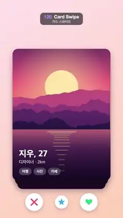

# 120 · Card Swipe · 카드 스와이프



**EN** A finger drags the top profile card off a stack, right with a LIKE stamp, then left with NOPE, while the cards behind move up.  
**KO** 손가락이 더미의 맨 위 프로필 카드를 오른쪽(LIKE), 다음엔 왼쪽(NOPE)으로 던지고 뒤 카드들이 한 칸씩 올라온다.

[Video (mp4)](../videos/120-card-swipe.mp4) · [Code](../effects/120-card-swipe.js) · UI & interaction · UI·인터랙션

## Prompt (English)

```text
Create a "Card Swipe" motion effect: a dating-app card stack. A finger drags the top card sideways (it tilts, a LIKE or NOPE stamp fades in), lets go, and the card flies off while the cards behind scale up one slot. Right swipe, then left swipe; the two profiles alternate, so it loops.

Look
- Background: diagonal gradient #FFE1EC (top left) to #FFD0B5 (bottom right).
- Cards 860 × 1160, centred at (540, 1010), corner radius 48, white, shadow rgba(40,10,40,0.3) blur 50 offset y 20. The photo fills the whole card; the lower half darkens with a gradient rgba(15,5,30,0 → 0.85).
- Profile A photo: a flat-illustration sunset (big pale-yellow sun, violet-to-pink-to-orange sky, layered magenta and purple mountain ridges, a lake with horizontal sun-reflection stripes). Profile B: the same kind of picture hue-rotated by 150° (green mountains, a pale cyan sun, teal sky and water).
- Card text (Apple SD Gothic Neo), left margin 56 px: name (800, 76 px, white) at 210 px above the bottom, sub-line (500, 38 px, white 85 %) at 150 px above the bottom, then tag chips (600, 32 px, white text on rgba(255,255,255,0.22) pills 64 px tall, radius 32, 28 px padding, 16 px gap) 112 px above the bottom. A: "지우, 27", "디자이너 · 2km", chips "여행" "사진" "카페". B: "민준, 29", "사진가 · 5km", chips "캠핑" "재즈" "러닝".
- Stack slots behind the top card: (scale 0.95, 66 px lower) and (scale 0.90, 132 px lower), each darkened a little more (rgba(30,10,40) at 9 % per slot).
- Three round white buttons at y 1780 with soft shadows: an X (#FF4D6A, r 78) at x 300, a five-point star (#3FA9FF, r 58) at x 540, a heart (#2BD47D, r 78) at x 780; icons in 12 px round strokes or fills.
- Stamp: a 300 × 124 rounded box (radius 20, 10 px stroke) with text in Arial Black 88 px. "LIKE" in #2BD47D near the card's top-left, rotated −15°; "NOPE" in #FF4D6A near the top-right, rotated +15°.

Motion (0–5 s)
- Two swipes of 2.5 s each: the first to the right (LIKE), the second to the left (NOPE). Inside a swipe (u = seconds into it): drag = 280 × easeInOut((u − 0.35) / 0.75), then the throw fly = 1250 × ((u − 1.1) / 0.5)² (accelerating off-screen). dx = direction × (drag + fly), dy = −0.06 |dx|, rotation = dx × 0.0005 rad.
- Stamp opacity = |dx| / 180 (clamped), drawn on the card so it tilts with it.
- The cards behind follow p = easeOut(|dx| / 520): each moves up one slot (scale and offset interpolate, shading lightens) and a new fourth card fades into the last slot.
- The matching button (heart on the right swipe, X on the left) swells up to 16 % while dragging and settles back at u 1.15–1.5 s.
- Finger: a translucent circle r 52, rgba(40,10,40,0.3), 5 px white ring, at (580 + d, 1160 + dy) with d = direction × min(|dx|, 290); it fades in at u 0.1–0.35 s, drags with the card, and fades out at the release (1.1–1.3 s).
- After the second swipe profile A is on top again, so t = 5 matches t = 0.

Technique
- Canvas 2D. Pre-render the two photos once (the second with a hue-rotate(150deg) saturate(0.9) canvas filter).

Output and rules
- One self-contained HTML file with no external assets (three.js from a CDN is fine if you use it), drawing on a 1080 × 1920 canvas (9:16) scaled to fit the window.
- Write a function renderFrame(t) that draws the frame for time t in seconds, and preview it with requestAnimationFrame. Everything must be a pure function of t and fixed seeds: no Math.random(), Date or state carried between frames, so frame i = renderFrame(i / 30) can be exported to a 30 fps video.
- Loop seamlessly every 5 seconds: renderFrame(5) must look exactly like renderFrame(0).
- No flicker of any kind: no noise or grain that changes from frame to frame, no strobing or blinking, no z-fighting, no shimmering 1 px lines. Any grain or texture stays fixed to the screen or to the object.
- Keep the top 280 px free of important content (a title label goes there) and fill the whole frame with a designed background.
```

## 프롬프트 (한국어)

```text
"카드 스와이프" 모션 효과를 만들어 줘: 데이팅 앱의 카드 더미. 손가락이 맨 위 카드를 옆으로 끌면(카드가 기울고 LIKE 또는 NOPE 도장이 나타난다) 놓는 순간 카드가 날아가고 뒤 카드들이 한 칸씩 커지며 올라온다. 오른쪽으로 한 번, 왼쪽으로 한 번. 두 프로필이 번갈아 나와서 반복된다.

모양
- 배경: 대각선 그라디언트 #FFE1EC(왼쪽 위) → #FFD0B5(오른쪽 아래).
- 카드 860 × 1160, 중심 (540, 1010), 모서리 반지름 48, 흰색, 그림자 rgba(40,10,40,0.3) 흐림 50 y 오프셋 20. 사진이 카드 전체를 채우고, 아래 절반은 그라디언트 rgba(15,5,30,0 → 0.85)로 어두워진다.
- 프로필 A 사진: 플랫 일러스트 노을(크고 옅은 노란 해, 보라→분홍→주황 하늘, 마젠타·보라 산 능선 여러 겹, 햇빛이 가로 줄무늬로 비치는 호수). 프로필 B: 같은 그림을 색상 150° 돌린 것(초록 산, 옅은 하늘색 해, 청록 하늘과 물).
- 카드 글자(Apple SD Gothic Neo), 왼쪽 여백 56 px: 이름(800, 76 px, 흰색) 아래에서 210 px 위, 보조 줄(500, 38 px, 85 % 흰색) 아래에서 150 px 위, 그 아래 태그 칩(600, 32 px 흰 글자, rgba(255,255,255,0.22) 알약 높이 64 px, 반지름 32, 안쪽 여백 28 px, 간격 16 px) 아래에서 112 px 위. A: "지우, 27", "디자이너 · 2km", 칩 "여행" "사진" "카페". B: "민준, 29", "사진가 · 5km", 칩 "캠핑" "재즈" "러닝".
- 맨 위 카드 뒤 자리: (배율 0.95, 66 px 아래), (배율 0.90, 132 px 아래). 칸마다 조금씩 더 어둡게(rgba(30,10,40) 칸당 9 %).
- y 1780에 부드러운 그림자의 둥근 흰 버튼 세 개: X(#FF4D6A, 반지름 78) x 300, 오각 별(#3FA9FF, 반지름 58) x 540, 하트(#2BD47D, 반지름 78) x 780. 아이콘은 12 px 둥근 선이나 채움.
- 도장: 300 × 124 둥근 상자(반지름 20, 선 10 px)에 Arial Black 88 px 글자. "LIKE"는 #2BD47D, 카드 왼쪽 위 근처, −15° 회전. "NOPE"는 #FF4D6A, 오른쪽 위 근처, +15° 회전.

움직임 (0–5초)
- 2.5초짜리 스와이프 두 번: 처음은 오른쪽(LIKE), 두 번째는 왼쪽(NOPE). 스와이프 안에서(u = 시작 후 초): drag = 280 × easeInOut((u − 0.35) / 0.75), 그다음 던지기 fly = 1250 × ((u − 1.1) / 0.5)²(가속하며 화면 밖으로). dx = 방향 × (drag + fly), dy = −0.06 |dx|, 회전 = dx × 0.0005 rad.
- 도장 불투명도 = |dx| / 180(0–1로 자름), 카드 위에 그려 카드와 함께 기운다.
- 뒤 카드들은 p = easeOut(|dx| / 520)을 따라 한 칸씩 올라오고(배율·위치 보간, 어둠은 옅어짐) 새 네 번째 카드가 마지막 칸에 페이드인한다.
- 맞는 버튼(오른쪽이면 하트, 왼쪽이면 X)이 끄는 동안 최대 16 % 부풀었다가 u 1.15–1.5초에 돌아간다.
- 손가락: 반투명 원 반지름 52, rgba(40,10,40,0.3), 5 px 흰 테두리, 위치 (580 + d, 1160 + dy), d = 방향 × min(|dx|, 290). u 0.1–0.35초에 나타나 카드와 함께 끌고, 놓을 때(1.1–1.3초) 사라진다.
- 두 번째 스와이프 뒤에는 프로필 A가 다시 맨 위라서 t = 5가 t = 0과 같다.

기법
- Canvas 2D. 두 사진은 처음에 한 번만 그려 둔다(두 번째는 캔버스 필터 hue-rotate(150deg) saturate(0.9)).

출력과 규칙
- 외부 파일 없는 HTML 파일 하나(three.js를 쓴다면 CDN은 괜찮다). 1080 × 1920(9:16) 캔버스에 그리고 창 크기에 맞춰 보이게 한다.
- 시간 t(초)의 프레임을 그리는 renderFrame(t) 함수를 만들고, 미리보기는 requestAnimationFrame으로 돌린다. 모든 것은 t와 고정 시드만으로 정해진다: Math.random(), Date, 프레임 사이에 쌓이는 상태 금지. 그래야 i번째 프레임 = renderFrame(i / 30)으로 30fps 영상을 뽑을 수 있다.
- 5초마다 끊김 없이 반복: renderFrame(5)는 renderFrame(0)과 똑같아 보여야 한다.
- 어떤 깜빡임도 금지: 프레임마다 바뀌는 노이즈·그레인, 번쩍임·깜빡임, z-fighting, 반짝이며 떨리는 1px 선 모두 금지. 그레인·질감은 화면이나 물체에 고정한다.
- 위쪽 280px에는 중요한 내용을 두지 않고(제목 라벨 자리), 화면 전체를 디자인된 배경으로 채운다.
```
