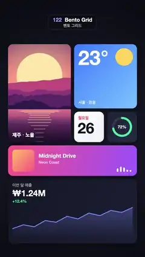

# 122 · Bento Grid · 벤토 그리드



**EN** Six dashboard tiles on a dark bento grid glide between three layouts; photos re-crop and text re-flows as each tile resizes.  
**KO** 어두운 벤토 그리드의 대시보드 타일 여섯 개가 세 가지 배치를 오가고, 크기가 바뀔 때마다 사진은 다시 잘리고 글자는 다시 배치된다.

[Video (mp4)](../videos/122-bento-grid.mp4) · [Code](../effects/122-bento-grid.js) · UI & interaction · UI·인터랙션

## Prompt (English)

```text
Create a "Bento Grid" motion effect: a FLIP-style layout animation. Six bento tiles on a 4 × 6 grid move between three layouts; each tile tweens its rectangle (staggered, eased) and lays its content out from its current size, so photos re-crop and text re-flows smoothly.

Look
- Background: radial gradient centred at (540, 1000), #1A1C2C (inner radius 100) to #090A10 at radius 1200.
- Grid: origin (60, 330), 4 columns × 6 rows, cell 222 × 228 px, gap 24 px (total 960 × 1488). A tile of w × h cells is w·222 + (w − 1)·24 wide and h·228 + (h − 1)·24 tall. Corner radius 36, shadow rgba(0,0,0,0.45) blur 40 offset y 14; content clipped to the rounded rect.
- Tiles (content always computed from the tile's current width and height):
  1 Photo: a flat-illustration sunset (big pale-yellow sun, violet-pink-orange sky, layered magenta/purple mountains, a lake with sun-reflection stripes) drawn at a fixed 1000 × 1000 size centred in the tile, so resizing only shows more or less of it; a dark gradient on the bottom 200 px and "제주 · 노을" (Apple SD Gothic Neo 800, 38 px, white) at the bottom left.
  2 Weather: gradient #3D7BFF → #79C2FF, a #FFD45C sun (radius 0.14 × the shorter side) at the top right, "23°" in Helvetica Neue 700 sized clamp(0.42 × shorter side, 72, 150), "서울 · 맑음" (600, 30 px, white 85 %) at the bottom.
  3 Calendar: white → #EEF0F6, "월요일" (700, 30 px, #FF4D5E) and "26" (Helvetica Neue 700, clamp(0.5 × shorter side, 96, 150), #141622).
  4 Steps: dark #1E2236 → #262B45, a ring (radius 0.3 × shorter side, stroke 0.24 × radius) with a 10 % white track and a #4BE3A0 arc at 72 %, "72%" in the middle.
  5 Music: gradient #FF5C8A → #9B5CFF, a cover square (side min(h − 64, 190), gradient #FFC15E → #FF5C8A, radius 24), "Midnight Drive" (Helvetica Neue 800) and "Neon Coast" (500, 28 px, white 80 %). The text sits to the right of the cover when the tile is wide and below it when it is tall, blended by smoothstep(1.2, 2.2, w / h). Five white equaliser bars bounce at the bottom right.
  6 Sales: dark #141726 → #1C2035, "이번 달 매출" (600, 30 px, white 60 %), "₩1.24M" (Helvetica Neue 800, 64 px, white), "+12.4%" (700, 30 px, #4BE3A0), and a sparkline of 12 values (0.30, 0.42, 0.36, 0.55, 0.50, 0.68, 0.60, 0.78, 0.70, 0.86, 0.80, 0.95) stretched to the tile: 6 px #7C8CFF line with an area fill rgba(124,140,255,0.35 → 0).
- Layouts as [col, row, w, h] for tiles 1–6:
  A: [0,0,2,3] [2,0,2,2] [2,2,1,1] [3,2,1,1] [0,3,4,1] [0,4,4,2]
  B: [0,0,4,2] [0,2,2,2] [2,2,2,1] [2,3,2,1] [0,4,2,2] [2,4,2,2]
  C: [2,0,2,4] [0,0,2,2] [0,2,1,1] [1,2,1,1] [0,3,2,1] [0,4,4,2]

Motion (0–5 s)
- A → B at 0.3 s, B → C at 1.9 s, C → A at 3.5 s. Each tile interpolates x, y, width and height over 1.0 s with ease-in-out cubic, starting 0.04 s later than the previous tile.
- While travelling a tile lifts: lift = sin(π k), it scales down to 94 % and its shadow grows (blur 40 → 70, offset 14 → 30).
- Everything settles back in layout A before t = 5.

Technique
- Canvas 2D. Never scale a tile's content as a bitmap: redraw it each frame from the current rectangle. Pre-render the sunset picture once.

Output and rules
- One self-contained HTML file with no external assets (three.js from a CDN is fine if you use it), drawing on a 1080 × 1920 canvas (9:16) scaled to fit the window.
- Write a function renderFrame(t) that draws the frame for time t in seconds, and preview it with requestAnimationFrame. Everything must be a pure function of t and fixed seeds: no Math.random(), Date or state carried between frames, so frame i = renderFrame(i / 30) can be exported to a 30 fps video.
- Loop seamlessly every 5 seconds: renderFrame(5) must look exactly like renderFrame(0).
- No flicker of any kind: no noise or grain that changes from frame to frame, no strobing or blinking, no z-fighting, no shimmering 1 px lines. Any grain or texture stays fixed to the screen or to the object.
- Keep the top 280 px free of important content (a title label goes there) and fill the whole frame with a designed background.
```

## 프롬프트 (한국어)

```text
"벤토 그리드" 모션 효과를 만들어 줘: FLIP 방식 레이아웃 애니메이션. 4 × 6 격자 위의 벤토 타일 여섯 개가 세 가지 배치를 오가며, 타일마다 사각형을 (시차를 두고, 이징으로) 보간하고 지금 크기에 맞춰 내용을 다시 배치해서 사진은 다시 잘리고 글자는 부드럽게 다시 흐르는 효과.

모양
- 배경: (540, 1000) 중심 방사형 그라디언트, #1A1C2C(안쪽 반지름 100)에서 반지름 1200의 #090A10까지.
- 격자: 원점 (60, 330), 4열 × 6행, 칸 222 × 228 px, 간격 24 px(전체 960 × 1488). w × h칸 타일은 너비 w·222 + (w − 1)·24, 높이 h·228 + (h − 1)·24. 모서리 반지름 36, 그림자 rgba(0,0,0,0.45) 흐림 40 y 오프셋 14. 내용은 둥근 사각형으로 클립.
- 타일(내용은 언제나 타일의 지금 너비·높이로 계산):
  1 사진: 플랫 일러스트 노을(크고 옅은 노란 해, 보라·분홍·주황 하늘, 마젠타·보라 산 여러 겹, 햇빛 줄무늬가 비친 호수)을 1000 × 1000 고정 크기로 타일 가운데에 그린다. 크기가 바뀌면 더 많이 또는 덜 보일 뿐이다. 아래 200 px에 어두운 그라디언트, 왼쪽 아래 "제주 · 노을"(Apple SD Gothic Neo 800, 38 px, 흰색).
  2 날씨: 그라디언트 #3D7BFF → #79C2FF, 오른쪽 위 #FFD45C 해(반지름 = 짧은 변 × 0.14), "23°" Helvetica Neue 700, 크기 clamp(짧은 변 × 0.42, 72, 150), 아래 "서울 · 맑음"(600, 30 px, 85 % 흰색).
  3 달력: 흰색 → #EEF0F6, "월요일"(700, 30 px, #FF4D5E), "26"(Helvetica Neue 700, clamp(짧은 변 × 0.5, 96, 150), #141622).
  4 걸음: 어두운 #1E2236 → #262B45, 링(반지름 = 짧은 변 × 0.3, 선 두께 = 반지름 × 0.24), 10 % 흰 트랙과 72 %까지의 #4BE3A0 호, 가운데 "72%".
  5 음악: 그라디언트 #FF5C8A → #9B5CFF, 커버 사각형(한 변 min(h − 64, 190), 그라디언트 #FFC15E → #FF5C8A, 반지름 24), "Midnight Drive"(Helvetica Neue 800), "Neon Coast"(500, 28 px, 80 % 흰색). 타일이 넓으면 글자가 커버 오른쪽, 높으면 커버 아래에 오고 smoothstep(1.2, 2.2, w / h)로 섞는다. 오른쪽 아래에 흰 이퀄라이저 막대 다섯 개가 춤춘다.
  6 매출: 어두운 #141726 → #1C2035, "이번 달 매출"(600, 30 px, 60 % 흰색), "₩1.24M"(Helvetica Neue 800, 64 px, 흰색), "+12.4%"(700, 30 px, #4BE3A0), 값 12개(0.30, 0.42, 0.36, 0.55, 0.50, 0.68, 0.60, 0.78, 0.70, 0.86, 0.80, 0.95)의 스파크라인을 타일에 맞춰 늘린다: 6 px #7C8CFF 선과 rgba(124,140,255,0.35 → 0) 영역 채움.
- 타일 1–6의 배치 [열, 행, w, h]:
  A: [0,0,2,3] [2,0,2,2] [2,2,1,1] [3,2,1,1] [0,3,4,1] [0,4,4,2]
  B: [0,0,4,2] [0,2,2,2] [2,2,2,1] [2,3,2,1] [0,4,2,2] [2,4,2,2]
  C: [2,0,2,4] [0,0,2,2] [0,2,1,1] [1,2,1,1] [0,3,2,1] [0,4,4,2]

움직임 (0–5초)
- 0.3초에 A → B, 1.9초에 B → C, 3.5초에 C → A. 타일마다 x, y, 너비, 높이를 1.0초 동안 ease-in-out cubic으로 보간하고, 앞 타일보다 0.04초씩 늦게 출발한다.
- 이동 중에는 타일이 들린다: lift = sin(π k), 94 %로 작아지고 그림자가 커진다(흐림 40 → 70, 오프셋 14 → 30).
- t = 5 전에 모두 배치 A로 돌아와 멈춘다.

기법
- Canvas 2D. 타일 내용을 비트맵으로 늘리지 말고 매 프레임 지금 사각형으로 다시 그린다. 노을 그림은 한 번만 그려 둔다.

출력과 규칙
- 외부 파일 없는 HTML 파일 하나(three.js를 쓴다면 CDN은 괜찮다). 1080 × 1920(9:16) 캔버스에 그리고 창 크기에 맞춰 보이게 한다.
- 시간 t(초)의 프레임을 그리는 renderFrame(t) 함수를 만들고, 미리보기는 requestAnimationFrame으로 돌린다. 모든 것은 t와 고정 시드만으로 정해진다: Math.random(), Date, 프레임 사이에 쌓이는 상태 금지. 그래야 i번째 프레임 = renderFrame(i / 30)으로 30fps 영상을 뽑을 수 있다.
- 5초마다 끊김 없이 반복: renderFrame(5)는 renderFrame(0)과 똑같아 보여야 한다.
- 어떤 깜빡임도 금지: 프레임마다 바뀌는 노이즈·그레인, 번쩍임·깜빡임, z-fighting, 반짝이며 떨리는 1px 선 모두 금지. 그레인·질감은 화면이나 물체에 고정한다.
- 위쪽 280px에는 중요한 내용을 두지 않고(제목 라벨 자리), 화면 전체를 디자인된 배경으로 채운다.
```
