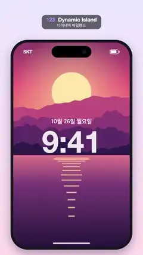

# 123 · Dynamic Island · 다이내믹 아일랜드



**EN** On a phone lock screen the black pill at the top springs open into a message notification, shrinks, then opens into a music player.  
**KO** 폰 잠금 화면 위쪽의 검은 알약이 튕기듯 커져 메시지 알림이 되고, 줄어든 뒤 다시 음악 플레이어로 펼쳐진다.

[Video (mp4)](https://sueun-dev.github.io/motion-effects/videos/123-dynamic-island.mp4) · [Code](../effects/123-dynamic-island.js) · UI & interaction · UI·인터랙션

## Prompt (English)

```text
Create a "Dynamic Island" motion effect: a pill morph. The black island at the top of a phone springs open (width, height and corner radius tween with an overshoot ease) into a message notification, shrinks back, then opens into a music player; content fades in once open.

Look
- Background: vertical gradient #ECE8FF to #FFDDEB.
- Phone body: #16161C rounded rect (80, 300, 920 × 1580), radius 130, shadow rgba(40,20,80,0.35) blur 70 offset y 30. Screen inset 20 px (100, 320, 880 × 1540), radius 112.
- Wallpaper: a flat-illustration sunset (big pale-yellow sun, violet-pink-orange sky, layered magenta/purple mountain ridges, a lake with horizontal sun-reflection stripes).
- Lock screen: "10월 26일 월요일" (Apple SD Gothic Neo 600, 44 px, white 90 %) centred at y 930; "9:41" (Helvetica Neue 700, 230 px) at y 1150; a white 85 % home bar 280 × 12 near the bottom.
- Status bar (top y 346): "SKT" (Helvetica Neue 600, 34 px, white) at the left (x 176, baseline 402) and a battery outline 64 × 32 (radius 9, 3 px) with a fill and a nub at the right. It fades out while the island is wider than 340–520 px.
- Island: pure black, idle 300 × 88 centred at the top (y 346), fully rounded, with a small camera lens dot #16182A (r 15) right of centre.

Motion (0–5 s)
- Notification: opens at 0.35 s to 820 × 210 (corner radius 70), closes at 1.9 s.
- Music player: opens at 2.6 s to 820 × 390 (corner radius 80), closes at 4.3 s.
- Opening uses ease-out-back over 0.55 s (a spring overshoot); closing uses ease-in-out over 0.45 s. The corner radius follows the height: min(h / 2, lerp(44, target radius, clamp((h − 88) / 60))).
- Content fades in from open + 0.25 to open + 0.5 s while scaling 0.94 → 1, and fades out from close − 0.05 to close + 0.12 s, before the shape shrinks. Clip content to the island.
- Notification content: a green app icon (gradient #5FE38A → #28B85A, 120 × 120, radius 30) with a white speech bubble; "지우" (700, 42 px, white); "지금" (500, 30 px, #8E8E93) at the right; "오늘 저녁 7시 어때? 맛집 찾았어" (500, 34 px, #D1D1D6).
- Player content: a 150 × 150 album cover (radius 30, a crop of the sunset picture); "Midnight Drive" (Helvetica Neue 700, 44 px, white) and "Neon Coast" (500, 34 px, #8E8E93); a six-bar waveform at the right (14 px bars, alternating #FF5E7E and #FF9F43, heights 14 + 46 × (0.5 + 0.5 sin(…)) at integer frequencies per loop); a 740 px progress bar (10 px round, 20 % white track, white fill growing slowly from 32 %) with "1:12" and "-2:31" (500, 28 px, #8E8E93); controls: white pause bars in the middle, double-triangle previous/next 150 px to each side.

Technique
- Canvas 2D. Pre-render the wallpaper and album cover once.

Output and rules
- One self-contained HTML file with no external assets (three.js from a CDN is fine if you use it), drawing on a 1080 × 1920 canvas (9:16) scaled to fit the window.
- Write a function renderFrame(t) that draws the frame for time t in seconds, and preview it with requestAnimationFrame. Everything must be a pure function of t and fixed seeds: no Math.random(), Date or state carried between frames, so frame i = renderFrame(i / 30) can be exported to a 30 fps video.
- Loop seamlessly every 5 seconds: renderFrame(5) must look exactly like renderFrame(0).
- No flicker of any kind: no noise or grain that changes from frame to frame, no strobing or blinking, no z-fighting, no shimmering 1 px lines. Any grain or texture stays fixed to the screen or to the object.
- Keep the top 280 px free of important content (a title label goes there) and fill the whole frame with a designed background.
```

## 프롬프트 (한국어)

```text
"다이내믹 아일랜드" 모션 효과를 만들어 줘: 알약 모프. 폰 위쪽의 검은 아일랜드가 튕기듯 열려(너비·높이·모서리 반지름이 오버슈트 이징으로 보간) 메시지 알림이 되고, 다시 줄어든 뒤 음악 플레이어로 열린다. 다 열리면 내용이 페이드인.

모양
- 배경: 세로 그라디언트 #ECE8FF → #FFDDEB.
- 폰 몸체: #16161C 둥근 사각형 (80, 300, 920 × 1580), 반지름 130, 그림자 rgba(40,20,80,0.35) 흐림 70 y 오프셋 30. 화면은 20 px 안쪽 (100, 320, 880 × 1540), 반지름 112.
- 배경화면: 플랫 일러스트 노을(크고 옅은 노란 해, 보라·분홍·주황 하늘, 마젠타·보라 산 능선 여러 겹, 햇빛이 가로 줄무늬로 비치는 호수).
- 잠금 화면: "10월 26일 월요일"(Apple SD Gothic Neo 600, 44 px, 90 % 흰색) y 930 가운데, "9:41"(Helvetica Neue 700, 230 px) y 1150, 아래쪽에 85 % 흰색 홈 바 280 × 12.
- 상태 표시줄(위 y 346): 왼쪽에 "SKT"(Helvetica Neue 600, 34 px, 흰색, x 176, 기준선 402), 오른쪽에 배터리 외곽선 64 × 32(반지름 9, 3 px)와 채움, 꼭지. 아일랜드 너비가 340–520 px를 넘는 동안 사라진다.
- 아일랜드: 완전한 검정, 평소 300 × 88, 위쪽 가운데(y 346), 완전히 둥근 모양. 가운데 오른쪽에 작은 카메라 렌즈 점 #16182A(반지름 15).

움직임 (0–5초)
- 알림: 0.35초에 820 × 210(모서리 반지름 70)으로 열리고 1.9초에 닫힌다.
- 음악 플레이어: 2.6초에 820 × 390(모서리 반지름 80)으로 열리고 4.3초에 닫힌다.
- 열릴 때는 0.55초 ease-out-back(스프링처럼 살짝 넘침), 닫힐 때는 0.45초 ease-in-out. 모서리 반지름은 높이를 따른다: min(h / 2, lerp(44, 목표 반지름, clamp((h − 88) / 60))).
- 내용은 열림 + 0.25초부터 + 0.5초까지 0.94 → 1로 커지며 나타나고, 닫힘 − 0.05초부터 + 0.12초까지 모양이 줄어들기 전에 사라진다. 내용은 아일랜드 모양으로 클립.
- 알림 내용: 초록 앱 아이콘(그라디언트 #5FE38A → #28B85A, 120 × 120, 반지름 30)에 흰 말풍선, "지우"(700, 42 px, 흰색), 오른쪽 "지금"(500, 30 px, #8E8E93), "오늘 저녁 7시 어때? 맛집 찾았어"(500, 34 px, #D1D1D6).
- 플레이어 내용: 150 × 150 앨범 커버(반지름 30, 노을 그림의 일부), "Midnight Drive"(Helvetica Neue 700, 44 px, 흰색)와 "Neon Coast"(500, 34 px, #8E8E93), 오른쪽에 막대 6개짜리 파형(막대 14 px, #FF5E7E와 #FF9F43 번갈아, 높이 14 + 46 × (0.5 + 0.5 sin(…)), 루프당 정수 주파수), 740 px 진행 막대(10 px 둥근 끝, 20 % 흰 트랙, 32 %에서 천천히 늘어나는 흰 채움)와 "1:12", "-2:31"(500, 28 px, #8E8E93), 조작 버튼: 가운데 흰 일시정지 막대, 양쪽 150 px에 이전/다음 겹삼각형.

기법
- Canvas 2D. 배경화면과 앨범 커버는 한 번만 그려 둔다.

출력과 규칙
- 외부 파일 없는 HTML 파일 하나(three.js를 쓴다면 CDN은 괜찮다). 1080 × 1920(9:16) 캔버스에 그리고 창 크기에 맞춰 보이게 한다.
- 시간 t(초)의 프레임을 그리는 renderFrame(t) 함수를 만들고, 미리보기는 requestAnimationFrame으로 돌린다. 모든 것은 t와 고정 시드만으로 정해진다: Math.random(), Date, 프레임 사이에 쌓이는 상태 금지. 그래야 i번째 프레임 = renderFrame(i / 30)으로 30fps 영상을 뽑을 수 있다.
- 5초마다 끊김 없이 반복: renderFrame(5)는 renderFrame(0)과 똑같아 보여야 한다.
- 어떤 깜빡임도 금지: 프레임마다 바뀌는 노이즈·그레인, 번쩍임·깜빡임, z-fighting, 반짝이며 떨리는 1px 선 모두 금지. 그레인·질감은 화면이나 물체에 고정한다.
- 위쪽 280px에는 중요한 내용을 두지 않고(제목 라벨 자리), 화면 전체를 디자인된 배경으로 채운다.
```
