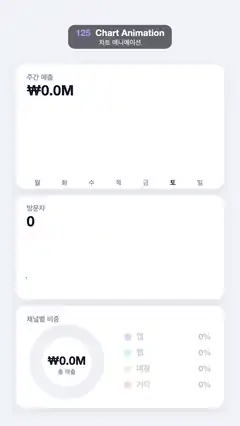

# 125 · Chart Animation · 차트 애니메이션



**EN** A sales dashboard builds up: bars spring up one by one, a line chart draws itself, a donut sweeps its segments and numbers count up.  
**KO** 매출 대시보드가 채워진다: 막대가 하나씩 솟고, 꺾은선이 그려지고, 도넛이 조각별로 돌며 숫자가 올라간다.

[Video (mp4)](https://sueun-dev.github.io/motion-effects/videos/125-chart-animation.mp4) · [Code](../effects/125-chart-animation.js) · UI & interaction · UI·인터랙션

## Prompt (English)

```text
Create a "Chart Animation" motion effect: a dashboard build-up. Bars grow one after another with an overshoot, a line chart draws itself left to right with points popping in, a donut sweeps its segments and the numbers count up; then it all retracts.

Look
- Background #F1F3F9. Three white cards at x 70, width 940, corner radius 44, shadow rgba(30,40,90,0.1) blur 40 offset y 14: y 290 (h 560), y 880 (h 470), y 1380 (h 460). Card title (Apple SD Gothic Neo 600, 32 px, #8A90A6) at (120, top + 70); big number (Helvetica Neue 800, 64 px, #141A2E) at (120, top + 140).
- Card 1 "주간 매출": seven bars for 월 화 수 목 금 토 일, values 0.45, 0.62, 0.38, 0.80, 0.70, 0.98, 0.58 of a 300 px max, x = 130 + 122 i, width 76, base y 790, corners 18 px top / 6 px bottom. Bars use a vertical gradient #B9C2FF → #DCE1FF; Saturday (토) is highlighted #7B5CFF → #5B6CFF and its label is dark #141A2E (other labels #8A90A6, 600, 30 px, at base + 44). "▲ 18.2%" (Helvetica Neue 700, 34 px, #16B686) right-aligned at (960, 430).
- Card 2 "방문자": a line of 10 values 0.22, 0.35, 0.30, 0.52, 0.46, 0.60, 0.55, 0.74, 0.70, 0.90 from x 120 to 960 between y 1300 (0) and y 1080 (1); 8 px #22C7A9 line with round joins and an area fill rgba(34,199,169,0.3 → 0); points are white circles r 13 with a 6 px #22C7A9 ring, the last one filled green.
- Card 3 "채널별 비중": a donut at (300, 1630), radius 140, 58 px thick, track #EEF0F7. Segments 38 % #5B6CFF "앱", 27 % #22C7A9 "웹", 20 % #FFB23F "매장", 15 % #FF6B8B "기타", with a hairline gap between them. Centre: "₩8.2M" (Helvetica Neue 800, 52 px) and "총 매출" (500, 28 px, #8A90A6). Legend at x 560, rows every 72 px from y 1530: a 30 × 30 rounded square (radius 9), label (600, 36 px) and the percentage (Helvetica Neue 700, 36 px) right-aligned at x 950.

Motion (0–5 s)
- Bars: bar i grows with ease-out-back over 0.5 s starting at 0.2 + 0.09 i s. The headline "₩NN.NM" shows 12.4 × the average growth (so it overshoots slightly with the bars); the ▲ badge fades in with the last bar.
- Line: p = easeInOut over 0.9–2.1 s. Reveal the line and area through a clip rectangle whose right edge moves from x 120 to x 960 with p; each point pops in (ease-out-back, over the next 60 px) as the edge passes it. The number counts 0 → "48,210" with p.
- Donut: q = easeInOut over 1.6–2.8 s sweeps clockwise from the top, filling the segments in order; the centre counts "₩0.0M" → "₩8.2M"; each legend row brightens from 25 % to 100 % opacity and its percentage counts up as its segment fills.
- Retract: from 4.05 s everything is multiplied by 1 − easeInOut((t − 4.05) / 0.7), so bars shrink, the line un-draws, the donut empties and numbers return to 0 by 4.75 s, matching t = 0.

Technique
- Canvas 2D, values computed directly from t with eased progress.

Output and rules
- One self-contained HTML file with no external assets (three.js from a CDN is fine if you use it), drawing on a 1080 × 1920 canvas (9:16) scaled to fit the window.
- Write a function renderFrame(t) that draws the frame for time t in seconds, and preview it with requestAnimationFrame. Everything must be a pure function of t and fixed seeds: no Math.random(), Date or state carried between frames, so frame i = renderFrame(i / 30) can be exported to a 30 fps video.
- Loop seamlessly every 5 seconds: renderFrame(5) must look exactly like renderFrame(0).
- No flicker of any kind: no noise or grain that changes from frame to frame, no strobing or blinking, no z-fighting, no shimmering 1 px lines. Any grain or texture stays fixed to the screen or to the object.
- Keep the top 280 px free of important content (a title label goes there) and fill the whole frame with a designed background.
```

## 프롬프트 (한국어)

```text
"차트 애니메이션" 모션 효과를 만들어 줘: 대시보드가 채워지는 효과. 막대가 오버슈트하며 하나씩 자라고, 꺾은선이 왼쪽에서 오른쪽으로 그려지며 점이 톡톡 나타나고, 도넛이 조각별로 돌며 숫자가 올라간 뒤 모두 되돌아간다.

모양
- 배경 #F1F3F9. 흰 카드 세 장, x 70, 너비 940, 모서리 반지름 44, 그림자 rgba(30,40,90,0.1) 흐림 40 y 오프셋 14: y 290(높이 560), y 880(높이 470), y 1380(높이 460). 카드 제목(Apple SD Gothic Neo 600, 32 px, #8A90A6) (120, 위 + 70), 큰 숫자(Helvetica Neue 800, 64 px, #141A2E) (120, 위 + 140).
- 카드 1 "주간 매출": 월 화 수 목 금 토 일 막대 일곱 개, 값 0.45, 0.62, 0.38, 0.80, 0.70, 0.98, 0.58(최대 300 px), x = 130 + 122 i, 너비 76, 바닥 y 790, 모서리 위 18 px / 아래 6 px. 막대는 세로 그라디언트 #B9C2FF → #DCE1FF, 토요일(토)만 #7B5CFF → #5B6CFF로 강조하고 라벨도 진한 #141A2E(다른 라벨 #8A90A6, 600, 30 px, 바닥 + 44). "▲ 18.2%"(Helvetica Neue 700, 34 px, #16B686) (960, 430)에 오른쪽 정렬.
- 카드 2 "방문자": 값 10개 0.22, 0.35, 0.30, 0.52, 0.46, 0.60, 0.55, 0.74, 0.70, 0.90의 꺾은선, x 120에서 960까지, y 1300(0)과 y 1080(1) 사이. 8 px #22C7A9 선, 둥근 이음, 영역 채움 rgba(34,199,169,0.3 → 0). 점은 흰 원 반지름 13에 6 px #22C7A9 테두리, 마지막 점만 초록으로 채움.
- 카드 3 "채널별 비중": 도넛 중심 (300, 1630), 반지름 140, 두께 58 px, 트랙 #EEF0F7. 조각 38 % #5B6CFF "앱", 27 % #22C7A9 "웹", 20 % #FFB23F "매장", 15 % #FF6B8B "기타", 조각 사이에 아주 가는 틈. 가운데 "₩8.2M"(Helvetica Neue 800, 52 px)과 "총 매출"(500, 28 px, #8A90A6). 범례 x 560, y 1530부터 72 px 간격: 30 × 30 둥근 사각형(반지름 9), 라벨(600, 36 px), x 950에 오른쪽 정렬한 퍼센트(Helvetica Neue 700, 36 px).

움직임 (0–5초)
- 막대: 막대 i는 0.2 + 0.09 i 초에 시작해 0.5초 동안 ease-out-back으로 자란다. 제목 숫자 "₩NN.NM"은 12.4 × 평균 성장값이라 막대와 함께 살짝 넘쳤다 돌아온다. ▲ 배지는 마지막 막대와 함께 나타난다.
- 꺾은선: p = 0.9–2.1초 easeInOut. 오른쪽 끝이 p에 따라 x 120에서 960으로 움직이는 클립 사각형으로 선과 영역을 드러낸다. 끝이 지나갈 때마다 점이 톡 나타난다(ease-out-back, 다음 60 px 동안). 숫자는 p에 따라 0 → "48,210".
- 도넛: q = 1.6–2.8초 easeInOut, 위에서부터 시계 방향으로 조각을 차례로 채운다. 가운데 숫자는 "₩0.0M" → "₩8.2M". 범례 줄은 자기 조각이 채워질 때 불투명도 25 % → 100 %로 밝아지고 퍼센트가 올라간다.
- 되돌리기: 4.05초부터 모든 값에 1 − easeInOut((t − 4.05) / 0.7)을 곱해서 막대는 줄고, 선은 지워지고, 도넛은 비고, 숫자는 4.75초까지 0으로 돌아가 t = 0과 같아진다.

기법
- Canvas 2D. 값은 이징한 진행도로 t에서 바로 계산한다.

출력과 규칙
- 외부 파일 없는 HTML 파일 하나(three.js를 쓴다면 CDN은 괜찮다). 1080 × 1920(9:16) 캔버스에 그리고 창 크기에 맞춰 보이게 한다.
- 시간 t(초)의 프레임을 그리는 renderFrame(t) 함수를 만들고, 미리보기는 requestAnimationFrame으로 돌린다. 모든 것은 t와 고정 시드만으로 정해진다: Math.random(), Date, 프레임 사이에 쌓이는 상태 금지. 그래야 i번째 프레임 = renderFrame(i / 30)으로 30fps 영상을 뽑을 수 있다.
- 5초마다 끊김 없이 반복: renderFrame(5)는 renderFrame(0)과 똑같아 보여야 한다.
- 어떤 깜빡임도 금지: 프레임마다 바뀌는 노이즈·그레인, 번쩍임·깜빡임, z-fighting, 반짝이며 떨리는 1px 선 모두 금지. 그레인·질감은 화면이나 물체에 고정한다.
- 위쪽 280px에는 중요한 내용을 두지 않고(제목 라벨 자리), 화면 전체를 디자인된 배경으로 채운다.
```
