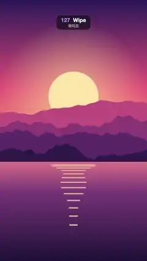

# 127 · Wipe · 와이프



**EN** A glowing slanted line sweeps across a sunset lake to reveal a night city behind it, then sweeps again to bring the sunset back.  
**KO** 빛나는 비스듬한 선이 노을 호수를 쓸고 지나가며 뒤의 밤 도시를 드러내고, 다시 쓸어 노을로 되돌린다.

[Video (mp4)](https://sueun-dev.github.io/motion-effects/videos/127-wipe.mp4) · [Code](../effects/127-wipe.js) · Transitions · 트랜지션

## Prompt (English)

```text
Create a "Wipe" scene transition: a slanted, glowing edge sweeps across the frame and swaps a sunset landscape for a night city, then sweeps again and brings the sunset back.

Look
Picture A, a sunset over mountains and a lake (flat illustration; its sun bobs and its reflection breathes on the 5 s loop):
- Sky over the top 62 % (y 0–1190): vertical gradient #2B1B5A (top) → #E8577A (55 %) → #FFB36B (horizon).
- Sun: flat disc #FFE6A8, radius 184 px, centre x 540, y 710 + 19·sin(2π·t/5). Behind it, over the sky, a glow: radial gradient rgba(255, 220, 150, 0.55) at 0.8 r fading to 0 at 3 r.
- Four mountain ridges, back to front #C2507E, #8E3B78, #5A2A68, #2E1A4A, each filled from the bottom up to a ridge line y = H·(base − amp·(0.5 + n(x))) with base 0.47 / 0.52 / 0.57 / 0.62, amp 0.10 / 0.12 / 0.11 / 0.08 and n a 4-octave smooth fractal noise (about ±0.4) at 2 / 3 / 4 / 5 cycles per frame width, sampled every 8 px.
- Lake below y 1190: vertical gradient #E0748A → #7A3B78 (30 %) → #1E1238 (bottom).
- Sun on the water: 14 horizontal bars rgba(255, 226, 160, 0.7) centred on x 540; bar i (0–13) at y = 1210 + 2.6·i², height 4 + 0.6·i px, half-width 184·(1 − i/16)·(0.8 + 0.2·sin(2π·t/5 + i)), so they narrow and spread apart going down and gently breathe.
Picture B, a night city by a river (static):
- Sky: vertical gradient #0B1030 (top) → #3A2A6E (y 783) → #E0607E at the waterline y 1306, staying #E0607E below it.
- 90 stars at fixed seeded positions in the top 45 %: white dots, 80 % opacity, radius 1–3 px.
- Moon: disc #FFF1D6, radius 72 px, centre (778, 384), with a 260 px glow rgba(255, 240, 210, 0.45) → 0.
- Skyline standing on y 1306, seeded random buildings 70–180 px wide with 6 px gaps: a back row of plain #2A2F5E blocks 260–620 px tall, and a front row of #141433 towers 160–820 px tall with 12 × 18 px windows on a 26 × 34 px grid (from 12 px inside the left wall and 24 px below the roof); 42 % of the windows are lit, 80 % of those warm yellow #FFD36E and 20 % ice blue #9BE7FF.
- River below y 1306: everything above the waterline mirrored, drawn in 6 px horizontal strips at 45 % opacity, each strip shifted sideways by 6·sin(0.05·y) px (ripples), then darkened by a vertical gradient rgba(20, 16, 50, 0.35) → rgba(8, 8, 26, 0.95).
The transition:
- The boundary is a straight line tilted about 20° from vertical, its top leaning left (in screen pixels with y pointing down, the line runs along (0.352, 0.936)). It travels along its normal n = (cos(−0.36), sin(−0.36)) ≈ (0.936, −0.352): to the right and a little up.
- The side the line has already passed (to its left) shows the incoming picture; the side ahead of it still shows the outgoing one.
- Edge: a solid white 8 px line with round caps and a warm glow (shadow colour rgba(255, 230, 200, 0.95), blur 40 px).
- Sheen: on the incoming side, a white gradient from 35 % opacity at the line to 0 at 320 px behind it (measured along the normal), as if light catches the edge.

Motion (0–5 s)
- Schedule: A holds 0–0.6 s, wipe A → B 0.6–1.9 s, B holds 1.9–3.1 s, wipe B → A 3.1–4.4 s (same direction), A holds 4.4–5 s, so t = 5 matches t = 0.
- Progress k = smoothstep(start, end, t) (3k² − 2k³ after clamping): it eases in and out and is fastest in the middle.
- The line's position along the normal goes from D0 = 1920·(−0.352) − 90 ≈ −766 px to D1 = 1080·0.936 + 90 ≈ 1101 px: the frame corners projected onto the normal plus a 90 px margin, so the line and its glow start and finish completely off-screen (no pop). It enters at the bottom-left corner and leaves past the top-right one.
- Outside the two wipes draw only the held picture (no line).

Technique
- Canvas 2D. Draw picture B once into an off-screen 1080 × 1920 canvas; redraw picture A into its own off-screen canvas every frame (its sun moves).
- Per frame: draw the outgoing picture; build the half-plane behind the line as one large quad (the point on the line ± 3000 px along the line, extended 3000 px back against the normal); clip to it, draw the incoming picture and fill the sheen; then stroke the line (3000 px each way) with shadowBlur for the glow.

Output and rules
- One self-contained HTML file with no external assets (three.js from a CDN is fine if you use it), drawing on a 1080 × 1920 canvas (9:16) scaled to fit the window.
- Write a function renderFrame(t) that draws the frame for time t in seconds, and preview it with requestAnimationFrame. Everything must be a pure function of t and fixed seeds: no Math.random(), Date or state carried between frames, so frame i = renderFrame(i / 30) can be exported to a 30 fps video.
- Loop seamlessly every 5 seconds: renderFrame(5) must look exactly like renderFrame(0).
- No flicker of any kind: no noise or grain that changes from frame to frame, no strobing or blinking, no z-fighting, no shimmering 1 px lines. Any grain or texture stays fixed to the screen or to the object.
- Keep the top 280 px free of important content (a title label goes there) and fill the whole frame with a designed background.
```

## 프롬프트 (한국어)

```text
"와이프" 장면 전환을 만들어 줘: 비스듬히 빛나는 경계선이 화면을 쓸고 지나가며 노을 풍경을 밤 도시로 바꾸고, 다시 한 번 쓸어 노을로 되돌린다.

모양
그림 A, 산과 호수 위의 노을(플랫 일러스트. 해가 5초 루프로 출렁이고 물에 비친 빛이 숨 쉬듯 변한다):
- 하늘(위쪽 62 %, y 0–1190): 세로 그라디언트 #2B1B5A(맨 위) → #E8577A(55 %) → #FFB36B(수평선).
- 해: 단색 원 #FFE6A8, 반지름 184 px, 중심 x 540, y 710 + 19·sin(2π·t/5). 뒤쪽 하늘에 빛무리: 0.8 r에서 rgba(255, 220, 150, 0.55)로 시작해 3 r에서 투명해지는 방사형 그라디언트.
- 산 능선 네 겹, 뒤에서 앞으로 #C2507E, #8E3B78, #5A2A68, #2E1A4A. 각 겹은 아래에서 능선 y = H·(base − amp·(0.5 + n(x)))까지 채운 실루엣이다. base 0.47 / 0.52 / 0.57 / 0.62, amp 0.10 / 0.12 / 0.11 / 0.08, n은 화면 너비당 2 / 3 / 4 / 5 주기의 4옥타브 부드러운 프랙털 노이즈(약 ±0.4), 8 px마다 샘플.
- 호수(y 1190 아래): 세로 그라디언트 #E0748A → #7A3B78(30 %) → #1E1238(맨 아래).
- 물에 비친 해: x 540에 가운데 맞춘 가로 막대 14개, rgba(255, 226, 160, 0.7). i번째 막대(0–13)는 y = 1210 + 2.6·i², 두께 4 + 0.6·i px, 반폭 184·(1 − i/16)·(0.8 + 0.2·sin(2π·t/5 + i)). 아래로 갈수록 좁아지고 간격이 벌어지며, 폭이 천천히 숨 쉬듯 변한다.
그림 B, 강가의 밤 도시(정지):
- 하늘: 세로 그라디언트 #0B1030(맨 위) → #3A2A6E(y 783) → 수면선 y 1306에서 #E0607E, 그 아래는 #E0607E 그대로.
- 별 90개: 위쪽 45 % 안의 시드로 고정한 위치에 흰 점, 불투명도 80 %, 반지름 1–3 px.
- 달: 원 #FFF1D6, 반지름 72 px, 중심 (778, 384), 반지름 260 px 빛무리 rgba(255, 240, 210, 0.45) → 투명.
- 스카이라인(y 1306 위에 선다): 시드 난수로 정한 폭 70–180 px, 사이 간격 6 px의 빌딩들. 뒷줄은 높이 260–620 px의 민무늬 #2A2F5E 덩어리, 앞줄은 높이 160–820 px의 #141433 빌딩이고 12 × 18 px 창문이 가로 26 px·세로 34 px 간격 격자로 있다(왼쪽 벽에서 12 px 안쪽, 지붕에서 24 px 아래부터). 창문의 42 %가 켜져 있고, 그중 80 %는 따뜻한 노랑 #FFD36E, 20 %는 얼음빛 하늘색 #9BE7FF.
- 강(y 1306 아래): 수면선 위의 모든 것을 위아래로 뒤집어 6 px 가로 띠로 나눠 불투명도 45 %로 그리고, 띠마다 6·sin(0.05·y) px씩 옆으로 밀어 물결을 만든 뒤, 세로 그라디언트 rgba(20, 16, 50, 0.35) → rgba(8, 8, 26, 0.95)로 어둡게 덮는다.
전환:
- 경계는 세로에서 약 20° 기운 직선으로, 위쪽 끝이 왼쪽으로 기울어 있다(y가 아래로 커지는 화면 픽셀 좌표에서 선의 방향은 (0.352, 0.936)). 선은 법선 n = (cos(−0.36), sin(−0.36)) ≈ (0.936, −0.352) 방향, 즉 오른쪽으로 조금 위를 향해 움직인다.
- 선이 이미 지나간 쪽(선의 왼쪽)에는 들어오는 그림이, 아직 지나가지 않은 쪽에는 나가는 그림이 보인다.
- 경계선: 끝이 둥근 8 px 흰 실선에 따뜻한 빛 번짐(그림자 색 rgba(255, 230, 200, 0.95), 블러 40 px).
- 광택: 들어오는 그림 쪽에, 선에서 불투명도 35 %로 시작해 법선 방향으로 320 px 뒤에서 0이 되는 흰 그라디언트. 경계에 빛이 걸린 느낌을 준다.

움직임 (0–5초)
- 일정: 0–0.6초 A 유지, 0.6–1.9초 A → B 와이프, 1.9–3.1초 B 유지, 3.1–4.4초 B → A 와이프(같은 방향), 4.4–5초 A 유지. 그래서 t = 5는 t = 0과 같다.
- 진행도 k = smoothstep(start, end, t)(클램프한 뒤 3k² − 2k³): 천천히 출발해 가운데서 가장 빠르고 부드럽게 멈춘다.
- 법선 방향으로 잰 선의 위치는 D0 = 1920·(−0.352) − 90 ≈ −766 px에서 D1 = 1080·0.936 + 90 ≈ 1101 px까지 간다. 화면 모서리를 법선에 투영한 값에 90 px 여유를 더한 것이라, 선과 빛 번짐이 완전히 화면 밖에서 시작해 화면 밖에서 끝난다(툭 나타나지 않음). 왼쪽 아래 모서리로 들어와 오른쪽 위 모서리 너머로 나간다.
- 두 와이프 사이에는 유지 중인 그림만 그린다(선 없음).

기법
- Canvas 2D. 그림 B는 1080 × 1920 오프스크린 캔버스에 한 번만 그리고, 그림 A는 해가 움직이므로 매 프레임 자기 오프스크린 캔버스에 다시 그린다.
- 프레임마다: 나가는 그림을 그린다. 선 뒤쪽 반평면을 큰 사각형 하나(선 위의 점에서 선 방향으로 ± 3000 px, 법선 반대쪽으로 3000 px 늘린 것)로 만들어 클립하고, 들어오는 그림을 그린 뒤 광택을 칠한다. 마지막으로 선(양쪽으로 3000 px)을 shadowBlur로 빛 번짐을 주며 그린다.

출력과 규칙
- 외부 파일 없는 HTML 파일 하나(three.js를 쓴다면 CDN은 괜찮다). 1080 × 1920(9:16) 캔버스에 그리고 창 크기에 맞춰 보이게 한다.
- 시간 t(초)의 프레임을 그리는 renderFrame(t) 함수를 만들고, 미리보기는 requestAnimationFrame으로 돌린다. 모든 것은 t와 고정 시드만으로 정해진다: Math.random(), Date, 프레임 사이에 쌓이는 상태 금지. 그래야 i번째 프레임 = renderFrame(i / 30)으로 30fps 영상을 뽑을 수 있다.
- 5초마다 끊김 없이 반복: renderFrame(5)는 renderFrame(0)과 똑같아 보여야 한다.
- 어떤 깜빡임도 금지: 프레임마다 바뀌는 노이즈·그레인, 번쩍임·깜빡임, z-fighting, 반짝이며 떨리는 1px 선 모두 금지. 그레인·질감은 화면이나 물체에 고정한다.
- 위쪽 280px에는 중요한 내용을 두지 않고(제목 라벨 자리), 화면 전체를 디자인된 배경으로 채운다.
```
