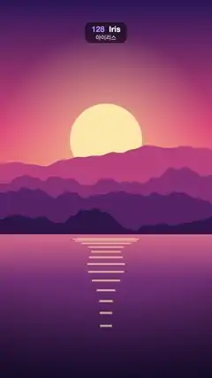

# 128 · Iris · 아이리스



**EN** A glowing iris closes on the sun, pauses, shuts, then opens on the moon over a night city; the reverse brings the sunset back.  
**KO** 빛나는 원이 해 위로 오므라들어 잠깐 멈췄다 닫히고, 밤 도시의 달에서 다시 열린다. 반대로 하면 노을로 돌아온다.

[Video (mp4)](../videos/128-iris.mp4) · [Code](../effects/128-iris.js) · Transitions · 트랜지션

## Prompt (English)

```text
Create an "Iris" scene transition: a glowing circle closes on the setting sun, pauses for a beat around it, shuts, then opens on the moon of a night city; the way back closes on the moon and opens on the sun.

Look
Picture A, a sunset over mountains and a lake (flat illustration; its sun bobs and its reflection breathes on the 5 s loop):
- Sky over the top 62 % (y 0–1190): vertical gradient #2B1B5A (top) → #E8577A (55 %) → #FFB36B (horizon).
- Sun: flat disc #FFE6A8, radius 184 px, centre x 540, y 710 + 19·sin(2π·t/5). Behind it, over the sky, a glow: radial gradient rgba(255, 220, 150, 0.55) at 0.8 r fading to 0 at 3 r.
- Four mountain ridges, back to front #C2507E, #8E3B78, #5A2A68, #2E1A4A, each filled from the bottom up to a ridge line y = H·(base − amp·(0.5 + n(x))) with base 0.47 / 0.52 / 0.57 / 0.62, amp 0.10 / 0.12 / 0.11 / 0.08 and n a 4-octave smooth fractal noise (about ±0.4) at 2 / 3 / 4 / 5 cycles per frame width, sampled every 8 px.
- Lake below y 1190: vertical gradient #E0748A → #7A3B78 (30 %) → #1E1238 (bottom).
- Sun on the water: 14 horizontal bars rgba(255, 226, 160, 0.7) centred on x 540; bar i (0–13) at y = 1210 + 2.6·i², height 4 + 0.6·i px, half-width 184·(1 − i/16)·(0.8 + 0.2·sin(2π·t/5 + i)), so they narrow and spread apart going down and gently breathe.
Picture B, a night city by a river (static):
- Sky: vertical gradient #0B1030 (top) → #3A2A6E (y 783) → #E0607E at the waterline y 1306, staying #E0607E below it.
- 90 stars at fixed seeded positions in the top 45 %: white dots, 80 % opacity, radius 1–3 px.
- Moon: disc #FFF1D6, radius 72 px, centre (778, 384), with a 260 px glow rgba(255, 240, 210, 0.45) → 0.
- Skyline standing on y 1306, seeded random buildings 70–180 px wide with 6 px gaps: a back row of plain #2A2F5E blocks 260–620 px tall, and a front row of #141433 towers 160–820 px tall with 12 × 18 px windows on a 26 × 34 px grid (from 12 px inside the left wall and 24 px below the roof); 42 % of the windows are lit, 80 % of those warm yellow #FFD36E and 20 % ice blue #9BE7FF.
- River below y 1306: everything above the waterline mirrored, drawn in 6 px horizontal strips at 45 % opacity, each strip shifted sideways by 6·sin(0.05·y) px (ripples), then darkened by a vertical gradient rgba(20, 16, 50, 0.35) → rgba(8, 8, 26, 0.95).
The transition:
- Points of interest: the sun (540, 710) in picture A and the moon (778, 384) in picture B. The iris closes centred on the outgoing picture's point and reopens centred on the incoming picture's point.
- Outside the circle (and while it is shut) a deep violet, not flat black: a radial gradient centred on the iris centre, #2E2152 at the centre to #07050F at 1400 px.
- Inside the circle: the picture, plus a soft inner shadow at the rim (radial gradient from transparent at 0.6 r to rgba(7, 5, 15, 0.45) at r).
- A ring on the edge: stroke rgba(255, 244, 225, 0.8), width min(5, r/6) px (so it thins away as the iris shuts), glow rgba(255, 200, 150, 0.8) with 24 px blur.
- Full-open radius R_full for a centre c: the distance from c to the farthest frame corner + 30 px.

Motion (0–5 s)
- Schedule: A holds 0–0.35 s, A → B 0.35–2.15 s, B holds 2.15–2.85 s, B → A 2.85–4.65 s, A holds 4.65–5 s. Inside each transition p runs linearly 0 → 1.
- Closing (p < 0.52): r = sqrt(lerp(R_full², 250², smoothstep(0, 0.36, p))) × (1 − k³), with k = clamp((p − 0.42) / 0.10). Easing the area (r²) instead of the radius makes the dark grow at an even, eased pace. The iris settles on a 250 px circle framing the sun (the beat, p 0.36–0.42), then snaps shut with a cubic ease-in at p = 0.52.
- Opening (p ≥ 0.52): r = R_full × sqrt(smoothstep(0.52, 1, p)), centred on the new point of interest.
- In seconds, A → B: closes 0.35–1.0 s, pauses until 1.1 s, is shut at 1.29 s and fully open on the moon at 2.15 s. B → A does the same around the moon (shut at 3.79 s) and opens on the sun by 4.65 s.
- While r < 1 px draw only the dark background.

Technique
- Canvas 2D: fill the background gradient, clip to arc(cx, cy, r), draw the picture and the rim shadow, restore, then stroke the ring with shadowBlur. Picture B is drawn once off-screen; picture A is redrawn every frame (its sun moves) while the iris centre stays fixed at (540, 710).

Output and rules
- One self-contained HTML file with no external assets (three.js from a CDN is fine if you use it), drawing on a 1080 × 1920 canvas (9:16) scaled to fit the window.
- Write a function renderFrame(t) that draws the frame for time t in seconds, and preview it with requestAnimationFrame. Everything must be a pure function of t and fixed seeds: no Math.random(), Date or state carried between frames, so frame i = renderFrame(i / 30) can be exported to a 30 fps video.
- Loop seamlessly every 5 seconds: renderFrame(5) must look exactly like renderFrame(0).
- No flicker of any kind: no noise or grain that changes from frame to frame, no strobing or blinking, no z-fighting, no shimmering 1 px lines. Any grain or texture stays fixed to the screen or to the object.
- Keep the top 280 px free of important content (a title label goes there) and fill the whole frame with a designed background.
```

## 프롬프트 (한국어)

```text
"아이리스" 장면 전환을 만들어 줘: 빛나는 원이 지는 해를 향해 오므라들어 해 둘레에서 잠깐 멈췄다가 닫히고, 밤 도시의 달을 중심으로 다시 열린다. 돌아올 때는 달 위로 닫혔다가 해 위로 열린다.

모양
그림 A, 산과 호수 위의 노을(플랫 일러스트. 해가 5초 루프로 출렁이고 물에 비친 빛이 숨 쉬듯 변한다):
- 하늘(위쪽 62 %, y 0–1190): 세로 그라디언트 #2B1B5A(맨 위) → #E8577A(55 %) → #FFB36B(수평선).
- 해: 단색 원 #FFE6A8, 반지름 184 px, 중심 x 540, y 710 + 19·sin(2π·t/5). 뒤쪽 하늘에 빛무리: 0.8 r에서 rgba(255, 220, 150, 0.55)로 시작해 3 r에서 투명해지는 방사형 그라디언트.
- 산 능선 네 겹, 뒤에서 앞으로 #C2507E, #8E3B78, #5A2A68, #2E1A4A. 각 겹은 아래에서 능선 y = H·(base − amp·(0.5 + n(x)))까지 채운 실루엣이다. base 0.47 / 0.52 / 0.57 / 0.62, amp 0.10 / 0.12 / 0.11 / 0.08, n은 화면 너비당 2 / 3 / 4 / 5 주기의 4옥타브 부드러운 프랙털 노이즈(약 ±0.4), 8 px마다 샘플.
- 호수(y 1190 아래): 세로 그라디언트 #E0748A → #7A3B78(30 %) → #1E1238(맨 아래).
- 물에 비친 해: x 540에 가운데 맞춘 가로 막대 14개, rgba(255, 226, 160, 0.7). i번째 막대(0–13)는 y = 1210 + 2.6·i², 두께 4 + 0.6·i px, 반폭 184·(1 − i/16)·(0.8 + 0.2·sin(2π·t/5 + i)). 아래로 갈수록 좁아지고 간격이 벌어지며, 폭이 천천히 숨 쉬듯 변한다.
그림 B, 강가의 밤 도시(정지):
- 하늘: 세로 그라디언트 #0B1030(맨 위) → #3A2A6E(y 783) → 수면선 y 1306에서 #E0607E, 그 아래는 #E0607E 그대로.
- 별 90개: 위쪽 45 % 안의 시드로 고정한 위치에 흰 점, 불투명도 80 %, 반지름 1–3 px.
- 달: 원 #FFF1D6, 반지름 72 px, 중심 (778, 384), 반지름 260 px 빛무리 rgba(255, 240, 210, 0.45) → 투명.
- 스카이라인(y 1306 위에 선다): 시드 난수로 정한 폭 70–180 px, 사이 간격 6 px의 빌딩들. 뒷줄은 높이 260–620 px의 민무늬 #2A2F5E 덩어리, 앞줄은 높이 160–820 px의 #141433 빌딩이고 12 × 18 px 창문이 가로 26 px·세로 34 px 간격 격자로 있다(왼쪽 벽에서 12 px 안쪽, 지붕에서 24 px 아래부터). 창문의 42 %가 켜져 있고, 그중 80 %는 따뜻한 노랑 #FFD36E, 20 %는 얼음빛 하늘색 #9BE7FF.
- 강(y 1306 아래): 수면선 위의 모든 것을 위아래로 뒤집어 6 px 가로 띠로 나눠 불투명도 45 %로 그리고, 띠마다 6·sin(0.05·y) px씩 옆으로 밀어 물결을 만든 뒤, 세로 그라디언트 rgba(20, 16, 50, 0.35) → rgba(8, 8, 26, 0.95)로 어둡게 덮는다.
전환:
- 관심점: 그림 A의 해 (540, 710), 그림 B의 달 (778, 384). 원은 나가는 그림의 관심점을 중심으로 닫히고, 들어오는 그림의 관심점을 중심으로 다시 열린다.
- 원 바깥(그리고 완전히 닫혔을 때)은 그냥 검정이 아닌 깊은 보라: 원 중심에서 #2E2152로 시작해 1400 px에서 #07050F가 되는 방사형 그라디언트.
- 원 안: 그림, 그리고 가장자리의 부드러운 안쪽 그림자(0.6 r에서 투명, r에서 rgba(7, 5, 15, 0.45)인 방사형 그라디언트).
- 가장자리 고리: rgba(255, 244, 225, 0.8) 선, 두께 min(5, r/6) px(원이 닫히면서 함께 가늘어진다), 빛 번짐 rgba(255, 200, 150, 0.8), 블러 24 px.
- 중심 c의 완전히 열린 반지름 R_full: c에서 가장 먼 화면 모서리까지의 거리 + 30 px.

움직임 (0–5초)
- 일정: 0–0.35초 A 유지, 0.35–2.15초 A → B, 2.15–2.85초 B 유지, 2.85–4.65초 B → A, 4.65–5초 A 유지. 전환 안에서 p는 0 → 1로 일정하게 증가한다.
- 닫힘(p < 0.52): r = sqrt(lerp(R_full², 250², smoothstep(0, 0.36, p))) × (1 − k³), k = clamp((p − 0.42) / 0.10). 반지름 대신 넓이(r²)에 이징을 걸어 어두운 부분이 고르고 부드럽게 늘어난다. 원은 해를 감싸는 반지름 250 px에서 멈췄다가(잠깐의 정지, p 0.36–0.42) 세제곱 ease-in으로 p = 0.52에 탁 닫힌다.
- 열림(p ≥ 0.52): r = R_full × sqrt(smoothstep(0.52, 1, p)), 새 관심점이 중심.
- 초로 보면 A → B: 0.35–1.0초에 닫히고, 1.1초까지 멈추고, 1.29초에 완전히 닫히고, 2.15초에 달을 중심으로 완전히 열린다. B → A는 달 둘레에서 똑같이 닫히고(3.79초에 닫힘) 4.65초까지 해를 중심으로 열린다.
- r < 1 px인 동안에는 어두운 배경만 그린다.

기법
- Canvas 2D: 배경 그라디언트를 칠하고, arc(cx, cy, r)로 클립해 그림과 가장자리 그림자를 그린 뒤 복원하고, shadowBlur를 준 고리를 그린다. 그림 B는 오프스크린에 한 번만 그리고, 그림 A는 해가 움직이므로 매 프레임 다시 그린다. 아이리스 중심은 (540, 710)에 고정한다.

출력과 규칙
- 외부 파일 없는 HTML 파일 하나(three.js를 쓴다면 CDN은 괜찮다). 1080 × 1920(9:16) 캔버스에 그리고 창 크기에 맞춰 보이게 한다.
- 시간 t(초)의 프레임을 그리는 renderFrame(t) 함수를 만들고, 미리보기는 requestAnimationFrame으로 돌린다. 모든 것은 t와 고정 시드만으로 정해진다: Math.random(), Date, 프레임 사이에 쌓이는 상태 금지. 그래야 i번째 프레임 = renderFrame(i / 30)으로 30fps 영상을 뽑을 수 있다.
- 5초마다 끊김 없이 반복: renderFrame(5)는 renderFrame(0)과 똑같아 보여야 한다.
- 어떤 깜빡임도 금지: 프레임마다 바뀌는 노이즈·그레인, 번쩍임·깜빡임, z-fighting, 반짝이며 떨리는 1px 선 모두 금지. 그레인·질감은 화면이나 물체에 고정한다.
- 위쪽 280px에는 중요한 내용을 두지 않고(제목 라벨 자리), 화면 전체를 디자인된 배경으로 채운다.
```
