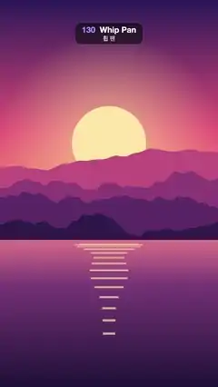

# 130 · Whip Pan · 휩 팬



**EN** The view whips sideways in a heavy horizontal motion blur from a sunset lake to a night city, holds, then whips on to the sunset.  
**KO** 화면이 강한 가로 모션 블러와 함께 노을 호수에서 밤 도시로 휙 넘어가 머물다가, 다시 휙 노을로 넘어간다.

[Video (mp4)](../videos/130-whip-pan.mp4) · [Code](../effects/130-whip-pan.js) · Transitions · 트랜지션

## Prompt (English)

```text
Create a "Whip Pan" scene transition: the camera whips sideways with heavy horizontal motion blur from a sunset landscape to a night city, holds, then whips on to the sunset again.

Look
Picture A, a sunset over mountains and a lake (flat illustration; its sun bobs and its reflection breathes on the 5 s loop):
- Sky over the top 62 % (y 0–1190): vertical gradient #2B1B5A (top) → #E8577A (55 %) → #FFB36B (horizon).
- Sun: flat disc #FFE6A8, radius 184 px, centre x 540, y 710 + 19·sin(2π·t/5). Behind it, over the sky, a glow: radial gradient rgba(255, 220, 150, 0.55) at 0.8 r fading to 0 at 3 r.
- Four mountain ridges, back to front #C2507E, #8E3B78, #5A2A68, #2E1A4A, each filled from the bottom up to a ridge line y = H·(base − amp·(0.5 + n(x))) with base 0.47 / 0.52 / 0.57 / 0.62, amp 0.10 / 0.12 / 0.11 / 0.08 and n a 4-octave smooth fractal noise (about ±0.4) at 2 / 3 / 4 / 5 cycles per frame width, sampled every 8 px.
- Lake below y 1190: vertical gradient #E0748A → #7A3B78 (30 %) → #1E1238 (bottom).
- Sun on the water: 14 horizontal bars rgba(255, 226, 160, 0.7) centred on x 540; bar i (0–13) at y = 1210 + 2.6·i², height 4 + 0.6·i px, half-width 184·(1 − i/16)·(0.8 + 0.2·sin(2π·t/5 + i)), so they narrow and spread apart going down and gently breathe.
Picture B, a night city by a river (static):
- Sky: vertical gradient #0B1030 (top) → #3A2A6E (y 783) → #E0607E at the waterline y 1306, staying #E0607E below it.
- 90 stars at fixed seeded positions in the top 45 %: white dots, 80 % opacity, radius 1–3 px.
- Moon: disc #FFF1D6, radius 72 px, centre (778, 384), with a 260 px glow rgba(255, 240, 210, 0.45) → 0.
- Skyline standing on y 1306, seeded random buildings 70–180 px wide with 6 px gaps: a back row of plain #2A2F5E blocks 260–620 px tall, and a front row of #141433 towers 160–820 px tall with 12 × 18 px windows on a 26 × 34 px grid (from 12 px inside the left wall and 24 px below the roof); 42 % of the windows are lit, 80 % of those warm yellow #FFD36E and 20 % ice blue #9BE7FF.
- River below y 1306: everything above the waterline mirrored, drawn in 6 px horizontal strips at 45 % opacity, each strip shifted sideways by 6·sin(0.05·y) px (ripples), then darkened by a vertical gradient rgba(20, 16, 50, 0.35) → rgba(8, 8, 26, 0.95).
The transition:
- The two pictures sit side by side on an endless horizontal strip A | B | A | B …, each 1080 px wide (tile j at x = 1080·j; even j = A, odd j = B). The camera's x position moves to the right, so the pictures slide to the left and the next one enters from the right.
- During the move each frame is a directional motion blur along x: a soft, sine-shaped smear whose length follows the speed, giving smooth streaks with no hard ends and no visible stacked copies. At rest the picture is perfectly sharp.

Motion (0–5 s)
- camX(t) = 1080 × (E(clamp((t − 0.7)/1.1)) + E(clamp((t − 3.2)/1.1))), with E the cubic ease-in-out (4k³ below 0.5, else 1 − (−2k + 2)³ / 2). So: A holds 0–0.7 s, whip to B 0.7–1.8 s, B holds 1.8–3.2 s, whip on to the next A 3.2–4.3 s, A holds 4.3–5 s. At 5 s the camera sits on the second A, which looks exactly like frame 0.
- The steep cubic is on purpose: almost no motion at the ends and a violent middle (peak about 98 px per frame). That is the whip.

Technique
- Speed v = camX(t + 1/60) − camX(t − 1/60) (pixels per frame). Blur length b = 10·v (a 10-frame shutter). Number of copies n = min(120, 1 + ceil(b / 6)), about one copy every 6 px, so the smear is smooth.
- Copy i (u = (i + 0.5)/n) is the strip seen from x + b·(u − 0.5) (the blur is centred on the camera), with weight w = sin(π·u).
- Combine them as a running weighted average without an extra buffer: keep the sum of the weights so far and draw copy i with globalAlpha = w_i / sum (the first copy at alpha 1). For each copy, draw every tile that overlaps the 1080 px window.
- Canvas 2D. Picture B is drawn once off-screen, picture A every frame (its sun moves).

Output and rules
- One self-contained HTML file with no external assets (three.js from a CDN is fine if you use it), drawing on a 1080 × 1920 canvas (9:16) scaled to fit the window.
- Write a function renderFrame(t) that draws the frame for time t in seconds, and preview it with requestAnimationFrame. Everything must be a pure function of t and fixed seeds: no Math.random(), Date or state carried between frames, so frame i = renderFrame(i / 30) can be exported to a 30 fps video.
- Loop seamlessly every 5 seconds: renderFrame(5) must look exactly like renderFrame(0).
- No flicker of any kind: no noise or grain that changes from frame to frame, no strobing or blinking, no z-fighting, no shimmering 1 px lines. Any grain or texture stays fixed to the screen or to the object.
- Keep the top 280 px free of important content (a title label goes there) and fill the whole frame with a designed background.
```

## 프롬프트 (한국어)

```text
"휩 팬" 장면 전환을 만들어 줘: 카메라를 휙 돌리듯 강한 가로 모션 블러와 함께 노을 풍경에서 밤 도시로 넘어가 머물다가, 다시 휙 노을로 넘어간다.

모양
그림 A, 산과 호수 위의 노을(플랫 일러스트. 해가 5초 루프로 출렁이고 물에 비친 빛이 숨 쉬듯 변한다):
- 하늘(위쪽 62 %, y 0–1190): 세로 그라디언트 #2B1B5A(맨 위) → #E8577A(55 %) → #FFB36B(수평선).
- 해: 단색 원 #FFE6A8, 반지름 184 px, 중심 x 540, y 710 + 19·sin(2π·t/5). 뒤쪽 하늘에 빛무리: 0.8 r에서 rgba(255, 220, 150, 0.55)로 시작해 3 r에서 투명해지는 방사형 그라디언트.
- 산 능선 네 겹, 뒤에서 앞으로 #C2507E, #8E3B78, #5A2A68, #2E1A4A. 각 겹은 아래에서 능선 y = H·(base − amp·(0.5 + n(x)))까지 채운 실루엣이다. base 0.47 / 0.52 / 0.57 / 0.62, amp 0.10 / 0.12 / 0.11 / 0.08, n은 화면 너비당 2 / 3 / 4 / 5 주기의 4옥타브 부드러운 프랙털 노이즈(약 ±0.4), 8 px마다 샘플.
- 호수(y 1190 아래): 세로 그라디언트 #E0748A → #7A3B78(30 %) → #1E1238(맨 아래).
- 물에 비친 해: x 540에 가운데 맞춘 가로 막대 14개, rgba(255, 226, 160, 0.7). i번째 막대(0–13)는 y = 1210 + 2.6·i², 두께 4 + 0.6·i px, 반폭 184·(1 − i/16)·(0.8 + 0.2·sin(2π·t/5 + i)). 아래로 갈수록 좁아지고 간격이 벌어지며, 폭이 천천히 숨 쉬듯 변한다.
그림 B, 강가의 밤 도시(정지):
- 하늘: 세로 그라디언트 #0B1030(맨 위) → #3A2A6E(y 783) → 수면선 y 1306에서 #E0607E, 그 아래는 #E0607E 그대로.
- 별 90개: 위쪽 45 % 안의 시드로 고정한 위치에 흰 점, 불투명도 80 %, 반지름 1–3 px.
- 달: 원 #FFF1D6, 반지름 72 px, 중심 (778, 384), 반지름 260 px 빛무리 rgba(255, 240, 210, 0.45) → 투명.
- 스카이라인(y 1306 위에 선다): 시드 난수로 정한 폭 70–180 px, 사이 간격 6 px의 빌딩들. 뒷줄은 높이 260–620 px의 민무늬 #2A2F5E 덩어리, 앞줄은 높이 160–820 px의 #141433 빌딩이고 12 × 18 px 창문이 가로 26 px·세로 34 px 간격 격자로 있다(왼쪽 벽에서 12 px 안쪽, 지붕에서 24 px 아래부터). 창문의 42 %가 켜져 있고, 그중 80 %는 따뜻한 노랑 #FFD36E, 20 %는 얼음빛 하늘색 #9BE7FF.
- 강(y 1306 아래): 수면선 위의 모든 것을 위아래로 뒤집어 6 px 가로 띠로 나눠 불투명도 45 %로 그리고, 띠마다 6·sin(0.05·y) px씩 옆으로 밀어 물결을 만든 뒤, 세로 그라디언트 rgba(20, 16, 50, 0.35) → rgba(8, 8, 26, 0.95)로 어둡게 덮는다.
전환:
- 두 그림이 끝없는 가로 띠 A | B | A | B … 위에 나란히 놓인다. 각각 폭 1080 px(j번째 칸은 x = 1080·j, 짝수 j = A, 홀수 j = B). 카메라의 x 위치가 오른쪽으로 움직이므로 그림은 왼쪽으로 밀려나고 다음 그림이 오른쪽에서 들어온다.
- 움직이는 동안 매 프레임은 x 방향 모션 블러다: 길이가 속도를 따라가는 부드러운 사인 모양 번짐이라, 끝이 딱 끊기지 않고 겹친 사본도 보이지 않는 매끈한 줄무늬가 된다. 멈춰 있을 때는 완전히 선명하다.

움직임 (0–5초)
- camX(t) = 1080 × (E(clamp((t − 0.7)/1.1)) + E(clamp((t − 3.2)/1.1))), E는 세제곱 ease-in-out(0.5 미만은 4k³, 그 외에는 1 − (−2k + 2)³ / 2). 그래서 0–0.7초 A 유지, 0.7–1.8초 B로 휙, 1.8–3.2초 B 유지, 3.2–4.3초 다음 A로 휙, 4.3–5초 A 유지. 5초에 카메라는 두 번째 A 위에 있고, 이는 0번 프레임과 똑같아 보인다.
- 가파른 세제곱 곡선은 일부러 쓴 것이다: 양 끝은 거의 멈춰 있고 가운데가 격렬하게 빠르다(최고 약 98 px/프레임). 이것이 '휩'이다.

기법
- 속도 v = camX(t + 1/60) − camX(t − 1/60)(프레임당 픽셀). 블러 길이 b = 10·v(10프레임 셔터). 사본 수 n = min(120, 1 + ceil(b / 6)), 약 6 px마다 사본 하나라 번짐이 매끈하다.
- i번째 사본(u = (i + 0.5)/n)은 x + b·(u − 0.5)에서 본 띠이고(블러의 가운데가 카메라 위치), 가중치는 w = sin(π·u).
- 별도 버퍼 없이 누적 가중 평균으로 합친다: 지금까지의 가중치 합을 유지하면서 i번째 사본을 globalAlpha = w_i / 합으로 그린다(첫 사본은 alpha 1). 사본마다 1080 px 창과 겹치는 칸을 모두 그린다.
- Canvas 2D. 그림 B는 오프스크린에 한 번만, 그림 A는 해가 움직이므로 매 프레임 그린다.

출력과 규칙
- 외부 파일 없는 HTML 파일 하나(three.js를 쓴다면 CDN은 괜찮다). 1080 × 1920(9:16) 캔버스에 그리고 창 크기에 맞춰 보이게 한다.
- 시간 t(초)의 프레임을 그리는 renderFrame(t) 함수를 만들고, 미리보기는 requestAnimationFrame으로 돌린다. 모든 것은 t와 고정 시드만으로 정해진다: Math.random(), Date, 프레임 사이에 쌓이는 상태 금지. 그래야 i번째 프레임 = renderFrame(i / 30)으로 30fps 영상을 뽑을 수 있다.
- 5초마다 끊김 없이 반복: renderFrame(5)는 renderFrame(0)과 똑같아 보여야 한다.
- 어떤 깜빡임도 금지: 프레임마다 바뀌는 노이즈·그레인, 번쩍임·깜빡임, z-fighting, 반짝이며 떨리는 1px 선 모두 금지. 그레인·질감은 화면이나 물체에 고정한다.
- 위쪽 280px에는 중요한 내용을 두지 않고(제목 라벨 자리), 화면 전체를 디자인된 배경으로 채운다.
```
