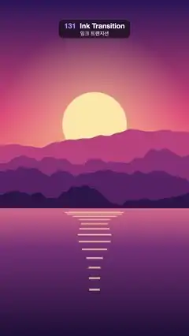

# 131 · Ink Transition · 잉크 트랜지션



**EN** Nine wobbly ink blots with coral and navy rims spread over a sunset lake and fill it with a night city, then spread again back.  
**KO** 산호색·남색 테두리의 울퉁불퉁한 잉크 얼룩 아홉 개가 번지며 노을 호수를 밤 도시로 채우고, 다시 번져 노을로 돌아온다.

[Video (mp4)](../videos/131-ink-transition.mp4) · [Code](../effects/131-ink-transition.js) · Transitions · 트랜지션

## Prompt (English)

```text
Create an "Ink Transition" (liquid transition): ink blots with a coral rim and a dark ink fringe spread from nine drops and fill a sunset landscape with a night city, then spread again to bring the sunset back.

Look
Picture A, a sunset over mountains and a lake (flat illustration; its sun bobs and its reflection breathes on the 5 s loop):
- Sky over the top 62 % (y 0–1190): vertical gradient #2B1B5A (top) → #E8577A (55 %) → #FFB36B (horizon).
- Sun: flat disc #FFE6A8, radius 184 px, centre x 540, y 710 + 19·sin(2π·t/5). Behind it, over the sky, a glow: radial gradient rgba(255, 220, 150, 0.55) at 0.8 r fading to 0 at 3 r.
- Four mountain ridges, back to front #C2507E, #8E3B78, #5A2A68, #2E1A4A, each filled from the bottom up to a ridge line y = H·(base − amp·(0.5 + n(x))) with base 0.47 / 0.52 / 0.57 / 0.62, amp 0.10 / 0.12 / 0.11 / 0.08 and n a 4-octave smooth fractal noise (about ±0.4) at 2 / 3 / 4 / 5 cycles per frame width, sampled every 8 px.
- Lake below y 1190: vertical gradient #E0748A → #7A3B78 (30 %) → #1E1238 (bottom).
- Sun on the water: 14 horizontal bars rgba(255, 226, 160, 0.7) centred on x 540; bar i (0–13) at y = 1210 + 2.6·i², height 4 + 0.6·i px, half-width 184·(1 − i/16)·(0.8 + 0.2·sin(2π·t/5 + i)), so they narrow and spread apart going down and gently breathe.
Picture B, a night city by a river (static):
- Sky: vertical gradient #0B1030 (top) → #3A2A6E (y 783) → #E0607E at the waterline y 1306, staying #E0607E below it.
- 90 stars at fixed seeded positions in the top 45 %: white dots, 80 % opacity, radius 1–3 px.
- Moon: disc #FFF1D6, radius 72 px, centre (778, 384), with a 260 px glow rgba(255, 240, 210, 0.45) → 0.
- Skyline standing on y 1306, seeded random buildings 70–180 px wide with 6 px gaps: a back row of plain #2A2F5E blocks 260–620 px tall, and a front row of #141433 towers 160–820 px tall with 12 × 18 px windows on a 26 × 34 px grid (from 12 px inside the left wall and 24 px below the roof); 42 % of the windows are lit, 80 % of those warm yellow #FFD36E and 20 % ice blue #9BE7FF.
- River below y 1306: everything above the waterline mirrored, drawn in 6 px horizontal strips at 45 % opacity, each strip shifted sideways by 6·sin(0.05·y) px (ripples), then darkened by a vertical gradient rgba(20, 16, 50, 0.35) → rgba(8, 8, 26, 0.95).
The transition:
- Nine drops, given as (x, y) fractions of the frame and a start point as a fraction of the transition: (0.5, 0.5, 0), (0.22, 0.2, 0.05), (0.8, 0.82, 0.10), (0.82, 0.2, 0.14), (0.18, 0.78, 0.18), (0.5, 0.86, 0.22), (0.5, 0.15, 0.26), (0.18, 0.5, 0.30), (0.84, 0.5, 0.35). At full size together they cover the whole frame.
- Drop growth e = clamp((p − start) / 0.65), linear; base radius 640·e px.
- Outline: a closed 180-point polygon. At angle a the radius is R·(1 + 0.3·fbm(1.7·cos a + 3.7·i, 1.7·sin a + 1.9·i, R/600 + lead/300)), with fbm a 4-octave smooth 3D noise and i the drop index. Reading the noise on a circle closes the shape; tying the third coordinate to the radius makes the outline morph slowly as it grows instead of wobbling over time.
- Three layers, each one path holding all nine blots (their union), drawn in order over the outgoing picture:
  1. coral #FF5D73: R = 640·e·1.08 + 120·min(1, 12·e) (lead 120)
  2. dark ink #1C1236: R = 640·e·1.04 + 55·min(1, 12·e) (lead 55)
  3. the incoming picture, clipped to R = 640·e (lead 0).
  So every blot has a thick coral band outside a navy band, running just ahead of the new scene, and the min(1, 12·e) term makes the rims swell quickly out of a dot. Where blots overlap, later layers paint over earlier rims, so merged blots open into one area.
- The second transition flips the drops vertically (y → 1 − y) and adds 9 to the first noise coordinate, so its blots have different shapes.

Motion (0–5 s)
- Schedule: A holds 0–0.3 s, ink A → B 0.3–2.2 s, B holds 2.2–2.8 s, ink B → A 2.8–4.7 s, A holds 4.7–5 s. In each transition p runs linearly 0 → 1.
- The blots spread at a steady, linear pace (no easing), like ink soaking in; most of the frame is covered by about 1.4 s and the last drop completes at 2.2 s.

Technique
- Canvas 2D: build each layer's union path from moveTo/lineTo subpaths (nonzero fill), fill the two colour layers, then clip to the third and draw the incoming picture. Picture B is drawn once off-screen, picture A every frame (its sun moves).

Output and rules
- One self-contained HTML file with no external assets (three.js from a CDN is fine if you use it), drawing on a 1080 × 1920 canvas (9:16) scaled to fit the window.
- Write a function renderFrame(t) that draws the frame for time t in seconds, and preview it with requestAnimationFrame. Everything must be a pure function of t and fixed seeds: no Math.random(), Date or state carried between frames, so frame i = renderFrame(i / 30) can be exported to a 30 fps video.
- Loop seamlessly every 5 seconds: renderFrame(5) must look exactly like renderFrame(0).
- No flicker of any kind: no noise or grain that changes from frame to frame, no strobing or blinking, no z-fighting, no shimmering 1 px lines. Any grain or texture stays fixed to the screen or to the object.
- Keep the top 280 px free of important content (a title label goes there) and fill the whole frame with a designed background.
```

## 프롬프트 (한국어)

```text
"잉크 트랜지션"(리퀴드 트랜지션)을 만들어 줘: 산호색 테두리와 어두운 잉크 가장자리를 두른 얼룩이 방울 아홉 개에서 번져 노을 풍경을 밤 도시로 채우고, 다시 번져 노을로 되돌린다.

모양
그림 A, 산과 호수 위의 노을(플랫 일러스트. 해가 5초 루프로 출렁이고 물에 비친 빛이 숨 쉬듯 변한다):
- 하늘(위쪽 62 %, y 0–1190): 세로 그라디언트 #2B1B5A(맨 위) → #E8577A(55 %) → #FFB36B(수평선).
- 해: 단색 원 #FFE6A8, 반지름 184 px, 중심 x 540, y 710 + 19·sin(2π·t/5). 뒤쪽 하늘에 빛무리: 0.8 r에서 rgba(255, 220, 150, 0.55)로 시작해 3 r에서 투명해지는 방사형 그라디언트.
- 산 능선 네 겹, 뒤에서 앞으로 #C2507E, #8E3B78, #5A2A68, #2E1A4A. 각 겹은 아래에서 능선 y = H·(base − amp·(0.5 + n(x)))까지 채운 실루엣이다. base 0.47 / 0.52 / 0.57 / 0.62, amp 0.10 / 0.12 / 0.11 / 0.08, n은 화면 너비당 2 / 3 / 4 / 5 주기의 4옥타브 부드러운 프랙털 노이즈(약 ±0.4), 8 px마다 샘플.
- 호수(y 1190 아래): 세로 그라디언트 #E0748A → #7A3B78(30 %) → #1E1238(맨 아래).
- 물에 비친 해: x 540에 가운데 맞춘 가로 막대 14개, rgba(255, 226, 160, 0.7). i번째 막대(0–13)는 y = 1210 + 2.6·i², 두께 4 + 0.6·i px, 반폭 184·(1 − i/16)·(0.8 + 0.2·sin(2π·t/5 + i)). 아래로 갈수록 좁아지고 간격이 벌어지며, 폭이 천천히 숨 쉬듯 변한다.
그림 B, 강가의 밤 도시(정지):
- 하늘: 세로 그라디언트 #0B1030(맨 위) → #3A2A6E(y 783) → 수면선 y 1306에서 #E0607E, 그 아래는 #E0607E 그대로.
- 별 90개: 위쪽 45 % 안의 시드로 고정한 위치에 흰 점, 불투명도 80 %, 반지름 1–3 px.
- 달: 원 #FFF1D6, 반지름 72 px, 중심 (778, 384), 반지름 260 px 빛무리 rgba(255, 240, 210, 0.45) → 투명.
- 스카이라인(y 1306 위에 선다): 시드 난수로 정한 폭 70–180 px, 사이 간격 6 px의 빌딩들. 뒷줄은 높이 260–620 px의 민무늬 #2A2F5E 덩어리, 앞줄은 높이 160–820 px의 #141433 빌딩이고 12 × 18 px 창문이 가로 26 px·세로 34 px 간격 격자로 있다(왼쪽 벽에서 12 px 안쪽, 지붕에서 24 px 아래부터). 창문의 42 %가 켜져 있고, 그중 80 %는 따뜻한 노랑 #FFD36E, 20 %는 얼음빛 하늘색 #9BE7FF.
- 강(y 1306 아래): 수면선 위의 모든 것을 위아래로 뒤집어 6 px 가로 띠로 나눠 불투명도 45 %로 그리고, 띠마다 6·sin(0.05·y) px씩 옆으로 밀어 물결을 만든 뒤, 세로 그라디언트 rgba(20, 16, 50, 0.35) → rgba(8, 8, 26, 0.95)로 어둡게 덮는다.
전환:
- 방울 아홉 개. (x, y)는 화면 비율, 셋째 값은 전환 안에서의 시작 시점 비율: (0.5, 0.5, 0), (0.22, 0.2, 0.05), (0.8, 0.82, 0.10), (0.82, 0.2, 0.14), (0.18, 0.78, 0.18), (0.5, 0.86, 0.22), (0.5, 0.15, 0.26), (0.18, 0.5, 0.30), (0.84, 0.5, 0.35). 모두 다 자라면 함께 화면 전체를 덮는다.
- 방울의 성장 e = clamp((p − start) / 0.65), 선형. 기본 반지름 640·e px.
- 윤곽: 점 180개짜리 닫힌 다각형. 각도 a에서 반지름은 R·(1 + 0.3·fbm(1.7·cos a + 3.7·i, 1.7·sin a + 1.9·i, R/600 + lead/300))이고, fbm은 4옥타브 부드러운 3D 노이즈, i는 방울 번호다. 원 위에서 노이즈를 읽으니 모양이 닫히고, 셋째 좌표를 반지름에 묶었기 때문에 윤곽이 시간에 따라 떨리지 않고 자라면서 천천히 모양을 바꾼다.
- 레이어 세 장. 각각 아홉 얼룩을 모두 담은 경로 하나(합집합)이고, 나가는 그림 위에 차례로 그린다:
  1. 산호색 #FF5D73: R = 640·e·1.08 + 120·min(1, 12·e)(lead 120)
  2. 어두운 잉크 #1C1236: R = 640·e·1.04 + 55·min(1, 12·e)(lead 55)
  3. 들어오는 그림, R = 640·e로 클립(lead 0).
  그래서 얼룩마다 굵은 산호색 띠가 남색 띠 바깥을 두르고 새 장면 바로 앞을 달린다. min(1, 12·e) 항 덕분에 테두리가 점에서 빠르게 부풀어 오른다. 얼룩이 겹치면 뒤 레이어가 앞 테두리를 덮어, 합쳐진 얼룩은 하나의 영역으로 열린다.
- 두 번째 전환은 방울을 위아래로 뒤집고(y → 1 − y) 노이즈 첫 좌표에 9를 더해 얼룩 모양을 다르게 한다.

움직임 (0–5초)
- 일정: 0–0.3초 A 유지, 0.3–2.2초 잉크 A → B, 2.2–2.8초 B 유지, 2.8–4.7초 잉크 B → A, 4.7–5초 A 유지. 전환마다 p는 0 → 1로 일정하게 증가한다.
- 얼룩은 이징 없이 일정한 속도로 번진다(잉크가 스며드는 느낌). 약 1.4초면 화면 대부분이 덮이고, 마지막 방울은 2.2초에 다 자란다.

기법
- Canvas 2D: 레이어마다 moveTo/lineTo 하위 경로로 합집합 경로를 만들고(nonzero 채우기), 색 레이어 둘을 칠한 뒤 셋째 경로로 클립해 들어오는 그림을 그린다. 그림 B는 오프스크린에 한 번만, 그림 A는 해가 움직이므로 매 프레임 그린다.

출력과 규칙
- 외부 파일 없는 HTML 파일 하나(three.js를 쓴다면 CDN은 괜찮다). 1080 × 1920(9:16) 캔버스에 그리고 창 크기에 맞춰 보이게 한다.
- 시간 t(초)의 프레임을 그리는 renderFrame(t) 함수를 만들고, 미리보기는 requestAnimationFrame으로 돌린다. 모든 것은 t와 고정 시드만으로 정해진다: Math.random(), Date, 프레임 사이에 쌓이는 상태 금지. 그래야 i번째 프레임 = renderFrame(i / 30)으로 30fps 영상을 뽑을 수 있다.
- 5초마다 끊김 없이 반복: renderFrame(5)는 renderFrame(0)과 똑같아 보여야 한다.
- 어떤 깜빡임도 금지: 프레임마다 바뀌는 노이즈·그레인, 번쩍임·깜빡임, z-fighting, 반짝이며 떨리는 1px 선 모두 금지. 그레인·질감은 화면이나 물체에 고정한다.
- 위쪽 280px에는 중요한 내용을 두지 않고(제목 라벨 자리), 화면 전체를 디자인된 배경으로 채운다.
```
