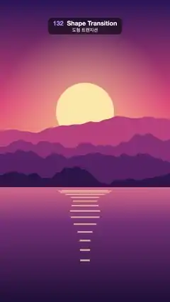

# 132 · Shape Transition · 도형 트랜지션



**EN** Yellow, coral and violet bands with zigzag and scalloped edges rise up the screen, wiping a sunset lake to a night city and back.  
**KO** 지그재그와 반원 물결 경계를 가진 노랑·산호·보라 색 띠가 아래에서 위로 올라가며 노을 호수를 밤 도시로, 다시 노을로 바꾼다.

[Video (mp4)](../videos/132-shape-transition.mp4) · [Code](../effects/132-shape-transition.js) · Transitions · 트랜지션

## Prompt (English)

```text
Create a "Shape Transition" (geometric transition): bold yellow, coral and violet bands with a zigzag top and a scalloped edge rise up the screen one after another, sweeping a sunset landscape away for a night city, then doing it again to bring the sunset back.

Look
Picture A, a sunset over mountains and a lake (flat illustration; its sun bobs and its reflection breathes on the 5 s loop):
- Sky over the top 62 % (y 0–1190): vertical gradient #2B1B5A (top) → #E8577A (55 %) → #FFB36B (horizon).
- Sun: flat disc #FFE6A8, radius 184 px, centre x 540, y 710 + 19·sin(2π·t/5). Behind it, over the sky, a glow: radial gradient rgba(255, 220, 150, 0.55) at 0.8 r fading to 0 at 3 r.
- Four mountain ridges, back to front #C2507E, #8E3B78, #5A2A68, #2E1A4A, each filled from the bottom up to a ridge line y = H·(base − amp·(0.5 + n(x))) with base 0.47 / 0.52 / 0.57 / 0.62, amp 0.10 / 0.12 / 0.11 / 0.08 and n a 4-octave smooth fractal noise (about ±0.4) at 2 / 3 / 4 / 5 cycles per frame width, sampled every 8 px.
- Lake below y 1190: vertical gradient #E0748A → #7A3B78 (30 %) → #1E1238 (bottom).
- Sun on the water: 14 horizontal bars rgba(255, 226, 160, 0.7) centred on x 540; bar i (0–13) at y = 1210 + 2.6·i², height 4 + 0.6·i px, half-width 184·(1 − i/16)·(0.8 + 0.2·sin(2π·t/5 + i)), so they narrow and spread apart going down and gently breathe.
Picture B, a night city by a river (static):
- Sky: vertical gradient #0B1030 (top) → #3A2A6E (y 783) → #E0607E at the waterline y 1306, staying #E0607E below it.
- 90 stars at fixed seeded positions in the top 45 %: white dots, 80 % opacity, radius 1–3 px.
- Moon: disc #FFF1D6, radius 72 px, centre (778, 384), with a 260 px glow rgba(255, 240, 210, 0.45) → 0.
- Skyline standing on y 1306, seeded random buildings 70–180 px wide with 6 px gaps: a back row of plain #2A2F5E blocks 260–620 px tall, and a front row of #141433 towers 160–820 px tall with 12 × 18 px windows on a 26 × 34 px grid (from 12 px inside the left wall and 24 px below the roof); 42 % of the windows are lit, 80 % of those warm yellow #FFD36E and 20 % ice blue #9BE7FF.
- River below y 1306: everything above the waterline mirrored, drawn in 6 px horizontal strips at 45 % opacity, each strip shifted sideways by 6·sin(0.05·y) px (ripples), then darkened by a vertical gradient rgba(20, 16, 50, 0.35) → rgba(8, 8, 26, 0.95).
The transition:
- Four edges rise from below the frame to above it. From top to bottom while they pass: outgoing picture | edge 0, zigzag | yellow #FFC93C band | edge 1, half circles | coral #FF5E5B band | edge 2, straight line | violet #5B3FD9 band | edge 3, straight line | incoming picture.
- Zigzag: triangular teeth 180 px wide and 130 px tall, pointing up (a point every 90 px, alternating between the edge height y and y − 130).
- Half circles: a row of domes of diameter 180 px (radius 90) side by side, bulging upward.
- Straight lines: rising slightly to the right, from y + 60 at the left side to y − 60 at the right (about 6°).
- Flat colours, no outlines and no shading.

Motion (0–5 s)
- Schedule: A holds 0–0.5 s, A → B 0.5–2.0 s, B holds 2.0–3.0 s, B → A 3.0–4.5 s (rising again), A holds 4.5–5 s. In each transition p runs linearly 0 → 1.
- Edge j (0–3) has height y_j = lerp(2130, −210, smoothstep(0.1·j, 0.1·j + 0.7, p)): it starts fully below the frame and ends fully above it (130 px of shape + 80 px margin), so nothing pops. Each edge travels for 0.7 of the transition (1.05 s) and they leave 0.15 s apart, so the bands open up as they fly up, each easing in and out.

Technique
- Canvas 2D in painter's order: draw the incoming picture full-frame; fill the region above edge 3 violet, above edge 2 coral, above edge 1 yellow; then clip to the region above edge 0 and draw the outgoing picture.
- "Region above an edge" is one closed path: from (−20, −400) to (1100, −400), down the right side to the edge, along the edge from right to left (zigzag points, dome arcs, or the tilted line), up the left side and closed.
- Picture B is drawn once off-screen, picture A every frame (its sun moves).

Output and rules
- One self-contained HTML file with no external assets (three.js from a CDN is fine if you use it), drawing on a 1080 × 1920 canvas (9:16) scaled to fit the window.
- Write a function renderFrame(t) that draws the frame for time t in seconds, and preview it with requestAnimationFrame. Everything must be a pure function of t and fixed seeds: no Math.random(), Date or state carried between frames, so frame i = renderFrame(i / 30) can be exported to a 30 fps video.
- Loop seamlessly every 5 seconds: renderFrame(5) must look exactly like renderFrame(0).
- No flicker of any kind: no noise or grain that changes from frame to frame, no strobing or blinking, no z-fighting, no shimmering 1 px lines. Any grain or texture stays fixed to the screen or to the object.
- Keep the top 280 px free of important content (a title label goes there) and fill the whole frame with a designed background.
```

## 프롬프트 (한국어)

```text
"도형 트랜지션"(지오메트릭 트랜지션)을 만들어 줘: 지그재그 윗변과 반원 물결 경계를 가진 노랑·산호·보라의 굵은 색 띠가 차례로 아래에서 위로 올라가며 노을 풍경을 쓸어 내고 밤 도시를 드러내고, 한 번 더 같은 방식으로 노을을 되돌린다.

모양
그림 A, 산과 호수 위의 노을(플랫 일러스트. 해가 5초 루프로 출렁이고 물에 비친 빛이 숨 쉬듯 변한다):
- 하늘(위쪽 62 %, y 0–1190): 세로 그라디언트 #2B1B5A(맨 위) → #E8577A(55 %) → #FFB36B(수평선).
- 해: 단색 원 #FFE6A8, 반지름 184 px, 중심 x 540, y 710 + 19·sin(2π·t/5). 뒤쪽 하늘에 빛무리: 0.8 r에서 rgba(255, 220, 150, 0.55)로 시작해 3 r에서 투명해지는 방사형 그라디언트.
- 산 능선 네 겹, 뒤에서 앞으로 #C2507E, #8E3B78, #5A2A68, #2E1A4A. 각 겹은 아래에서 능선 y = H·(base − amp·(0.5 + n(x)))까지 채운 실루엣이다. base 0.47 / 0.52 / 0.57 / 0.62, amp 0.10 / 0.12 / 0.11 / 0.08, n은 화면 너비당 2 / 3 / 4 / 5 주기의 4옥타브 부드러운 프랙털 노이즈(약 ±0.4), 8 px마다 샘플.
- 호수(y 1190 아래): 세로 그라디언트 #E0748A → #7A3B78(30 %) → #1E1238(맨 아래).
- 물에 비친 해: x 540에 가운데 맞춘 가로 막대 14개, rgba(255, 226, 160, 0.7). i번째 막대(0–13)는 y = 1210 + 2.6·i², 두께 4 + 0.6·i px, 반폭 184·(1 − i/16)·(0.8 + 0.2·sin(2π·t/5 + i)). 아래로 갈수록 좁아지고 간격이 벌어지며, 폭이 천천히 숨 쉬듯 변한다.
그림 B, 강가의 밤 도시(정지):
- 하늘: 세로 그라디언트 #0B1030(맨 위) → #3A2A6E(y 783) → 수면선 y 1306에서 #E0607E, 그 아래는 #E0607E 그대로.
- 별 90개: 위쪽 45 % 안의 시드로 고정한 위치에 흰 점, 불투명도 80 %, 반지름 1–3 px.
- 달: 원 #FFF1D6, 반지름 72 px, 중심 (778, 384), 반지름 260 px 빛무리 rgba(255, 240, 210, 0.45) → 투명.
- 스카이라인(y 1306 위에 선다): 시드 난수로 정한 폭 70–180 px, 사이 간격 6 px의 빌딩들. 뒷줄은 높이 260–620 px의 민무늬 #2A2F5E 덩어리, 앞줄은 높이 160–820 px의 #141433 빌딩이고 12 × 18 px 창문이 가로 26 px·세로 34 px 간격 격자로 있다(왼쪽 벽에서 12 px 안쪽, 지붕에서 24 px 아래부터). 창문의 42 %가 켜져 있고, 그중 80 %는 따뜻한 노랑 #FFD36E, 20 %는 얼음빛 하늘색 #9BE7FF.
- 강(y 1306 아래): 수면선 위의 모든 것을 위아래로 뒤집어 6 px 가로 띠로 나눠 불투명도 45 %로 그리고, 띠마다 6·sin(0.05·y) px씩 옆으로 밀어 물결을 만든 뒤, 세로 그라디언트 rgba(20, 16, 50, 0.35) → rgba(8, 8, 26, 0.95)로 어둡게 덮는다.
전환:
- 경계 네 개가 화면 아래에서 위로 올라간다. 지나가는 동안 위에서 아래 순서로: 나가는 그림 | 경계 0, 지그재그 | 노랑 #FFC93C 띠 | 경계 1, 반원 | 산호 #FF5E5B 띠 | 경계 2, 직선 | 보라 #5B3FD9 띠 | 경계 3, 직선 | 들어오는 그림.
- 지그재그: 폭 180 px, 높이 130 px의 위를 향한 삼각형 이빨(90 px마다 꼭짓점, 경계 높이 y와 y − 130을 번갈아).
- 반원: 지름 180 px(반지름 90)의 위로 볼록한 돔이 나란히 늘어선 줄.
- 직선: 오른쪽으로 살짝 올라간다. 왼쪽 끝 y + 60에서 오른쪽 끝 y − 60(약 6°).
- 단색, 윤곽선과 음영 없음.

움직임 (0–5초)
- 일정: 0–0.5초 A 유지, 0.5–2.0초 A → B, 2.0–3.0초 B 유지, 3.0–4.5초 B → A(역시 위로 올라감), 4.5–5초 A 유지. 전환마다 p는 0 → 1로 일정하게 증가한다.
- j번째 경계(0–3)의 높이 y_j = lerp(2130, −210, smoothstep(0.1·j, 0.1·j + 0.7, p)): 화면 아래 완전히 밖에서 출발해 화면 위 완전히 밖에서 끝난다(도형 130 px + 여유 80 px). 그래서 툭 나타나지 않는다. 경계마다 전환의 0.7(1.05초)에 걸쳐 움직이고 0.15초 간격으로 뒤따라, 띠들이 각자 부드럽게 가속·감속하며 날아오르면서 벌어진다.

기법
- Canvas 2D, 화가 순서: 들어오는 그림을 화면 전체에 그리고, 경계 3 위쪽을 보라, 경계 2 위쪽을 산호, 경계 1 위쪽을 노랑으로 칠한 뒤, 경계 0 위쪽 영역으로 클립해 나가는 그림을 그린다.
- '경계 위쪽 영역'은 닫힌 경로 하나다: (−20, −400)에서 (1100, −400)으로 가서 오른쪽 변을 따라 경계까지 내려오고, 경계를 오른쪽에서 왼쪽으로 따라간 뒤(지그재그 꼭짓점, 돔의 호, 또는 기운 직선) 왼쪽 변을 따라 올라가 닫는다.
- 그림 B는 오프스크린에 한 번만, 그림 A는 해가 움직이므로 매 프레임 그린다.

출력과 규칙
- 외부 파일 없는 HTML 파일 하나(three.js를 쓴다면 CDN은 괜찮다). 1080 × 1920(9:16) 캔버스에 그리고 창 크기에 맞춰 보이게 한다.
- 시간 t(초)의 프레임을 그리는 renderFrame(t) 함수를 만들고, 미리보기는 requestAnimationFrame으로 돌린다. 모든 것은 t와 고정 시드만으로 정해진다: Math.random(), Date, 프레임 사이에 쌓이는 상태 금지. 그래야 i번째 프레임 = renderFrame(i / 30)으로 30fps 영상을 뽑을 수 있다.
- 5초마다 끊김 없이 반복: renderFrame(5)는 renderFrame(0)과 똑같아 보여야 한다.
- 어떤 깜빡임도 금지: 프레임마다 바뀌는 노이즈·그레인, 번쩍임·깜빡임, z-fighting, 반짝이며 떨리는 1px 선 모두 금지. 그레인·질감은 화면이나 물체에 고정한다.
- 위쪽 280px에는 중요한 내용을 두지 않고(제목 라벨 자리), 화면 전체를 디자인된 배경으로 채운다.
```
