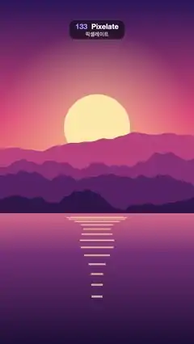

# 133 · Pixelate · 픽셀레이트



**EN** A sunset lake breaks into ever bigger square blocks, blends into a night city at the coarsest mosaic, sharpens, then goes back.  
**KO** 노을 호수가 점점 커지는 네모 블록으로 깨지고, 가장 거친 모자이크에서 밤 도시로 섞인 뒤 선명해진다. 그리고 거꾸로 돌아온다.

[Video (mp4)](https://sueun-dev.github.io/motion-effects/videos/133-pixelate.mp4) · [Code](../effects/133-pixelate.js) · Transitions · 트랜지션

## Prompt (English)

```text
Create a "Pixelate" (mosaic) scene transition: a sunset landscape breaks into ever bigger square blocks, crossfades into a night city while the blocks are biggest, then the blocks shrink back to a sharp picture; then the same again back to the sunset.

Look
Picture A, a sunset over mountains and a lake (flat illustration; this effect uses it as a still, drawn at t = 0):
- Sky over the top 62 % (y 0–1190): vertical gradient #2B1B5A (top) → #E8577A (55 %) → #FFB36B (horizon).
- Sun: flat disc #FFE6A8, radius 184 px, centre x 540, y 710. Behind it, over the sky, a glow: radial gradient rgba(255, 220, 150, 0.55) at 0.8 r fading to 0 at 3 r.
- Four mountain ridges, back to front #C2507E, #8E3B78, #5A2A68, #2E1A4A, each filled from the bottom up to a ridge line y = H·(base − amp·(0.5 + n(x))) with base 0.47 / 0.52 / 0.57 / 0.62, amp 0.10 / 0.12 / 0.11 / 0.08 and n a 4-octave smooth fractal noise (about ±0.4) at 2 / 3 / 4 / 5 cycles per frame width, sampled every 8 px.
- Lake below y 1190: vertical gradient #E0748A → #7A3B78 (30 %) → #1E1238 (bottom).
- Sun on the water: 14 horizontal bars rgba(255, 226, 160, 0.7) centred on x 540; bar i (0–13) at y = 1210 + 2.6·i², height 4 + 0.6·i px, half-width 184·(1 − i/16)·(0.8 + 0.2·sin(i)), so they narrow and spread apart going down.
Picture B, a night city by a river (static):
- Sky: vertical gradient #0B1030 (top) → #3A2A6E (y 783) → #E0607E at the waterline y 1306, staying #E0607E below it.
- 90 stars at fixed seeded positions in the top 45 %: white dots, 80 % opacity, radius 1–3 px.
- Moon: disc #FFF1D6, radius 72 px, centre (778, 384), with a 260 px glow rgba(255, 240, 210, 0.45) → 0.
- Skyline standing on y 1306, seeded random buildings 70–180 px wide with 6 px gaps: a back row of plain #2A2F5E blocks 260–620 px tall, and a front row of #141433 towers 160–820 px tall with 12 × 18 px windows on a 26 × 34 px grid (from 12 px inside the left wall and 24 px below the roof); 42 % of the windows are lit, 80 % of those warm yellow #FFD36E and 20 % ice blue #9BE7FF.
- River below y 1306: everything above the waterline mirrored, drawn in 6 px horizontal strips at 45 % opacity, each strip shifted sideways by 6·sin(0.05·y) px (ripples), then darkened by a vertical gradient rgba(20, 16, 50, 0.35) → rgba(8, 8, 26, 0.95).
The transition:
- Block sizes in px: 1, 6, 10, 15, 24, 40, 60, 120. Each divides both 1080 and 1920, so the blocks tile the frame exactly (no partial blocks at the edges), and the geometric growth reads as an ease-in.
- Blocks are hard-edged squares, each the average colour of its area.
- The crossfade happens inside the mosaic: the block colours blend from the old picture to the new one while the blocks are large, which hides the swap.

Motion (0–5 s)
- Work in frame numbers, f = round(t·30). A → B runs over frames 15–59 (0.5–2.0 s), B → A over frames 90–134 (3.0–4.5 s); sharp holds otherwise.
- Each transition is 15 steps of 3 frames. Step q = floor(frame within the transition / 3), 0–14 (15 = finished): block size = SIZES[7 − |q − 7|], i.e. 1, 6, 10, 15, 24, 40, 60, 120, 60, 40, 24, 15, 10, 6, 1; crossfade amount m = smoothstep(3, 11, q) (the incoming picture's share). The biggest 120 px blocks come at about 1.2 s and 3.7 s.
- Soft steps: on the third frame of each step, also draw the next step's mosaic on top at 50 % opacity, so each size change lands in two half-steps instead of one hard jump.

Technique
- Canvas 2D. Draw both pictures once into off-screen canvases (picture A as a still at t = 0).
- Mosaic of one step: on a small canvas of (1080/size) × (1920/size) px with high-quality smoothing, draw the outgoing picture, then the incoming one at alpha m (the downscale averages each block); then draw that small image back up to 1080 × 1920 with imageSmoothingEnabled = false so the blocks stay crisp.

Output and rules
- One self-contained HTML file with no external assets (three.js from a CDN is fine if you use it), drawing on a 1080 × 1920 canvas (9:16) scaled to fit the window.
- Write a function renderFrame(t) that draws the frame for time t in seconds, and preview it with requestAnimationFrame. Everything must be a pure function of t and fixed seeds: no Math.random(), Date or state carried between frames, so frame i = renderFrame(i / 30) can be exported to a 30 fps video.
- Loop seamlessly every 5 seconds: renderFrame(5) must look exactly like renderFrame(0).
- No flicker of any kind: no noise or grain that changes from frame to frame, no strobing or blinking, no z-fighting, no shimmering 1 px lines. Any grain or texture stays fixed to the screen or to the object.
- Keep the top 280 px free of important content (a title label goes there) and fill the whole frame with a designed background.
```

## 프롬프트 (한국어)

```text
"픽셀레이트"(모자이크) 장면 전환을 만들어 줘: 노을 풍경이 점점 커지는 네모 블록으로 깨지고, 블록이 가장 클 때 밤 도시로 섞인 뒤, 블록이 다시 작아져 선명한 그림이 된다. 그리고 같은 방식으로 노을로 돌아온다.

모양
그림 A, 산과 호수 위의 노을(플랫 일러스트. 이 효과에서는 t = 0에 그린 정지 화면으로 쓴다):
- 하늘(위쪽 62 %, y 0–1190): 세로 그라디언트 #2B1B5A(맨 위) → #E8577A(55 %) → #FFB36B(수평선).
- 해: 단색 원 #FFE6A8, 반지름 184 px, 중심 x 540, y 710. 뒤쪽 하늘에 빛무리: 0.8 r에서 rgba(255, 220, 150, 0.55)로 시작해 3 r에서 투명해지는 방사형 그라디언트.
- 산 능선 네 겹, 뒤에서 앞으로 #C2507E, #8E3B78, #5A2A68, #2E1A4A. 각 겹은 아래에서 능선 y = H·(base − amp·(0.5 + n(x)))까지 채운 실루엣이다. base 0.47 / 0.52 / 0.57 / 0.62, amp 0.10 / 0.12 / 0.11 / 0.08, n은 화면 너비당 2 / 3 / 4 / 5 주기의 4옥타브 부드러운 프랙털 노이즈(약 ±0.4), 8 px마다 샘플.
- 호수(y 1190 아래): 세로 그라디언트 #E0748A → #7A3B78(30 %) → #1E1238(맨 아래).
- 물에 비친 해: x 540에 가운데 맞춘 가로 막대 14개, rgba(255, 226, 160, 0.7). i번째 막대(0–13)는 y = 1210 + 2.6·i², 두께 4 + 0.6·i px, 반폭 184·(1 − i/16)·(0.8 + 0.2·sin(i)). 아래로 갈수록 좁아지고 간격이 벌어진다.
그림 B, 강가의 밤 도시(정지):
- 하늘: 세로 그라디언트 #0B1030(맨 위) → #3A2A6E(y 783) → 수면선 y 1306에서 #E0607E, 그 아래는 #E0607E 그대로.
- 별 90개: 위쪽 45 % 안의 시드로 고정한 위치에 흰 점, 불투명도 80 %, 반지름 1–3 px.
- 달: 원 #FFF1D6, 반지름 72 px, 중심 (778, 384), 반지름 260 px 빛무리 rgba(255, 240, 210, 0.45) → 투명.
- 스카이라인(y 1306 위에 선다): 시드 난수로 정한 폭 70–180 px, 사이 간격 6 px의 빌딩들. 뒷줄은 높이 260–620 px의 민무늬 #2A2F5E 덩어리, 앞줄은 높이 160–820 px의 #141433 빌딩이고 12 × 18 px 창문이 가로 26 px·세로 34 px 간격 격자로 있다(왼쪽 벽에서 12 px 안쪽, 지붕에서 24 px 아래부터). 창문의 42 %가 켜져 있고, 그중 80 %는 따뜻한 노랑 #FFD36E, 20 %는 얼음빛 하늘색 #9BE7FF.
- 강(y 1306 아래): 수면선 위의 모든 것을 위아래로 뒤집어 6 px 가로 띠로 나눠 불투명도 45 %로 그리고, 띠마다 6·sin(0.05·y) px씩 옆으로 밀어 물결을 만든 뒤, 세로 그라디언트 rgba(20, 16, 50, 0.35) → rgba(8, 8, 26, 0.95)로 어둡게 덮는다.
전환:
- 블록 크기(px): 1, 6, 10, 15, 24, 40, 60, 120. 모두 1080과 1920을 나누어떨어지게 하므로 블록이 화면을 정확히 채우고(가장자리에 잘린 블록 없음), 기하급수적으로 커져서 ease-in처럼 보인다.
- 블록은 가장자리가 딱 떨어지는 정사각형이고, 각 블록은 그 영역의 평균 색이다.
- 크로스페이드는 모자이크 안에서 일어난다: 블록이 클 때 블록 색이 옛 그림에서 새 그림으로 섞여 바뀌므로 교체가 숨겨진다.

움직임 (0–5초)
- 프레임 번호 f = round(t·30)로 계산한다. A → B는 15–59번 프레임(0.5–2.0초), B → A는 90–134번 프레임(3.0–4.5초), 나머지는 선명하게 유지.
- 전환마다 3프레임짜리 단계가 15개다. 단계 q = floor(전환 안에서의 프레임 / 3), 0–14(15 = 끝남): 블록 크기 = SIZES[7 − |q − 7|], 즉 1, 6, 10, 15, 24, 40, 60, 120, 60, 40, 24, 15, 10, 6, 1. 섞임 정도 m = smoothstep(3, 11, q)(들어오는 그림의 비율). 가장 큰 120 px 블록은 약 1.2초와 3.7초에 나온다.
- 부드러운 단계: 각 단계의 셋째 프레임에는 다음 단계의 모자이크를 50 % 불투명도로 위에 한 번 더 그린다. 그래서 크기 변화가 한 번에 툭 바뀌지 않고 반 단계씩 두 번에 걸쳐 내려앉는다.

기법
- Canvas 2D. 두 그림을 오프스크린 캔버스에 한 번만 그린다(그림 A는 t = 0의 정지 화면).
- 한 단계의 모자이크: (1080/size) × (1920/size) px 작은 캔버스에 고품질 스무딩으로 나가는 그림을 그리고, 들어오는 그림을 alpha m으로 그 위에 그린다(축소하면서 블록마다 평균이 난다). 그 작은 이미지를 imageSmoothingEnabled = false로 1080 × 1920까지 다시 키워 블록을 또렷하게 유지한다.

출력과 규칙
- 외부 파일 없는 HTML 파일 하나(three.js를 쓴다면 CDN은 괜찮다). 1080 × 1920(9:16) 캔버스에 그리고 창 크기에 맞춰 보이게 한다.
- 시간 t(초)의 프레임을 그리는 renderFrame(t) 함수를 만들고, 미리보기는 requestAnimationFrame으로 돌린다. 모든 것은 t와 고정 시드만으로 정해진다: Math.random(), Date, 프레임 사이에 쌓이는 상태 금지. 그래야 i번째 프레임 = renderFrame(i / 30)으로 30fps 영상을 뽑을 수 있다.
- 5초마다 끊김 없이 반복: renderFrame(5)는 renderFrame(0)과 똑같아 보여야 한다.
- 어떤 깜빡임도 금지: 프레임마다 바뀌는 노이즈·그레인, 번쩍임·깜빡임, z-fighting, 반짝이며 떨리는 1px 선 모두 금지. 그레인·질감은 화면이나 물체에 고정한다.
- 위쪽 280px에는 중요한 내용을 두지 않고(제목 라벨 자리), 화면 전체를 디자인된 배경으로 채운다.
```
