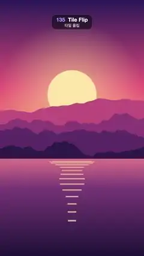

# 135 · Tile Flip · 타일 플립



**EN** A 6 × 10 grid of tiles flips in a slanted wave down the screen, lifting toward the camera, turning a sunset into a night city and back.  
**KO** 6 × 10 격자 타일이 비스듬한 물결을 따라 위에서 아래로 뒤집히며 카메라 쪽으로 들리고, 노을을 밤 도시로, 다시 노을로 바꾼다.

[Video (mp4)](https://sueun-dev.github.io/motion-effects/videos/135-tile-flip.mp4) · [Code](../effects/135-tile-flip.js) · Transitions · 트랜지션

## Prompt (English)

```text
Create a "Tile Flip" scene transition in three.js: the frame is a 6 × 10 grid of thin tiles; a slanted wave runs down the grid, flipping each tile 180° about its vertical axis while lifting it toward the camera, which turns a sunset landscape into a night city, and a second wave turns it back.

Look
Picture A, a sunset over mountains and a lake (flat illustration; this effect uses it as a still, drawn at t = 0):
- Sky over the top 62 % (y 0–1190): vertical gradient #2B1B5A (top) → #E8577A (55 %) → #FFB36B (horizon).
- Sun: flat disc #FFE6A8, radius 184 px, centre x 540, y 710. Behind it, over the sky, a glow: radial gradient rgba(255, 220, 150, 0.55) at 0.8 r fading to 0 at 3 r.
- Four mountain ridges, back to front #C2507E, #8E3B78, #5A2A68, #2E1A4A, each filled from the bottom up to a ridge line y = H·(base − amp·(0.5 + n(x))) with base 0.47 / 0.52 / 0.57 / 0.62, amp 0.10 / 0.12 / 0.11 / 0.08 and n a 4-octave smooth fractal noise (about ±0.4) at 2 / 3 / 4 / 5 cycles per frame width, sampled every 8 px.
- Lake below y 1190: vertical gradient #E0748A → #7A3B78 (30 %) → #1E1238 (bottom).
- Sun on the water: 14 horizontal bars rgba(255, 226, 160, 0.7) centred on x 540; bar i (0–13) at y = 1210 + 2.6·i², height 4 + 0.6·i px, half-width 184·(1 − i/16)·(0.8 + 0.2·sin(i)), so they narrow and spread apart going down.
Picture B, a night city by a river (static):
- Sky: vertical gradient #0B1030 (top) → #3A2A6E (y 783) → #E0607E at the waterline y 1306, staying #E0607E below it.
- 90 stars at fixed seeded positions in the top 45 %: white dots, 80 % opacity, radius 1–3 px.
- Moon: disc #FFF1D6, radius 72 px, centre (778, 384), with a 260 px glow rgba(255, 240, 210, 0.45) → 0.
- Skyline standing on y 1306, seeded random buildings 70–180 px wide with 6 px gaps: a back row of plain #2A2F5E blocks 260–620 px tall, and a front row of #141433 towers 160–820 px tall with 12 × 18 px windows on a 26 × 34 px grid (from 12 px inside the left wall and 24 px below the roof); 42 % of the windows are lit, 80 % of those warm yellow #FFD36E and 20 % ice blue #9BE7FF.
- River below y 1306: everything above the waterline mirrored, drawn in 6 px horizontal strips at 45 % opacity, each strip shifted sideways by 6·sin(0.05·y) px (ripples), then darkened by a vertical gradient rgba(20, 16, 50, 0.35) → rgba(8, 8, 26, 0.95).
The transition:
- 60 thin boxes, each 180 × 192 × 16 px (6 columns × 10 rows), filling the frame edge to edge.
- The front face (+z) shows the tile's own piece of picture A and the back face (−z) its piece of picture B: remap those two faces' UVs to ((c + u)/6, 1 − (r + 1 − v)/10) for column c and row r (r = 0 at the top). The four side faces are flat #4A3D6E.
- Unlit materials (MeshBasicMaterial) with sRGB canvas textures; both faces are tinted by brightness 0.4 + 0.6·cos²a, so a tile darkens as it turns edge-on.
- Background #151026, visible in the gaps while tiles turn.
- Camera: perspective, fov 25°, looking straight at the grid from D = 960 / tan(12.5°) ≈ 4330 px in front of the front faces (camera z = D + 8), so at rest the front faces fill the 1080 × 1920 frame exactly and it looks like a flat picture.

Motion (0–5 s)
- Tile angle a = π·turn, turn = S(span(t, 0.4, 2.1)) + S(span(t, 2.9, 4.6)), S(p) = smoothstep(d, d + 0.4, p), span(t, a, b) = clamp((t − a)/(b − a)).
- Delay d = 0.6·(r + 0.4·c) / (9 + 0.4·5): a slanted wave from the top-left tile (d = 0) to the bottom-right one (d = 0.6). Each tile flips in about 0.68 s; the wave spans about 1 s.
- A → B: 0 → 180° in 0.4–2.1 s; B → A: on to 360° in the same direction in 2.9–4.6 s; t = 5 matches t = 0.
- While turning, a tile lifts toward the camera: z = 140·sin²a px.

Technique
- three.js with a WebGL renderer at 1080 × 1920. Draw both pictures once into canvases (picture A as a still at t = 0) and use them as CanvasTextures. Each tile gets its own BoxGeometry with UVs cut for its cell and a material array [side, side, side, side, front A, back B].

Output and rules
- One self-contained HTML file with no external assets (three.js from a CDN is fine if you use it), drawing on a 1080 × 1920 canvas (9:16) scaled to fit the window.
- Write a function renderFrame(t) that draws the frame for time t in seconds, and preview it with requestAnimationFrame. Everything must be a pure function of t and fixed seeds: no Math.random(), Date or state carried between frames, so frame i = renderFrame(i / 30) can be exported to a 30 fps video.
- Loop seamlessly every 5 seconds: renderFrame(5) must look exactly like renderFrame(0).
- No flicker of any kind: no noise or grain that changes from frame to frame, no strobing or blinking, no z-fighting, no shimmering 1 px lines. Any grain or texture stays fixed to the screen or to the object.
- Keep the top 280 px free of important content (a title label goes there) and fill the whole frame with a designed background.
```

## 프롬프트 (한국어)

```text
three.js로 "타일 플립" 장면 전환을 만들어 줘: 화면은 6 × 10 격자의 얇은 타일이다. 비스듬한 물결이 격자를 위에서 아래로 훑으며 타일마다 세로축을 중심으로 180° 뒤집고 카메라 쪽으로 들어 올려 노을 풍경을 밤 도시로 바꾸고, 두 번째 물결이 다시 되돌린다.

모양
그림 A, 산과 호수 위의 노을(플랫 일러스트. 이 효과에서는 t = 0에 그린 정지 화면으로 쓴다):
- 하늘(위쪽 62 %, y 0–1190): 세로 그라디언트 #2B1B5A(맨 위) → #E8577A(55 %) → #FFB36B(수평선).
- 해: 단색 원 #FFE6A8, 반지름 184 px, 중심 x 540, y 710. 뒤쪽 하늘에 빛무리: 0.8 r에서 rgba(255, 220, 150, 0.55)로 시작해 3 r에서 투명해지는 방사형 그라디언트.
- 산 능선 네 겹, 뒤에서 앞으로 #C2507E, #8E3B78, #5A2A68, #2E1A4A. 각 겹은 아래에서 능선 y = H·(base − amp·(0.5 + n(x)))까지 채운 실루엣이다. base 0.47 / 0.52 / 0.57 / 0.62, amp 0.10 / 0.12 / 0.11 / 0.08, n은 화면 너비당 2 / 3 / 4 / 5 주기의 4옥타브 부드러운 프랙털 노이즈(약 ±0.4), 8 px마다 샘플.
- 호수(y 1190 아래): 세로 그라디언트 #E0748A → #7A3B78(30 %) → #1E1238(맨 아래).
- 물에 비친 해: x 540에 가운데 맞춘 가로 막대 14개, rgba(255, 226, 160, 0.7). i번째 막대(0–13)는 y = 1210 + 2.6·i², 두께 4 + 0.6·i px, 반폭 184·(1 − i/16)·(0.8 + 0.2·sin(i)). 아래로 갈수록 좁아지고 간격이 벌어진다.
그림 B, 강가의 밤 도시(정지):
- 하늘: 세로 그라디언트 #0B1030(맨 위) → #3A2A6E(y 783) → 수면선 y 1306에서 #E0607E, 그 아래는 #E0607E 그대로.
- 별 90개: 위쪽 45 % 안의 시드로 고정한 위치에 흰 점, 불투명도 80 %, 반지름 1–3 px.
- 달: 원 #FFF1D6, 반지름 72 px, 중심 (778, 384), 반지름 260 px 빛무리 rgba(255, 240, 210, 0.45) → 투명.
- 스카이라인(y 1306 위에 선다): 시드 난수로 정한 폭 70–180 px, 사이 간격 6 px의 빌딩들. 뒷줄은 높이 260–620 px의 민무늬 #2A2F5E 덩어리, 앞줄은 높이 160–820 px의 #141433 빌딩이고 12 × 18 px 창문이 가로 26 px·세로 34 px 간격 격자로 있다(왼쪽 벽에서 12 px 안쪽, 지붕에서 24 px 아래부터). 창문의 42 %가 켜져 있고, 그중 80 %는 따뜻한 노랑 #FFD36E, 20 %는 얼음빛 하늘색 #9BE7FF.
- 강(y 1306 아래): 수면선 위의 모든 것을 위아래로 뒤집어 6 px 가로 띠로 나눠 불투명도 45 %로 그리고, 띠마다 6·sin(0.05·y) px씩 옆으로 밀어 물결을 만든 뒤, 세로 그라디언트 rgba(20, 16, 50, 0.35) → rgba(8, 8, 26, 0.95)로 어둡게 덮는다.
전환:
- 얇은 상자 60개, 각각 180 × 192 × 16 px(6열 × 10행), 화면을 빈틈없이 채운다.
- 앞면(+z)은 그 타일 자리의 그림 A 조각, 뒷면(−z)은 그림 B 조각을 보여 준다: 두 면의 UV를 열 c, 행 r(맨 위가 r = 0)에 대해 ((c + u)/6, 1 − (r + 1 − v)/10)로 바꾼다. 옆면 넷은 단색 #4A3D6E.
- 조명 없는 재질(MeshBasicMaterial)에 sRGB 캔버스 텍스처. 양면 모두 밝기 0.4 + 0.6·cos²a를 곱해, 타일이 옆으로 설수록 어두워진다.
- 배경 #151026, 타일이 도는 동안 틈으로 보인다.
- 카메라: 원근, fov 25°, 앞면에서 D = 960 / tan(12.5°) ≈ 4330 px 떨어진 정면에서 본다(카메라 z = D + 8). 그래서 멈춰 있을 때 앞면이 1080 × 1920 화면을 정확히 채워 평면 그림처럼 보인다.

움직임 (0–5초)
- 타일 각도 a = π·turn, turn = S(span(t, 0.4, 2.1)) + S(span(t, 2.9, 4.6)), S(p) = smoothstep(d, d + 0.4, p), span(t, a, b) = clamp((t − a)/(b − a)).
- 지연 d = 0.6·(r + 0.4·c) / (9 + 0.4·5): 왼쪽 위 타일(d = 0)에서 오른쪽 아래 타일(d = 0.6)로 가는 비스듬한 물결. 타일 하나는 약 0.68초에 뒤집히고, 물결 전체는 약 1초에 걸친다.
- A → B: 0.4–2.1초에 0 → 180°, B → A: 2.9–4.6초에 같은 방향으로 360°까지. t = 5는 t = 0과 같다.
- 도는 동안 타일이 카메라 쪽으로 들린다: z = 140·sin²a px.

기법
- three.js, 1080 × 1920 WebGL 렌더러. 두 그림을 캔버스에 한 번만 그려(그림 A는 t = 0의 정지 화면) CanvasTexture로 쓴다. 타일마다 자기 칸에 맞게 UV를 자른 BoxGeometry와 재질 배열 [옆, 옆, 옆, 옆, 앞 A, 뒤 B]를 준다.

출력과 규칙
- 외부 파일 없는 HTML 파일 하나(three.js를 쓴다면 CDN은 괜찮다). 1080 × 1920(9:16) 캔버스에 그리고 창 크기에 맞춰 보이게 한다.
- 시간 t(초)의 프레임을 그리는 renderFrame(t) 함수를 만들고, 미리보기는 requestAnimationFrame으로 돌린다. 모든 것은 t와 고정 시드만으로 정해진다: Math.random(), Date, 프레임 사이에 쌓이는 상태 금지. 그래야 i번째 프레임 = renderFrame(i / 30)으로 30fps 영상을 뽑을 수 있다.
- 5초마다 끊김 없이 반복: renderFrame(5)는 renderFrame(0)과 똑같아 보여야 한다.
- 어떤 깜빡임도 금지: 프레임마다 바뀌는 노이즈·그레인, 번쩍임·깜빡임, z-fighting, 반짝이며 떨리는 1px 선 모두 금지. 그레인·질감은 화면이나 물체에 고정한다.
- 위쪽 280px에는 중요한 내용을 두지 않고(제목 라벨 자리), 화면 전체를 디자인된 배경으로 채운다.
```
