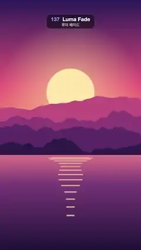

# 137 · Luma Fade · 루마 페이드



**EN** A sunset lake melts into a night city brightest parts first, along a warm glowing edge; then the city melts back the same way.  
**KO** 노을 호수가 가장 밝은 곳부터 따뜻하게 빛나는 경계를 따라 밤 도시로 녹아들고, 도시도 같은 방식으로 다시 노을로 녹아든다.

[Video (mp4)](https://sueun-dev.github.io/motion-effects/videos/137-luma-fade.mp4) · [Code](../effects/137-luma-fade.js) · Transitions · 트랜지션

## Prompt (English)

```text
Create a "Luma Fade" (luma matte, gradient wipe) scene transition: the outgoing picture dissolves into the next one in the order of its own brightness, brightest parts first, along a soft, warm glowing edge; then the same way back.

Look
Picture A, a sunset over mountains and a lake (flat illustration; this effect uses it as a still, drawn at t = 0):
- Sky over the top 62 % (y 0–1190): vertical gradient #2B1B5A (top) → #E8577A (55 %) → #FFB36B (horizon).
- Sun: flat disc #FFE6A8, radius 184 px, centre x 540, y 710. Behind it, over the sky, a glow: radial gradient rgba(255, 220, 150, 0.55) at 0.8 r fading to 0 at 3 r.
- Four mountain ridges, back to front #C2507E, #8E3B78, #5A2A68, #2E1A4A, each filled from the bottom up to a ridge line y = H·(base − amp·(0.5 + n(x))) with base 0.47 / 0.52 / 0.57 / 0.62, amp 0.10 / 0.12 / 0.11 / 0.08 and n a 4-octave smooth fractal noise (about ±0.4) at 2 / 3 / 4 / 5 cycles per frame width, sampled every 8 px.
- Lake below y 1190: vertical gradient #E0748A → #7A3B78 (30 %) → #1E1238 (bottom).
- Sun on the water: 14 horizontal bars rgba(255, 226, 160, 0.7) centred on x 540; bar i (0–13) at y = 1210 + 2.6·i², height 4 + 0.6·i px, half-width 184·(1 − i/16)·(0.8 + 0.2·sin(i)), so they narrow and spread apart going down.
Picture B, a night city by a river (static):
- Sky: vertical gradient #0B1030 (top) → #3A2A6E (y 783) → #E0607E at the waterline y 1306, staying #E0607E below it.
- 90 stars at fixed seeded positions in the top 45 %: white dots, 80 % opacity, radius 1–3 px.
- Moon: disc #FFF1D6, radius 72 px, centre (778, 384), with a 260 px glow rgba(255, 240, 210, 0.45) → 0.
- Skyline standing on y 1306, seeded random buildings 70–180 px wide with 6 px gaps: a back row of plain #2A2F5E blocks 260–620 px tall, and a front row of #141433 towers 160–820 px tall with 12 × 18 px windows on a 26 × 34 px grid (from 12 px inside the left wall and 24 px below the roof); 42 % of the windows are lit, 80 % of those warm yellow #FFD36E and 20 % ice blue #9BE7FF.
- River below y 1306: everything above the waterline mirrored, drawn in 6 px horizontal strips at 45 % opacity, each strip shifted sideways by 6·sin(0.05·y) px (ripples), then darkened by a vertical gradient rgba(20, 16, 50, 0.35) → rgba(8, 8, 26, 0.95).
The transition:
- The matte comes from the outgoing picture: at half resolution (540 × 960), blur it 2 px, take luminance L = 0.2126·R + 0.7152·G + 0.0722·B (0–1) and add 0.06·noise(x/70, y/70) (a fixed smooth noise field, x and y in half-res pixels), so flat areas break up into organic melting shapes instead of vanishing all at once.
- Rank-equalise it: sort all pixels by that value and replace each one by its rank / (n − 1), 0 = darkest, 1 = brightest. A threshold moving at a steady rate then eats an even amount of area per frame, whatever the picture.
- Sunset → city: the sun and its glowing sky go first, then the pink lake and the far ridges, and the darkest parts (top of the sky, front hills, bottom of the lake) last. City → sunset: the moon, the lit windows and the pink horizon go first, the dark towers last.
- At each half-res pixel, v = smoothstep(th − 0.07, th + 0.07, rank) (0 = old, 1 = new). The new picture shows through v, and a glow of colour rgb(255, 196, 130) with alpha 3·v·(1 − v) (up to 0.75, only along the melting edge) is added on top with 'screen' blending.

Motion (0–5 s)
- Schedule: A holds 0–0.5 s, A → B 0.5–2.0 s (A's ranks), B holds 2.0–3.0 s, B → A 3.0–4.5 s (B's ranks), A holds 4.5–5 s.
- Threshold th = lerp(1.07, −0.07, k), k = smoothstep(start, end, t): the range overshoots by the softness on both sides, so the dissolve starts and ends with no pixel half-melted (no pop).

Technique
- Canvas 2D with ImageData. Draw both pictures once (picture A as a still at t = 0) and precompute both rank maps once.
- Per frame: write the matte (alpha = 255·v) and the glow into two 540 × 960 ImageData canvases; mask a copy of the incoming picture with the matte scaled up to full size with smoothing ('destination-in'), draw it over the outgoing picture, then draw the glow scaled up with 'screen'.

Output and rules
- One self-contained HTML file with no external assets (three.js from a CDN is fine if you use it), drawing on a 1080 × 1920 canvas (9:16) scaled to fit the window.
- Write a function renderFrame(t) that draws the frame for time t in seconds, and preview it with requestAnimationFrame. Everything must be a pure function of t and fixed seeds: no Math.random(), Date or state carried between frames, so frame i = renderFrame(i / 30) can be exported to a 30 fps video.
- Loop seamlessly every 5 seconds: renderFrame(5) must look exactly like renderFrame(0).
- No flicker of any kind: no noise or grain that changes from frame to frame, no strobing or blinking, no z-fighting, no shimmering 1 px lines. Any grain or texture stays fixed to the screen or to the object.
- Keep the top 280 px free of important content (a title label goes there) and fill the whole frame with a designed background.
```

## 프롬프트 (한국어)

```text
"루마 페이드"(루마 매트, 그라디언트 와이프) 장면 전환을 만들어 줘: 나가는 그림이 자기 밝기 순서대로, 가장 밝은 곳부터 부드럽고 따뜻하게 빛나는 경계를 따라 다음 그림으로 녹아들고, 같은 방식으로 돌아온다.

모양
그림 A, 산과 호수 위의 노을(플랫 일러스트. 이 효과에서는 t = 0에 그린 정지 화면으로 쓴다):
- 하늘(위쪽 62 %, y 0–1190): 세로 그라디언트 #2B1B5A(맨 위) → #E8577A(55 %) → #FFB36B(수평선).
- 해: 단색 원 #FFE6A8, 반지름 184 px, 중심 x 540, y 710. 뒤쪽 하늘에 빛무리: 0.8 r에서 rgba(255, 220, 150, 0.55)로 시작해 3 r에서 투명해지는 방사형 그라디언트.
- 산 능선 네 겹, 뒤에서 앞으로 #C2507E, #8E3B78, #5A2A68, #2E1A4A. 각 겹은 아래에서 능선 y = H·(base − amp·(0.5 + n(x)))까지 채운 실루엣이다. base 0.47 / 0.52 / 0.57 / 0.62, amp 0.10 / 0.12 / 0.11 / 0.08, n은 화면 너비당 2 / 3 / 4 / 5 주기의 4옥타브 부드러운 프랙털 노이즈(약 ±0.4), 8 px마다 샘플.
- 호수(y 1190 아래): 세로 그라디언트 #E0748A → #7A3B78(30 %) → #1E1238(맨 아래).
- 물에 비친 해: x 540에 가운데 맞춘 가로 막대 14개, rgba(255, 226, 160, 0.7). i번째 막대(0–13)는 y = 1210 + 2.6·i², 두께 4 + 0.6·i px, 반폭 184·(1 − i/16)·(0.8 + 0.2·sin(i)). 아래로 갈수록 좁아지고 간격이 벌어진다.
그림 B, 강가의 밤 도시(정지):
- 하늘: 세로 그라디언트 #0B1030(맨 위) → #3A2A6E(y 783) → 수면선 y 1306에서 #E0607E, 그 아래는 #E0607E 그대로.
- 별 90개: 위쪽 45 % 안의 시드로 고정한 위치에 흰 점, 불투명도 80 %, 반지름 1–3 px.
- 달: 원 #FFF1D6, 반지름 72 px, 중심 (778, 384), 반지름 260 px 빛무리 rgba(255, 240, 210, 0.45) → 투명.
- 스카이라인(y 1306 위에 선다): 시드 난수로 정한 폭 70–180 px, 사이 간격 6 px의 빌딩들. 뒷줄은 높이 260–620 px의 민무늬 #2A2F5E 덩어리, 앞줄은 높이 160–820 px의 #141433 빌딩이고 12 × 18 px 창문이 가로 26 px·세로 34 px 간격 격자로 있다(왼쪽 벽에서 12 px 안쪽, 지붕에서 24 px 아래부터). 창문의 42 %가 켜져 있고, 그중 80 %는 따뜻한 노랑 #FFD36E, 20 %는 얼음빛 하늘색 #9BE7FF.
- 강(y 1306 아래): 수면선 위의 모든 것을 위아래로 뒤집어 6 px 가로 띠로 나눠 불투명도 45 %로 그리고, 띠마다 6·sin(0.05·y) px씩 옆으로 밀어 물결을 만든 뒤, 세로 그라디언트 rgba(20, 16, 50, 0.35) → rgba(8, 8, 26, 0.95)로 어둡게 덮는다.
전환:
- 매트는 나가는 그림에서 만든다: 절반 해상도(540 × 960)로 줄여 2 px 블러를 주고, 밝기 L = 0.2126·R + 0.7152·G + 0.0722·B(0–1)에 0.06·noise(x/70, y/70)(고정된 부드러운 노이즈, x·y는 절반 해상도 픽셀)를 더한다. 그래서 평평한 영역도 한꺼번에 사라지지 않고 유기적으로 녹아드는 모양으로 쪼개진다.
- 순위로 평탄화: 모든 픽셀을 그 값으로 정렬하고 각 픽셀을 순위 / (n − 1)로 바꾼다(0 = 가장 어두움, 1 = 가장 밝음). 그러면 일정한 속도로 움직이는 문턱값이 그림이 어떻든 프레임마다 고른 넓이를 먹어 들어간다.
- 노을 → 도시: 해와 빛나는 하늘이 먼저, 이어서 분홍 호수와 먼 능선, 가장 어두운 부분(하늘 맨 위, 앞산, 호수 아래쪽)이 마지막. 도시 → 노을: 달, 켜진 창문, 분홍 지평선이 먼저, 어두운 빌딩이 마지막.
- 절반 해상도 픽셀마다 v = smoothstep(th − 0.07, th + 0.07, rank)(0 = 옛 그림, 1 = 새 그림). 새 그림을 v만큼 보여 주고, 그 위에 색 rgb(255, 196, 130), alpha 3·v·(1 − v)(최대 0.75, 녹는 경계에서만)인 빛을 'screen' 블렌딩으로 더한다.

움직임 (0–5초)
- 일정: 0–0.5초 A 유지, 0.5–2.0초 A → B(A의 순위), 2.0–3.0초 B 유지, 3.0–4.5초 B → A(B의 순위), 4.5–5초 A 유지.
- 문턱값 th = lerp(1.07, −0.07, k), k = smoothstep(start, end, t): 범위를 양쪽으로 부드러운 폭만큼 넘치게 잡아, 반쯤 녹은 픽셀 없이 시작하고 끝난다(툭 튀지 않음).

기법
- Canvas 2D와 ImageData. 두 그림을 한 번만 그리고(그림 A는 t = 0의 정지 화면) 두 순위 지도도 한 번만 미리 계산한다.
- 프레임마다: 매트(alpha = 255·v)와 빛을 540 × 960 ImageData 캔버스 두 장에 쓰고, 들어오는 그림의 사본을 전체 크기로 부드럽게 키운 매트로 마스킹('destination-in')해 나가는 그림 위에 그린 뒤, 빛을 키워 'screen'으로 그린다.

출력과 규칙
- 외부 파일 없는 HTML 파일 하나(three.js를 쓴다면 CDN은 괜찮다). 1080 × 1920(9:16) 캔버스에 그리고 창 크기에 맞춰 보이게 한다.
- 시간 t(초)의 프레임을 그리는 renderFrame(t) 함수를 만들고, 미리보기는 requestAnimationFrame으로 돌린다. 모든 것은 t와 고정 시드만으로 정해진다: Math.random(), Date, 프레임 사이에 쌓이는 상태 금지. 그래야 i번째 프레임 = renderFrame(i / 30)으로 30fps 영상을 뽑을 수 있다.
- 5초마다 끊김 없이 반복: renderFrame(5)는 renderFrame(0)과 똑같아 보여야 한다.
- 어떤 깜빡임도 금지: 프레임마다 바뀌는 노이즈·그레인, 번쩍임·깜빡임, z-fighting, 반짝이며 떨리는 1px 선 모두 금지. 그레인·질감은 화면이나 물체에 고정한다.
- 위쪽 280px에는 중요한 내용을 두지 않고(제목 라벨 자리), 화면 전체를 디자인된 배경으로 채운다.
```
