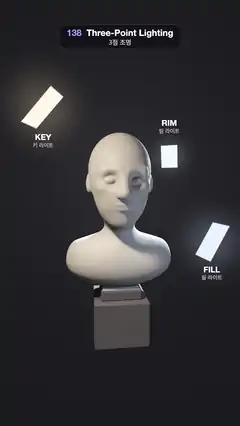

# 138 · Three-Point Lighting · 3점 조명



**EN** A plaster head on a dark plinth goes dark, then a warm key, a cool fill and a back rim light, each a glowing card, switch on one by one.  
**KO** 어두운 받침 위 석고 두상이 꺼졌다가, 빛나는 카드로 보이는 따뜻한 키·차가운 필·뒤쪽 림 조명이 하나씩 켜지며 형태를 빚는다.

[Video (mp4)](https://sueun-dev.github.io/motion-effects/videos/138-three-point-lighting.mp4) · [Code](../effects/138-three-point-lighting.js) · Lighting & shadows · 조명·그림자

## Prompt (English)

```text
Create a "Three-Point Lighting" motion effect: a plaster head on a plinth, lit by the classic studio set-up of key, fill and rim light, with each lamp shown as a small glowing card that switches on in turn.

Look
- A raymarched (signed distance field) plaster bust: an ellipsoid skull and face, chin, cheekbones, brow, eye sockets with closed eyelids, nose with nostril wings, lips, ears, neck, collarbones and a chest cut flat underneath, all joined with smooth minimum (k 0.02–0.14). The head is about 0.6 units wide, centred at (0, 1.55, 0); the shoulders are about 1.2 units wide.
- Plaster colour (0.86, 0.83, 0.79) in linear light; a dark plinth (0.13, 0.125, 0.14) below: a thin cap and a 0.54 × 0.46 × 0.54 block, top of the block at y ≈ 0.43.
- Backdrop: almost black charcoal, from (0.006, 0.006, 0.009) at the edges to (0.03, 0.028, 0.034) in a soft glow behind the head.
- Three lamps, each a point light with its own soft shadow, and each drawn as a 0.22 × 0.30 card that glows in its colour (brightness 0.12 when off, 2.5 when on) with a faint halo:
  - KEY: warm (1.0, 0.82, 0.62), strength 1.5, at (−0.62, 2.08, 0.72): high on the left, in front;
  - FILL: cool (0.62, 0.74, 1.0), strength 0.3, at (0.64, 1.12, 0.70): low on the right, much weaker;
  - RIM: cool white (0.72, 0.86, 1.0), strength 4.0, at (0.80, 1.95, −1.0): behind the head on the right.
- The cards turn halfway between facing the head and facing the camera, so you can see them.
- Shading per lamp: wrapped diffuse (n·l + 0.15) / 1.15, a soft highlight pow(n·h, 24) × 0.25, and for the rim lamp only a grazing sheen (1 − n·v)^2.5 × n·l × 3 that makes the outline glow. A tiny room light 0.025. Tone curve c / (1 + 0.6c), then gamma 2.2.
- Labels under the key and fill cards and above the rim card: "KEY / 키 라이트", "FILL / 필 라이트", "RIM / 림 라이트" (white, 800 weight 36 px; Korean 25 px at 70 % white), at 30 % opacity while their lamp is off.
- Camera: on a circle of radius 2.75 round the head at height 1.55, looking at (0, 1.28, 0), focal length 2.3 (a fairly long lens). The bust fills the middle of the frame (about y 600–1580 px), the cards sit round it.

Motion (0–5 s), a = 2π · t / 5
- 0–0.45 s: all three lamps on. 0.45–0.95 s: all fade out (smoothstep) to a dark silhouette.
- Then they come back one at a time, each over 0.6 s: key at 1.3 s, fill at 2.2 s, rim at 3.1 s. 3.7–5 s: all three on, matching the start.
- The camera drifts round the head: angle −0.12 + 0.08 · sin(a) rad.

Technique
- One full-screen fragment shader: sphere tracing (160 steps) with a bounding sphere for speed; normals from central differences.
- Soft shadows marched towards each lamp with the improved penumbra estimate (y = h² / 2h_prev, d = √(h² − y²), res = min(res, k·d / (t − y)), steps 0.005–0.045), k = 10 / 6 / 12 for key / fill / rim. The shadow march uses the real distance field, not the bounding sphere (otherwise the bound casts banded shadows).
- 2 × 2 supersampling and a fixed per-pixel dither of ±0.5 / 255, so the dark gradients never band.
- The labels are drawn on a 2D canvas on top, at the cards' positions projected with the same camera.

Output and rules
- One self-contained HTML file with no external assets (three.js from a CDN is fine if you use it), drawing on a 1080 × 1920 canvas (9:16) scaled to fit the window.
- Write a function renderFrame(t) that draws the frame for time t in seconds, and preview it with requestAnimationFrame. Everything must be a pure function of t and fixed seeds: no Math.random(), Date or state carried between frames, so frame i = renderFrame(i / 30) can be exported to a 30 fps video.
- Loop seamlessly every 5 seconds: renderFrame(5) must look exactly like renderFrame(0).
- No flicker of any kind: no noise or grain that changes from frame to frame, no strobing or blinking, no z-fighting, no shimmering 1 px lines. Any grain or texture stays fixed to the screen or to the object.
- Keep the top 280 px free of important content (a title label goes there) and fill the whole frame with a designed background.
```

## 프롬프트 (한국어)

```text
"3점 조명" 모션 효과를 만들어 줘: 받침 위의 석고 두상을 키·필·림 세 조명의 고전적인 스튜디오 배치로 비추고, 조명마다 작게 빛나는 카드로 보여 주며 하나씩 켜지는 효과.

모양
- 레이마칭(부호 거리장)으로 만든 석고 흉상: 타원체 두개골과 얼굴, 턱, 광대, 눈썹뼈, 감은 눈꺼풀이 있는 눈구멍, 콧방울이 있는 코, 입술, 귀, 목, 쇄골, 아래가 평평하게 잘린 가슴을 스무스 최소값(k 0.02–0.14)으로 이어 붙인다. 머리는 폭 약 0.6, 중심 (0, 1.55, 0), 어깨 폭 약 1.2.
- 석고 색 (0.86, 0.83, 0.79)(선형); 아래에 어두운 받침 (0.13, 0.125, 0.14): 얇은 캡과 0.54 × 0.46 × 0.54 블록, 블록 윗면 y ≈ 0.43.
- 배경: 거의 검은 숯색, 가장자리 (0.006, 0.006, 0.009)에서 머리 뒤의 부드러운 빛 (0.03, 0.028, 0.034)까지.
- 조명 셋, 각각 자기 소프트 섀도를 가진 점광원이며 0.22 × 0.30 카드로 그려져 제 색으로 빛난다(꺼지면 밝기 0.12, 켜지면 2.5, 옅은 후광):
  - 키(KEY): 따뜻한 (1.0, 0.82, 0.62), 세기 1.5, 위치 (−0.62, 2.08, 0.72): 왼쪽 앞 높은 곳;
  - 필(FILL): 차가운 (0.62, 0.74, 1.0), 세기 0.3, 위치 (0.64, 1.12, 0.70): 오른쪽 아래, 훨씬 약하게;
  - 림(RIM): 차가운 흰색 (0.72, 0.86, 1.0), 세기 4.0, 위치 (0.80, 1.95, −1.0): 머리 뒤 오른쪽.
- 카드는 머리를 향한 방향과 카메라를 향한 방향의 중간으로 돌려서 잘 보이게 한다.
- 조명별 셰이딩: 감싼 확산광 (n·l + 0.15) / 1.15, 부드러운 하이라이트 pow(n·h, 24) × 0.25, 림 조명에만 스치는 광택 (1 − n·v)^2.5 × n·l × 3을 더해 외곽선이 빛나게 한다. 아주 약한 실내광 0.025. 톤 곡선 c / (1 + 0.6c) 뒤 감마 2.2.
- 키·필 카드 아래, 림 카드 위에 라벨: "KEY / 키 라이트", "FILL / 필 라이트", "RIM / 림 라이트"(흰색 800 굵기 36px, 한글 25px 70 % 흰색). 조명이 꺼져 있을 때는 불투명도 30 %.
- 카메라: 머리를 중심으로 반지름 2.75, 높이 1.55의 원 위에서 (0, 1.28, 0)을 보고, 초점 거리 2.3(꽤 긴 렌즈). 흉상은 화면 가운데(대략 y 600–1580 px)를 채우고 카드가 그 둘레에 놓인다.

움직임 (0–5초), a = 2π · t / 5
- 0–0.45초: 세 조명 모두 켜짐. 0.45–0.95초: 모두 꺼지며(smoothstep) 어두운 실루엣이 된다.
- 그 뒤 하나씩 0.6초에 걸쳐 다시 켜진다: 키 1.3초, 필 2.2초, 림 3.1초. 3.7–5초: 셋 다 켜진 채로, 처음과 같다.
- 카메라가 머리 둘레를 살짝 떠돈다: 각도 −0.12 + 0.08 · sin(a) rad.

기법
- 전체 화면 프래그먼트 셰이더 하나: 스피어 트레이싱(160단계), 속도를 위한 경계 구, 중앙 차분 법선.
- 조명마다 개선된 반그림자 추정으로 소프트 섀도를 행진한다(y = h² / 2h_prev, d = √(h² − y²), res = min(res, k·d / (t − y)), 걸음 0.005–0.045). k는 키 / 필 / 림 = 10 / 6 / 12. 그림자 행진에는 경계 구가 아니라 실제 거리장을 쓴다(아니면 경계 구가 줄무늬 그림자를 만든다).
- 2 × 2 슈퍼샘플링과 픽셀마다 고정된 ±0.5 / 255 디더로 어두운 그라디언트에 띠가 생기지 않게 한다.
- 라벨은 같은 카메라로 투영한 카드 위치에 맞춰 위에 2D 캔버스로 그린다.

출력과 규칙
- 외부 파일 없는 HTML 파일 하나(three.js를 쓴다면 CDN은 괜찮다). 1080 × 1920(9:16) 캔버스에 그리고 창 크기에 맞춰 보이게 한다.
- 시간 t(초)의 프레임을 그리는 renderFrame(t) 함수를 만들고, 미리보기는 requestAnimationFrame으로 돌린다. 모든 것은 t와 고정 시드만으로 정해진다: Math.random(), Date, 프레임 사이에 쌓이는 상태 금지. 그래야 i번째 프레임 = renderFrame(i / 30)으로 30fps 영상을 뽑을 수 있다.
- 5초마다 끊김 없이 반복: renderFrame(5)는 renderFrame(0)과 똑같아 보여야 한다.
- 어떤 깜빡임도 금지: 프레임마다 바뀌는 노이즈·그레인, 번쩍임·깜빡임, z-fighting, 반짝이며 떨리는 1px 선 모두 금지. 그레인·질감은 화면이나 물체에 고정한다.
- 위쪽 280px에는 중요한 내용을 두지 않고(제목 라벨 자리), 화면 전체를 디자인된 배경으로 채운다.
```
