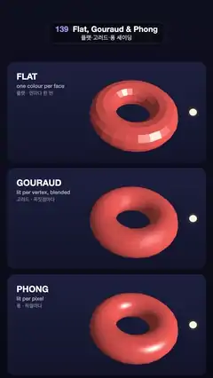

# 139 · Flat, Gouraud & Phong · 플랫·고러드·퐁 셰이딩



**EN** One low-poly coral torus is shaded three ways, per face, per vertex and per pixel, as a light circles it: faceted, blotchy, then smooth highlights.  
**KO** 같은 저폴리 산호색 토러스를 면마다·꼭짓점마다·픽셀마다 세 방식으로 칠하고, 빛이 그 둘레를 돌면 각진·얼룩진·매끈한 하이라이트가 비교된다.

[Video (mp4)](https://sueun-dev.github.io/motion-effects/videos/139-shading-models.mp4) · [Code](../effects/139-shading-models.js) · Lighting & shadows · 조명·그림자

## Prompt (English)

```text
Create a "Flat, Gouraud & Phong" motion effect: the same low-poly torus drawn three times, stacked, with the same lighting evaluated once per face, once per vertex, or once per pixel, while one light circles in front of it.

Look
- Background: a deep navy vertical gradient #0E1020 → #090A14, with three rounded cards (x 36–1044, corner radius 36), one per row, each a gradient #1C2140 → #12152B.
- Three rows of 1080 × 540 px starting at y = 300 (300–840, 840–1380, 1380–1920), each its own viewport with the same camera: perspective, 30° vertical field of view, aspect 2:1, at (0, 0, 8.2) looking down −z.
- In every row: a torus, radius 1.25, tube 0.55, with only 12 × 24 segments so the facets show, coral #FF6A55, centred at x = 1.1 (right of centre, leaving room for the labels).
- Lighting (the same formula in all three): a directional light from the torus centre towards the bulb; colour = base × (0.16 + 0.9 · max(n·l, 0)) + warm white (1.0, 0.97, 0.9) × 0.95 · pow(max(n·h, 0), 70), with h the half vector to the viewer; gamma 1/2.2 at the end.
  - FLAT: the normal is the face normal, from the screen-space derivatives of the view position (cross(dFdx(p), dFdy(p))): one colour per triangle.
  - GOURAUD: the colour is computed at each vertex and blended across the triangle: the highlight is smeared and jumps from vertex to vertex.
  - PHONG: the normal is blended across the triangle and the colour computed per pixel: a crisp, gliding highlight.
- The light is drawn as a small warm-white bulb (radius 0.11) with a soft additive halo (radius 0.3).
- Labels top left of each card (x 84): "FLAT" / "GOURAUD" / "PHONG" in white 800 weight 44 px, then "one colour per face" / "lit per vertex, blended" / "lit per pixel" at 27 px, 62 % white, then the Korean "플랫 · 면마다 한 번" / "고러드 · 꼭짓점마다" / "퐁 · 픽셀마다" at 25 px, 45 % white.

Motion (0–5 s), a = 2π · t / 5
- The torus spins once about its own axis (rotation about its local z: a) inside a tilted group: tilt (−0.75 + 0.12 · sin a, 0.3 · sin a, 0.25) rad.
- The bulb circles in front of it, the other way round: (1.1 + 1.6 · cos(−a), 1.1 · sin(−a), 2.0).
- Both are whole turns, so the loop is seamless.

Technique
- three.js with three ShaderMaterials that share the lighting function and differ only in where they evaluate it (vertex shader for Gouraud; fragment shader with derivative normals for flat; fragment shader with the interpolated normal for Phong).
- Draw it yourself: clear, draw the backdrop (a full-screen quad with the canvas texture), then for each row set the viewport and scissor, swap the torus material and render the scene again, clearing depth in between.
- The labels are 2D text on top.

Output and rules
- One self-contained HTML file with no external assets (three.js from a CDN is fine if you use it), drawing on a 1080 × 1920 canvas (9:16) scaled to fit the window.
- Write a function renderFrame(t) that draws the frame for time t in seconds, and preview it with requestAnimationFrame. Everything must be a pure function of t and fixed seeds: no Math.random(), Date or state carried between frames, so frame i = renderFrame(i / 30) can be exported to a 30 fps video.
- Loop seamlessly every 5 seconds: renderFrame(5) must look exactly like renderFrame(0).
- No flicker of any kind: no noise or grain that changes from frame to frame, no strobing or blinking, no z-fighting, no shimmering 1 px lines. Any grain or texture stays fixed to the screen or to the object.
- Keep the top 280 px free of important content (a title label goes there) and fill the whole frame with a designed background.
```

## 프롬프트 (한국어)

```text
"플랫·고러드·퐁 셰이딩" 모션 효과를 만들어 줘: 같은 저폴리 토러스를 세 번 위아래로 그리고, 같은 조명 공식을 면마다 한 번, 꼭짓점마다 한 번, 픽셀마다 한 번 계산하며, 빛 하나가 그 앞을 도는 효과.

모양
- 배경: 짙은 남색 세로 그라디언트 #0E1020 → #090A14. 줄마다 둥근 카드 하나씩 세 장(x 36–1044, 모서리 반지름 36), 각각 #1C2140 → #12152B 그라디언트.
- y = 300부터 1080 × 540 px 줄 셋(300–840, 840–1380, 1380–1920), 줄마다 뷰포트를 따로 쓰고 카메라는 같다: 원근, 세로 시야각 30°, 화면비 2:1, (0, 0, 8.2)에서 −z 방향을 본다.
- 줄마다 토러스 하나: 반지름 1.25, 튜브 0.55, 분할은 12 × 24뿐이라 면이 보인다. 산호색 #FF6A55, 중심 x = 1.1(라벨 자리를 남기려고 가운데보다 오른쪽).
- 조명(세 줄 모두 같은 공식): 토러스 중심에서 전구 쪽을 향한 방향광. 색 = 기본색 × (0.16 + 0.9 · max(n·l, 0)) + 따뜻한 흰색 (1.0, 0.97, 0.9) × 0.95 · pow(max(n·h, 0), 70), h는 보는 방향과의 하프 벡터. 마지막에 감마 1/2.2.
  - 플랫(FLAT): 법선은 면 법선, 뷰 위치의 화면 공간 미분으로 구한다(cross(dFdx(p), dFdy(p))). 삼각형마다 한 색.
  - 고러드(GOURAUD): 꼭짓점에서 색을 계산해 삼각형 안에서 섞는다. 하이라이트가 번지고 꼭짓점에서 꼭짓점으로 튄다.
  - 퐁(PHONG): 법선을 삼각형 안에서 섞고 색은 픽셀마다 계산한다. 또렷하게 미끄러지는 하이라이트.
- 빛은 작은 따뜻한 흰색 전구(반지름 0.11)와 부드러운 가산 후광(반지름 0.3)으로 그린다.
- 카드 왼쪽 위(x 84) 라벨: "FLAT" / "GOURAUD" / "PHONG" 흰색 800 굵기 44px, 그 아래 "one colour per face" / "lit per vertex, blended" / "lit per pixel" 27px 62 % 흰색, 그 아래 한글 "플랫 · 면마다 한 번" / "고러드 · 꼭짓점마다" / "퐁 · 픽셀마다" 25px 45 % 흰색.

움직임 (0–5초), a = 2π · t / 5
- 토러스는 기울인 그룹 안에서 자기 축으로 한 바퀴 돈다(로컬 z축 회전: a). 기울기 (−0.75 + 0.12 · sin a, 0.3 · sin a, 0.25) rad.
- 전구는 그 앞을 반대 방향으로 돈다: (1.1 + 1.6 · cos(−a), 1.1 · sin(−a), 2.0).
- 둘 다 정확히 한 바퀴라 끊김 없이 반복된다.

기법
- three.js의 ShaderMaterial 셋. 조명 함수는 같고 계산하는 자리만 다르다(고러드는 버텍스 셰이더, 플랫은 미분 법선을 쓰는 프래그먼트 셰이더, 퐁은 보간 법선을 쓰는 프래그먼트 셰이더).
- 직접 그린다: 지우고, 배경(캔버스 텍스처를 입힌 전체 화면 사각형)을 그린 뒤, 줄마다 뷰포트와 시저를 정하고 토러스 재질을 바꿔 장면을 다시 그린다. 사이사이 깊이 버퍼를 지운다.
- 라벨은 위에 2D 텍스트로 그린다.

출력과 규칙
- 외부 파일 없는 HTML 파일 하나(three.js를 쓴다면 CDN은 괜찮다). 1080 × 1920(9:16) 캔버스에 그리고 창 크기에 맞춰 보이게 한다.
- 시간 t(초)의 프레임을 그리는 renderFrame(t) 함수를 만들고, 미리보기는 requestAnimationFrame으로 돌린다. 모든 것은 t와 고정 시드만으로 정해진다: Math.random(), Date, 프레임 사이에 쌓이는 상태 금지. 그래야 i번째 프레임 = renderFrame(i / 30)으로 30fps 영상을 뽑을 수 있다.
- 5초마다 끊김 없이 반복: renderFrame(5)는 renderFrame(0)과 똑같아 보여야 한다.
- 어떤 깜빡임도 금지: 프레임마다 바뀌는 노이즈·그레인, 번쩍임·깜빡임, z-fighting, 반짝이며 떨리는 1px 선 모두 금지. 그레인·질감은 화면이나 물체에 고정한다.
- 위쪽 280px에는 중요한 내용을 두지 않고(제목 라벨 자리), 화면 전체를 디자인된 배경으로 채운다.
```
