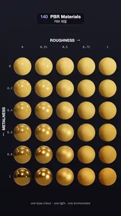

# 140 · PBR Materials · PBR 재질



**EN** A 5 × 6 chart of gold spheres, rougher to the right and more metallic downwards, catches one orbiting light and a turning studio environment.  
**KO** 오른쪽으로 갈수록 거칠고 아래로 갈수록 금속성이 커지는 5 × 6 금색 구슬 표가, 도는 조명 하나와 회전하는 스튜디오 환경을 받아 반짝인다.

[Video (mp4)](https://sueun-dev.github.io/motion-effects/videos/140-pbr-materials.mp4) · [Code](../effects/140-pbr-materials.js) · Lighting & shadows · 조명·그림자

## Prompt (English)

```text
Create a "PBR Materials" motion effect: a chart of physically based spheres that share one base colour, with roughness rising to the right and metalness rising downwards, under one orbiting light and a turning environment.

Look
- Background: a vertical gradient #1B1C26 (top) → #0C0C12 (bottom).
- 30 spheres in 5 columns × 6 rows, radius 80 px (0.8 units), 96 × 64 segments, all MeshStandardMaterial with base colour #E0A23A:
  - columns: roughness 0, 0.25, 0.5, 0.75, 1, centres at x = 200, 390, 580, 770, 960 px;
  - rows: metalness 0, 0.2, 0.4, 0.6, 0.8, 1, centres at y = 590, 786, 982, 1178, 1374, 1570 px.
- Smooth dielectric spheres show a small white highlight over yellow plastic; smooth metal ones turn into mirrored gold that reflects the room; rough ones go soft and matte.
- Lighting: a neutral room environment map (prefiltered, intensity 0.42) plus one directional light #FFF4E6, intensity 3.6. ACES Filmic tone mapping.
- Labels (2D, on top): "ROUGHNESS  →" centred above the chart at y 360 (white, 700 weight 34 px) with the values 0 / 0.25 / 0.5 / 0.75 / 1 under it at y 420 (monospace 26 px, 60 % white); the row values 0 … 1 at x 88; "←  METALNESS" rotated −90° at x 34 so the arrow points down; a caption "one base colour · one light · one environment" at y 1810 (28 px, 55 % white).
- Camera: orthographic, 1 unit = 100 px, looking straight at the chart, so every sphere is the same size and lines up with the labels.

Motion (0–5 s), a = 2π · t / 5
- The light circles the view axis once: position (6 cos a, 6 sin a, 4.5), so the lit side and the highlight sweep round every sphere.
- The environment turns once about the vertical axis (environment rotation y = a), so reflections slide across the smooth metal spheres.
- Nothing else moves; both motions are whole turns, so the loop is seamless.

Technique
- three.js MeshStandardMaterial (metal/rough PBR: GGX specular, Smith shadowing, Schlick Fresnel), one material per sphere.
- Environment from the RoomEnvironment scene through a PMREM generator, so rough spheres sample blurrier reflections; scene.environmentRotation turns it.
- Antialiasing on; the chart is static apart from the light and the environment, so nothing shimmers.

Output and rules
- One self-contained HTML file with no external assets (three.js from a CDN is fine if you use it), drawing on a 1080 × 1920 canvas (9:16) scaled to fit the window.
- Write a function renderFrame(t) that draws the frame for time t in seconds, and preview it with requestAnimationFrame. Everything must be a pure function of t and fixed seeds: no Math.random(), Date or state carried between frames, so frame i = renderFrame(i / 30) can be exported to a 30 fps video.
- Loop seamlessly every 5 seconds: renderFrame(5) must look exactly like renderFrame(0).
- No flicker of any kind: no noise or grain that changes from frame to frame, no strobing or blinking, no z-fighting, no shimmering 1 px lines. Any grain or texture stays fixed to the screen or to the object.
- Keep the top 280 px free of important content (a title label goes there) and fill the whole frame with a designed background.
```

## 프롬프트 (한국어)

```text
"PBR 재질" 모션 효과를 만들어 줘: 기본색이 같은 물리 기반 구슬을 표로 늘어놓고, 오른쪽으로 갈수록 거칠기가, 아래로 갈수록 금속성이 커지게 하며, 도는 조명 하나와 회전하는 환경 아래 두는 효과.

모양
- 배경: 세로 그라디언트 #1B1C26(위) → #0C0C12(아래).
- 구슬 30개, 5열 × 6행, 반지름 80px(0.8), 분할 96 × 64, 모두 MeshStandardMaterial, 기본색 #E0A23A:
  - 열: 거칠기 0, 0.25, 0.5, 0.75, 1, 중심 x = 200, 390, 580, 770, 960 px;
  - 행: 금속성 0, 0.2, 0.4, 0.6, 0.8, 1, 중심 y = 590, 786, 982, 1178, 1374, 1570 px.
- 매끈한 비금속 구슬은 노란 플라스틱 위에 작은 흰 하이라이트, 매끈한 금속 구슬은 방을 비추는 거울 같은 금, 거친 구슬은 부드럽고 무광이 된다.
- 조명: 중성 룸 환경맵(프리필터, 세기 0.42)과 방향광 하나 #FFF4E6, 세기 3.6. ACES Filmic 톤 매핑.
- 라벨(위에 2D): 표 위 y 360에 "ROUGHNESS  →"(흰색 700 굵기 34px), 그 아래 y 420에 값 0 / 0.25 / 0.5 / 0.75 / 1(고정폭 26px, 60 % 흰색); x 88에 행 값 0 … 1; x 34에 −90° 돌린 "←  METALNESS"(화살표가 아래를 향함); y 1810에 설명 "one base colour · one light · one environment"(28px, 55 % 흰색).
- 카메라: 직교, 1 단위 = 100px, 표를 정면으로 봐서 구슬 크기가 모두 같고 라벨과 줄이 맞는다.

움직임 (0–5초), a = 2π · t / 5
- 조명이 시선 축을 한 바퀴 돈다: 위치 (6 cos a, 6 sin a, 4.5). 밝은 쪽과 하이라이트가 구슬마다 빙 돈다.
- 환경맵이 세로축으로 한 바퀴 돈다(환경 회전 y = a). 매끈한 금속 구슬 위로 반사가 미끄러진다.
- 그 밖에는 움직이지 않는다. 두 움직임 모두 정확히 한 바퀴라 끊김 없이 반복된다.

기법
- three.js MeshStandardMaterial(메탈/러프 PBR: GGX 스페큘러, Smith 차폐, Schlick 프레넬), 구슬마다 재질 하나.
- 환경맵은 RoomEnvironment 장면을 PMREM 생성기로 거쳐 만든다. 그래서 거친 구슬일수록 흐린 반사를 읽는다. scene.environmentRotation으로 돌린다.
- 안티에일리어싱 켬. 조명과 환경 말고는 표가 멈춰 있어 반짝이며 떨리는 곳이 없다.

출력과 규칙
- 외부 파일 없는 HTML 파일 하나(three.js를 쓴다면 CDN은 괜찮다). 1080 × 1920(9:16) 캔버스에 그리고 창 크기에 맞춰 보이게 한다.
- 시간 t(초)의 프레임을 그리는 renderFrame(t) 함수를 만들고, 미리보기는 requestAnimationFrame으로 돌린다. 모든 것은 t와 고정 시드만으로 정해진다: Math.random(), Date, 프레임 사이에 쌓이는 상태 금지. 그래야 i번째 프레임 = renderFrame(i / 30)으로 30fps 영상을 뽑을 수 있다.
- 5초마다 끊김 없이 반복: renderFrame(5)는 renderFrame(0)과 똑같아 보여야 한다.
- 어떤 깜빡임도 금지: 프레임마다 바뀌는 노이즈·그레인, 번쩍임·깜빡임, z-fighting, 반짝이며 떨리는 1px 선 모두 금지. 그레인·질감은 화면이나 물체에 고정한다.
- 위쪽 280px에는 중요한 내용을 두지 않고(제목 라벨 자리), 화면 전체를 디자인된 배경으로 채운다.
```
