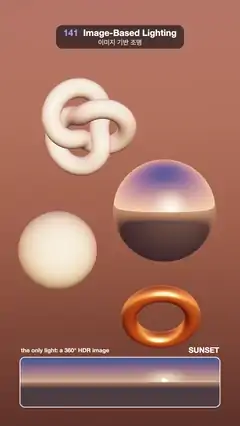

# 141 · Image-Based Lighting · 이미지 기반 조명



**EN** A chrome ball, a pearl knot, a gold ring and a clay ball are lit only by a turning 360° HDR picture that changes from sunset to studio to night city.  
**KO** 크롬 공, 진주빛 매듭, 금반지, 점토 공이 오직 도는 360° HDR 사진 한 장으로만 빛나고, 그 사진이 노을에서 스튜디오, 밤 도시로 바뀐다.

[Video (mp4)](https://sueun-dev.github.io/motion-effects/videos/141-image-based-lighting.mp4) · [Code](../effects/141-image-based-lighting.js) · Lighting & shadows · 조명·그림자

## Prompt (English)

```text
Create an "Image-Based Lighting" motion effect: four objects with no lamps at all, lit only by a 360° HDR picture that turns and changes from sunset to studio to night city, with the picture itself shown as a strip at the bottom.

Look
- Three procedural HDR panoramas, 512 × 256 floating-point pixels (equirectangular, linear light), made once:
  - SUNSET: sky from a glowing horizon (2.2, 0.75, 0.26) to a deep blue zenith (0.05, 0.08, 0.26) (mix by y^0.4); a sun 0.12 rad above the horizon at azimuth 1.4 rad: 600 · e^(900(cos θ − 1)) for the disc plus 2.2 · e^(14(cos θ − 1)) for the glow, tinted (1, 0.62, 0.3); ground from (0.5, 0.22, 0.12) near the horizon to (0.06, 0.035, 0.04).
  - STUDIO: dark grey 0.035 (+0.03 towards the top); a big warm softbox (value 7, longitude −0.55…0.35, latitude 0.1…0.8, soft 0.03 edges); a tall cool strip light opposite (value 5, longitude 2.35…2.55, latitude −0.15…0.85); an overhead dome 2.2 · e^(18(y − 1)).
  - NIGHT CITY: sky (0.06, 0.05, 0.12) at the horizon to (0.004, 0.008, 0.03) above; a moon (30 · e^(2500(cos θ − 1))) at 0.55 rad up, azimuth 2.1; 140 seeded city lights along the horizon (70 % warm (5, 2.6, 0.9), 30 % cool (0.8, 3, 5)); a magenta and a cyan neon sign.
- Objects, floating, no lamps:
  - a chrome sphere, radius 1.1, at (0.95, 0.15, 0): metalness 1, roughness 0.03;
  - a matte clay sphere, radius 0.82, at (−1.3, −0.65, 0.5): #E8E2D8, roughness 0.95;
  - a pearl torus knot (0.6, 0.21, 300 × 48) at (−0.75, 1.95, −0.3): #F4EEF7, roughness 0.25, clearcoat 1 (roughness 0.04);
  - a brushed gold ring (torus 0.66, 0.17) at (0.85, −2.05, 0.6): #FFC46B, metalness 1, roughness 0.32.
- The backdrop is the same picture, blurred (blurriness 0.45) and dimmed (intensity 0.5), so it reads as light rather than scenery.
- Camera: perspective, 34°, at (0, 1, 15) looking at (0, 0.1, 0). ACES Filmic tone mapping.
- Bottom strip: the current panorama, tone mapped (v / (1 + v), gamma 2.2), drawn at (90, 1610), 900 × 225 px, rounded corners 22, white 4 px border; above it "the only light: a 360° HDR image" (left, 26 px) and the picture's name SUNSET / STUDIO / NIGHT CITY (right, 800 weight 34 px).

Motion (0–5 s), a = 2π · t / 5
- The loop is three equal slots of 5/3 s: sunset, studio, night city. Each picture holds, then cross-fades into the next over the last 39 % of its slot (smoothstep, about 0.65 s); night city fades back into sunset at the end.
- The whole picture turns once per loop (environment and backdrop rotation y = a); the strip scrolls one width per loop with it.
- The knot turns once (rotation (0.4, a, 0.2 · sin a)); the ring rocks (0.55 + 0.2 · sin a, 0.5 · sin a, 0).
- The names swap through nothing (each fades in only above weight 0.5), never drawn over each other.

Technique
- Every frame: blend the three float panoramas with the current weights into one DataTexture, then prefilter it with a PMREM generator (reusing the same render target), and use it as scene.environment and scene.background. Rough surfaces read the blurred mip levels, so the clay ball shows only the overall colour of the light and the chrome ball the sharp picture.
- three.js MeshStandardMaterial / MeshPhysicalMaterial; no light objects in the scene.
- Keep the backdrop blurred: a sharp, fast-panning bright background would strobe.

Output and rules
- One self-contained HTML file with no external assets (three.js from a CDN is fine if you use it), drawing on a 1080 × 1920 canvas (9:16) scaled to fit the window.
- Write a function renderFrame(t) that draws the frame for time t in seconds, and preview it with requestAnimationFrame. Everything must be a pure function of t and fixed seeds: no Math.random(), Date or state carried between frames, so frame i = renderFrame(i / 30) can be exported to a 30 fps video.
- Loop seamlessly every 5 seconds: renderFrame(5) must look exactly like renderFrame(0).
- No flicker of any kind: no noise or grain that changes from frame to frame, no strobing or blinking, no z-fighting, no shimmering 1 px lines. Any grain or texture stays fixed to the screen or to the object.
- Keep the top 280 px free of important content (a title label goes there) and fill the whole frame with a designed background.
```

## 프롬프트 (한국어)

```text
"이미지 기반 조명" 모션 효과를 만들어 줘: 조명 장치 없이 오직 360° HDR 사진 한 장으로만 빛나는 물체 넷. 그 사진이 돌며 노을에서 스튜디오, 밤 도시로 바뀌고, 사진 자체는 아래 띠로 보여 준다.

모양
- 절차적으로 만든 HDR 파노라마 셋, 512 × 256 부동소수점 픽셀(등장방형, 선형 광), 처음에 한 번 만든다:
  - 노을(SUNSET): 빛나는 지평선 (2.2, 0.75, 0.26)에서 짙은 파란 천정 (0.05, 0.08, 0.26)까지(y^0.4로 섞음); 지평선 위 0.12 rad, 방위각 1.4 rad의 해: 원반 600 · e^(900(cos θ − 1)) + 빛무리 2.2 · e^(14(cos θ − 1)), 색 (1, 0.62, 0.3); 땅은 지평선 쪽 (0.5, 0.22, 0.12)에서 (0.06, 0.035, 0.04)로.
  - 스튜디오(STUDIO): 어두운 회색 0.035(위로 갈수록 +0.03); 큰 따뜻한 소프트박스(값 7, 경도 −0.55…0.35, 위도 0.1…0.8, 가장자리 0.03 부드럽게); 반대편의 길쭉한 차가운 스트립 조명(값 5, 경도 2.35…2.55, 위도 −0.15…0.85); 머리 위 돔 2.2 · e^(18(y − 1)).
  - 밤 도시(NIGHT CITY): 하늘 지평선 (0.06, 0.05, 0.12)에서 위로 (0.004, 0.008, 0.03); 달(30 · e^(2500(cos θ − 1))) 0.55 rad 높이, 방위각 2.1; 지평선을 따라 시드로 정한 도시 불빛 140개(70 % 따뜻한 (5, 2.6, 0.9), 30 % 차가운 (0.8, 3, 5)); 자홍색과 청록색 네온 간판 하나씩.
- 물체(떠 있음, 조명 없음):
  - 크롬 구, 반지름 1.1, (0.95, 0.15, 0): 금속성 1, 거칠기 0.03;
  - 무광 점토 구, 반지름 0.82, (−1.3, −0.65, 0.5): #E8E2D8, 거칠기 0.95;
  - 진주빛 토러스 매듭(0.6, 0.21, 300 × 48), (−0.75, 1.95, −0.3): #F4EEF7, 거칠기 0.25, 클리어코트 1(거칠기 0.04);
  - 헤어라인 금반지(토러스 0.66, 0.17), (0.85, −2.05, 0.6): #FFC46B, 금속성 1, 거칠기 0.32.
- 배경도 같은 사진을 흐리게(블러 0.45) 어둡게(세기 0.5) 써서, 풍경이 아니라 빛으로 읽히게 한다.
- 카메라: 원근 34°, (0, 1, 15)에서 (0, 0.1, 0)을 본다. ACES Filmic 톤 매핑.
- 아래 띠: 지금의 파노라마를 톤 매핑(v / (1 + v), 감마 2.2)해 (90, 1610)에 900 × 225 px, 모서리 22, 흰 테두리 4px로 그린다. 그 위에 "the only light: a 360° HDR image"(왼쪽, 26px)와 사진 이름 SUNSET / STUDIO / NIGHT CITY(오른쪽, 800 굵기 34px).

움직임 (0–5초), a = 2π · t / 5
- 루프는 5/3초씩 세 칸: 노을, 스튜디오, 밤 도시. 각 사진이 머물다가 칸의 마지막 39 % 동안(smoothstep, 약 0.65초) 다음 사진으로 교차 전환하고, 끝에서 밤 도시가 다시 노을로 넘어간다.
- 사진 전체가 루프마다 한 바퀴 돈다(환경·배경 회전 y = a). 아래 띠도 루프마다 한 폭씩 함께 흐른다.
- 매듭은 한 바퀴 돌고(회전 (0.4, a, 0.2 · sin a)), 반지는 흔들린다((0.55 + 0.2 · sin a, 0.5 · sin a, 0)).
- 이름은 겹치지 않고 비었다가 바뀐다(가중치 0.5를 넘을 때만 나타남).

기법
- 매 프레임: 세 부동소수점 파노라마를 지금의 가중치로 섞어 DataTexture 하나에 넣고, PMREM 생성기로 프리필터해(같은 렌더 타깃 재사용) scene.environment와 scene.background로 쓴다. 거친 표면은 흐린 밉 단계를 읽으므로 점토 공은 빛의 전체 색만, 크롬 공은 또렷한 사진을 보여 준다.
- three.js MeshStandardMaterial / MeshPhysicalMaterial, 장면에 조명 객체는 없다.
- 배경은 흐리게 둔다: 또렷하고 빠르게 흐르는 밝은 배경은 번쩍임처럼 보인다.

출력과 규칙
- 외부 파일 없는 HTML 파일 하나(three.js를 쓴다면 CDN은 괜찮다). 1080 × 1920(9:16) 캔버스에 그리고 창 크기에 맞춰 보이게 한다.
- 시간 t(초)의 프레임을 그리는 renderFrame(t) 함수를 만들고, 미리보기는 requestAnimationFrame으로 돌린다. 모든 것은 t와 고정 시드만으로 정해진다: Math.random(), Date, 프레임 사이에 쌓이는 상태 금지. 그래야 i번째 프레임 = renderFrame(i / 30)으로 30fps 영상을 뽑을 수 있다.
- 5초마다 끊김 없이 반복: renderFrame(5)는 renderFrame(0)과 똑같아 보여야 한다.
- 어떤 깜빡임도 금지: 프레임마다 바뀌는 노이즈·그레인, 번쩍임·깜빡임, z-fighting, 반짝이며 떨리는 1px 선 모두 금지. 그레인·질감은 화면이나 물체에 고정한다.
- 위쪽 280px에는 중요한 내용을 두지 않고(제목 라벨 자리), 화면 전체를 디자인된 배경으로 채운다.
```
