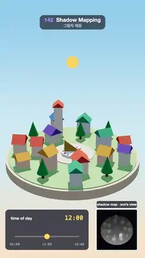

# 142 · Shadow Mapping · 그림자 매핑



**EN** A toy sun swings over a round toy town from noon to sunset and sunrise; crisp shadows sweep round a sundial while an inset shows the sun's depth map.  
**KO** 장난감 해가 둥근 장난감 마을 위를 정오에서 해 질 녘, 해 뜰 녘으로 오가고, 해시계를 도는 선명한 그림자 옆에 해가 본 깊이 맵이 보인다.

[Video (mp4)](https://sueun-dev.github.io/motion-effects/videos/142-shadow-mapping.mp4) · [Code](../effects/142-shadow-mapping.js) · Lighting & shadows · 조명·그림자

## Prompt (English)

```text
Create a "Shadow Mapping" motion effect: a little round toy town under a toy sun that a time-of-day slider sweeps from noon to sunset and back to sunrise, with crisp shadows and an inset showing the shadow map (the depth seen from the sun).

Look
- The town on a round base: a cream cylinder (radius 3.7, 0.5 thick, #E9DCC5), a grass disc #97CC8A (radius 3.55), a pale square #F4EBDD (radius 1.2) in the middle with a sundial: a white dial (radius 0.62), 12 dark hour marks and a gold triangular gnomon #C9A24A (0.87 long, 0.7 tall).
- Around the square (seed 42): an inner ring of 7 lots (radius 1.95) and an outer ring of 11 (radius 2.95), each a small house facing the square (box 0.55–0.8 wide, 0.5–0.7 deep, 0.45–1.05 tall, pastel walls #FFF6EA / #FFE3D3 / #E3F1FF / #FFF0C9 / #E6F6E9, a gable roof extruded from a triangle in #E8644F / #3F7FD9 / #F2A93B / #6D5BD0 / #2FA58A) or a cone tree (#3E9A5B on a brown trunk); plus a white clock tower 1.9 tall with a red roof at the back.
- Sky backdrop: a vertical gradient, warm cream at the bottom through pale blue to (0.56, 0.79, 0.93) at the top; it warms to peach and dusky blue when the sun is low.
- Lights: a hemisphere light (#DCEBFF / #9A8A70, 1.1) and the sun, a directional light (3.2) that turns from #FFF1D6 to orange #FF9F62 as it gets low. The sun is also drawn as a yellow ball (radius 0.34, #FFD25A) 5.2 units out along its direction.
- Camera: perspective, 36°, at (0, 10.5, 19.5) looking at (0, 1.55, 0). ACES Filmic tone mapping, exposure 1.2.
- Inset, bottom right (x 720, y 1560, 300 × 300 px, white 6 px border, a dark title pill "shadow map · sun’s view" above it): the scene seen from the sun's shadow camera, grey = depth (near white, far dark).
- Slider panel, bottom left (x 40–660, y 1560–1860, dark translucent): "time of day", the time as HH:MM in yellow monospace 46 px, a track from 06:00 to 18:00 with a yellow knob.

Motion (0–5 s), a = 2π · t / 5
- Time of day h = 12 + 6 · sin(a): 12:00 → 18:00 (1.25 s) → 12:00 (2.5 s) → 06:00 (3.75 s) → 12:00.
- The sun rides a tilted daily circle: q = (h − 12) / 6 · 1.62, direction = normalize(sin q, 0.82 · cos q + 0.22, −0.57 · cos q). At noon it is high behind the town (shadows short, pointing at the camera); at 06:00 and 18:00 it is low at the sides and the shadows stretch right across the town.
- The sky and sun colour warm with lowness = 1 − smoothstep(0.2, 0.75, sun height).

Technique
- three.js shadow mapping: the sun casts shadows into a 4096 × 4096 PCF shadow map, orthographic shadow camera ±4.6, near 2, far 24, bias −0.0004, normal bias 0.02 (no acne); every mesh casts and receives.
- The shadow map is first rendered from the sun each frame; every pixel the camera sees is then compared with that depth to decide light or shadow.
- The inset re-renders the scene from sun.shadow.camera into a scissored 300 × 300 viewport with an override material that writes linear depth (grey = 1 − (z − 8) / 7.5, squared).
- The sky is a full-screen quad shader drawn first; the slider and labels are 2D on top.

Output and rules
- One self-contained HTML file with no external assets (three.js from a CDN is fine if you use it), drawing on a 1080 × 1920 canvas (9:16) scaled to fit the window.
- Write a function renderFrame(t) that draws the frame for time t in seconds, and preview it with requestAnimationFrame. Everything must be a pure function of t and fixed seeds: no Math.random(), Date or state carried between frames, so frame i = renderFrame(i / 30) can be exported to a 30 fps video.
- Loop seamlessly every 5 seconds: renderFrame(5) must look exactly like renderFrame(0).
- No flicker of any kind: no noise or grain that changes from frame to frame, no strobing or blinking, no z-fighting, no shimmering 1 px lines. Any grain or texture stays fixed to the screen or to the object.
- Keep the top 280 px free of important content (a title label goes there) and fill the whole frame with a designed background.
```

## 프롬프트 (한국어)

```text
"그림자 매핑" 모션 효과를 만들어 줘: 작고 둥근 장난감 마을 위를 시간 슬라이더가 장난감 해를 정오에서 해 질 녘, 다시 해 뜰 녘으로 옮기고, 선명한 그림자와 함께 그림자 맵(해에서 본 깊이)을 작은 창으로 보여 주는 효과.

모양
- 둥근 받침 위의 마을: 크림색 원기둥(반지름 3.7, 두께 0.5, #E9DCC5), 잔디 원판 #97CC8A(반지름 3.55), 가운데 연한 광장 #F4EBDD(반지름 1.2)과 해시계: 흰 시계판(반지름 0.62), 어두운 시간 눈금 12개, 금색 삼각형 바늘(그노몬) #C9A24A(길이 0.87, 높이 0.7).
- 광장 둘레(시드 42): 안쪽 고리 7자리(반지름 1.95)와 바깥 고리 11자리(반지름 2.95). 자리마다 광장을 향한 작은 집(상자 폭 0.55–0.8, 깊이 0.5–0.7, 높이 0.45–1.05, 파스텔 벽 #FFF6EA / #FFE3D3 / #E3F1FF / #FFF0C9 / #E6F6E9, 삼각형을 돌출한 박공지붕 #E8644F / #3F7FD9 / #F2A93B / #6D5BD0 / #2FA58A) 또는 원뿔 나무(#3E9A5B, 갈색 줄기). 뒤쪽에 높이 1.9의 흰 시계탑과 빨간 지붕.
- 하늘 배경: 세로 그라디언트, 아래 따뜻한 크림색에서 연한 파랑을 지나 위 (0.56, 0.79, 0.93). 해가 낮으면 복숭앗빛과 어스름한 파랑으로 따뜻해진다.
- 조명: 반구광(#DCEBFF / #9A8A70, 1.1)과 해: 방향광(3.2), 낮아질수록 #FFF1D6에서 주황 #FF9F62로. 해는 그 방향으로 5.2 떨어진 노란 공(반지름 0.34, #FFD25A)으로도 그린다.
- 카메라: 원근 36°, (0, 10.5, 19.5)에서 (0, 1.55, 0)을 본다. ACES Filmic 톤 매핑, 노출 1.2.
- 오른쪽 아래 작은 창(x 720, y 1560, 300 × 300 px, 흰 테두리 6px, 위에 어두운 제목 알약 "shadow map · sun’s view"): 해의 그림자 카메라에서 본 장면, 회색 = 깊이(가까우면 흰색, 멀면 어둡게).
- 왼쪽 아래 슬라이더 패널(x 40–660, y 1560–1860, 어두운 반투명): "time of day", 노란 고정폭 46px의 시각 HH:MM, 06:00–18:00 트랙과 노란 손잡이.

움직임 (0–5초), a = 2π · t / 5
- 시각 h = 12 + 6 · sin(a): 12:00 → 18:00(1.25초) → 12:00(2.5초) → 06:00(3.75초) → 12:00.
- 해는 기울어진 하루 궤도를 탄다: q = (h − 12) / 6 · 1.62, 방향 = normalize(sin q, 0.82 · cos q + 0.22, −0.57 · cos q). 정오에는 마을 뒤 높이 떠서 그림자가 짧고 카메라 쪽을 향하며, 06:00과 18:00에는 옆으로 낮게 떠서 그림자가 마을을 가로질러 길게 늘어난다.
- 하늘과 햇빛 색은 낮음 = 1 − smoothstep(0.2, 0.75, 해 높이)에 따라 따뜻해진다.

기법
- three.js 그림자 매핑: 해가 4096 × 4096 PCF 그림자 맵에 그림자를 드리운다. 직교 그림자 카메라 ±4.6, near 2, far 24, bias −0.0004, normal bias 0.02(그림자 여드름 없음). 모든 메시가 그림자를 드리우고 받는다.
- 매 프레임 먼저 해에서 그림자 맵을 그리고, 카메라가 보는 픽셀마다 그 깊이와 비교해 빛인지 그림자인지 정한다.
- 작은 창은 sun.shadow.camera로 장면을 다시 그려 시저로 자른 300 × 300 뷰포트에 넣는다. 오버라이드 재질이 선형 깊이를 쓴다(회색 = 1 − (z − 8) / 7.5의 제곱).
- 하늘은 맨 먼저 그리는 전체 화면 사각형 셰이더, 슬라이더와 라벨은 위에 2D로 그린다.

출력과 규칙
- 외부 파일 없는 HTML 파일 하나(three.js를 쓴다면 CDN은 괜찮다). 1080 × 1920(9:16) 캔버스에 그리고 창 크기에 맞춰 보이게 한다.
- 시간 t(초)의 프레임을 그리는 renderFrame(t) 함수를 만들고, 미리보기는 requestAnimationFrame으로 돌린다. 모든 것은 t와 고정 시드만으로 정해진다: Math.random(), Date, 프레임 사이에 쌓이는 상태 금지. 그래야 i번째 프레임 = renderFrame(i / 30)으로 30fps 영상을 뽑을 수 있다.
- 5초마다 끊김 없이 반복: renderFrame(5)는 renderFrame(0)과 똑같아 보여야 한다.
- 어떤 깜빡임도 금지: 프레임마다 바뀌는 노이즈·그레인, 번쩍임·깜빡임, z-fighting, 반짝이며 떨리는 1px 선 모두 금지. 그레인·질감은 화면이나 물체에 고정한다.
- 위쪽 280px에는 중요한 내용을 두지 않고(제목 라벨 자리), 화면 전체를 디자인된 배경으로 채운다.
```
