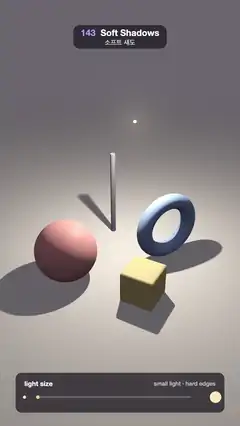

# 143 · Soft Shadows · 소프트 섀도



**EN** A glowing lamp over a ball, a ring, a pole and a block swells from a pinpoint to a big globe, and their hard shadows melt into wide, soft penumbrae.  
**KO** 공·고리·막대·블록 위의 빛나는 전등이 점에서 큰 구로 부풀면, 날카롭던 그림자가 넓고 부드러운 반그림자로 녹아내린다.

[Video (mp4)](https://sueun-dev.github.io/motion-effects/videos/143-soft-shadows.mp4) · [Code](../effects/143-soft-shadows.js) · Lighting & shadows · 조명·그림자

## Prompt (English)

```text
Create a "Soft Shadows" motion effect: one spherical lamp over a few objects swells from a pinpoint to a big globe and back while its power stays the same, so only the shadows change: hard edges, then wide penumbrae.

Look
- A raymarched scene on a warm off-white floor (0.93, 0.89, 0.84) that fades into a dark plum backdrop (0.16, 0.14, 0.17) far away:
  - a coral ball (1.0, 0.42, 0.38), radius 0.78, resting at (−1.35, 0.78, 0.55);
  - a blue ring (0.35, 0.55, 1.0) standing on edge: torus radius 0.72, tube 0.2, at (1.25, 0.95, −0.35), turned −0.55 rad;
  - a thin dark pole (0.22, 0.22, 0.28), radius 0.07, 2.5 tall, at (−0.2, 0, −1.6);
  - a yellow block (1.0, 0.78, 0.3), 0.84 cube with 0.06 rounded edges, at (0.55, 0.42, 1.35), turned 0.5 rad.
- The lamp: a frosted globe, white-hot in the middle (1.0, 0.96, 0.88) × 1.9, warmer at the rim (1.0, 0.6, 0.3) × 1.3, with a soft glow round it.
- Lighting: diffuse from the lamp, (1.0, 0.93, 0.82) × max(n·l, 0) × 19 / d² (the same power at every size), a small highlight pow(n·h, 40) × 0.25, and a soft sky fill (0.44, 0.42, 0.50) × (0.5 + 0.5 n.y) × 0.32.
- Camera at (0, 6.6, 8.6) looking at (0, 1.55, 0), focal length 3.3. Tone curve c / (1 + 0.35c), gamma 2.2.
- A panel at the bottom (x 70–1010, y 1680–1860, dark translucent, corner radius 28): "light size", a caption that changes from "small light · hard edges" to "big light · wide penumbra" (one fades out, then the other fades in), and a slider whose knob grows with the lamp between a small dot and a big dot.

Motion (0–5 s), a = 2π · t / 5
- Lamp radius = 0.04 + 0.96 · s(k), k = 0.5 − 0.5 · cos(a), s = smoothstep: a pinpoint at 0 s and 5 s, a globe of radius 1.0 at 2.5 s, lingering a little at both ends.
- The lamp drifts: (0.35 + 0.7 · sin a, 3.75, −0.5 + 0.35 · sin 2a), so the shadows also swing gently.
- As it grows the shadows' edges widen, the ring's hole fills in, and the thin pole's shadow fades almost away (no umbra left).

Technique
- One fragment shader: sphere tracing of the objects (the floor is an analytic plane), normals from central differences.
- Sphere-light soft shadows: march from the point towards the lamp centre; the cone is as wide as the lamp looks from there, w = radius / distance; res = min(res, h / (w · t)), allowed down to −1, then visibility = 0.25 (1 + res)² (2 − res), which runs smoothly from umbra to full light.
- 2 × 2 supersampling and a fixed per-pixel dither of ±0.5 / 255 (no banding in the glow).

Output and rules
- One self-contained HTML file with no external assets (three.js from a CDN is fine if you use it), drawing on a 1080 × 1920 canvas (9:16) scaled to fit the window.
- Write a function renderFrame(t) that draws the frame for time t in seconds, and preview it with requestAnimationFrame. Everything must be a pure function of t and fixed seeds: no Math.random(), Date or state carried between frames, so frame i = renderFrame(i / 30) can be exported to a 30 fps video.
- Loop seamlessly every 5 seconds: renderFrame(5) must look exactly like renderFrame(0).
- No flicker of any kind: no noise or grain that changes from frame to frame, no strobing or blinking, no z-fighting, no shimmering 1 px lines. Any grain or texture stays fixed to the screen or to the object.
- Keep the top 280 px free of important content (a title label goes there) and fill the whole frame with a designed background.
```

## 프롬프트 (한국어)

```text
"소프트 섀도" 모션 효과를 만들어 줘: 물체 몇 개 위의 구형 전등 하나가 점에서 큰 구로 부풀었다가 돌아오는데 세기는 그대로라, 그림자만 바뀐다: 날카로운 가장자리에서 넓은 반그림자로.

모양
- 레이마칭 장면, 따뜻한 미색 바닥 (0.93, 0.89, 0.84)이 멀리서 짙은 자두색 배경 (0.16, 0.14, 0.17)으로 사라진다:
  - 산호색 공 (1.0, 0.42, 0.38), 반지름 0.78, (−1.35, 0.78, 0.55)에 놓임;
  - 세로로 선 파란 고리 (0.35, 0.55, 1.0): 토러스 반지름 0.72, 튜브 0.2, (1.25, 0.95, −0.35), −0.55 rad 돌림;
  - 가는 어두운 막대 (0.22, 0.22, 0.28), 반지름 0.07, 높이 2.5, (−0.2, 0, −1.6);
  - 노란 블록 (1.0, 0.78, 0.3), 모서리 0.06을 둥글린 0.84 정육면체, (0.55, 0.42, 1.35), 0.5 rad 돌림.
- 전등: 젖빛 유리구. 가운데는 하얗게 뜨겁고 (1.0, 0.96, 0.88) × 1.9, 가장자리는 따뜻하게 (1.0, 0.6, 0.3) × 1.3, 둘레에 부드러운 빛무리.
- 조명: 전등의 확산광 (1.0, 0.93, 0.82) × max(n·l, 0) × 19 / d²(크기와 상관없이 같은 세기), 작은 하이라이트 pow(n·h, 40) × 0.25, 부드러운 하늘 채움광 (0.44, 0.42, 0.50) × (0.5 + 0.5 n.y) × 0.32.
- 카메라 (0, 6.6, 8.6)에서 (0, 1.55, 0)을 보고, 초점 거리 3.3. 톤 곡선 c / (1 + 0.35c), 감마 2.2.
- 아래 패널(x 70–1010, y 1680–1860, 어두운 반투명, 모서리 28): "light size", 설명이 "small light · hard edges"에서 "big light · wide penumbra"로 바뀌고(하나가 사라진 뒤 다른 하나가 나타남), 손잡이가 전등과 함께 커지는 슬라이더가 작은 점과 큰 점 사이에 있다.

움직임 (0–5초), a = 2π · t / 5
- 전등 반지름 = 0.04 + 0.96 · s(k), k = 0.5 − 0.5 · cos(a), s = smoothstep: 0초와 5초에 점, 2.5초에 반지름 1.0의 구, 양 끝에서 조금 머문다.
- 전등이 떠돈다: (0.35 + 0.7 · sin a, 3.75, −0.5 + 0.35 · sin 2a). 그림자도 살짝 흔들린다.
- 커질수록 그림자 가장자리가 넓어지고, 고리의 구멍이 메워지고, 가는 막대의 그림자는 본그림자가 사라지며 거의 지워진다.

기법
- 프래그먼트 셰이더 하나: 물체는 스피어 트레이싱(바닥은 해석적 평면), 법선은 중앙 차분.
- 구 광원 소프트 섀도: 점에서 전등 중심으로 행진하며, 원뿔 폭은 그 점에서 본 전등 크기 w = 반지름 / 거리. res = min(res, h / (w · t))를 −1까지 허용하고, 가시도 = 0.25 (1 + res)² (2 − res)로 본그림자에서 완전한 빛까지 매끄럽게 잇는다.
- 2 × 2 슈퍼샘플링과 픽셀마다 고정된 ±0.5 / 255 디더(빛무리에 띠 없음).

출력과 규칙
- 외부 파일 없는 HTML 파일 하나(three.js를 쓴다면 CDN은 괜찮다). 1080 × 1920(9:16) 캔버스에 그리고 창 크기에 맞춰 보이게 한다.
- 시간 t(초)의 프레임을 그리는 renderFrame(t) 함수를 만들고, 미리보기는 requestAnimationFrame으로 돌린다. 모든 것은 t와 고정 시드만으로 정해진다: Math.random(), Date, 프레임 사이에 쌓이는 상태 금지. 그래야 i번째 프레임 = renderFrame(i / 30)으로 30fps 영상을 뽑을 수 있다.
- 5초마다 끊김 없이 반복: renderFrame(5)는 renderFrame(0)과 똑같아 보여야 한다.
- 어떤 깜빡임도 금지: 프레임마다 바뀌는 노이즈·그레인, 번쩍임·깜빡임, z-fighting, 반짝이며 떨리는 1px 선 모두 금지. 그레인·질감은 화면이나 물체에 고정한다.
- 위쪽 280px에는 중요한 내용을 두지 않고(제목 라벨 자리), 화면 전체를 디자인된 배경으로 채운다.
```
