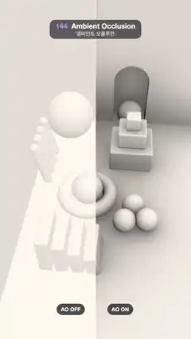

# 144 · Ambient Occlusion · 앰비언트 오클루전



**EN** A wipe slides across a white clay still life in a room corner: without AO the shapes look pasted on; with AO every contact, gap and corner darkens softly.  
**KO** 방 구석의 흰 점토 정물 위로 와이프가 오가며, AO가 없으면 붕 떠 보이던 모양이 AO를 켜면 닿는 곳·틈·구석마다 부드럽게 어두워진다.

[Video (mp4)](https://sueun-dev.github.io/motion-effects/videos/144-ambient-occlusion.mp4) · [Code](../effects/144-ambient-occlusion.js) · Lighting & shadows · 조명·그림자

## Prompt (English)

```text
Create an "Ambient Occlusion" motion effect: a white clay still life in a room corner, lit by soft sky light, with a vertical wipe that slides back and forth between AO off (left) and AO on (right).

Look
- A raymarched room: floor y = 0, back wall z = −3, left wall x = −1.9, with an arched niche cut into the back wall (0.55 radius arch over a 1.1-wide opening) holding a ball (radius 0.42).
- Clay objects, all one warm white (0.93, 0.90, 0.86):
  - a big ball, radius 0.75, wedged into the corner at (−1.15, 0.75, −2.25), touching floor and both walls;
  - a stack of three rounded blocks at (0.85, 0, −1.25): 1.24 × 0.7, then 0.8 × 0.5, then 0.4 × 0.4;
  - four pegs (capsules, radius 0.13) leaning on the left wall, 0.4 apart;
  - a ring lying flat (torus 0.62, 0.2) at (−0.3, 0.2, 0.55) with a ball (radius 0.42) sitting in its hole;
  - three pebbles (radius 0.3) huddled together at (1.0, 0.3, 1.25);
  - four slabs standing close together like books (0.3 thick, 1.0 deep, 1.1 → 0.62 tall, tilted a little more each) at z = 2.35.
- Light: a soft sky dome, mix((0.62, 0.60, 0.58), (1.0, 0.98, 0.95), 0.5 + 0.5 n.y) × 0.9 × AO, plus a faint key (1.0, 0.95, 0.88) × 0.22 × max(n·l, 0) from (0.5 + 0.3 sin a, 0.9, 0.55), never shadowed.
- Camera at (0.5, 7.6, 6.9) looking down at (−0.15, 0.35, −0.25), focal length 3.7: the corner fills the frame from top to bottom.
- The wipe: a 3 px white line; left of it AO = 1 (flat, shapes look pasted on), right of it AO is applied. Two pills ride 140 px either side of the line at y 1720–1784 ("AO OFF" left, "AO ON" right, white 800 weight 30 px on dark translucent), fading out near the frame edges.

Motion (0–5 s), a = 2π · t / 5
- Wipe position = 0.5 + 0.36 · sin(a) of the frame width: centre at 0 s, far right at 1.25 s, far left at 3.75 s.
- The key light sways a little: x = 0.5 + 0.3 · sin(a). The scene and camera stay still.

Technique
- One fragment shader: sphere tracing of a signed distance field (planes, spheres, rounded boxes, a torus, capsules; the niche is a smooth subtraction).
- Ambient occlusion per hit point: 16 cosine-weighted directions on a golden-angle spiral round the normal, rotated per pixel by a fixed hash (never by time); each is marched 12 steps out to 1.6 units, visibility = min(h / (0.5 t)); AO = (average visibility)^1.25.
- 2 × 2 supersampling (each sub-sample with its own fixed rotation), AO only computed right of the wipe, fixed ±0.5 / 255 dither, gamma 2.2.

Output and rules
- One self-contained HTML file with no external assets (three.js from a CDN is fine if you use it), drawing on a 1080 × 1920 canvas (9:16) scaled to fit the window.
- Write a function renderFrame(t) that draws the frame for time t in seconds, and preview it with requestAnimationFrame. Everything must be a pure function of t and fixed seeds: no Math.random(), Date or state carried between frames, so frame i = renderFrame(i / 30) can be exported to a 30 fps video.
- Loop seamlessly every 5 seconds: renderFrame(5) must look exactly like renderFrame(0).
- No flicker of any kind: no noise or grain that changes from frame to frame, no strobing or blinking, no z-fighting, no shimmering 1 px lines. Any grain or texture stays fixed to the screen or to the object.
- Keep the top 280 px free of important content (a title label goes there) and fill the whole frame with a designed background.
```

## 프롬프트 (한국어)

```text
"앰비언트 오클루전" 모션 효과를 만들어 줘: 방 구석의 흰 점토 정물을 부드러운 하늘빛으로 비추고, 세로 와이프가 좌우로 오가며 AO 끔(왼쪽)과 AO 켬(오른쪽)을 비교하는 효과.

모양
- 레이마칭한 방: 바닥 y = 0, 뒷벽 z = −3, 왼벽 x = −1.9. 뒷벽에는 아치형 벽감(폭 1.1 입구 위에 반지름 0.55 아치)을 파고, 그 안에 공(반지름 0.42)을 둔다.
- 점토 물체, 모두 같은 따뜻한 흰색 (0.93, 0.90, 0.86):
  - 큰 공, 반지름 0.75, (−1.15, 0.75, −2.25) 구석에 끼어 바닥과 두 벽에 닿는다;
  - (0.85, 0, −1.25)에 둥근 블록 셋을 쌓은 탑: 1.24 × 0.7, 그 위 0.8 × 0.5, 그 위 0.4 × 0.4;
  - 왼벽에 기댄 막대 넷(캡슐, 반지름 0.13), 간격 0.4;
  - 바닥에 누운 고리(토러스 0.62, 0.2), (−0.3, 0.2, 0.55), 구멍에 공(반지름 0.42)이 앉아 있다;
  - (1.0, 0.3, 1.25)에 옹기종기 모인 조약돌 셋(반지름 0.3);
  - z = 2.35에 책처럼 바짝 붙어 선 판 넷(두께 0.3, 깊이 1.0, 높이 1.1 → 0.62, 하나씩 조금 더 기울어짐).
- 빛: 부드러운 하늘 돔 mix((0.62, 0.60, 0.58), (1.0, 0.98, 0.95), 0.5 + 0.5 n.y) × 0.9 × AO, 여기에 그림자 없는 약한 키 라이트 (1.0, 0.95, 0.88) × 0.22 × max(n·l, 0), 방향 (0.5 + 0.3 sin a, 0.9, 0.55).
- 카메라 (0.5, 7.6, 6.9)에서 (−0.15, 0.35, −0.25)를 내려다보고, 초점 거리 3.7: 구석이 화면 위에서 아래까지 채운다.
- 와이프: 3px 흰 선. 선 왼쪽은 AO = 1(납작해서 모양이 붙여 놓은 듯 뜸), 오른쪽은 AO 적용. 선 양옆 140px에 알약 둘이 y 1720–1784에서 따라다닌다(왼쪽 "AO OFF", 오른쪽 "AO ON", 어두운 반투명 위 흰색 800 굵기 30px). 화면 끝에 가까워지면 사라진다.

움직임 (0–5초), a = 2π · t / 5
- 와이프 위치 = 화면 폭의 0.5 + 0.36 · sin(a): 0초에 가운데, 1.25초에 오른쪽 끝, 3.75초에 왼쪽 끝.
- 키 라이트가 살짝 흔들린다: x = 0.5 + 0.3 · sin(a). 장면과 카메라는 멈춰 있다.

기법
- 프래그먼트 셰이더 하나: 부호 거리장 스피어 트레이싱(평면, 구, 둥근 상자, 토러스, 캡슐; 벽감은 스무스 빼기).
- 맞은 점마다 앰비언트 오클루전: 법선 둘레 황금각 나선 위의 코사인 가중 방향 16개를 픽셀마다 고정된 해시로(시간이 아니라) 돌린다. 방향마다 12걸음, 1.6까지 행진하며 가시도 = min(h / (0.5 t)). AO = (가시도 평균)^1.25.
- 2 × 2 슈퍼샘플링(서브샘플마다 고정된 회전), AO는 와이프 오른쪽에서만 계산, 고정 ±0.5 / 255 디더, 감마 2.2.

출력과 규칙
- 외부 파일 없는 HTML 파일 하나(three.js를 쓴다면 CDN은 괜찮다). 1080 × 1920(9:16) 캔버스에 그리고 창 크기에 맞춰 보이게 한다.
- 시간 t(초)의 프레임을 그리는 renderFrame(t) 함수를 만들고, 미리보기는 requestAnimationFrame으로 돌린다. 모든 것은 t와 고정 시드만으로 정해진다: Math.random(), Date, 프레임 사이에 쌓이는 상태 금지. 그래야 i번째 프레임 = renderFrame(i / 30)으로 30fps 영상을 뽑을 수 있다.
- 5초마다 끊김 없이 반복: renderFrame(5)는 renderFrame(0)과 똑같아 보여야 한다.
- 어떤 깜빡임도 금지: 프레임마다 바뀌는 노이즈·그레인, 번쩍임·깜빡임, z-fighting, 반짝이며 떨리는 1px 선 모두 금지. 그레인·질감은 화면이나 물체에 고정한다.
- 위쪽 280px에는 중요한 내용을 두지 않고(제목 라벨 자리), 화면 전체를 디자인된 배경으로 채운다.
```
