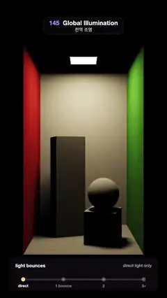

# 145 · Global Illumination · 전역 조명



**EN** A path-traced Cornell box adds its light bounces one by one: black shadows and ceiling fill with soft light, and red and green bleed onto the white blocks.  
**KO** 패스 트레이싱한 코넬 박스에 빛의 반사가 하나씩 더해지며, 검던 그림자와 천장이 부드럽게 밝아지고 빨강·초록이 흰 블록에 번진다.

[Video (mp4)](https://sueun-dev.github.io/motion-effects/videos/145-global-illumination.mp4) · [Code](../effects/145-global-illumination.js) · Lighting & shadows · 조명·그림자

## Prompt (English)

```text
Create a "Global Illumination" motion effect: a tall Cornell box, path traced, whose light is split by the number of bounces; the loop adds the bounces back one by one, from direct light only to full global illumination, and removes them again.

Look
- The room, open at the front: x −0.5…0.5, y 0…1.75, z −0.5…0.5. Floor, ceiling and back wall white (albedo 0.73), left wall red (0.63, 0.065, 0.05), right wall green (0.14, 0.45, 0.091), all perfectly diffuse.
- A square lamp in the ceiling, 0.26 × 0.26, emission (16, 12.5, 7.5).
- A tall white block 0.3 × 1.0 × 0.3 at (−0.17, 0, −0.16), turned 0.3 rad; a short white block 0.3 cube at (0.19, 0, 0.12), turned −0.3 rad, with a white ball (radius 0.15) resting on it.
- Camera at (0, 0.875, 3.05) looking down −z, ray direction (uv · 0.2725, −1) with uv = (2·pixel − resolution) / width: the box opening fills the middle of the frame (about x 150–930, y 280–1640), black round it.
- Display: (direct + w1 · one bounce + w2 · two bounces + w3 · three or more) × 2.3, an ACES-like curve x(2.51x + 0.03) / (x(2.43x + 0.59) + 0.14), gamma 2.2, fixed ±0.5 / 255 dither.
- A panel at the bottom (x 60–1020, y 1660–1870, dark translucent): "light bounces", a caption that changes from "direct light only" to "direct + indirect light" (one fades out, then the other in), and a 4-step slider "direct · 1 bounce · 2 · 3+" whose track fills and whose dots light up as the bounces come in.

Motion (0–5 s)
- Direct light only at 0 s: hard light, black ceiling, black shadows, no colour on the white blocks.
- The bounces come in one after another (smoothstep, 0.45 s each): 1 bounce at 0.55 s, 2 at 1.15 s, 3+ at 1.75 s; full GI holds about 2.2–3.05 s (soft light everywhere, red on the tall block's left side, green on the ball and the short block's right side, a lit ceiling).
- They leave in reverse: 3+ at 3.05 s, 2 at 3.65 s, 1 at 4.25 s; direct only again from 4.7 s, matching the start.

Technique
- Path tracing on the GPU, once, before the first frame: 64 passes × 32 paths per pixel = 2048 paths, each pixel jittered inside itself (free antialiasing), seeds from a PCG hash of (pixel, path index) only, so the result is the same on every run.
- Each path: intersect the five wall rectangles, the two rotated blocks (slab test in the block's own frame) and the ball; at every hit sample one point on the lamp with a shadow ray (next-event estimation), then continue in a cosine-weighted direction (throughput × albedo), up to 8 bounces; light found by a bounce is not counted again.
- File each next-event contribution by the bounce on which it was found: hit 0 → direct, 1 → one bounce, 2 → two, 3+ → the rest. Write the four sums to four float render targets at once (multiple render targets), ping-ponging two sets to accumulate.
- Every frame then only mixes the four stored images with the weights above, so it is fast and completely noise-stable.

Output and rules
- One self-contained HTML file with no external assets (three.js from a CDN is fine if you use it), drawing on a 1080 × 1920 canvas (9:16) scaled to fit the window.
- Write a function renderFrame(t) that draws the frame for time t in seconds, and preview it with requestAnimationFrame. Everything must be a pure function of t and fixed seeds: no Math.random(), Date or state carried between frames, so frame i = renderFrame(i / 30) can be exported to a 30 fps video.
- Loop seamlessly every 5 seconds: renderFrame(5) must look exactly like renderFrame(0).
- No flicker of any kind: no noise or grain that changes from frame to frame, no strobing or blinking, no z-fighting, no shimmering 1 px lines. Any grain or texture stays fixed to the screen or to the object.
- Keep the top 280 px free of important content (a title label goes there) and fill the whole frame with a designed background.
```

## 프롬프트 (한국어)

```text
"전역 조명" 모션 효과를 만들어 줘: 키가 큰 코넬 박스를 패스 트레이싱하고, 빛을 반사 횟수별로 나눠 둔 뒤, 루프 동안 반사를 하나씩 더해 직접광만 있던 장면을 완전한 전역 조명으로 바꿨다가 다시 빼는 효과.

모양
- 앞이 열린 방: x −0.5…0.5, y 0…1.75, z −0.5…0.5. 바닥·천장·뒷벽은 흰색(반사율 0.73), 왼벽은 빨강 (0.63, 0.065, 0.05), 오른벽은 초록 (0.14, 0.45, 0.091), 모두 완전 확산.
- 천장의 정사각형 조명, 0.26 × 0.26, 방출 (16, 12.5, 7.5).
- 흰 기둥 블록 0.3 × 1.0 × 0.3, (−0.17, 0, −0.16), 0.3 rad 돌림; 흰 낮은 블록 0.3 정육면체, (0.19, 0, 0.12), −0.3 rad 돌림, 그 위에 흰 공(반지름 0.15).
- 카메라 (0, 0.875, 3.05)에서 −z 방향, 광선 방향 (uv · 0.2725, −1), uv = (2·픽셀 − 해상도) / 폭: 상자 입구가 화면 가운데(대략 x 150–930, y 280–1640)를 채우고 둘레는 검다.
- 표시: (직접광 + w1 · 1회 반사 + w2 · 2회 + w3 · 3회 이상) × 2.3, ACES 비슷한 곡선 x(2.51x + 0.03) / (x(2.43x + 0.59) + 0.14), 감마 2.2, 고정 ±0.5 / 255 디더.
- 아래 패널(x 60–1020, y 1660–1870, 어두운 반투명): "light bounces", 설명이 "direct light only"에서 "direct + indirect light"로 바뀌고(하나가 사라진 뒤 다른 하나가 나타남), 4단 슬라이더 "direct · 1 bounce · 2 · 3+"는 반사가 들어올 때마다 트랙이 차고 점이 켜진다.

움직임 (0–5초)
- 0초에는 직접광만: 강한 빛, 검은 천장, 검은 그림자, 흰 블록에 색이 없다.
- 반사가 차례로 들어온다(smoothstep, 각 0.45초): 1회 0.55초, 2회 1.15초, 3회 이상 1.75초. 약 2.2–3.05초에 완전한 GI가 머문다(어디나 부드러운 빛, 기둥 왼쪽에 빨강, 공과 낮은 블록 오른쪽에 초록, 밝아진 천장).
- 거꾸로 빠진다: 3회 이상 3.05초, 2회 3.65초, 1회 4.25초. 4.7초부터 다시 직접광만, 처음과 같다.

기법
- 첫 프레임 전에 한 번 GPU에서 패스 트레이싱: 64패스 × 픽셀당 32경로 = 2048경로, 픽셀 안에서 흔들어(공짜 안티에일리어싱), 시드는 (픽셀, 경로 번호)만으로 만든 PCG 해시라 매번 결과가 같다.
- 경로마다: 벽 사각형 다섯, 돌린 블록 둘(블록 자기 좌표계에서 슬랩 테스트), 공과 교차. 맞을 때마다 조명 위 한 점을 그림자 광선으로 샘플링(다음 사건 추정)하고 코사인 가중 방향으로 이어 간다(처리량 × 반사율), 최대 8회 반사. 반사로 조명을 만나면 다시 세지 않는다.
- 다음 사건 기여를 찾은 반사 횟수별로 나눠 담는다: 0번째 맞음 → 직접광, 1 → 1회 반사, 2 → 2회, 3 이상 → 나머지. 네 합을 부동소수점 렌더 타깃 넷에 한 번에 쓰고(다중 렌더 타깃), 두 벌을 핑퐁해 누적한다.
- 매 프레임에는 저장한 네 이미지를 위 가중치로 섞기만 하므로 빠르고 노이즈가 전혀 흔들리지 않는다.

출력과 규칙
- 외부 파일 없는 HTML 파일 하나(three.js를 쓴다면 CDN은 괜찮다). 1080 × 1920(9:16) 캔버스에 그리고 창 크기에 맞춰 보이게 한다.
- 시간 t(초)의 프레임을 그리는 renderFrame(t) 함수를 만들고, 미리보기는 requestAnimationFrame으로 돌린다. 모든 것은 t와 고정 시드만으로 정해진다: Math.random(), Date, 프레임 사이에 쌓이는 상태 금지. 그래야 i번째 프레임 = renderFrame(i / 30)으로 30fps 영상을 뽑을 수 있다.
- 5초마다 끊김 없이 반복: renderFrame(5)는 renderFrame(0)과 똑같아 보여야 한다.
- 어떤 깜빡임도 금지: 프레임마다 바뀌는 노이즈·그레인, 번쩍임·깜빡임, z-fighting, 반짝이며 떨리는 1px 선 모두 금지. 그레인·질감은 화면이나 물체에 고정한다.
- 위쪽 280px에는 중요한 내용을 두지 않고(제목 라벨 자리), 화면 전체를 디자인된 배경으로 채운다.
```
