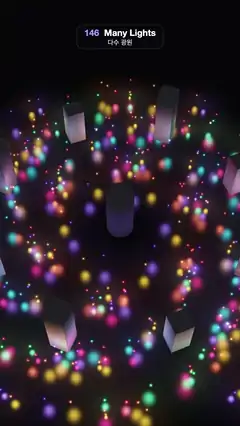

# 146 · Many Lights · 다수 광원



**EN** 336 coloured point lights swirl in six spiral arms over a black lacquer floor inside a ring of pillars, each casting its own small pool and reflection.  
**KO** 색색의 점광원 336개가 기둥 고리 안 검은 옻칠 바닥 위를 여섯 갈래 나선으로 소용돌이치며, 저마다 작은 빛 웅덩이와 반사를 만든다.

[Video (mp4)](https://sueun-dev.github.io/motion-effects/videos/146-many-lights.mp4) · [Code](../effects/146-many-lights.js) · Lighting & shadows · 조명·그림자

## Prompt (English)

```text
Create a "Many Lights" motion effect: hundreds of small coloured point lights swirling in a spiral over a dark glossy floor with pillars, every light lighting the floor and the pillars itself, the way deferred or clustered renderers handle hundreds of lights.

Look
- Background #020206. A black lacquer floor (base #15161D, very glossy: Blinn-Phong exponent 300, specular strength 3.2).
- A ring of 8 square pillars (0.45 × 0.45) at radius 3.3, heights alternating 1.7 / 1.1, turned to face the centre, and a round core column (radius 0.34, 1.4 tall) in the middle; pillar material #9A9DB0, exponent 40, specular 0.5.
- 336 lights = 6 identical spiral arms × 56 lights (seed 11). In each arm, light j has radius r = 0.5 + 4.6 · √rand, angle along the spiral 0.8 · r + ±0.175 jitter, height 0.14–0.64, a colour from #FF2E88, #21D4FD, #FFB224, #8C5CFF, #3DFFA2, #FF5F3D (the same in every arm), and a wobble phase.
- Each light's reach is short: weight = (clamp(1 − (d / 1.25)⁴))² / (d² + 0.04), zero beyond 1.25 units. Its strength is 0.22 × its colour. Every surface pixel adds base × (n·l) + specular for all lights in reach; then a soft tone map c / (1 + c) and gamma 2.2, plus a fixed ±0.5 / 255 dither so the dark floor does not band.
- The lights themselves are additive glow dots (point size 420 / depth px), a soft halo e^(−9r²) plus a bright core 0.6 · e^(−60r²) that turns half white.
- Camera: perspective, 42°, at (0, 12, 7.6) looking at (0, 0, −0.4): a steep view down onto the swirl, which fills the frame from about y 350 to the bottom.

Motion (0–5 s), a = 2π · t / 5
- Every arm turns round the centre: inner lights (r < 2.4) by two arms' width per loop (2 · 60° = 120°), outer lights by one (60°). Because all six arms are identical, the picture at 5 s is exactly the picture at 0 s.
- Each light also wobbles: angle + 0.12 · sin(a + phase), height + 0.08 · sin(a + 2 · phase).
- The pools of light and their sharp reflections slide across the lacquer and up the pillar faces.

Technique
- three.js with custom ShaderMaterials for the floor and pillars: the fragment shader loops over all 336 lights, reading positions (row 0) and colours (row 1) from a 336 × 2 float DataTexture with texelFetch, and skips any light whose reach does not touch the pixel, as a clustered renderer would.
- The positions are rewritten into the texture every frame from t only; the glow dots are a THREE.Points cloud with an additive ShaderMaterial and the same positions.

Output and rules
- One self-contained HTML file with no external assets (three.js from a CDN is fine if you use it), drawing on a 1080 × 1920 canvas (9:16) scaled to fit the window.
- Write a function renderFrame(t) that draws the frame for time t in seconds, and preview it with requestAnimationFrame. Everything must be a pure function of t and fixed seeds: no Math.random(), Date or state carried between frames, so frame i = renderFrame(i / 30) can be exported to a 30 fps video.
- Loop seamlessly every 5 seconds: renderFrame(5) must look exactly like renderFrame(0).
- No flicker of any kind: no noise or grain that changes from frame to frame, no strobing or blinking, no z-fighting, no shimmering 1 px lines. Any grain or texture stays fixed to the screen or to the object.
- Keep the top 280 px free of important content (a title label goes there) and fill the whole frame with a designed background.
```

## 프롬프트 (한국어)

```text
"다수 광원" 모션 효과를 만들어 줘: 색색의 작은 점광원 수백 개가 기둥이 선 어두운 광택 바닥 위를 나선으로 소용돌이치고, 지연·클러스터 렌더러처럼 빛 하나하나가 바닥과 기둥을 직접 비추는 효과.

모양
- 배경 #020206. 검은 옻칠 바닥(기본색 #15161D, 아주 반짝임: 블린-퐁 지수 300, 스페큘러 세기 3.2).
- 반지름 3.3에 사각 기둥 8개(0.45 × 0.45), 높이는 1.7 / 1.1을 번갈아, 가운데를 향해 돌려 세운다. 가운데에는 둥근 축 기둥(반지름 0.34, 높이 1.4). 기둥 재질 #9A9DB0, 지수 40, 스페큘러 0.5.
- 광원 336개 = 똑같은 나선 팔 6개 × 56개(시드 11). 팔마다 j번째 빛: 반지름 r = 0.5 + 4.6 · √난수, 나선을 따른 각도 0.8 · r + ±0.175 흔들림, 높이 0.14–0.64, 색은 #FF2E88, #21D4FD, #FFB224, #8C5CFF, #3DFFA2, #FF5F3D 중 하나(팔마다 같음), 흔들림 위상.
- 빛마다 닿는 거리가 짧다: 가중치 = (clamp(1 − (d / 1.25)⁴))² / (d² + 0.04), 1.25 밖에서는 0. 세기는 색의 0.22배. 표면 픽셀마다 닿는 모든 빛의 기본색 × (n·l) + 스페큘러를 더한 뒤 부드러운 톤 매핑 c / (1 + c), 감마 2.2, 어두운 바닥에 띠가 생기지 않게 고정 ±0.5 / 255 디더.
- 광원 자체는 가산 혼합 빛점(점 크기 420 / 깊이 px): 부드러운 후광 e^(−9r²)에 절반쯤 하얀 밝은 심 0.6 · e^(−60r²).
- 카메라: 원근 42°, (0, 12, 7.6)에서 (0, 0, −0.4)를 본다. 소용돌이를 가파르게 내려다보며, 대략 y 350부터 아래 끝까지 채운다.

움직임 (0–5초), a = 2π · t / 5
- 팔 전체가 가운데를 돈다: 안쪽 빛(r < 2.4)은 루프마다 팔 두 칸(2 · 60° = 120°), 바깥 빛은 한 칸(60°). 여섯 팔이 똑같아서 5초의 그림이 0초의 그림과 정확히 같다.
- 빛마다 흔들리기도 한다: 각도 + 0.12 · sin(a + 위상), 높이 + 0.08 · sin(a + 2 · 위상).
- 빛 웅덩이와 날카로운 반사가 옻칠 바닥과 기둥 면을 미끄러진다.

기법
- three.js, 바닥과 기둥에 직접 만든 ShaderMaterial: 프래그먼트 셰이더가 336개 빛을 모두 돌며, 336 × 2 부동소수점 DataTexture에서 위치(0행)와 색(1행)을 texelFetch로 읽고, 닿지 않는 빛은 건너뛴다(클러스터 렌더러처럼).
- 위치는 매 프레임 t만으로 텍스처에 다시 쓴다. 빛점은 같은 위치를 쓰는 THREE.Points 구름에 가산 혼합 ShaderMaterial.

출력과 규칙
- 외부 파일 없는 HTML 파일 하나(three.js를 쓴다면 CDN은 괜찮다). 1080 × 1920(9:16) 캔버스에 그리고 창 크기에 맞춰 보이게 한다.
- 시간 t(초)의 프레임을 그리는 renderFrame(t) 함수를 만들고, 미리보기는 requestAnimationFrame으로 돌린다. 모든 것은 t와 고정 시드만으로 정해진다: Math.random(), Date, 프레임 사이에 쌓이는 상태 금지. 그래야 i번째 프레임 = renderFrame(i / 30)으로 30fps 영상을 뽑을 수 있다.
- 5초마다 끊김 없이 반복: renderFrame(5)는 renderFrame(0)과 똑같아 보여야 한다.
- 어떤 깜빡임도 금지: 프레임마다 바뀌는 노이즈·그레인, 번쩍임·깜빡임, z-fighting, 반짝이며 떨리는 1px 선 모두 금지. 그레인·질감은 화면이나 물체에 고정한다.
- 위쪽 280px에는 중요한 내용을 두지 않고(제목 라벨 자리), 화면 전체를 디자인된 배경으로 채운다.
```
