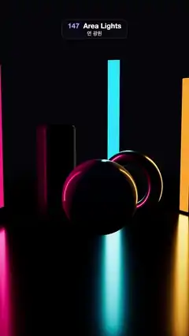

# 147 · Area Lights · 면 광원



**EN** Three tall neon panels, pink, cyan and amber, sweep round a white ball, a steel ring and a dark block, laying long soft streaks across a black lacquer floor.  
**KO** 분홍·청록·호박색의 길쭉한 네온 패널 셋이 흰 공, 강철 고리, 검은 블록 둘레를 쓸고 지나가며, 검은 옻칠 바닥에 길고 부드러운 빛줄기를 남긴다.

[Video (mp4)](https://sueun-dev.github.io/motion-effects/videos/147-area-lights.mp4) · [Code](../effects/147-area-lights.js) · Lighting & shadows · 조명·그림자

## Prompt (English)

```text
Create an "Area Lights" motion effect: three tall rectangular neon panels that are real area lights, sweeping round a few glossy objects on a dark lacquer floor, so the reflections keep the panels' long shape and stretch across the floor.

Look
- Background #06060B, with fog of the same colour from 17 to 34 units so the floor fades out with no hard horizon.
- Floor: a large plane, #16161E, roughness 0.16, metalness 0.2 (black lacquer).
- Objects:
  - a white glossy ball, radius 1.05, at (0.15, 1.05, 0.9): #F2F0EC, roughness 0.12;
  - a steel ring standing upright (torus 0.85, tube 0.24) at (1.15, 1.09, −1.1), turned −0.55 rad: #C9CCD6, metalness 1, roughness 0.22;
  - a dark rounded block 1.0 × 3.0 × 1.0 (edge radius 0.16) at (−1.2, 1.5, −0.9), turned 0.45 rad: #2A2C3A, roughness 0.3.
- A faint hemisphere light (#3A3F66 / black, 0.35) so the dark sides keep their form.
- Three panels, each a RectAreaLight 0.45 × 4.4, intensity 12, plus a visible plane of the same size and colour (unlit, not tone mapped, double-sided): pink #FF2E7E, cyan #22D8FF, amber #FFA62B. Each stays upright, facing the centre.
- Camera: perspective, 40°, at (0, 3.4, 13.5) looking at (0, 1.75, 0). ACES Filmic tone mapping.

Motion (0–5 s), a = 2π · t / 5
- The panels sweep together like a fan round the back of the objects: panel angle q = c + 0.95 · sin(a) + 0.2 · sin(2a + p), with centre angles c = −1.1, 0, 1.1 rad (0 = straight behind the ball), phases p = 0, 2.1, 4.2.
- Orbit radii 3.3 (pink), 4.2 (cyan), 3.75 (amber); heights 2.6, 2.9, 2.5, each bobbing 0.25 · sin(2a + p).
- Position (r · sin q, height, −r · cos q + 1.4 · (1 − cos q)): behind the objects the path is a circle; past the sides it bends forward out of frame, so one panel is always out at a side lighting the fronts, and the panels never pass in front of the objects.
- Long, soft-edged streaks of pink, cyan and amber slide across the floor and wrap round the ball and the ring.

Technique
- three.js RectAreaLight with RectAreaLightUniformsLib.init(): area lighting by linearly transformed cosines on MeshStandardMaterial, which gives the true stretched, soft-ended reflections of a rectangle instead of a point highlight.
- Each light gets its visible panel as a child mesh, so the glow you see and the light it casts move as one.
- Antialiasing on; no shadows (rect area lights cast none), so nothing can flicker.

Output and rules
- One self-contained HTML file with no external assets (three.js from a CDN is fine if you use it), drawing on a 1080 × 1920 canvas (9:16) scaled to fit the window.
- Write a function renderFrame(t) that draws the frame for time t in seconds, and preview it with requestAnimationFrame. Everything must be a pure function of t and fixed seeds: no Math.random(), Date or state carried between frames, so frame i = renderFrame(i / 30) can be exported to a 30 fps video.
- Loop seamlessly every 5 seconds: renderFrame(5) must look exactly like renderFrame(0).
- No flicker of any kind: no noise or grain that changes from frame to frame, no strobing or blinking, no z-fighting, no shimmering 1 px lines. Any grain or texture stays fixed to the screen or to the object.
- Keep the top 280 px free of important content (a title label goes there) and fill the whole frame with a designed background.
```

## 프롬프트 (한국어)

```text
"면 광원" 모션 효과를 만들어 줘: 진짜 면 광원인 길쭉한 직사각형 네온 패널 셋이 어두운 옻칠 바닥 위 광택 물체 몇 개 둘레를 쓸고 지나가, 반사가 패널의 긴 모양 그대로 바닥에 늘어지는 효과.

모양
- 배경 #06060B, 같은 색 안개를 17에서 34까지 깔아 바닥이 딱딱한 지평선 없이 사라지게 한다.
- 바닥: 큰 평면, #16161E, 거칠기 0.16, 금속성 0.2(검은 옻칠).
- 물체:
  - 흰 광택 공, 반지름 1.05, (0.15, 1.05, 0.9): #F2F0EC, 거칠기 0.12;
  - 세워 둔 강철 고리(토러스 0.85, 튜브 0.24), (1.15, 1.09, −1.1), −0.55 rad 돌림: #C9CCD6, 금속성 1, 거칠기 0.22;
  - 어두운 둥근 블록 1.0 × 3.0 × 1.0(모서리 반지름 0.16), (−1.2, 1.5, −0.9), 0.45 rad 돌림: #2A2C3A, 거칠기 0.3.
- 어두운 면도 형태가 남도록 약한 반구광(#3A3F66 / 검정, 0.35).
- 패널 셋, 각각 RectAreaLight 0.45 × 4.4, 세기 12, 같은 크기·색의 보이는 평면(조명 무시, 톤 매핑 없음, 양면)을 더한다: 분홍 #FF2E7E, 청록 #22D8FF, 호박색 #FFA62B. 늘 똑바로 서서 가운데를 향한다.
- 카메라: 원근 40°, (0, 3.4, 13.5)에서 (0, 1.75, 0)을 본다. ACES Filmic 톤 매핑.

움직임 (0–5초), a = 2π · t / 5
- 패널들이 부채처럼 함께 물체 뒤를 쓸고 지나간다: 패널 각도 q = c + 0.95 · sin(a) + 0.2 · sin(2a + p), 중심 각도 c = −1.1, 0, 1.1 rad(0 = 공 바로 뒤), 위상 p = 0, 2.1, 4.2.
- 궤도 반지름 3.3(분홍), 4.2(청록), 3.75(호박), 높이 2.6, 2.9, 2.5, 각각 0.25 · sin(2a + p)로 오르내린다.
- 위치 (r · sin q, 높이, −r · cos q + 1.4 · (1 − cos q)): 물체 뒤에서는 원을 그리고, 옆을 지나면 앞쪽 화면 밖으로 휘어 나간다. 그래서 늘 패널 하나는 옆에서 앞면을 비추고, 패널이 물체 앞을 가로지르는 일은 없다.
- 분홍·청록·호박색의 길고 가장자리가 부드러운 빛줄기가 바닥을 미끄러지고 공과 고리를 감싼다.

기법
- three.js RectAreaLight와 RectAreaLightUniformsLib.init(): MeshStandardMaterial에서 선형 변환 코사인(LTC)으로 면 조명을 계산해, 점 하이라이트가 아니라 직사각형이 늘어난 진짜 반사와 부드러운 끝을 얻는다.
- 조명마다 보이는 패널을 자식 메시로 붙여, 보이는 빛과 비추는 빛이 함께 움직인다.
- 안티에일리어싱 켬. 그림자가 없어(직사각형 면 광원은 그림자를 만들지 않음) 깜빡일 곳이 없다.

출력과 규칙
- 외부 파일 없는 HTML 파일 하나(three.js를 쓴다면 CDN은 괜찮다). 1080 × 1920(9:16) 캔버스에 그리고 창 크기에 맞춰 보이게 한다.
- 시간 t(초)의 프레임을 그리는 renderFrame(t) 함수를 만들고, 미리보기는 requestAnimationFrame으로 돌린다. 모든 것은 t와 고정 시드만으로 정해진다: Math.random(), Date, 프레임 사이에 쌓이는 상태 금지. 그래야 i번째 프레임 = renderFrame(i / 30)으로 30fps 영상을 뽑을 수 있다.
- 5초마다 끊김 없이 반복: renderFrame(5)는 renderFrame(0)과 똑같아 보여야 한다.
- 어떤 깜빡임도 금지: 프레임마다 바뀌는 노이즈·그레인, 번쩍임·깜빡임, z-fighting, 반짝이며 떨리는 1px 선 모두 금지. 그레인·질감은 화면이나 물체에 고정한다.
- 위쪽 280px에는 중요한 내용을 두지 않고(제목 라벨 자리), 화면 전체를 디자인된 배경으로 채운다.
```
