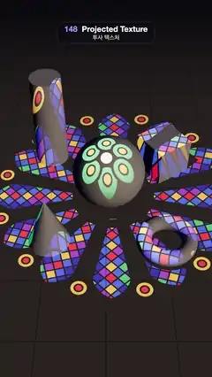

# 148 · Projected Texture · 투사 텍스처



**EN** A circling spotlight casts a stained-glass rose window onto a stone floor, its coloured glass sliding and wrapping over a white sphere, column, cube and cone.  
**KO** 천천히 도는 스포트라이트가 어두운 돌바닥에 스테인드글라스 장미창을 비추고, 색유리 무늬가 흰 구·기둥·상자·원뿔·고리 위를 미끄러지며 감싼다.

[Video (mp4)](https://sueun-dev.github.io/motion-effects/videos/148-projector-gobo.mp4) · [Code](../effects/148-projector-gobo.js) · Lighting & shadows · 조명·그림자

## Prompt (English)

```text
Create a "Projected Texture" motion effect: a spotlight with a light cookie (gobo) projects a stained-glass rose window onto a stone floor and white plaster shapes, and the pattern slides and turns over them.

Look
- The cookie: a 1024 × 1024 canvas, drawn once, black everywhere except the window (coordinates below in a 1024-unit frame centred on the canvas):
  - 12 pointed lancets radiating from r = 150 to an arch tip at r = 478 (half width 22 at the inner end, 74 at r = 392), outlined with 14 px black tracery. Inside each, diamond quarries 34 px wide (grid turned 45°) with 5 px black lead. Colours by position: the middle strip alternates ruby #E0213A and amber #F5A623 every 50 px along the lancet; the next strip is blue #2A5BFF (15 % violet #8A3FD1); the outer quarries are navy #2B2DB0 with 12 % green #1FA866 and 6 % pale #F4E6C0. The random choices come from a seeded generator that is reused for every other lancet, so the window repeats every 60°.
  - 12 gold #F5A623 roundels (radius 34, ruby heart radius 15) between the lancet tips at r = 445; at the centre six emerald #1FA866 foils (radius 44, amber heart radius 18) at r = 78 around a cream #FFF0CC disc (radius 30); black lead round all of them.
- Scene: a 40 × 40 floor of pale stone #A39C90 with faint tile lines #857F74 (4 px lines every 256 px of a 1024 px texture repeated 5 ×), roughness 0.85. White plaster #F2EEE6, roughness 0.55: a sphere (radius 1.25) at (0.1, 1.25, 0.4); a column (radius 0.55 at the top, 0.62 at the base, height 3.6) at (−2.1, 1.8, −1.8); a 1.4 cube at (2.15, 0.7, −1.2) turned 0.6 rad; a cone (radius 0.7, height 1.9) at (−1.9, 0.95, 2.4); a torus (radius 0.75, tube 0.26) lying flat at (2.0, 0.26, 2.6).
- Lights: the spotlight (white, intensity 9, no distance decay, half-angle 0.36 rad, penumbra 0.1) carrying the cookie and casting shadows (2048² map); a dim hemisphere light (sky #3A4A78, ground #120E16, 0.6); a faint warm fill #FFE9D6 at 0.6 from (6, 5, 7) so the shapes still read outside the beam.
- Background #07070C with fog from 18 to 30. Camera: perspective, 44° vertical field of view, at (0, 12.5, 12) looking at (0, 0.4, 0.4); the window lies across the floor as a wide ellipse with the shapes in the middle of the frame.

Motion (0–5 s), a = 2π · t / 5
- The spotlight circles high above: position (−2.6 + 1.6 · cos a, 12.5, 3.2 + 1.6 · sin a), aimed at (0.25 · cos a, 0, 0.4 + 0.25 · sin a). The coloured glass slides over the shapes and their projected shadows swing round.
- The picture also turns about the beam's axis by a / 6 (60° per loop). The window repeats every 60°, so frame 150 matches frame 0.

Technique
- three.js SpotLight.map: three projects the texture through the spotlight's shadow camera and multiplies the light colour by it per pixel, so the light needs castShadow = true. Shadow bias −0.0004, normal bias 0.02, shadow camera near 4 and far 30.
- To turn the projection, rotate the shadow camera's up vector about the light axis each frame: up = u1 · cos r + u2 · sin r, with u1 and u2 perpendicular to the beam (three calls lookAt on the shadow camera, which uses up).
- The cookie is an sRGB CanvasTexture with anisotropy 8. ACES Filmic tone mapping, exposure 1.1, PCF soft shadow maps, antialiasing on.

Output and rules
- One self-contained HTML file with no external assets (three.js from a CDN is fine if you use it), drawing on a 1080 × 1920 canvas (9:16) scaled to fit the window.
- Write a function renderFrame(t) that draws the frame for time t in seconds, and preview it with requestAnimationFrame. Everything must be a pure function of t and fixed seeds: no Math.random(), Date or state carried between frames, so frame i = renderFrame(i / 30) can be exported to a 30 fps video.
- Loop seamlessly every 5 seconds: renderFrame(5) must look exactly like renderFrame(0).
- No flicker of any kind: no noise or grain that changes from frame to frame, no strobing or blinking, no z-fighting, no shimmering 1 px lines. Any grain or texture stays fixed to the screen or to the object.
- Keep the top 280 px free of important content (a title label goes there) and fill the whole frame with a designed background.
```

## 프롬프트 (한국어)

```text
"투사 텍스처" 모션 효과를 만들어 줘: 라이트 쿠키(고보)를 단 스포트라이트가 돌바닥과 흰 석고 도형 위에 스테인드글라스 장미창을 비추고, 그 무늬가 도형들 위를 미끄러지며 도는 효과.

모양
- 쿠키: 1024 × 1024 캔버스에 한 번만 그린다. 창 말고는 모두 검정(아래 좌표는 캔버스 가운데를 원점으로 한 1024 단위 기준):
  - 뾰족 아치 모양 창살 12개가 r = 150에서 r = 478의 아치 끝까지 바깥으로 뻗는다(안쪽 끝 반폭 22, r = 392에서 74). 14px 검은 석조 테두리. 각 창살 안은 45° 돌린 34px 마름모 유리 조각과 5px 검은 납선. 색은 위치로 정한다: 가운데 줄은 루비 #E0213A와 호박 #F5A623이 창살을 따라 50px마다 번갈아, 그다음 줄은 파랑 #2A5BFF(15 %는 보라 #8A3FD1), 바깥 조각은 남색 #2B2DB0에 초록 #1FA866 12 %, 연한 #F4E6C0 6 %. 무작위는 고정 시드 생성기로 고르고 창살 하나 건너 같은 시드를 다시 써서, 창 전체가 60°마다 똑같이 반복된다.
  - 창살 끝 사이 r = 445에 금색 #F5A623 원판 12개(반지름 34, 가운데 루비 반지름 15). 중심에는 r = 78에 에메랄드 #1FA866 잎 6장(반지름 44, 가운데 호박 반지름 18)이 크림색 #FFF0CC 원판(반지름 30)을 두른다. 모두 검은 납선을 두른다.
- 장면: 40 × 40 연한 돌바닥 #A39C90, 희미한 타일 선 #857F74(1024px 텍스처에 256px마다 4px 선, 5번 반복), 거칠기 0.85. 흰 석고 #F2EEE6, 거칠기 0.55: 구(반지름 1.25) (0.1, 1.25, 0.4); 기둥(위 반지름 0.55, 아래 0.62, 높이 3.6) (−2.1, 1.8, −1.8); 한 변 1.4 상자 (2.15, 0.7, −1.2), 0.6 rad 회전; 원뿔(반지름 0.7, 높이 1.9) (−1.9, 0.95, 2.4); 바닥에 눕힌 도넛(반지름 0.75, 굵기 0.26) (2.0, 0.26, 2.6).
- 조명: 스포트라이트(흰색, 세기 9, 거리 감쇠 없음, 반각 0.36 rad, 반그림자 0.1)가 쿠키를 싣고 그림자를 드리운다(2048² 맵). 어두운 반구광(하늘 #3A4A78, 땅 #120E16, 0.6). 빛 밖에서도 도형이 보이도록 희미한 따뜻한 보조광 #FFE9D6 0.6, 위치 (6, 5, 7).
- 배경 #07070C, 안개 18–30. 카메라: 원근, 세로 시야각 44°, 위치 (0, 12.5, 12)에서 (0, 0.4, 0.4)를 본다. 창 무늬가 바닥에 넓은 타원으로 깔리고 도형들은 화면 가운데에 있다.

움직임 (0–5초), a = 2π · t / 5
- 스포트라이트가 높은 곳에서 원을 그린다: 위치 (−2.6 + 1.6 · cos a, 12.5, 3.2 + 1.6 · sin a), 겨냥점 (0.25 · cos a, 0, 0.4 + 0.25 · sin a). 색유리가 도형 위를 미끄러지고 투사된 그림자가 돌아간다.
- 그림 자체도 빛줄기 축을 중심으로 a / 6만큼 돈다(한 루프에 60°). 창이 60°마다 반복되므로 150번째 프레임이 0번째와 맞물린다.

기법
- three.js SpotLight.map: three가 스포트라이트의 그림자 카메라로 텍스처를 투사해 픽셀마다 빛 색에 곱한다. 그래서 castShadow = true가 필요하다. 그림자 바이어스 −0.0004, 노멀 바이어스 0.02, 그림자 카메라 near 4, far 30.
- 투사를 돌리려면 매 프레임 그림자 카메라의 up 벡터를 빛 축 둘레로 돌린다: up = u1 · cos r + u2 · sin r(u1, u2는 빛 축에 수직). three가 그림자 카메라에 lookAt을 부르고, lookAt은 up을 쓴다.
- 쿠키는 sRGB CanvasTexture, 이방성 필터 8. ACES Filmic 톤 매핑, 노출 1.1, PCF 소프트 그림자, 안티에일리어싱 켬.

출력과 규칙
- 외부 파일 없는 HTML 파일 하나(three.js를 쓴다면 CDN은 괜찮다). 1080 × 1920(9:16) 캔버스에 그리고 창 크기에 맞춰 보이게 한다.
- 시간 t(초)의 프레임을 그리는 renderFrame(t) 함수를 만들고, 미리보기는 requestAnimationFrame으로 돌린다. 모든 것은 t와 고정 시드만으로 정해진다: Math.random(), Date, 프레임 사이에 쌓이는 상태 금지. 그래야 i번째 프레임 = renderFrame(i / 30)으로 30fps 영상을 뽑을 수 있다.
- 5초마다 끊김 없이 반복: renderFrame(5)는 renderFrame(0)과 똑같아 보여야 한다.
- 어떤 깜빡임도 금지: 프레임마다 바뀌는 노이즈·그레인, 번쩍임·깜빡임, z-fighting, 반짝이며 떨리는 1px 선 모두 금지. 그레인·질감은 화면이나 물체에 고정한다.
- 위쪽 280px에는 중요한 내용을 두지 않고(제목 라벨 자리), 화면 전체를 디자인된 배경으로 채운다.
```
