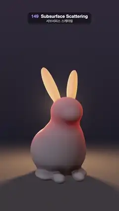

# 149 · Subsurface Scattering · 서브서피스 스캐터링



**EN** A milky wax rabbit sits in the dark as a warm lamp swings behind it; its thin ears and edges glow amber through, while the thick body stays creamy and dim.  
**KO** 어둠 속 우윳빛 밀랍 토끼 뒤로 따뜻한 램프가 흔들리며 지나가고, 얇은 귀와 가장자리는 호박색으로 비쳐 빛나며 두꺼운 몸통은 크림색으로 어둑하게 남는다.

[Video (mp4)](https://sueun-dev.github.io/motion-effects/videos/149-subsurface-scattering.mp4) · [Code](../effects/149-subsurface-scattering.js) · Materials & surface detail · 재질·표면

## Prompt (English)

```text
Create a "Subsurface Scattering" motion effect: a wax rabbit, raymarched as a signed distance field, lit by a warm lamp that swings behind it, so light shines through the thin ears and edges.

Look
- The rabbit, joined with a polynomial smooth minimum (k in brackets), facing +z and turned 0.35 rad about y: body ellipsoid radii (0.88, 0.82, 1.02) at (0, −0.4, −0.15); chest (0.58, 0.62, 0.55) at (0, 0.08, 0.35) [0.3]; head (0.47, 0.43, 0.5) at (0, 0.82, 0.62) [0.25]; muzzle (0.24, 0.19, 0.17) at (0, 0.7, 1.04) [0.12]; tail sphere radius 0.26 at (0, −0.55, −1.13) [0.12]; front paws (0.16, 0.13, 0.28) at (±0.3, −1.06, 0.78) [0.12]; hind feet (0.24, 0.13, 0.5) at (±0.55, −1.08, 0.12) [0.16]. Cut flat at the floor y = −1.2.
- Two ears [0.08]: thin cupped slabs with an elliptic outline 0.13 × 0.6, 0.09 thick plus a 0.022 ridge down the middle (veins), cupped by z += 1.1 · x², rooted at (±0.2, 1.1, 0.45), leaning out 0.3 rad and back 0.38 rad.
- Wax colour (0.95, 0.88, 0.78). Lamp colour (1, 0.72, 0.45) × 2.6, drawn as a small orb (bright core 0.07 wide, soft halo) wherever the rabbit does not hide it.
- Background: near black, (0.012, 0.012, 0.02) low to (0.035, 0.03, 0.045) higher. A dark floor (0.05, 0.045, 0.05) gets a warm pool from the lamp (falloff 1 / (1 + 0.12 · d²)) and the rabbit's soft shadow, fading into the background between distance 6 and 22.
- Camera: origin (0, 0.55, 7), direction normalize(uv · 0.66, −2.4) tipped 0.07 rad down, uv = (2 · fragCoord − resolution) / width. The rabbit fills the middle of the frame, ear tips well below the top 280 px.

Motion (0–5 s), a = 2π · t / 5
- The lamp moves on a circle of radius 2.7 at height 1.25: φ = 1.9 · sin(a) measured from straight behind the rabbit, position (2.7 · sin φ, 1.25, −2.7 · cos φ).
- At 0 s and 2.5 s it passes right behind: the ears glow amber, a red rim lines the body and a halo sits round the head. At the ends of the swing it is out to the side and a little in front, and the rabbit looks like plain lit wax with a warm red band along the shadow edge.

Technique
- WebGL2 fragment-shader raymarching inside a bounding sphere (radius 2.6): up to 160 steps of 0.85 · d, hit when d < 0.0003 · t. Normals from a tetrahedral four-sample gradient (e = 0.001).
- Subsurface: from each visible point march towards the lamp through the whole field (128 steps, step clamp(0.7 · |d|, 0.012, 0.25)) and add up the distance spent inside, softened at the surface by clamp(0.5 − d / 0.04, 0, 1). Transmission T = 0.88 · exp(−th · (4.5, 14, 24)) + 0.12 · exp(−th · (1.6, 3.6, 6.5)): red survives deepest, so thin parts glow amber and thicker parts deep red. Add lamp × wax × (1, 0.7, 0.5) × T × (0.35 + 0.65 · max(rd · l, 0)²) × 0.8.
- Front light: wrapped diffuse max((n · l + 0.35) / 1.35, 0) × shadow × 0.55; dim room light (0.09, 0.085, 0.09) and a cool fill (0.07, 0.085, 0.12) from (−0.6, 0.5, 0.7), both × ambient occlusion; specular power 24 × 0.25. Soft shadows: 64 steps, res = min(res, 8h / t).
- 2 × 2 supersampling, an ACES-style curve, gamma 2.2 and a fixed one-level grain.

Output and rules
- One self-contained HTML file with no external assets (three.js from a CDN is fine if you use it), drawing on a 1080 × 1920 canvas (9:16) scaled to fit the window.
- Write a function renderFrame(t) that draws the frame for time t in seconds, and preview it with requestAnimationFrame. Everything must be a pure function of t and fixed seeds: no Math.random(), Date or state carried between frames, so frame i = renderFrame(i / 30) can be exported to a 30 fps video.
- Loop seamlessly every 5 seconds: renderFrame(5) must look exactly like renderFrame(0).
- No flicker of any kind: no noise or grain that changes from frame to frame, no strobing or blinking, no z-fighting, no shimmering 1 px lines. Any grain or texture stays fixed to the screen or to the object.
- Keep the top 280 px free of important content (a title label goes there) and fill the whole frame with a designed background.
```

## 프롬프트 (한국어)

```text
"서브서피스 스캐터링" 모션 효과를 만들어 줘: 부호 거리 함수로 레이마칭한 밀랍 토끼 뒤로 따뜻한 램프가 흔들리며 지나가, 얇은 귀와 가장자리로 빛이 비쳐 나오는 효과.

모양
- 토끼는 다항식 smooth minimum(괄호 안이 k)으로 잇고, +z를 보며 y축으로 0.35 rad 돌린다: 몸통 타원체 반지름 (0.88, 0.82, 1.02) 위치 (0, −0.4, −0.15); 가슴 (0.58, 0.62, 0.55) 위치 (0, 0.08, 0.35) [0.3]; 머리 (0.47, 0.43, 0.5) 위치 (0, 0.82, 0.62) [0.25]; 주둥이 (0.24, 0.19, 0.17) 위치 (0, 0.7, 1.04) [0.12]; 꼬리 구 반지름 0.26 위치 (0, −0.55, −1.13) [0.12]; 앞발 (0.16, 0.13, 0.28) 위치 (±0.3, −1.06, 0.78) [0.12]; 뒷발 (0.24, 0.13, 0.5) 위치 (±0.55, −1.08, 0.12) [0.16]. 바닥 y = −1.2에서 평평하게 자른다.
- 귀 두 개 [0.08]: 0.13 × 0.6 타원 윤곽의 얇고 오목한 판, 두께 0.09에 가운데 0.022 두둑(핏줄), z += 1.1 · x²로 오목하게, 뿌리 (±0.2, 1.1, 0.45), 바깥으로 0.3 rad, 뒤로 0.38 rad 기운다.
- 밀랍 색 (0.95, 0.88, 0.78). 램프 색 (1, 0.72, 0.45) × 2.6, 토끼에 가리지 않을 때 작은 구슬(밝은 심 0.07, 부드러운 후광)로 그린다.
- 배경: 거의 검정, 아래 (0.012, 0.012, 0.02)에서 위 (0.035, 0.03, 0.045). 어두운 바닥 (0.05, 0.045, 0.05)에 램프의 따뜻한 빛 웅덩이(감쇠 1 / (1 + 0.12 · d²))와 토끼의 부드러운 그림자, 거리 6–22에서 배경으로 사라진다.
- 카메라: 원점 (0, 0.55, 7), 방향 normalize(uv · 0.66, −2.4)를 0.07 rad 아래로, uv = (2 · fragCoord − resolution) / width. 토끼가 화면 가운데를 채우고 귀 끝은 위쪽 280px보다 한참 아래.

움직임 (0–5초), a = 2π · t / 5
- 램프는 높이 1.25, 반지름 2.7의 원 위를 움직인다: 토끼 바로 뒤에서 잰 각 φ = 1.9 · sin(a), 위치 (2.7 · sin φ, 1.25, −2.7 · cos φ).
- 0초와 2.5초에는 바로 뒤를 지나며 귀가 호박색으로 빛나고, 몸 가장자리에 붉은 테가 생기고, 머리에 후광이 걸린다. 흔들림 끝에서는 옆쪽 살짝 앞으로 나와, 토끼가 그림자 경계에 따뜻한 붉은 띠가 있는 평범한 밀랍처럼 보인다.

기법
- WebGL2 프래그먼트 셰이더 레이마칭, 경계 구(반지름 2.6) 안에서만: 최대 160걸음, 걸음 0.85 · d, d < 0.0003 · t면 충돌. 법선은 사면체 네 점 기울기(e = 0.001).
- 서브서피스: 보이는 점마다 램프 쪽으로 필드 전체를 행진하며(128걸음, 걸음 clamp(0.7 · |d|, 0.012, 0.25)) 안에 있던 거리를 더하고, 표면 근처는 clamp(0.5 − d / 0.04, 0, 1)로 부드럽게 센다. 투과 T = 0.88 · exp(−th · (4.5, 14, 24)) + 0.12 · exp(−th · (1.6, 3.6, 6.5)): 빨강이 가장 깊이 살아남아, 얇은 곳은 호박색, 두꺼운 곳은 짙은 빨강으로 빛난다. 램프 × 밀랍 × (1, 0.7, 0.5) × T × (0.35 + 0.65 · max(rd · l, 0)²) × 0.8을 더한다.
- 앞빛: 감싸는 확산 max((n · l + 0.35) / 1.35, 0) × 그림자 × 0.55; 어두운 방 빛 (0.09, 0.085, 0.09)과 (−0.6, 0.5, 0.7)에서 오는 차가운 보조광 (0.07, 0.085, 0.12), 둘 다 × 앰비언트 오클루전; 반사광 지수 24 × 0.25. 부드러운 그림자: 64걸음, res = min(res, 8h / t).
- 2 × 2 슈퍼샘플링, ACES 비슷한 곡선, 감마 2.2, 고정된 1단계 그레인.

출력과 규칙
- 외부 파일 없는 HTML 파일 하나(three.js를 쓴다면 CDN은 괜찮다). 1080 × 1920(9:16) 캔버스에 그리고 창 크기에 맞춰 보이게 한다.
- 시간 t(초)의 프레임을 그리는 renderFrame(t) 함수를 만들고, 미리보기는 requestAnimationFrame으로 돌린다. 모든 것은 t와 고정 시드만으로 정해진다: Math.random(), Date, 프레임 사이에 쌓이는 상태 금지. 그래야 i번째 프레임 = renderFrame(i / 30)으로 30fps 영상을 뽑을 수 있다.
- 5초마다 끊김 없이 반복: renderFrame(5)는 renderFrame(0)과 똑같아 보여야 한다.
- 어떤 깜빡임도 금지: 프레임마다 바뀌는 노이즈·그레인, 번쩍임·깜빡임, z-fighting, 반짝이며 떨리는 1px 선 모두 금지. 그레인·질감은 화면이나 물체에 고정한다.
- 위쪽 280px에는 중요한 내용을 두지 않고(제목 라벨 자리), 화면 전체를 디자인된 배경으로 채운다.
```
