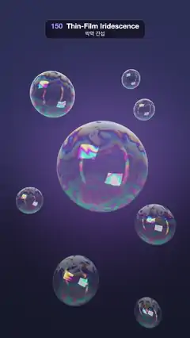

# 150 · Thin-Film Iridescence · 박막 간섭



**EN** Soap bubbles drift over deep navy; swirling bands of magenta, green and gold flow across their skins, thinning to dark at the top, with softbox glints.  
**KO** 짙은 남색 위로 비눗방울이 떠다니고, 자홍·초록·금색 띠가 표면을 소용돌이치며 흐른다. 꼭대기는 얇아져 어둡고 소프트박스 반사가 반짝인다.

[Video (mp4)](https://sueun-dev.github.io/motion-effects/videos/150-thin-film-iridescence.mp4) · [Code](../effects/150-thin-film-iridescence.js) · Materials & surface detail · 재질·표면

## Prompt (English)

```text
Create a "Thin-Film Iridescence" motion effect: soap bubbles whose colours come from light interfering in a soap film a few hundred nanometres thick, computed per wavelength.

Look
- Eight bubbles, analytic spheres (centre; radius): (0.3, 0.1, 0; 1.9), (−2.3, 3.3, −1; 1.05), (2.4, −2.7, 0.5; 0.85), (−2.5, −1.6, 1; 0.55), (2.6, 2.7, −0.5; 0.5), (−0.9, −4.7, 0; 1.0), (1.1, 3.8, 0.8; 0.36), (2.1, −5.6, 0.3; 0.55). Camera at (0, 0, 10), ray direction normalize(uv · 0.42, −1), uv = (2 · fragCoord − resolution) / width; the biggest bubble sits in the middle, none reaches the top 280 px.
- Backdrop seen through them: (0.012, 0.014, 0.03) at the bottom to (0.03, 0.035, 0.08) higher up, plus a soft violet glow (0.07, 0.04, 0.12) · exp(−1.6 · |uv − (0.1, 0.05)|²) behind the big bubble.
- The studio the bubbles reflect: a room gradient from (0.05, 0.06, 0.1) below to (0.85, 0.9, 1.05) above (smoothstep −0.3 to 0.9 of the direction's y); a white softbox × 9, 0.38 × 0.26 in size, up left towards (−0.55, 0.55, 0.62); a warm vertical strip (4, 2.4, 1.2) on the right towards (0.85, 0.1, 0.5).
- Film thickness in nm at a point q on the unit sphere: mix(120, 950, smoothstep(0.95, −0.9, q.y)) (the film drains: thin and dark on top, thicker below) + 280 · fbm(w · 1.5 + o), a 3-octave simplex fbm. Here o = (0.22 · cos(a + k), 0.22 · sin(a + k), 3.1 · k) for bubble k, and w is q turned about the vertical axis by 0.35 · sin(a + 1.7 · k), then warped by 0.4 × three simplex noises of w · 1.2 + o.

Motion (0–5 s), a = 2π · t / 5
- Bubble k drifts round its spot: x + 0.3 · sin(a + 1.3k), y + 0.35 · sin(2a + 0.7k), z + 0.4 · cos(a + k).
- The coloured swirls flow slowly over each bubble as the noise offset o goes round its circle and the film sways back and forth; all of it returns to the start at 5 s.

Technique
- One WebGL2 fragment shader. For every bubble a ray hits, shade the near wall and then the far wall seen from inside (normal flipped): cos θ = n · (−rd), clamped to at least 0.02.
- Film reflectance for film index n = 1.33 in air: cos θt = sqrt(1 − (1 − cos²θ) / n²); Fresnel amplitudes r_s and r_p; for 16 wavelengths from 395 to 695 nm (20 nm apart) δ = 4π · n · d · cos θt / λ and the Airy reflectance R = 2r²(1 − cos δ) / (1 − 2r² cos δ + r⁴), averaged over s and p. Sum R × the CIE 1931 colour-matching functions (the Wyman–Sloan–Shirley multi-lobe fit) into XYZ, convert to linear sRGB and divide by the same sum for R = 1, so a flat spectrum is white.
- Composite front to back: colour += throughput × R × studio(reflect(rd, n)); throughput ×= 1 − R; at the end add throughput × backdrop.
- 2 × 2 supersampling, an ACES-style curve, gamma 2.2 and a fixed one-level grain.

Output and rules
- One self-contained HTML file with no external assets (three.js from a CDN is fine if you use it), drawing on a 1080 × 1920 canvas (9:16) scaled to fit the window.
- Write a function renderFrame(t) that draws the frame for time t in seconds, and preview it with requestAnimationFrame. Everything must be a pure function of t and fixed seeds: no Math.random(), Date or state carried between frames, so frame i = renderFrame(i / 30) can be exported to a 30 fps video.
- Loop seamlessly every 5 seconds: renderFrame(5) must look exactly like renderFrame(0).
- No flicker of any kind: no noise or grain that changes from frame to frame, no strobing or blinking, no z-fighting, no shimmering 1 px lines. Any grain or texture stays fixed to the screen or to the object.
- Keep the top 280 px free of important content (a title label goes there) and fill the whole frame with a designed background.
```

## 프롬프트 (한국어)

```text
"박막 간섭" 모션 효과를 만들어 줘: 두께 수백 나노미터의 비누막 안에서 빛이 간섭해 생기는 색을 파장마다 계산한 비눗방울.

모양
- 비눗방울 8개, 해석적 구(중심; 반지름): (0.3, 0.1, 0; 1.9), (−2.3, 3.3, −1; 1.05), (2.4, −2.7, 0.5; 0.85), (−2.5, −1.6, 1; 0.55), (2.6, 2.7, −0.5; 0.5), (−0.9, −4.7, 0; 1.0), (1.1, 3.8, 0.8; 0.36), (2.1, −5.6, 0.3; 0.55). 카메라 (0, 0, 10), 광선 방향 normalize(uv · 0.42, −1), uv = (2 · fragCoord − resolution) / width. 가장 큰 방울이 가운데 있고 위쪽 280px에는 아무것도 닿지 않는다.
- 방울 너머로 보이는 배경: 아래 (0.012, 0.014, 0.03)에서 위 (0.03, 0.035, 0.08), 큰 방울 뒤에 부드러운 보라 빛 (0.07, 0.04, 0.12) · exp(−1.6 · |uv − (0.1, 0.05)|²).
- 방울에 비치는 스튜디오: 방 그라디언트 아래 (0.05, 0.06, 0.1)에서 위 (0.85, 0.9, 1.05)(방향 y의 smoothstep −0.3–0.9); 왼쪽 위 (−0.55, 0.55, 0.62) 방향에 크기 0.38 × 0.26, 밝기 × 9의 흰 소프트박스; 오른쪽 (0.85, 0.1, 0.5) 방향에 따뜻한 세로 띠 (4, 2.4, 1.2).
- 단위 구 위 점 q에서의 막 두께(nm): mix(120, 950, smoothstep(0.95, −0.9, q.y))(막이 흘러내려 위는 얇고 어둡고 아래는 두껍다) + 280 · fbm(w · 1.5 + o), 3옥타브 심플렉스 fbm. 방울 k에 대해 o = (0.22 · cos(a + k), 0.22 · sin(a + k), 3.1 · k), w는 q를 세로축으로 0.35 · sin(a + 1.7 · k)만큼 돌리고 w · 1.2 + o의 심플렉스 노이즈 세 개 × 0.4로 비튼 것.

움직임 (0–5초), a = 2π · t / 5
- 방울 k는 제자리 둘레를 떠다닌다: x + 0.3 · sin(a + 1.3k), y + 0.35 · sin(2a + 0.7k), z + 0.4 · cos(a + k).
- 노이즈 오프셋 o가 원을 돌고 막이 좌우로 흔들리면서 색 소용돌이가 천천히 흐른다. 5초에 모두 처음으로 돌아온다.

기법
- WebGL2 프래그먼트 셰이더 하나. 광선이 맞힌 방울마다 앞벽, 그리고 안에서 본 뒷벽(법선 뒤집기)을 칠한다: cos θ = n · (−rd), 최소 0.02.
- 공기 속 막(굴절률 n = 1.33)의 반사율: cos θt = sqrt(1 − (1 − cos²θ) / n²); 프레넬 진폭 r_s, r_p; 395–695 nm에서 20 nm 간격 16개 파장마다 δ = 4π · n · d · cos θt / λ, 에어리 반사율 R = 2r²(1 − cos δ) / (1 − 2r² cos δ + r⁴)를 s, p 평균. R × CIE 1931 등색 함수(Wyman–Sloan–Shirley 다중 로브 근사)를 XYZ로 더하고 선형 sRGB로 바꾼 뒤, R = 1일 때의 같은 합으로 나눠 평평한 스펙트럼이 흰색이 되게 한다.
- 앞에서 뒤로 합성: 색 += 투과량 × R × 스튜디오(reflect(rd, n)); 투과량 ×= 1 − R; 마지막에 투과량 × 배경을 더한다.
- 2 × 2 슈퍼샘플링, ACES 비슷한 곡선, 감마 2.2, 고정된 1단계 그레인.

출력과 규칙
- 외부 파일 없는 HTML 파일 하나(three.js를 쓴다면 CDN은 괜찮다). 1080 × 1920(9:16) 캔버스에 그리고 창 크기에 맞춰 보이게 한다.
- 시간 t(초)의 프레임을 그리는 renderFrame(t) 함수를 만들고, 미리보기는 requestAnimationFrame으로 돌린다. 모든 것은 t와 고정 시드만으로 정해진다: Math.random(), Date, 프레임 사이에 쌓이는 상태 금지. 그래야 i번째 프레임 = renderFrame(i / 30)으로 30fps 영상을 뽑을 수 있다.
- 5초마다 끊김 없이 반복: renderFrame(5)는 renderFrame(0)과 똑같아 보여야 한다.
- 어떤 깜빡임도 금지: 프레임마다 바뀌는 노이즈·그레인, 번쩍임·깜빡임, z-fighting, 반짝이며 떨리는 1px 선 모두 금지. 그레인·질감은 화면이나 물체에 고정한다.
- 위쪽 280px에는 중요한 내용을 두지 않고(제목 라벨 자리), 화면 전체를 디자인된 배경으로 채운다.
```
