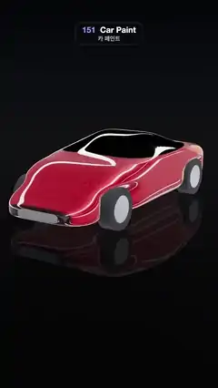

# 151 · Car Paint · 카 페인트



**EN** A red concept car glitters with metal flake under a mirror clearcoat as long studio light strips roll over its flanks and roof, mirrored in a black floor.  
**KO** 빨간 콘셉트카가 거울 같은 클리어코트 아래 금속 플레이크로 반짝이고, 긴 스튜디오 조명 띠가 옆면과 지붕을 타고 넘어가며 검은 바닥에 비친다.

[Video (mp4)](https://sueun-dev.github.io/motion-effects/videos/151-car-paint.mp4) · [Code](../effects/151-car-paint.js) · Materials & surface detail · 재질·표면

## Prompt (English)

```text
Create a "Car Paint" motion effect: a red concept car in a two-layer paint, glittering metal flakes in a red base coat under a mirror-smooth clearcoat, with studio light strips rolling over the body.

Look
- Body: a parametric surface, 360 × 240 segments, u along the car (s = 2u − 1, z = 2.2 · s, nose at +z), v round the cross-section (φ = −2π · v so the faces point outwards).
  - Side profile: top(s) = 0.45 + 0.42 · smoothstep(1, 0.45, s) + 0.36 · exp(−((s + 0.15) / 0.4)²), bottom 0.15: a low nose, a long hood, the roof just behind the middle and a cut-off tail.
  - Half width 0.95 − 0.14 · smoothstep(0.4, 1, s) − 0.06 · smoothstep(−0.6, −1, s). Cross-section: x = w · sgn(cos φ) · |cos φ|^0.36, y = mid + half-height · sgn(sin φ) · |sin φ|^(0.5 above, 0.36 below); both ends rounded by (1 − s⁸)^0.25.
  - Glasshouse: above the belt line y = 0.9, where cabin(s) = smoothstep(0.45, 0.15, s) · smoothstep(−0.8, −0.45, s), the width pulls in to 64 %. Wheel arches: width × (1 − 0.3 · arch(s) · smoothstep(0.72, 0.5, y)) with arch = Gaussians of width 0.15 at s = ±0.6.
- Paint: physical material #900A16, metalness 0.6, roughness 0.4, clearcoat 1, clearcoat roughness 0.01. Its normal map is the flake layer: a 512² seeded texture in which 20 % of the texels tilt the normal by 0.25–0.6 in a random direction and the rest stay flat; nearest filtering up close, mipmaps far away, repeated 1.5 ×, normal scale 0.7. Texture coordinates (z / 4.4, arc length round the section / 4.4) keep the flakes even. The clearcoat keeps the smooth body normal.
- Glass: the glasshouse triangles get their own material, #040506, roughness 0.05, clearcoat 1. Vertex colours fade the paint to black towards the glass and on the nose and tail panels.
- Wheels: tyres (radius 0.33, width 0.24) #0C0C0E, silver hubs (radius 0.21, metalness 1, roughness 0.25), at x = ±0.8, z = ±1.32, y = 0.33.
- The studio it reflects, rendered once into a prefiltered environment map: background #06070A; eight light strips 40 long, parallel to the car, on a ring of radius 9 round its length axis every 45°, alternately 1.6 and 0.5 wide, HDR colour (12, 12, 13); two round softboxes (radius 4) on that axis at z = ±13, cool (1.2, 1.3, 1.5) in front and warm (1.6, 0.9, 0.45) behind.
- A key light #FFF6EA, intensity 1.6, from (2, 7, 5) with a soft shadow (radius 8) makes the flakes glitter. Floor #0E0F13, roughness 0.45, 86 % opaque, its own reflections at 0.05; a copy of the car mirrored under it (scale y −1) shows through as the reflection.
- Background gradient #040508 → #171A22 (50 %) → #0B0C10 (62 %) → #050507; fog #0D0E12 from 14 to 30. Camera: 34° vertical field of view at (5.6, 2.9, 9.2) looking at (0, 0.2, 0.2), a front three-quarter view with the reflection below the car.

Motion (0–5 s)
- Only the studio moves: its rotation about the car's length axis is 2π · t / 20 (90° per loop; the strip ring repeats every 90°). Long highlights roll up the flanks, over the roof and down the other side, sharp in the clearcoat and soft and red in the base coat.
- The car stays still, so the flakes glitter in place instead of crawling.

Technique
- three.js ParametricGeometry and MeshPhysicalMaterial (normalMap for the base layer, clearcoat on the plain normal), geometry groups for paint and glass, a PMREM environment from a small studio scene and scene.environmentRotation to turn it.
- ACES Filmic tone mapping, PCF soft shadows, antialiasing on.

Output and rules
- One self-contained HTML file with no external assets (three.js from a CDN is fine if you use it), drawing on a 1080 × 1920 canvas (9:16) scaled to fit the window.
- Write a function renderFrame(t) that draws the frame for time t in seconds, and preview it with requestAnimationFrame. Everything must be a pure function of t and fixed seeds: no Math.random(), Date or state carried between frames, so frame i = renderFrame(i / 30) can be exported to a 30 fps video.
- Loop seamlessly every 5 seconds: renderFrame(5) must look exactly like renderFrame(0).
- No flicker of any kind: no noise or grain that changes from frame to frame, no strobing or blinking, no z-fighting, no shimmering 1 px lines. Any grain or texture stays fixed to the screen or to the object.
- Keep the top 280 px free of important content (a title label goes there) and fill the whole frame with a designed background.
```

## 프롬프트 (한국어)

```text
"카 페인트" 모션 효과를 만들어 줘: 빨간 베이스 코트 속에서 반짝이는 금속 플레이크와 거울처럼 매끈한 클리어코트, 두 겹 도장의 콘셉트카 위로 스튜디오 조명 띠가 굴러가는 효과.

모양
- 차체: 매개변수 곡면, 분할 360 × 240. u는 차 길이 방향(s = 2u − 1, z = 2.2 · s, 앞코가 +z), v는 단면 둘레(φ = −2π · v로 면이 바깥을 보게).
  - 옆 윤곽: top(s) = 0.45 + 0.42 · smoothstep(1, 0.45, s) + 0.36 · exp(−((s + 0.15) / 0.4)²), 바닥 0.15: 낮은 앞코, 긴 보닛, 가운데 조금 뒤의 지붕, 잘린 꼬리.
  - 반폭 0.95 − 0.14 · smoothstep(0.4, 1, s) − 0.06 · smoothstep(−0.6, −1, s). 단면: x = w · sgn(cos φ) · |cos φ|^0.36, y = 가운데 + 반높이 · sgn(sin φ) · |sin φ|^(위 0.5, 아래 0.36); 양 끝은 (1 − s⁸)^0.25로 둥글게.
  - 유리 캐빈: 벨트라인 y = 0.9 위, cabin(s) = smoothstep(0.45, 0.15, s) · smoothstep(−0.8, −0.45, s)인 곳에서 폭이 64 %로 좁아진다. 휠 아치: 폭 × (1 − 0.3 · arch(s) · smoothstep(0.72, 0.5, y)), arch는 s = ±0.6의 폭 0.15 가우스.
- 도장: 물리 재질 #900A16, 금속성 0.6, 거칠기 0.4, 클리어코트 1, 클리어코트 거칠기 0.01. 노멀 맵이 플레이크 층이다: 512² 고정 시드 텍스처에서 텍셀 20 %가 법선을 무작위 방향으로 0.25–0.6 기울이고 나머지는 평평하다. 가까이서는 nearest 필터, 멀리서는 밉맵, 1.5번 반복, 노멀 세기 0.7. 텍스처 좌표 (z / 4.4, 단면 둘레 호 길이 / 4.4)로 플레이크 밀도를 고르게 한다. 클리어코트는 매끈한 차체 법선을 그대로 쓴다.
- 유리: 캐빈 삼각형은 따로 재질 #040506, 거칠기 0.05, 클리어코트 1. 버텍스 색으로 유리 쪽과 앞뒤 패널의 도장을 검게 잦아들게 한다.
- 바퀴: 타이어(반지름 0.33, 폭 0.24) #0C0C0E, 은색 휠(반지름 0.21, 금속성 1, 거칠기 0.25), 위치 x = ±0.8, z = ±1.32, y = 0.33.
- 비치는 스튜디오(한 번 렌더해 프리필터 환경맵으로): 배경 #06070A; 차와 나란한 길이 40의 조명 띠 8개가 차 길이 축 둘레 반지름 9의 고리에 45°마다, 폭 1.6과 0.5 번갈아, HDR 색 (12, 12, 13); 그 축 위 z = ±13에 둥근 소프트박스(반지름 4) 둘, 앞은 차가운 (1.2, 1.3, 1.5), 뒤는 따뜻한 (1.6, 0.9, 0.45).
- 키 라이트 #FFF6EA, 세기 1.6, 위치 (2, 7, 5), 부드러운 그림자(반지름 8). 이 빛에 플레이크가 반짝인다. 바닥 #0E0F13, 거칠기 0.45, 불투명도 86 %, 바닥 자체 반사 0.05; 바닥 아래에 위아래를 뒤집은 차 사본(scale y −1)이 비쳐 반사가 된다.
- 배경 그라디언트 #040508 → #171A22(50 %) → #0B0C10(62 %) → #050507; 안개 #0D0E12, 14–30. 카메라: 세로 시야각 34°, 위치 (5.6, 2.9, 9.2)에서 (0, 0.2, 0.2)를 보는 앞쪽 3/4 구도, 차 아래로 반사가 보인다.

움직임 (0–5초)
- 움직이는 건 스튜디오뿐: 차 길이 축 둘레 회전이 2π · t / 20(한 루프에 90°, 띠 고리는 90°마다 반복). 긴 하이라이트가 옆면을 타고 올라 지붕을 넘어 반대편으로 내려간다. 클리어코트에서는 날카롭고 베이스 코트에서는 부드럽고 붉다.
- 차는 가만히 있으므로 플레이크가 기어가지 않고 제자리에서 반짝인다.

기법
- three.js ParametricGeometry와 MeshPhysicalMaterial(베이스 층에 normalMap, 클리어코트는 매끈한 법선), 도장과 유리를 나눈 지오메트리 그룹, 작은 스튜디오 장면으로 만든 PMREM 환경맵과 그것을 돌리는 scene.environmentRotation.
- ACES Filmic 톤 매핑, PCF 소프트 그림자, 안티에일리어싱 켬.

출력과 규칙
- 외부 파일 없는 HTML 파일 하나(three.js를 쓴다면 CDN은 괜찮다). 1080 × 1920(9:16) 캔버스에 그리고 창 크기에 맞춰 보이게 한다.
- 시간 t(초)의 프레임을 그리는 renderFrame(t) 함수를 만들고, 미리보기는 requestAnimationFrame으로 돌린다. 모든 것은 t와 고정 시드만으로 정해진다: Math.random(), Date, 프레임 사이에 쌓이는 상태 금지. 그래야 i번째 프레임 = renderFrame(i / 30)으로 30fps 영상을 뽑을 수 있다.
- 5초마다 끊김 없이 반복: renderFrame(5)는 renderFrame(0)과 똑같아 보여야 한다.
- 어떤 깜빡임도 금지: 프레임마다 바뀌는 노이즈·그레인, 번쩍임·깜빡임, z-fighting, 반짝이며 떨리는 1px 선 모두 금지. 그레인·질감은 화면이나 물체에 고정한다.
- 위쪽 280px에는 중요한 내용을 두지 않고(제목 라벨 자리), 화면 전체를 디자인된 배경으로 채운다.
```
