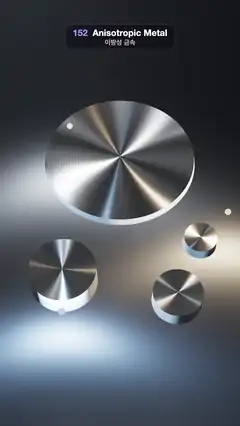

# 152 · Anisotropic Metal · 이방성 금속



**EN** Spun-aluminium discs and knobs sit on brushed steel; three circling lamps draw radial light bars that turn like clock hands and long streaks on the plate.  
**KO** 브러시드 강판 위에 스핀 가공 알루미늄 원반과 노브가 놓이고, 둘레를 도는 램프 셋이 시곗바늘처럼 도는 방사형 빛줄기와 판 위의 긴 줄무늬를 그린다.

[Video (mp4)](https://sueun-dev.github.io/motion-effects/videos/152-anisotropic-metal.mp4) · [Code](../effects/152-anisotropic-metal.js) · Materials & surface detail · 재질·표면

## Prompt (English)

```text
Create an "Anisotropic Metal" motion effect: spun-metal discs and brushed steel whose highlights stretch into streaks, because the roughness is different along and across the machining grooves.

Look
- A brushed steel plate, a box 9 × 0.2 × 16 with its top at y = 0: colour #7D838C, metalness 1, roughness 0.38, anisotropy 0.92 along x (straight brushing).
- Four spun knobs (radius, height, x, z): a big platter (1.55, 0.16, 0, −1.25); knobs (0.62, 0.5, −1.05, 1.55), (0.46, 0.36, 1.05, 1.95) and (0.32, 0.26, 1.55, 0.75).
  - Each is an open cylinder wall (128 segments, radius r at the top, 1.02 r at the base), colour #9EA3AB, metalness 1, roughness 0.36, anisotropy 0.9 turned 90° (lathe-turned sides), with a disc on top.
  - The top: colour #E4E7EC, metalness 1, roughness 0.32, anisotropy 0.95, plus an anisotropy map (512²) whose RG channels hold the direction outwards from the centre ((u − 0.5, v − 0.5) normalised, stored as · 0.5 + 0.5) and whose B channel is the strength, fading to 0 in the middle 1/40. A roughness map (1024²) adds fine lathe rings: 205 + 28 · sin(2π · 90 · r) + 12 · sin(2π · 33.3 · r).
- Three lamps: point lights #FFD9A8, #A8D4FF and #FFFFFF, intensity 9, decay 2, each drawn as a small bead (radius 0.06) of its colour.
- A dim room environment for the reflections (prefiltered, intensity 0.1); background #07080B. Camera: 38° vertical field of view at (0, 10.6, 6.6) looking at (0, 0, 0.05): from above and in front, the platter in the upper middle, the knobs below it.

Motion (0–5 s), a = 2π · t / 5
- Lamp i (i = 0, 1, 2) circles low over the metal at angle q = a + i · 120°: position (2.0 · cos q, 0.85 + 0.2 · sin 2q, 0.55 + 2.2 · sin q).
- On each spun top every lamp makes a bright bar through the centre that points at the lamp, so the bars turn like clock hands, warm, cool and white. On the plate the same lamps stretch into long sideways streaks that slide along with them. Nothing else moves.

Technique
- three.js MeshPhysicalMaterial anisotropy: along the anisotropy direction the roughness is mix(α², 1, anisotropy²), across it α², so highlights elongate along that direction. On the tops the direction comes from the anisotropy map (radial, the groove direction rotated 90°); the anisotropy rotation turns it for the walls; the plate uses the plain tangent direction.
- ACES Filmic tone mapping, exposure 1.05, antialiasing on.

Output and rules
- One self-contained HTML file with no external assets (three.js from a CDN is fine if you use it), drawing on a 1080 × 1920 canvas (9:16) scaled to fit the window.
- Write a function renderFrame(t) that draws the frame for time t in seconds, and preview it with requestAnimationFrame. Everything must be a pure function of t and fixed seeds: no Math.random(), Date or state carried between frames, so frame i = renderFrame(i / 30) can be exported to a 30 fps video.
- Loop seamlessly every 5 seconds: renderFrame(5) must look exactly like renderFrame(0).
- No flicker of any kind: no noise or grain that changes from frame to frame, no strobing or blinking, no z-fighting, no shimmering 1 px lines. Any grain or texture stays fixed to the screen or to the object.
- Keep the top 280 px free of important content (a title label goes there) and fill the whole frame with a designed background.
```

## 프롬프트 (한국어)

```text
"이방성 금속" 모션 효과를 만들어 줘: 가공 홈을 따라갈 때와 가로지를 때 거칠기가 달라서 하이라이트가 길게 늘어나는 스핀 가공 원반과 브러시드 강철.

모양
- 브러시드 강판: 9 × 0.2 × 16 상자, 윗면 y = 0. 색 #7D838C, 금속성 1, 거칠기 0.38, x 방향 이방성 0.92(직선 브러싱).
- 스핀 가공 노브 4개(반지름, 높이, x, z): 큰 원반 (1.55, 0.16, 0, −1.25); 노브 (0.62, 0.5, −1.05, 1.55), (0.46, 0.36, 1.05, 1.95), (0.32, 0.26, 1.55, 0.75).
  - 각각 뚜껑 없는 원통 벽(128분할, 위 반지름 r, 아래 1.02 r), 색 #9EA3AB, 금속성 1, 거칠기 0.36, 이방성 0.9를 90° 돌려(선반 가공한 옆면), 위에 원판.
  - 윗면: 색 #E4E7EC, 금속성 1, 거칠기 0.32, 이방성 0.95, 그리고 이방성 맵(512²): RG에 중심에서 바깥을 향하는 방향((u − 0.5, v − 0.5) 정규화, · 0.5 + 0.5로 저장), B에 세기(가운데 1/40 안에서 0으로 줄어듦). 거칠기 맵(1024²)으로 촘촘한 선반 고리: 205 + 28 · sin(2π · 90 · r) + 12 · sin(2π · 33.3 · r).
- 램프 셋: 점광원 #FFD9A8, #A8D4FF, #FFFFFF, 세기 9, 감쇠 2, 각자 그 색의 작은 구슬(반지름 0.06)로 보인다.
- 반사용 어두운 방 환경맵(프리필터, 세기 0.1), 배경 #07080B. 카메라: 세로 시야각 38°, 위치 (0, 10.6, 6.6)에서 (0, 0, 0.05)를 본다. 위 앞쪽에서 내려다보며 큰 원반은 위쪽 가운데, 노브들은 그 아래.

움직임 (0–5초), a = 2π · t / 5
- 램프 i(i = 0, 1, 2)가 금속 위를 낮게 돈다. 각 q = a + i · 120°, 위치 (2.0 · cos q, 0.85 + 0.2 · sin 2q, 0.55 + 2.2 · sin q).
- 스핀 윗면마다 램프 하나가 중심을 지나 램프를 가리키는 밝은 막대를 만들어, 막대들이 따뜻한색·차가운색·흰색 시곗바늘처럼 돈다. 판 위에서는 같은 램프가 옆으로 긴 줄무늬가 되어 함께 미끄러진다. 나머지는 움직이지 않는다.

기법
- three.js MeshPhysicalMaterial의 anisotropy: 이방성 방향으로는 거칠기가 mix(α², 1, anisotropy²), 가로로는 α²이라 하이라이트가 그 방향으로 늘어난다. 윗면은 이방성 맵에서 방향을 읽고(방사 방향, 홈 방향을 90° 돌린 것), 벽은 anisotropyRotation으로 돌리고, 판은 기본 탄젠트 방향을 쓴다.
- ACES Filmic 톤 매핑, 노출 1.05, 안티에일리어싱 켬.

출력과 규칙
- 외부 파일 없는 HTML 파일 하나(three.js를 쓴다면 CDN은 괜찮다). 1080 × 1920(9:16) 캔버스에 그리고 창 크기에 맞춰 보이게 한다.
- 시간 t(초)의 프레임을 그리는 renderFrame(t) 함수를 만들고, 미리보기는 requestAnimationFrame으로 돌린다. 모든 것은 t와 고정 시드만으로 정해진다: Math.random(), Date, 프레임 사이에 쌓이는 상태 금지. 그래야 i번째 프레임 = renderFrame(i / 30)으로 30fps 영상을 뽑을 수 있다.
- 5초마다 끊김 없이 반복: renderFrame(5)는 renderFrame(0)과 똑같아 보여야 한다.
- 어떤 깜빡임도 금지: 프레임마다 바뀌는 노이즈·그레인, 번쩍임·깜빡임, z-fighting, 반짝이며 떨리는 1px 선 모두 금지. 그레인·질감은 화면이나 물체에 고정한다.
- 위쪽 280px에는 중요한 내용을 두지 않고(제목 라벨 자리), 화면 전체를 디자인된 배경으로 채운다.
```
