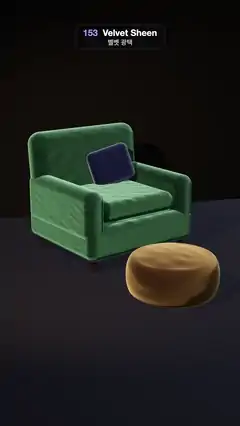

# 153 · Velvet Sheen · 벨벳 광택



**EN** An emerald velvet armchair with a sapphire cushion beside a mustard pouf; as a warm lamp circles the room, soft light rims glow along every rounded edge.  
**KO** 사파이어 쿠션을 얹은 에메랄드 벨벳 안락의자 옆에 겨자색 푸프가 놓이고, 따뜻한 램프가 방을 돌면 둥근 모서리마다 부드러운 빛 테두리가 번진다.

[Video (mp4)](https://sueun-dev.github.io/motion-effects/videos/153-velvet-sheen.mp4) · [Code](../effects/153-velvet-sheen.js) · Materials & surface detail · 재질·표면

## Prompt (English)

```text
Create a "Velvet Sheen" motion effect: velvet furniture whose colour stays deep where it faces you and glows lighter along every edge seen at a grazing angle.

Look
- Velvet: physical material with roughness 1, metalness 0, sheen 1, sheen roughness 0.38, dithering on, and a faint crushed-velvet normal map (normal scale 0.6): a 256² tileable height field of 24 waves with whole-number frequencies (2–8 cycles across the tile, seeded), slopes × 0.15. Three colourways (base / sheen colour): emerald #032A19 / #A6FFE0, sapphire #08113D / #BCCDFF, mustard #3D2404 / #FFDF9C.
- The armchair, emerald, from rounded boxes (width × height × depth, corner radius) turned 0.35 rad: base 2.0 × 0.5 × 1.8 (0.12) at y = 0.45; seat cushion 1.42 × 0.3 × 1.36 (0.14) at (0, 0.85, 0.12), its top puffed up by 0.08 · (1 − x²)(1 − z²); back 2.0 × 1.3 × 0.42 (0.2) at (0, 1.25, −0.72) tilted back 0.1 rad; arms 0.32 × 0.78 × 1.78 (0.15) at x = ±0.86, y = 0.86. Four wooden legs #3B2414 (radius 0.05 tapering to 0.035, height 0.22) at (±0.85, ±0.75).
- A sapphire cushion 0.72 × 0.62 × 0.22 (0.1) at (0.28, 1.28, −0.36), rotated (−0.25, −0.35, 0.18).
- A mustard pouf: a lathe (96 segments) with a rolled side, radius 0.48 + 0.16 · cos(θ)^0.6 over a half circle of height 0.54, a top domed by 0.05, at (0.3, 0, 2.0).
- Room: a wall #2A2724 at z = −2.2 and a floor #1C120C (roughness 0.95 and 0.7), both with dim reflections (0.1) and dithering. Background #0D0B0A. A soft room environment at intensity 0.3.
- Lights: a warm key spotlight #FFE0BD, intensity 70, decay 2, half-angle 0.7, penumbra 0.7, aimed at (0, 0.6, 0.3), soft shadows (2048², radius 8); a cool rim light #BFD0FF at 0.9 from behind (3, 6, −5).
- Camera: 36° vertical field of view; the chair sits in the middle of the frame with the pouf in front and to the right.

Motion (0–5 s), a = 2π · t / 5
- The key light circles at height 4.5: (4.5 · cos(a + 2.4), 4.5, 1.5 + 3.5 · sin(a + 2.4)).
- The camera drifts round and back: angle c = −0.3 + 0.22 · sin a, position (9.6 · sin c, 3.6, 9.6 · cos c + 0.6), always looking at (−0.05, 0.8, 0.7).
- The sheen slides along the arms, the back, the cushion edges and the pouf's rolled side as the light and the viewing angle change; flat faces turned towards you stay dark and rich.

Technique
- three.js MeshPhysicalMaterial sheen (the Charlie sheen lobe, a soft lobe that grows towards grazing angles) over an almost black, fully rough base, RoundedBoxGeometry and LatheGeometry, a RoomEnvironment through a PMREM generator.
- ACES Filmic tone mapping, exposure 1.15, PCF soft shadows, dithering against banding in the dark gradients, antialiasing on.

Output and rules
- One self-contained HTML file with no external assets (three.js from a CDN is fine if you use it), drawing on a 1080 × 1920 canvas (9:16) scaled to fit the window.
- Write a function renderFrame(t) that draws the frame for time t in seconds, and preview it with requestAnimationFrame. Everything must be a pure function of t and fixed seeds: no Math.random(), Date or state carried between frames, so frame i = renderFrame(i / 30) can be exported to a 30 fps video.
- Loop seamlessly every 5 seconds: renderFrame(5) must look exactly like renderFrame(0).
- No flicker of any kind: no noise or grain that changes from frame to frame, no strobing or blinking, no z-fighting, no shimmering 1 px lines. Any grain or texture stays fixed to the screen or to the object.
- Keep the top 280 px free of important content (a title label goes there) and fill the whole frame with a designed background.
```

## 프롬프트 (한국어)

```text
"벨벳 광택" 모션 효과를 만들어 줘: 나를 향한 면은 색이 깊게 남고, 비스듬히 보이는 모서리마다 더 밝게 빛나는 벨벳 가구.

모양
- 벨벳: 물리 재질, 거칠기 1, 금속성 0, sheen 1, sheen 거칠기 0.38, 디더링 켬, 희미한 크러시드 벨벳 노멀 맵(노멀 세기 0.6): 정수 주파수(타일당 2–8번, 고정 시드) 물결 24개로 만든 256² 이어지는 높이 필드, 기울기 × 0.15. 색 조합 세 가지(바탕 / sheen 색): 에메랄드 #032A19 / #A6FFE0, 사파이어 #08113D / #BCCDFF, 겨자 #3D2404 / #FFDF9C.
- 에메랄드 안락의자, 둥근 상자들로(폭 × 높이 × 깊이, 모서리 반지름) 만들고 0.35 rad 돌린다: 받침 2.0 × 0.5 × 1.8(0.12) y = 0.45; 방석 1.42 × 0.3 × 1.36(0.14) (0, 0.85, 0.12), 윗면을 0.08 · (1 − x²)(1 − z²)만큼 볼록하게; 등받이 2.0 × 1.3 × 0.42(0.2) (0, 1.25, −0.72), 뒤로 0.1 rad; 팔걸이 0.32 × 0.78 × 1.78(0.15) x = ±0.86, y = 0.86. 나무 다리 #3B2414 네 개(반지름 0.05에서 0.035로 가늘게, 높이 0.22) (±0.85, ±0.75).
- 사파이어 쿠션 0.72 × 0.62 × 0.22(0.1) (0.28, 1.28, −0.36), 회전 (−0.25, −0.35, 0.18).
- 겨자색 푸프: 옆이 말린 회전체(96분할), 높이 0.54 반원을 따라 반지름 0.48 + 0.16 · cos(θ)^0.6, 윗면 0.05 볼록, 위치 (0.3, 0, 2.0).
- 방: z = −2.2의 벽 #2A2724와 바닥 #1C120C(거칠기 0.95, 0.7), 둘 다 반사 0.1, 디더링. 배경 #0D0B0A. 부드러운 방 환경맵 세기 0.3.
- 조명: 따뜻한 키 스포트라이트 #FFE0BD, 세기 70, 감쇠 2, 반각 0.7, 반그림자 0.7, (0, 0.6, 0.3)을 겨냥, 부드러운 그림자(2048², 반지름 8); 뒤 (3, 6, −5)에서 차가운 림 라이트 #BFD0FF 0.9.
- 카메라: 세로 시야각 36°. 의자가 화면 가운데, 푸프는 그 앞 오른쪽.

움직임 (0–5초), a = 2π · t / 5
- 키 라이트가 높이 4.5에서 돈다: (4.5 · cos(a + 2.4), 4.5, 1.5 + 3.5 · sin(a + 2.4)).
- 카메라는 둘레를 갔다 돌아온다: 각 c = −0.3 + 0.22 · sin a, 위치 (9.6 · sin c, 3.6, 9.6 · cos c + 0.6), 늘 (−0.05, 0.8, 0.7)을 본다.
- 빛과 보는 각이 바뀌며 광택이 팔걸이, 등받이, 쿠션 모서리, 푸프의 말린 옆면을 따라 미끄러진다. 나를 향한 평평한 면은 어둡고 깊게 남는다.

기법
- three.js MeshPhysicalMaterial의 sheen(Charlie sheen 로브: 비스듬할수록 커지는 부드러운 광택)을 거의 검고 완전히 거친 바탕 위에, RoundedBoxGeometry와 LatheGeometry, PMREM 생성기로 만든 RoomEnvironment.
- ACES Filmic 톤 매핑, 노출 1.15, PCF 소프트 그림자, 어두운 그라디언트의 띠를 막는 디더링, 안티에일리어싱 켬.

출력과 규칙
- 외부 파일 없는 HTML 파일 하나(three.js를 쓴다면 CDN은 괜찮다). 1080 × 1920(9:16) 캔버스에 그리고 창 크기에 맞춰 보이게 한다.
- 시간 t(초)의 프레임을 그리는 renderFrame(t) 함수를 만들고, 미리보기는 requestAnimationFrame으로 돌린다. 모든 것은 t와 고정 시드만으로 정해진다: Math.random(), Date, 프레임 사이에 쌓이는 상태 금지. 그래야 i번째 프레임 = renderFrame(i / 30)으로 30fps 영상을 뽑을 수 있다.
- 5초마다 끊김 없이 반복: renderFrame(5)는 renderFrame(0)과 똑같아 보여야 한다.
- 어떤 깜빡임도 금지: 프레임마다 바뀌는 노이즈·그레인, 번쩍임·깜빡임, z-fighting, 반짝이며 떨리는 1px 선 모두 금지. 그레인·질감은 화면이나 물체에 고정한다.
- 위쪽 280px에는 중요한 내용을 두지 않고(제목 라벨 자리), 화면 전체를 디자인된 배경으로 채운다.
```
