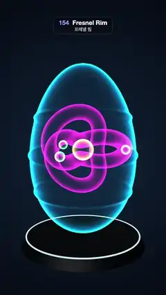

# 154 · Fresnel Rim · 프레넬 림



**EN** A scan ring slides down an egg and back up: above it the egg is white ceramic, below it a cyan x-ray shell glowing only at its edges round a spinning knot.  
**KO** 스캔 고리가 알을 따라 내려갔다 돌아온다. 고리 위는 흰 도자기, 아래는 가장자리만 빛나는 청록 엑스레이 껍질이 되어 안에서 도는 매듭을 드러낸다.

[Video (mp4)](https://sueun-dev.github.io/motion-effects/videos/154-fresnel-rim.mp4) · [Code](../effects/154-fresnel-rim.js) · Materials & surface detail · 재질·표면

## Prompt (English)

```text
Create a "Fresnel Rim" motion effect: an x-ray / hologram shader whose brightness depends only on the viewing angle, so edges seen side-on glow and surfaces facing you disappear, shown on half of an egg cut by a moving scan plane.

Look
- The egg: a lathe of 200 profile points × 160 segments, y from −1.9 to 1.9, radius R(y) = 1.18 · sqrt(1 − (y / 1.9)²) · (1 − 0.1 · y / 1.9) plus three raised bands 0.04 · exp(−((y − c) / 0.06)²) at c = 0.75, −0.1 and −0.95.
- Above the cut the egg is solid: physical material #F4F1EC, roughness 0.32, clearcoat 1 (roughness 0.08), both sides. Below the cut the same egg is drawn with the x-ray shader in cyan #38D9FF (power 4, gain 2.4).
- Inside, drawn only in x-ray, so it shows only below the cut: a torus knot (radius 0.62, tube 0.17, p 2, q 3) magenta #FF4FD8 (power 1.6, gain 1.5); a core sphere (radius 0.24) yellow #FFE36E (1.5, 1.6); three beads (radius 0.11) mint #9CFFB5 (1.4, 1.8).
- X-ray shader: f = (1 − |N · V|)^power in view space; colour = tint × (f × gain + 0.025) × (0.92 + 0.08 · sin(160 · world y)) for faint hologram lines fixed in the world; additive blending, no depth writes, both sides.
- The cut: a ring (tube 0.018) of radius R(h) at height h in HDR cyan (0.6, 2.2, 3), and a 4.6 × 4.6 additive sheet (a radial gradient rgba(80, 220, 255) from 0.35 to 0.12 at 55 % to 0) scaled 0.4 + 0.6 · R(h); both hidden when the cut is above or below the egg.
- A dark plinth (radius 1.3 at the top, 1.42 below, height 0.24) at y = −2.12, #0B1118 with dim reflections, and a glowing ring (radius 1.3) at y = −2.0 in (0.3, 1.2, 1.8).
- Background: a radial gradient #12233A in the middle to #03060C. Room environment at 0.8 and a key light 1.6 from (−4, 6, 6) for the ceramic. Camera: 34° vertical field of view at (0, 2.2, 10.5) looking at (0, 0.05, 0).

Motion (0–5 s), a = 2π · t / 5
- The cut height h = 2.05 − 4.1 · (0.5 − 0.5 · cos a): at 0 s it is above the egg (all x-ray), at 2.5 s below it (all ceramic), and it slides back up by 5 s.
- The knot turns: rotation (0.4, a, 0.2 · sin a). Bead i circles at q = ±a + i · 120° (the middle one the other way): (0.95 · cos q, 0.55 · sin(q + i), 0.95 · sin q).

Technique
- three.js: the solid material keeps y > h with a clipping plane (normal (0, 1, 0), constant −h) and the x-ray ShaderMaterial keeps y < h with the opposite plane (normal (0, −1, 0), constant h); renderer.localClippingEnabled = true, and the ShaderMaterial includes the clipping_planes chunks with clipping: true.
- ACES Filmic tone mapping, antialiasing on.

Output and rules
- One self-contained HTML file with no external assets (three.js from a CDN is fine if you use it), drawing on a 1080 × 1920 canvas (9:16) scaled to fit the window.
- Write a function renderFrame(t) that draws the frame for time t in seconds, and preview it with requestAnimationFrame. Everything must be a pure function of t and fixed seeds: no Math.random(), Date or state carried between frames, so frame i = renderFrame(i / 30) can be exported to a 30 fps video.
- Loop seamlessly every 5 seconds: renderFrame(5) must look exactly like renderFrame(0).
- No flicker of any kind: no noise or grain that changes from frame to frame, no strobing or blinking, no z-fighting, no shimmering 1 px lines. Any grain or texture stays fixed to the screen or to the object.
- Keep the top 280 px free of important content (a title label goes there) and fill the whole frame with a designed background.
```

## 프롬프트 (한국어)

```text
"프레넬 림" 모션 효과를 만들어 줘: 밝기가 보는 각도에만 달린 엑스레이/홀로그램 셰이더로, 옆으로 보이는 가장자리는 빛나고 나를 향한 면은 사라진다. 움직이는 스캔 평면이 자른 알의 한쪽에서 보여 준다.

모양
- 알: 프로필 점 200개 × 160분할 회전체, y는 −1.9에서 1.9, 반지름 R(y) = 1.18 · sqrt(1 − (y / 1.9)²) · (1 − 0.1 · y / 1.9)에 c = 0.75, −0.1, −0.95의 돋은 띠 0.04 · exp(−((y − c) / 0.06)²) 세 개를 더한다.
- 자른 선 위의 알은 단단하다: 물리 재질 #F4F1EC, 거칠기 0.32, 클리어코트 1(거칠기 0.08), 양면. 선 아래는 같은 알을 청록 #38D9FF 엑스레이 셰이더로 그린다(지수 4, 게인 2.4).
- 안쪽은 엑스레이로만 그려 선 아래에서만 보인다: 토러스 매듭(반지름 0.62, 굵기 0.17, p 2, q 3) 자홍 #FF4FD8(1.6, 1.5); 가운데 구(반지름 0.24) 노랑 #FFE36E(1.5, 1.6); 구슬 셋(반지름 0.11) 민트 #9CFFB5(1.4, 1.8).
- 엑스레이 셰이더: 뷰 공간에서 f = (1 − |N · V|)^지수; 색 = 틴트 × (f × 게인 + 0.025) × (0.92 + 0.08 · sin(160 · 월드 y)), 세계에 고정된 희미한 홀로그램 줄; 더하기 블렌딩, 깊이 쓰기 끔, 양면.
- 자른 자리: 높이 h에 반지름 R(h)의 고리(굵기 0.018), HDR 청록 (0.6, 2.2, 3), 그리고 4.6 × 4.6 더하기 판(rgba(80, 220, 255) 원형 그라디언트 0.35에서 55 % 0.12, 끝 0)을 0.4 + 0.6 · R(h)로 키운다. 자른 선이 알 위나 아래에 있으면 둘 다 숨긴다.
- 어두운 받침(위 반지름 1.3, 아래 1.42, 높이 0.24) y = −2.12, #0B1118에 희미한 반사, y = −2.0에 빛나는 고리(반지름 1.3) (0.3, 1.2, 1.8).
- 배경: 가운데 #12233A에서 #03060C로 원형 그라디언트. 도자기용 방 환경맵 0.8, (−4, 6, 6)에서 키 라이트 1.6. 카메라: 세로 시야각 34°, 위치 (0, 2.2, 10.5)에서 (0, 0.05, 0)을 본다.

움직임 (0–5초), a = 2π · t / 5
- 자르는 높이 h = 2.05 − 4.1 · (0.5 − 0.5 · cos a): 0초에는 알 위(전부 엑스레이), 2.5초에는 알 아래(전부 도자기), 5초까지 다시 올라간다.
- 매듭이 돈다: 회전 (0.4, a, 0.2 · sin a). 구슬 i는 q = ±a + i · 120°로 돈다(가운데 것은 반대로): (0.95 · cos q, 0.55 · sin(q + i), 0.95 · sin q).

기법
- three.js: 단단한 재질은 클리핑 평면(법선 (0, 1, 0), 상수 −h)으로 y > h만, 엑스레이 ShaderMaterial은 반대 평면(법선 (0, −1, 0), 상수 h)으로 y < h만 남긴다. renderer.localClippingEnabled = true, ShaderMaterial에는 clipping_planes 청크를 넣고 clipping: true.
- ACES Filmic 톤 매핑, 안티에일리어싱 켬.

출력과 규칙
- 외부 파일 없는 HTML 파일 하나(three.js를 쓴다면 CDN은 괜찮다). 1080 × 1920(9:16) 캔버스에 그리고 창 크기에 맞춰 보이게 한다.
- 시간 t(초)의 프레임을 그리는 renderFrame(t) 함수를 만들고, 미리보기는 requestAnimationFrame으로 돌린다. 모든 것은 t와 고정 시드만으로 정해진다: Math.random(), Date, 프레임 사이에 쌓이는 상태 금지. 그래야 i번째 프레임 = renderFrame(i / 30)으로 30fps 영상을 뽑을 수 있다.
- 5초마다 끊김 없이 반복: renderFrame(5)는 renderFrame(0)과 똑같아 보여야 한다.
- 어떤 깜빡임도 금지: 프레임마다 바뀌는 노이즈·그레인, 번쩍임·깜빡임, z-fighting, 반짝이며 떨리는 1px 선 모두 금지. 그레인·질감은 화면이나 물체에 고정한다.
- 위쪽 280px에는 중요한 내용을 두지 않고(제목 라벨 자리), 화면 전체를 디자인된 배경으로 채운다.
```
