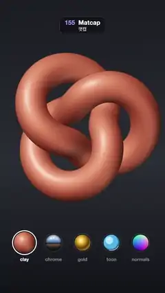

# 155 · Matcap · 맷캡



**EN** A turning torus knot takes its whole look from painted balls: clay, chrome, gold, toon and raw normals wipe across it each second, the ball in use ringed.  
**KO** 돌아가는 토러스 매듭이 그려 둔 구슬 그림에서 겉모습을 통째로 빌린다. 점토·크롬·금·툰·노멀이 1초마다 쓸어 지나가며 바뀌고, 쓰는 구슬엔 고리가 쳐진다.

[Video (mp4)](https://sueun-dev.github.io/motion-effects/videos/155-matcap.mp4) · [Code](../effects/155-matcap.js) · Materials & surface detail · 재질·표면

## Prompt (English)

```text
Create a "Matcap" motion effect: a model with no lights at all that takes its entire look from a picture of a lit ball (a material capture), cycling through five painted matcaps.

Look
- The model: a torus knot (radius 0.86, tube 0.31, 480 × 72 segments, p 2, q 3) at y = 0.42. Camera: 34° vertical field of view at (0, 0, 9.8).
- Background: a vertical gradient #1A1C22 → #2A2D35 (55 %) → #121318.
- Five matcaps, each a 512² canvas with the ball (radius 250) in the middle and the outside filled with its rim colour:
  - clay: radial gradient from (190, 170), radius 330: #F7C2A6 → #D98462 (35 %) → #9C4630 (70 %) → #4A1C12; a warm bounce light at the lower right; a soft white highlight (radius 60) at the upper left.
  - chrome: vertical gradient #F4F8FF → #9BC0EE (30 %) → #3A5A86 (50 %) → a dark horizon #0E1117 (53 %) → #6E5848 (60 %) → #2C221B (80 %) → #100C0A; 55 % darker towards the rim; two white window highlights up left.
  - gold: radial gradient from (205, 185): #FFF7D6 → #FFD86A (18 %) → #C98C1E (45 %) → #5E3A08 (75 %) → #B07A22 at the rim; a sharp white highlight (radius 40).
  - toon: flat bands, shadow #2C6E9E, mid tone #4FB3E8 (circle radius 230 offset up left by 30), light #A8E6FF (radius 120, offset 70), a white highlight ellipse and a rim-light arc #E3F8FF at the lower right.
  - normals: the raw view-space normal as colour, RGB = n · 0.5 + 0.5.
- Below the knot (2D overlay): the five balls in a row at y = 1590, 190 px apart, radius 52 growing to 70 while in use, each with a ring (opacity 0.15 → 1) and its name in 30 px type below.

Motion (0–5 s), a = 2π · t / 5
- Matcap k (0 clay, 1 chrome, 2 gold, 3 toon, 4 normals) shows from t = k s. From 0.45 to 1.0 of each second (smoothstep) the next one wipes in from left to right: the wipe edge runs from −0.15 to 1.15 of the screen width, softened over ±0.06. After the normals, clay wipes back in, so 5 s matches 0 s.
- The knot turns: rotation (0.35 · sin a, a, 0.15 · sin 2a). The lighting stays fixed to the screen as it turns: that is the matcap look.

Technique
- three.js ShaderMaterial: no lights. In view space n = normal, v = direction to the eye; x = normalize(v.z, 0, −v.x), y = cross(v, x), uv = (x · n, y · n) · 0.495 + 0.5 (the same lookup as MeshMatcapMaterial). colour = mix(matcap(next), matcap(current), smoothstep(edge − 0.06, edge + 0.06, fragCoord.x / width)).
- Matcap canvases are sRGB textures; the shader ends with three's colour-space output.

Output and rules
- One self-contained HTML file with no external assets (three.js from a CDN is fine if you use it), drawing on a 1080 × 1920 canvas (9:16) scaled to fit the window.
- Write a function renderFrame(t) that draws the frame for time t in seconds, and preview it with requestAnimationFrame. Everything must be a pure function of t and fixed seeds: no Math.random(), Date or state carried between frames, so frame i = renderFrame(i / 30) can be exported to a 30 fps video.
- Loop seamlessly every 5 seconds: renderFrame(5) must look exactly like renderFrame(0).
- No flicker of any kind: no noise or grain that changes from frame to frame, no strobing or blinking, no z-fighting, no shimmering 1 px lines. Any grain or texture stays fixed to the screen or to the object.
- Keep the top 280 px free of important content (a title label goes there) and fill the whole frame with a designed background.
```

## 프롬프트 (한국어)

```text
"맷캡" 모션 효과를 만들어 줘: 조명이 전혀 없이, 빛 받은 구슬 그림(재질 캡처) 한 장에서 겉모습 전부를 가져오는 모델이 그려 둔 맷캡 다섯 개를 차례로 갈아입는 효과.

모양
- 모델: 토러스 매듭(반지름 0.86, 굵기 0.31, 분할 480 × 72, p 2, q 3), y = 0.42. 카메라: 세로 시야각 34°, 위치 (0, 0, 9.8).
- 배경: 세로 그라디언트 #1A1C22 → #2A2D35(55 %) → #121318.
- 맷캡 다섯 개, 512² 캔버스 가운데에 구슬(반지름 250), 바깥은 테두리 색으로 채운다:
  - 점토: (190, 170)에서 반지름 330 원형 그라디언트 #F7C2A6 → #D98462(35 %) → #9C4630(70 %) → #4A1C12; 오른쪽 아래 따뜻한 반사광; 왼쪽 위 부드러운 흰 하이라이트(반지름 60).
  - 크롬: 세로 그라디언트 #F4F8FF → #9BC0EE(30 %) → #3A5A86(50 %) → 어두운 지평선 #0E1117(53 %) → #6E5848(60 %) → #2C221B(80 %) → #100C0A; 테두리로 갈수록 55 % 어둡게; 왼쪽 위 흰 창문 하이라이트 둘.
  - 금: (205, 185)에서 원형 그라디언트 #FFF7D6 → #FFD86A(18 %) → #C98C1E(45 %) → #5E3A08(75 %) → 테두리 #B07A22; 날카로운 흰 하이라이트(반지름 40).
  - 툰: 평평한 단계, 그림자 #2C6E9E, 중간 #4FB3E8(반지름 230 원을 왼쪽 위로 30), 밝은 면 #A8E6FF(반지름 120, 70 이동), 흰 하이라이트 타원, 오른쪽 아래 림 라이트 호 #E3F8FF.
  - 노멀: 뷰 공간 법선을 그대로 색으로, RGB = n · 0.5 + 0.5.
- 매듭 아래(2D 오버레이): 구슬 다섯 개를 y = 1590에 190px 간격으로, 반지름 52, 쓰는 동안 70으로 커지고, 고리(불투명도 0.15 → 1)와 아래에 30px 이름.

움직임 (0–5초), a = 2π · t / 5
- 맷캡 k(0 점토, 1 크롬, 2 금, 3 툰, 4 노멀)가 t = k초부터 보인다. 매초 0.45–1.0 구간(smoothstep)에 다음 맷캡이 왼쪽에서 오른쪽으로 쓸고 들어온다: 경계는 화면 폭의 −0.15에서 1.15로, ±0.06 부드럽게. 노멀 다음에 점토가 다시 들어와 5초가 0초와 맞는다.
- 매듭이 돈다: 회전 (0.35 · sin a, a, 0.15 · sin 2a). 돌아도 빛은 화면에 고정된 채 있다. 그게 맷캡의 모습이다.

기법
- three.js ShaderMaterial, 조명 없음. 뷰 공간에서 n = 법선, v = 눈 쪽 방향; x = normalize(v.z, 0, −v.x), y = cross(v, x), uv = (x · n, y · n) · 0.495 + 0.5(MeshMatcapMaterial과 같은 조회). 색 = mix(matcap(다음), matcap(지금), smoothstep(경계 − 0.06, 경계 + 0.06, fragCoord.x / 폭)).
- 맷캡 캔버스는 sRGB 텍스처, 셰이더 끝에 three의 색 공간 출력.

출력과 규칙
- 외부 파일 없는 HTML 파일 하나(three.js를 쓴다면 CDN은 괜찮다). 1080 × 1920(9:16) 캔버스에 그리고 창 크기에 맞춰 보이게 한다.
- 시간 t(초)의 프레임을 그리는 renderFrame(t) 함수를 만들고, 미리보기는 requestAnimationFrame으로 돌린다. 모든 것은 t와 고정 시드만으로 정해진다: Math.random(), Date, 프레임 사이에 쌓이는 상태 금지. 그래야 i번째 프레임 = renderFrame(i / 30)으로 30fps 영상을 뽑을 수 있다.
- 5초마다 끊김 없이 반복: renderFrame(5)는 renderFrame(0)과 똑같아 보여야 한다.
- 어떤 깜빡임도 금지: 프레임마다 바뀌는 노이즈·그레인, 번쩍임·깜빡임, z-fighting, 반짝이며 떨리는 1px 선 모두 금지. 그레인·질감은 화면이나 물체에 고정한다.
- 위쪽 280px에는 중요한 내용을 두지 않고(제목 라벨 자리), 화면 전체를 디자인된 배경으로 채운다.
```
