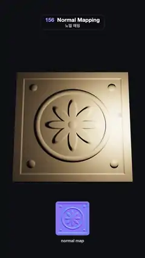

# 156 · Normal Mapping · 노멀 매핑



**EN** A flat stone tile looks deeply carved as a lamp circles over it, then tips edge-on to show it is one flat quad of two triangles; its normal map sits below.  
**KO** 평평한 돌 타일이 위를 도는 램프 아래 깊이 새긴 듯 보이다가, 옆으로 눕혀지며 삼각형 두 개짜리 납작한 판임을 드러낸다. 아래에는 그 노멀 맵이 놓인다.

[Video (mp4)](https://sueun-dev.github.io/motion-effects/videos/156-normal-mapping.mp4) · [Code](../effects/156-normal-mapping.js) · Materials & surface detail · 재질·표면

## Prompt (English)

```text
Create a "Normal Mapping" motion effect: a single flat quad that looks deeply carved because a normal map tilts the lighting normal per pixel, and a tip to a grazing angle that shows it is flat.

Look
- The height field, 1024² over (x, y) in −1..1 (dome(d, w) = sqrt(1 − (d / w)²)): a field at 0.35 + 0.04 · fbm(4x, 4y); a raised frame 0.9 · smoothstep(0.84, 0.88, max(|x|, |y|)); a rounded ring 0.35 + 0.5 · dome(r − 0.62, 0.05); a carved groove −0.28 · dome(r − 0.72, 0.035); eight petals where r < 0.2 + 0.26 · |cos 4θ|^1.5, raised 0.45 · (1 − 0.35 r) with a soft edge; a boss 0.35 + 0.6 · dome(r, 0.11); four studs 0.45 · dome(0.07) at (±0.7, ±0.7). Combine with max (the groove subtracts).
- The normal map: central differences × 22, RGB = (−dx, −dy, 1) / length · 0.5 + 0.5 (x right, y up).
- The tile: a 2.7 × 2.7 plane with 1 × 1 segments (two triangles), standard material #D2C2A6, roughness 0.62, with the normal map (anisotropy 8); under it a 0.08 thick slab #8C7E68. The tile group sits at y = 0.55.
- A lamp in the tile's own frame: a point light #FFE6C2, intensity 7, decay 2, drawn as a bead (radius 0.05). A hemisphere light #8C9BC0 / #2A2018 at 0.35. Background #0E0F13. Camera: 32° vertical field of view at (0, 0.2, 10.5) looking at (0, 0.45, 0).
- The two triangles: 4 px fat lines #4FE3FF along the square and its diagonal, drawn on top of everything, opacity smoothstep(0.15, 0.6, tip).
- Below the tile (2D overlay): the normal-map canvas as a 250 px rounded card centred at y = 1500, outlined in white at 35 %, with "normal map" in 30 px type under it.

Motion (0–5 s), a = 2π · t / 5
- The lamp circles low over the tile: (1.05 · cos a, 1.05 · sin a, 0.65) in the tile's frame. Petals, ring, studs and frame light up on one side and fall into shadow on the other as it goes round.
- tip = smoothstep(1.3, 2.3, t) · (1 − smoothstep(2.9, 3.9, t)): the tile turns about x by −0.3 − 1.08 · tip (from almost facing you to about 79°, edge-on), while the lines fade in. Seen from the side its outline is a straight line: there is no relief, only lighting. It turns back by 3.9 s.
- A gentle sway about y: 0.26 · sin a.

Technique
- three.js MeshStandardMaterial with a tangent-space normalMap from a CanvasTexture; Line2 / LineMaterial (linewidth 4, resolution 1080 × 1920) for the triangle edges; the canvas also drawn by the 2D overlay.
- ACES Filmic tone mapping, antialiasing on.

Output and rules
- One self-contained HTML file with no external assets (three.js from a CDN is fine if you use it), drawing on a 1080 × 1920 canvas (9:16) scaled to fit the window.
- Write a function renderFrame(t) that draws the frame for time t in seconds, and preview it with requestAnimationFrame. Everything must be a pure function of t and fixed seeds: no Math.random(), Date or state carried between frames, so frame i = renderFrame(i / 30) can be exported to a 30 fps video.
- Loop seamlessly every 5 seconds: renderFrame(5) must look exactly like renderFrame(0).
- No flicker of any kind: no noise or grain that changes from frame to frame, no strobing or blinking, no z-fighting, no shimmering 1 px lines. Any grain or texture stays fixed to the screen or to the object.
- Keep the top 280 px free of important content (a title label goes there) and fill the whole frame with a designed background.
```

## 프롬프트 (한국어)

```text
"노멀 매핑" 모션 효과를 만들어 줘: 노멀 맵이 픽셀마다 조명 법선을 기울여 깊이 새긴 듯 보이는 평평한 사각형 하나, 그리고 비스듬히 눕혀 납작함을 보여 주는 효과.

모양
- 높이 필드, (x, y) −1..1에서 1024²(dome(d, w) = sqrt(1 − (d / w)²)): 바탕 0.35 + 0.04 · fbm(4x, 4y); 돋은 테두리 0.9 · smoothstep(0.84, 0.88, max(|x|, |y|)); 둥근 고리 0.35 + 0.5 · dome(r − 0.62, 0.05); 파인 홈 −0.28 · dome(r − 0.72, 0.035); r < 0.2 + 0.26 · |cos 4θ|^1.5인 꽃잎 여덟 장, 0.45 · (1 − 0.35 r)만큼 돋고 가장자리는 부드럽게; 가운데 혹 0.35 + 0.6 · dome(r, 0.11); (±0.7, ±0.7)에 징 넷 0.45 · dome(0.07). max로 합친다(홈은 뺀다).
- 노멀 맵: 중앙 차분 × 22, RGB = (−dx, −dy, 1) / 길이 · 0.5 + 0.5(x 오른쪽, y 위).
- 타일: 2.7 × 2.7 평면, 분할 1 × 1(삼각형 둘), 표준 재질 #D2C2A6, 거칠기 0.62, 노멀 맵(이방성 필터 8); 아래에 두께 0.08 판 #8C7E68. 타일 그룹은 y = 0.55.
- 타일 자체 좌표계 안의 램프: 점광원 #FFE6C2, 세기 7, 감쇠 2, 구슬(반지름 0.05)로 보인다. 반구광 #8C9BC0 / #2A2018, 0.35. 배경 #0E0F13. 카메라: 세로 시야각 32°, 위치 (0, 0.2, 10.5)에서 (0, 0.45, 0)을 본다.
- 삼각형 둘: 정사각형 테두리와 대각선을 4px 굵은 선 #4FE3FF로, 모든 것 위에 그리고, 불투명도 smoothstep(0.15, 0.6, tip).
- 타일 아래(2D 오버레이): 노멀 맵 캔버스를 250px 둥근 카드로 y = 1500 가운데에, 흰색 35 % 테두리, 아래에 30px "normal map".

움직임 (0–5초), a = 2π · t / 5
- 램프가 타일 위를 낮게 돈다: 타일 좌표계에서 (1.05 · cos a, 1.05 · sin a, 0.65). 돌 때마다 꽃잎, 고리, 징, 테두리의 한쪽은 밝아지고 반대쪽은 그림자에 잠긴다.
- tip = smoothstep(1.3, 2.3, t) · (1 − smoothstep(2.9, 3.9, t)): 타일이 x축으로 −0.3 − 1.08 · tip 돈다(거의 정면에서 약 79°, 거의 옆모습까지). 그동안 선이 나타난다. 옆에서 본 윤곽은 곧은 선이다. 입체는 없고 조명만 있다. 3.9초까지 돌아온다.
- y축으로 살짝 흔들림: 0.26 · sin a.

기법
- three.js MeshStandardMaterial에 CanvasTexture로 만든 탄젠트 공간 normalMap; 삼각형 테두리는 Line2 / LineMaterial(linewidth 4, resolution 1080 × 1920); 같은 캔버스를 2D 오버레이에도 그린다.
- ACES Filmic 톤 매핑, 안티에일리어싱 켬.

출력과 규칙
- 외부 파일 없는 HTML 파일 하나(three.js를 쓴다면 CDN은 괜찮다). 1080 × 1920(9:16) 캔버스에 그리고 창 크기에 맞춰 보이게 한다.
- 시간 t(초)의 프레임을 그리는 renderFrame(t) 함수를 만들고, 미리보기는 requestAnimationFrame으로 돌린다. 모든 것은 t와 고정 시드만으로 정해진다: Math.random(), Date, 프레임 사이에 쌓이는 상태 금지. 그래야 i번째 프레임 = renderFrame(i / 30)으로 30fps 영상을 뽑을 수 있다.
- 5초마다 끊김 없이 반복: renderFrame(5)는 renderFrame(0)과 똑같아 보여야 한다.
- 어떤 깜빡임도 금지: 프레임마다 바뀌는 노이즈·그레인, 번쩍임·깜빡임, z-fighting, 반짝이며 떨리는 1px 선 모두 금지. 그레인·질감은 화면이나 물체에 고정한다.
- 위쪽 280px에는 중요한 내용을 두지 않고(제목 라벨 자리), 화면 전체를 디자인된 배경으로 채운다.
```
