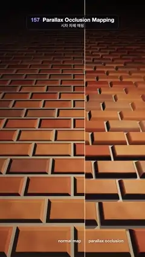

# 157 · Parallax Occlusion Mapping · 시차 차폐 매핑



**EN** A torch-lit brick floor split by a sliding divider: plain normal mapping on the left looks flat, parallax occlusion on the right shows deep mortar and shadows.  
**KO** 횃불이 비추는 벽돌 바닥을 움직이는 경계선이 가른다. 왼쪽 일반 노멀 매핑은 납작해 보이고, 오른쪽 시차 차폐 매핑은 깊은 줄눈과 그림자를 보여 준다.

[Video (mp4)](https://sueun-dev.github.io/motion-effects/videos/157-parallax-occlusion-mapping.mp4) · [Code](../effects/157-parallax-occlusion-mapping.js) · Materials & surface detail · 재질·표면

## Prompt (English)

```text
Create a "Parallax Occlusion Mapping" motion effect: a brick floor that is one flat plane, rendered with plain normal mapping on one side of a moving divider and with parallax occlusion mapping (a ray march through the height field) on the other.

Look
- The floor: the plane y = 0. Bricks 0.42 × 0.2 in running bond (every other row shifted by half a brick); the mortar lies D = 0.085 below the plane.
- Height h (1 = the plane): mix(mortar 0.08 + 0.04 · vnoise(12p), brick top − 0.06 · vnoise(14p + 9r), sqrt(smoothstep(0.011, 0.04, distance to the brick's edge))), where r is a per-brick hash and the brick top is 0.86 + 0.1 · r plus a small random tilt along the brick.
- Colour: bricks mix (0.42, 0.13, 0.08) to (0.62, 0.28, 0.14) by the brick hash, about 18 % of them 60 % towards a dusky (0.3, 0.2, 0.16), all × (0.85 + 0.25 · vnoise(9p)); mortar (0.5, 0.47, 0.42).
- Lighting: a torch, warm (1, 0.72, 0.45) × 3.2 with falloff 1 / (1 + 0.55 · d²); ambient (0.05, 0.06, 0.09); specular power 18 × 0.25; everything × exp(−0.3 · distance from the camera), so the floor fades into darkness far away (the top of the frame).
- Camera: origin as below, looking 45° down: forward = normalize(sin yaw, −1, −cos yaw), rays forward + 0.45 · (uv.x · right + uv.y · up).
- The divider: a soft warm line (Gaussian, 2.2 px) at x = (0.5 + 0.15 · sin(a + 0.6)) · width. Labels (2D overlay, 30 px, warm white with a dark shadow) ride with it at y = 1810: "normal map" ending 28 px left of it, "parallax occlusion" starting 28 px right of it.

Motion (0–5 s), a = 2π · t / 5
- The camera drifts in a small circle: (0.06 · sin a, 1.35 + 0.02 · sin 2a, −0.06 · cos a), yaw 0.025 · sin a.
- The torch circles low over the floor: (0.75 · cos a, 0.95, −1.35 + 0.45 · sin a); the brick shadows swing round on the right.
- The divider slides between 35 % and 65 % of the width and back, so the same bricks are seen both ways: on the left they light up but stay flat; on the right they stand up, hide the mortar behind them and cast shadows.

Technique
- One WebGL2 fragment shader. Intersect each view ray with the plane. Left of the divider: shade there with normals from the height field (plain normal mapping).
- Right of the divider, parallax occlusion: n = mix(96, 48, |rd.y|) layers; each step moves the ray D / |rd.y| / n deeper; stop at the first layer where (1 − h) − depth ≤ 0 and refine linearly between the last two layers. Shade at the hit point.
- Self-shadow: from the hit march 36 steps of 0.004 towards the torch; sh = min(sh, clamp(0.5 + 6 · clearance / s, 0, 1)), and light × (0.3 + 0.7 · sh).
- Normals: central differences of h (e = 0.0015) scaled by D. 2 × 2 supersampling, an ACES-style curve, gamma 2.2 and a fixed one-level grain.

Output and rules
- One self-contained HTML file with no external assets (three.js from a CDN is fine if you use it), drawing on a 1080 × 1920 canvas (9:16) scaled to fit the window.
- Write a function renderFrame(t) that draws the frame for time t in seconds, and preview it with requestAnimationFrame. Everything must be a pure function of t and fixed seeds: no Math.random(), Date or state carried between frames, so frame i = renderFrame(i / 30) can be exported to a 30 fps video.
- Loop seamlessly every 5 seconds: renderFrame(5) must look exactly like renderFrame(0).
- No flicker of any kind: no noise or grain that changes from frame to frame, no strobing or blinking, no z-fighting, no shimmering 1 px lines. Any grain or texture stays fixed to the screen or to the object.
- Keep the top 280 px free of important content (a title label goes there) and fill the whole frame with a designed background.
```

## 프롬프트 (한국어)

```text
"시차 차폐 매핑" 모션 효과를 만들어 줘: 평평한 평면 하나인 벽돌 바닥을, 움직이는 경계선 한쪽은 일반 노멀 매핑으로, 다른 쪽은 시차 차폐 매핑(높이 필드 안으로 광선 행진)으로 그리는 효과.

모양
- 바닥: 평면 y = 0. 0.42 × 0.2 벽돌을 반 장씩 엇갈려 쌓는다(한 줄 건너 반 장 이동). 줄눈은 평면보다 D = 0.085 아래.
- 높이 h(1 = 평면): mix(줄눈 0.08 + 0.04 · vnoise(12p), 벽돌 윗면 − 0.06 · vnoise(14p + 9r), sqrt(smoothstep(0.011, 0.04, 벽돌 가장자리까지 거리))). r은 벽돌마다의 해시, 벽돌 윗면은 0.86 + 0.1 · r에 길이 방향으로 살짝 무작위 기울기.
- 색: 벽돌은 해시로 (0.42, 0.13, 0.08)에서 (0.62, 0.28, 0.14) 사이, 약 18 %는 칙칙한 (0.3, 0.2, 0.16) 쪽으로 60 %, 모두 × (0.85 + 0.25 · vnoise(9p)); 줄눈 (0.5, 0.47, 0.42).
- 조명: 횃불, 따뜻한 (1, 0.72, 0.45) × 3.2, 감쇠 1 / (1 + 0.55 · d²); 주변광 (0.05, 0.06, 0.09); 반사광 지수 18 × 0.25; 전부 × exp(−0.3 · 카메라 거리)로 먼 바닥(화면 위쪽)은 어둠에 잠긴다.
- 카메라: 원점은 아래 움직임 참고, 45° 아래를 본다: forward = normalize(sin yaw, −1, −cos yaw), 광선 forward + 0.45 · (uv.x · right + uv.y · up).
- 경계선: x = (0.5 + 0.15 · sin(a + 0.6)) · 폭에 부드러운 따뜻한 선(가우스, 2.2px). 라벨(2D 오버레이, 30px, 어두운 그림자 진 따뜻한 흰색)이 y = 1810에서 함께 움직인다: "normal map"은 선 왼쪽 28px에서 끝나고, "parallax occlusion"은 선 오른쪽 28px에서 시작한다.

움직임 (0–5초), a = 2π · t / 5
- 카메라가 작은 원을 그린다: (0.06 · sin a, 1.35 + 0.02 · sin 2a, −0.06 · cos a), yaw 0.025 · sin a.
- 횃불이 바닥 위를 낮게 돈다: (0.75 · cos a, 0.95, −1.35 + 0.45 · sin a). 오른쪽의 벽돌 그림자가 따라 돈다.
- 경계선이 폭의 35 %와 65 % 사이를 오가며 같은 벽돌을 두 방식으로 보여 준다: 왼쪽에서는 빛은 받지만 납작하고, 오른쪽에서는 솟아올라 뒤의 줄눈을 가리고 그림자를 드리운다.

기법
- WebGL2 프래그먼트 셰이더 하나. 시선 광선을 평면과 교차시킨다. 경계선 왼쪽: 그 점에서 높이 필드 법선으로 칠한다(일반 노멀 매핑).
- 경계선 오른쪽, 시차 차폐: 층 수 n = mix(96, 48, |rd.y|); 한 걸음마다 광선이 D / |rd.y| / n만큼 깊어진다; (1 − h) − 깊이 ≤ 0이 되는 첫 층에서 멈추고 마지막 두 층 사이를 선형으로 보정한다. 그 점에서 칠한다.
- 자기 그림자: 맞은 점에서 횃불 쪽으로 0.004씩 36걸음; sh = min(sh, clamp(0.5 + 6 · 여유 높이 / s, 0, 1)), 빛 × (0.3 + 0.7 · sh).
- 법선: h의 중앙 차분(e = 0.0015)에 D를 곱한다. 2 × 2 슈퍼샘플링, ACES 비슷한 곡선, 감마 2.2, 고정된 1단계 그레인.

출력과 규칙
- 외부 파일 없는 HTML 파일 하나(three.js를 쓴다면 CDN은 괜찮다). 1080 × 1920(9:16) 캔버스에 그리고 창 크기에 맞춰 보이게 한다.
- 시간 t(초)의 프레임을 그리는 renderFrame(t) 함수를 만들고, 미리보기는 requestAnimationFrame으로 돌린다. 모든 것은 t와 고정 시드만으로 정해진다: Math.random(), Date, 프레임 사이에 쌓이는 상태 금지. 그래야 i번째 프레임 = renderFrame(i / 30)으로 30fps 영상을 뽑을 수 있다.
- 5초마다 끊김 없이 반복: renderFrame(5)는 renderFrame(0)과 똑같아 보여야 한다.
- 어떤 깜빡임도 금지: 프레임마다 바뀌는 노이즈·그레인, 번쩍임·깜빡임, z-fighting, 반짝이며 떨리는 1px 선 모두 금지. 그레인·질감은 화면이나 물체에 고정한다.
- 위쪽 280px에는 중요한 내용을 두지 않고(제목 라벨 자리), 화면 전체를 디자인된 배경으로 채운다.
```
