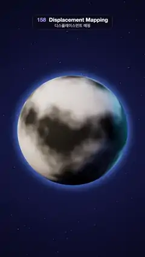

# 158 · Displacement Mapping · 디스플레이스먼트 매핑



**EN** A smooth grey ball painted with its own height map pushes its vertices outward into a planet of seas, ridges and snowy peaks, then sinks back.  
**KO** 자기 높이 맵이 칠해진 매끈한 회색 공이 꼭짓점을 밖으로 밀어 바다·산맥·눈 덮인 봉우리의 행성이 되었다가 다시 가라앉는다.

[Video (mp4)](https://sueun-dev.github.io/motion-effects/videos/158-displacement-mapping.mp4) · [Code](../effects/158-displacement-mapping.js) · Materials & surface detail · 재질·표면

## Prompt (English)

```text
Create a "Displacement Mapping" motion effect: a smooth ball painted with a greyscale height map grows real mountains out of that map (the vertices move, so the silhouette breaks), turns into a small planet, then sinks back to a ball.

Look
- A geodesic sphere of radius 1.55 with 146,412 shared vertices (icosahedron detail 120, vertices merged so recomputed normals are smooth and seamless), tilted (0.32, 0, −0.18) rad.
- Height h (0–1) per vertex from its direction p on the unit sphere: continents c = 4-octave fractal noise at 1.2 · p; ridges r = 1 − |noise(2.6 · p)|; h = clamp(0.5 + 1.1 c + 0.55 r² · max(0, c + 0.04)). Sea level 0.46: below it the surface stays flat.
- Two vertex colourings, crossfaded:
  - the height map itself in grey: 0.03 + 0.92 · smoothstep(0.22, 0.88, h);
  - terrain: deep sea #0B2259 → shallow #2C78C2 → sand #E6D49C → grass #6BA552 → forest #3E6D35 (0.66) → rock #80654A (0.76) → scree #B7AEA2 (0.86) → snow #F4F6FA (0.93).
- Material: standard, roughness 0.82, vertex colours. Lights: hemisphere #A9C2FF / #2A1E3A at 1.0; a warm sun #FFE7C4 at 3.0 from (−6, 4, 5) with a 4096² PCF soft shadow map, so peaks shade their own valleys; a cyan rim light #6FD3FF at 2.6 from (6, 1.5, −5).
- An atmosphere halo: the back faces of a sphere 1.18 × the radius, additive blue (0.3, 0.6, 1.0) glow strongest just outside the planet's edge.
- Background: a radial gradient #1C2457 → #0D1030 → #05060F with 420 fixed stars (0.8–2.4 px, seeded).
- Camera: 30° field of view at (0, 0.4, 13.6) looking at (0, 0.05, 0); the planet fills the middle (about y 500–1450 px). ACES Filmic tone mapping.

Motion (0–5 s), a = 2π · t / 5
- Amount: amt = smoothstep(0.08, 0.92, 0.5 − 0.5 cos a): 0 at 0 s and 5 s, full at 2.5 s, with a short hold at each end.
- Each vertex sits at radius 1.55 · (1 + 0.36 · amt · (max(h, 0.46) − 0.46)): up to about +19 % for the highest peaks. Normals are recomputed every frame.
- Colours crossfade from the grey height map to terrain with k = smoothstep(0.1, 0.75, amt); the halo brightens from 0.45 to 1.0 with k.
- The planet sways about its axis: 2.4 + 0.32 · sin(a) rad.

Technique
- three.js. Real displacement on the CPU: keep the rest positions and the per-vertex height, and each frame write position = direction · radius · (1 + lift · height), then computeVertexNormals(). The silhouette, the self-shadowing and the lighting all change, unlike a normal or bump map.
- Heights come from 3D noise on the sphere direction, so there is no UV seam or pole pinch.

Output and rules
- One self-contained HTML file with no external assets (three.js from a CDN is fine if you use it), drawing on a 1080 × 1920 canvas (9:16) scaled to fit the window.
- Write a function renderFrame(t) that draws the frame for time t in seconds, and preview it with requestAnimationFrame. Everything must be a pure function of t and fixed seeds: no Math.random(), Date or state carried between frames, so frame i = renderFrame(i / 30) can be exported to a 30 fps video.
- Loop seamlessly every 5 seconds: renderFrame(5) must look exactly like renderFrame(0).
- No flicker of any kind: no noise or grain that changes from frame to frame, no strobing or blinking, no z-fighting, no shimmering 1 px lines. Any grain or texture stays fixed to the screen or to the object.
- Keep the top 280 px free of important content (a title label goes there) and fill the whole frame with a designed background.
```

## 프롬프트 (한국어)

```text
"디스플레이스먼트 매핑" 모션 효과를 만들어 줘: 회색 높이 맵이 칠해진 매끈한 공이 그 맵대로 진짜 산을 밀어 올려(꼭짓점이 움직여 실루엣이 깨진다) 작은 행성이 되었다가 다시 공으로 가라앉는 효과.

모양
- 반지름 1.55의 지오데식 구, 공유 꼭짓점 146,412개(정이십면체 detail 120, 꼭짓점을 병합해 다시 계산한 법선이 매끄럽고 이음매가 없다), 기울기 (0.32, 0, −0.18) rad.
- 꼭짓점마다 단위 구 위 방향 p로 높이 h(0–1)를 정한다: 대륙 c = 1.2 · p에서 4옥타브 프랙털 노이즈; 능선 r = 1 − |noise(2.6 · p)|; h = clamp(0.5 + 1.1 c + 0.55 r² · max(0, c + 0.04)). 해수면 0.46: 그 아래는 평평하게 둔다.
- 꼭짓점 색 두 가지를 크로스페이드:
  - 높이 맵 자체를 회색으로: 0.03 + 0.92 · smoothstep(0.22, 0.88, h);
  - 지형: 깊은 바다 #0B2259 → 얕은 바다 #2C78C2 → 모래 #E6D49C → 풀 #6BA552 → 숲 #3E6D35(0.66) → 바위 #80654A(0.76) → 자갈 #B7AEA2(0.86) → 눈 #F4F6FA(0.93).
- 재질: 표준, 거칠기 0.82, 꼭짓점 색. 조명: 반구광 #A9C2FF / #2A1E3A 세기 1.0; 따뜻한 태양 #FFE7C4 세기 3.0, 위치 (−6, 4, 5), 4096² PCF 소프트 그림자 맵으로 봉우리가 자기 골짜기에 그림자를 드리운다; 하늘색 림 라이트 #6FD3FF 세기 2.6, 위치 (6, 1.5, −5).
- 대기 헤일로: 반지름 1.18배 구의 뒷면을 가산 합성한 파란 빛 (0.3, 0.6, 1.0), 행성 가장자리 바로 바깥이 가장 밝다.
- 배경: 방사형 그라디언트 #1C2457 → #0D1030 → #05060F, 고정된 별 420개(0.8–2.4 px, 시드 고정).
- 카메라: 시야각 30°, 위치 (0, 0.4, 13.6)에서 (0, 0.05, 0)을 본다. 행성이 화면 가운데(대략 y 500–1450 px)를 채운다. ACES Filmic 톤 매핑.

움직임 (0–5초), a = 2π · t / 5
- 양: amt = smoothstep(0.08, 0.92, 0.5 − 0.5 cos a): 0초와 5초에 0, 2.5초에 최대, 양 끝에 짧게 머문다.
- 각 꼭짓점의 반지름 = 1.55 · (1 + 0.36 · amt · (max(h, 0.46) − 0.46)): 가장 높은 봉우리는 약 +19 %. 법선은 매 프레임 다시 계산한다.
- 색은 k = smoothstep(0.1, 0.75, amt)로 회색 높이 맵에서 지형으로 바뀌고, 헤일로는 k에 따라 0.45에서 1.0으로 밝아진다.
- 행성은 축을 중심으로 흔들린다: 2.4 + 0.32 · sin(a) rad.

기법
- three.js. CPU에서 하는 진짜 디스플레이스먼트: 원래 위치와 꼭짓점별 높이를 보관해 두고 매 프레임 위치 = 방향 · 반지름 · (1 + 높이 배율 · 높이)로 쓴 뒤 computeVertexNormals()를 부른다. 노멀 맵이나 범프 맵과 달리 실루엣, 자기 그림자, 조명이 모두 바뀐다.
- 높이는 구의 방향으로 읽는 3D 노이즈라 UV 이음매나 극점 찌그러짐이 없다.

출력과 규칙
- 외부 파일 없는 HTML 파일 하나(three.js를 쓴다면 CDN은 괜찮다). 1080 × 1920(9:16) 캔버스에 그리고 창 크기에 맞춰 보이게 한다.
- 시간 t(초)의 프레임을 그리는 renderFrame(t) 함수를 만들고, 미리보기는 requestAnimationFrame으로 돌린다. 모든 것은 t와 고정 시드만으로 정해진다: Math.random(), Date, 프레임 사이에 쌓이는 상태 금지. 그래야 i번째 프레임 = renderFrame(i / 30)으로 30fps 영상을 뽑을 수 있다.
- 5초마다 끊김 없이 반복: renderFrame(5)는 renderFrame(0)과 똑같아 보여야 한다.
- 어떤 깜빡임도 금지: 프레임마다 바뀌는 노이즈·그레인, 번쩍임·깜빡임, z-fighting, 반짝이며 떨리는 1px 선 모두 금지. 그레인·질감은 화면이나 물체에 고정한다.
- 위쪽 280px에는 중요한 내용을 두지 않고(제목 라벨 자리), 화면 전체를 디자인된 배경으로 채운다.
```
