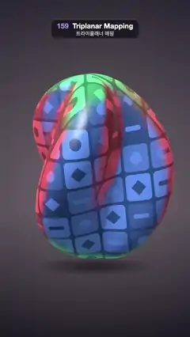

# 159 · Triplanar Mapping · 트라이플래너 매핑



**EN** A twisted three-lobed blob with no UVs wears glazed tiles projected from three axes; red, green and blue tints show each projection, then fade.  
**KO** UV가 없는 비틀린 세 갈래 덩어리에 세 축에서 투영한 유약 타일이 입혀지고, 빨강·초록·파랑 색조가 각 투영을 보여 준 뒤 사라진다.

[Video (mp4)](https://sueun-dev.github.io/motion-effects/videos/159-triplanar-mapping.mp4) · [Code](../effects/159-triplanar-mapping.js) · Materials & surface detail · 재질·표면

## Prompt (English)

```text
Create a "Triplanar Mapping" motion effect: a twisted blob with no texture coordinates is covered in tiles by projecting one texture along the X, Y and Z axes and blending the three by the surface normal; a debug tint shows which projection wins where.

Look
- The blob: a geodesic sphere (icosahedron detail 90, vertices merged) reshaped per vertex: lobes = 1 + 0.3 · cos(3 · atan2(z, x) + 2.4 · y); new position (1.25 · x · lobes, 1.95 · y, 1.25 · z · lobes), so three lobes twist up its height; smooth recomputed normals.
- The texture: a seamless 1200 px canvas of 6 × 6 rounded tiles (corner radius 26 px, 10 px of dark grout #3B3340) in glazes #F2E8D5 (most often), #E9B44C, #1B998B, #E4572E, #2E4057 picked by a seeded random; each tile carries a motif (circle, diamond or bar, by (x + y) mod 3) in cream or navy. Repeat wrapping, anisotropy 16.
- Projection: in object space (so the tiles stay on the object), sample the texture at p.zy, p.xz and p.xy × 0.3 (one texture repeat is about 3.3 units); weights w = |normal|⁸, normalised to sum 1.
- Debug view: each projection shown as grey (0.25 + its luminance) times its axis colour: X red (0.95, 0.12, 0.14), Y green (0.12, 0.85, 0.32), Z blue (0.12, 0.3, 0.95); the colours mix in the blend zones.
- Shading: light from (−0.5, 0.8, 0.55): albedo · (0.22 + 0.3 · hemisphere + 1.0 · diffuse) + Blinn specular (power 60, 0.55) + a faint blue fresnel rim.
- Background: a vertical gradient #2B2733 → #4A4250 (62 %) → #1E1B24, a warm radial glow behind the blob and a soft elliptical contact shadow at y ≈ 1520 px.
- Camera: 30° field of view at (0, 0.6, 13) looking at the origin; the blob fills y ≈ 420–1480 px.

Motion (0–5 s), a = 2π · t / 5
- The blob sways and wobbles: rotation (0.2 + 0.14 sin a, 0.42 sin a, 0.1 cos a) rad, height 0.08 · sin(2a).
- Tint amount = 1 − smoothstep(0.6, 1.6, t) + smoothstep(3.4, 4.4, t): full debug colours at 0 s, the plain seamless tiles from 1.6 to 3.4 s, colours back by 4.4 s and held to 5 s.

Technique
- three.js ShaderMaterial. Vertex shader passes the object-space position and normal plus world normal and position; the fragment shader does three texture lookups, blends them by the sharpened normal weights and lights the result.
- No UV unwrap, so there are no seams or stretched tiles anywhere; the only sign of the method is the narrow cross-fade where two projections meet, which the tint makes obvious.

Output and rules
- One self-contained HTML file with no external assets (three.js from a CDN is fine if you use it), drawing on a 1080 × 1920 canvas (9:16) scaled to fit the window.
- Write a function renderFrame(t) that draws the frame for time t in seconds, and preview it with requestAnimationFrame. Everything must be a pure function of t and fixed seeds: no Math.random(), Date or state carried between frames, so frame i = renderFrame(i / 30) can be exported to a 30 fps video.
- Loop seamlessly every 5 seconds: renderFrame(5) must look exactly like renderFrame(0).
- No flicker of any kind: no noise or grain that changes from frame to frame, no strobing or blinking, no z-fighting, no shimmering 1 px lines. Any grain or texture stays fixed to the screen or to the object.
- Keep the top 280 px free of important content (a title label goes there) and fill the whole frame with a designed background.
```

## 프롬프트 (한국어)

```text
"트라이플래너 매핑" 모션 효과를 만들어 줘: 텍스처 좌표가 없는 비틀린 덩어리에 하나의 텍스처를 X, Y, Z 세 축으로 투영하고 표면 법선으로 섞어 타일을 입히는 효과. 디버그 색조가 어느 투영이 어디를 맡는지 보여 준다.

모양
- 덩어리: 지오데식 구(정이십면체 detail 90, 꼭짓점 병합)를 꼭짓점마다 변형한다: lobes = 1 + 0.3 · cos(3 · atan2(z, x) + 2.4 · y); 새 위치 (1.25 · x · lobes, 1.95 · y, 1.25 · z · lobes). 세 갈래가 높이를 따라 비틀려 올라간다. 법선은 다시 계산해 매끄럽게.
- 텍스처: 이음매 없는 1200 px 캔버스에 6 × 6 둥근 타일(모서리 반지름 26 px, 어두운 줄눈 #3B3340 10 px). 유약 색 #F2E8D5(가장 자주), #E9B44C, #1B998B, #E4572E, #2E4057을 시드 고정 난수로 고른다. 타일마다 무늬(원, 마름모, 막대 중 (x + y) mod 3)를 크림색 또는 남색으로. 반복 래핑, 이방성 16.
- 투영: 물체 공간에서(타일이 물체에 붙어 있도록) p.zy, p.xz, p.xy × 0.3으로 텍스처를 읽는다(한 번 반복이 약 3.3 단위). 가중치 w = |법선|⁸, 합이 1이 되게 정규화.
- 디버그 화면: 각 투영을 회색(0.25 + 밝기) × 축 색으로: X 빨강 (0.95, 0.12, 0.14), Y 초록 (0.12, 0.85, 0.32), Z 파랑 (0.12, 0.3, 0.95). 섞이는 구역에서는 색이 섞인다.
- 셰이딩: 빛 방향 (−0.5, 0.8, 0.55): albedo · (0.22 + 0.3 · 반구광 + 1.0 · 확산) + 블린 스펙큘러(지수 60, 0.55) + 옅은 파란 프레넬 테두리.
- 배경: 세로 그라디언트 #2B2733 → #4A4250(62 %) → #1E1B24, 덩어리 뒤의 따뜻한 원형 빛, y ≈ 1520 px의 부드러운 타원 접지 그림자.
- 카메라: 시야각 30°, 위치 (0, 0.6, 13)에서 원점을 본다. 덩어리가 y ≈ 420–1480 px를 채운다.

움직임 (0–5초), a = 2π · t / 5
- 덩어리가 흔들리고 기우뚱한다: 회전 (0.2 + 0.14 sin a, 0.42 sin a, 0.1 cos a) rad, 높이 0.08 · sin(2a).
- 색조 양 = 1 − smoothstep(0.6, 1.6, t) + smoothstep(3.4, 4.4, t): 0초에 디버그 색 전부, 1.6–3.4초에 이음매 없는 원래 타일, 4.4초까지 색이 돌아와 5초까지 유지.

기법
- three.js ShaderMaterial. 버텍스 셰이더는 물체 공간 위치·법선과 월드 법선·위치를 넘기고, 프래그먼트 셰이더는 텍스처를 세 번 읽어 날카롭게 만든 법선 가중치로 섞은 뒤 조명한다.
- UV 펼치기가 없어서 어디에도 이음매나 늘어난 타일이 없다. 이 방법의 흔적은 두 투영이 만나는 좁은 크로스페이드뿐이고, 색조가 그것을 분명히 보여 준다.

출력과 규칙
- 외부 파일 없는 HTML 파일 하나(three.js를 쓴다면 CDN은 괜찮다). 1080 × 1920(9:16) 캔버스에 그리고 창 크기에 맞춰 보이게 한다.
- 시간 t(초)의 프레임을 그리는 renderFrame(t) 함수를 만들고, 미리보기는 requestAnimationFrame으로 돌린다. 모든 것은 t와 고정 시드만으로 정해진다: Math.random(), Date, 프레임 사이에 쌓이는 상태 금지. 그래야 i번째 프레임 = renderFrame(i / 30)으로 30fps 영상을 뽑을 수 있다.
- 5초마다 끊김 없이 반복: renderFrame(5)는 renderFrame(0)과 똑같아 보여야 한다.
- 어떤 깜빡임도 금지: 프레임마다 바뀌는 노이즈·그레인, 번쩍임·깜빡임, z-fighting, 반짝이며 떨리는 1px 선 모두 금지. 그레인·질감은 화면이나 물체에 고정한다.
- 위쪽 280px에는 중요한 내용을 두지 않고(제목 라벨 자리), 화면 전체를 디자인된 배경으로 채운다.
```
