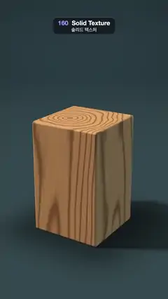

# 160 · Solid Texture · 솔리드 텍스처



**EN** A block of oak splits into five slices that lift, twist and fan out; every fresh cut shows growth rings that line up with the grain on the sides.  
**KO** 참나무 블록이 다섯 조각으로 갈라져 들리고 비틀리며 부채처럼 펼쳐지고, 새로 드러난 단면마다 옆면 결과 이어지는 나이테가 보인다.

[Video (mp4)](https://sueun-dev.github.io/motion-effects/videos/160-solid-texture.mp4) · [Code](../effects/160-solid-texture.js) · Materials & surface detail · 재질·표면

## Prompt (English)

```text
Create a "Solid Texture" motion effect: the wood is a function of 3D position, not a picture wrapped on the surface, so when a block is sliced open every cut face shows the inside of the same wood.

Look
- A rounded block 1.9 × 3.0 × 1.9 (edge radius 0.06) standing on a floor at y = 0, cut into five horizontal slices 0.6 thick. Each slice is the block intersected with its own slab, so the cut faces are flat and the outer edges rounded; closed, the five slices make the whole block again.
- The wood, evaluated at each point's rest position p (where it sat in the closed block):
  - rings around a vertical pith at (x, z) = (−0.3, 0.2): r = distance to the pith + 0.07 · noise(p.xz · 1.1, p.y · 0.3) + 0.015 · noise(p · (3, 0.6, 3)), made slightly out of round by r += 0.05 · r · sin(3 · angle + 0.8 · p.y);
  - ring index = 7 · r + 0.5 · noise(2r) (uneven ring widths); latewood = (0.5 + 0.5 cos(2π · ring))⁵, thin dark bands;
  - colour (linear) = mix(light oak (0.78, 0.40, 0.16) ≈ #E6A970, dark latewood (0.30, 0.11, 0.035) ≈ #955E34, 0.9 · latewood), times 0.93 + 0.07 · fibre noise stretched along y (14, 1.2, 14), and a dark pith within 0.12 of the centre.
- Lighting: a warm key from (−0.55, 0.85, 0.35) with raymarched soft shadows (k = 10), an ambient (0.07, 0.09, 0.11), cool skylight on up-facing surfaces, a cool fill from the right, a little specular and SDF ambient occlusion.
- Floor: dark teal (0.03, 0.06, 0.072) with the soft shadow, fading into a deep blue-green background with a vignette.
- Camera: at (6.5, 6.4, 10.2) looking at (0, 2.15, 0), about 34° vertical field of view; the block stands in the middle of the frame and the opened stack stays below y ≈ 330 px.

Motion (0–5 s), a = 2π · t / 5
- Open amount s = smoothstep(0.08, 0.92, 0.5 − 0.5 cos a): closed at 0 s and 5 s, fully open at 2.5 s.
- Slice i (0 = bottom) lifts i · 0.32 · s, turns i · 0.24 · s rad about the vertical axis and tips i · 0.07 · s rad toward the camera, so every upper cut face comes into view; the bottom slice stays on the floor.
- The whole stack sways 0.22 · sin(a) rad about the vertical.

Technique
- One full-screen fragment shader: sphere-trace the union of five slice SDFs; for the hit, transform the point back into the block's rest frame and evaluate the 3D wood function there, so the texture moves with each slice and the rings on a cut face meet the long grain on the sides exactly.
- Analytic floor plane, raymarched soft shadows, 2 × 2 supersampling, gentle highlight roll-off, gamma 2.2.

Output and rules
- One self-contained HTML file with no external assets (three.js from a CDN is fine if you use it), drawing on a 1080 × 1920 canvas (9:16) scaled to fit the window.
- Write a function renderFrame(t) that draws the frame for time t in seconds, and preview it with requestAnimationFrame. Everything must be a pure function of t and fixed seeds: no Math.random(), Date or state carried between frames, so frame i = renderFrame(i / 30) can be exported to a 30 fps video.
- Loop seamlessly every 5 seconds: renderFrame(5) must look exactly like renderFrame(0).
- No flicker of any kind: no noise or grain that changes from frame to frame, no strobing or blinking, no z-fighting, no shimmering 1 px lines. Any grain or texture stays fixed to the screen or to the object.
- Keep the top 280 px free of important content (a title label goes there) and fill the whole frame with a designed background.
```

## 프롬프트 (한국어)

```text
"솔리드 텍스처" 모션 효과를 만들어 줘: 나무 무늬가 표면에 감싼 그림이 아니라 3D 위치의 함수라서, 블록을 잘라 열면 모든 단면에 같은 나무의 속이 보이는 효과.

모양
- 바닥 y = 0 위에 선 둥근 블록 1.9 × 3.0 × 1.9(모서리 반지름 0.06)를 두께 0.6의 수평 조각 다섯 개로 자른다. 각 조각은 블록과 자기 판의 교집합이라 단면은 평평하고 바깥 모서리는 둥글다. 닫히면 다섯 조각이 다시 블록 하나가 된다.
- 나무 무늬는 각 점의 원래 위치 p(닫힌 블록에서의 자리)에서 계산한다:
  - (x, z) = (−0.3, 0.2)의 세로 심을 도는 나이테: r = 심까지 거리 + 0.07 · noise(p.xz · 1.1, p.y · 0.3) + 0.015 · noise(p · (3, 0.6, 3)), r += 0.05 · r · sin(3 · 각도 + 0.8 · p.y)로 살짝 찌그러뜨린다;
  - 나이테 번호 = 7 · r + 0.5 · noise(2r)(나이테 간격이 고르지 않게); 늦은재 = (0.5 + 0.5 cos(2π · 번호))⁵, 얇고 어두운 띠;
  - 색(선형) = mix(밝은 참나무 (0.78, 0.40, 0.16) ≈ #E6A970, 어두운 늦은재 (0.30, 0.11, 0.035) ≈ #955E34, 0.9 · 늦은재), 여기에 y로 늘인 섬유 노이즈 (14, 1.2, 14)로 0.93 + 0.07배, 심에서 0.12 안쪽은 어둡게.
- 조명: 따뜻한 키 라이트 방향 (−0.55, 0.85, 0.35), 레이마칭 소프트 그림자(k = 10), 주변광 (0.07, 0.09, 0.11), 위를 향한 면에 시원한 하늘빛, 오른쪽에서 시원한 보조광, 약간의 스펙큘러와 SDF 앰비언트 오클루전.
- 바닥: 어두운 청록 (0.03, 0.06, 0.072)에 부드러운 그림자, 비네트가 있는 짙은 청록 배경으로 사라진다.
- 카메라: 위치 (6.5, 6.4, 10.2)에서 (0, 2.15, 0)을 보고, 세로 시야각 약 34°. 블록은 화면 가운데에 서 있고, 펼쳐진 더미도 y ≈ 330 px 아래에 머문다.

움직임 (0–5초), a = 2π · t / 5
- 열림 정도 s = smoothstep(0.08, 0.92, 0.5 − 0.5 cos a): 0초와 5초에 닫힘, 2.5초에 완전히 열림.
- i번째 조각(0 = 맨 아래)은 i · 0.32 · s만큼 올라가고, 세로축으로 i · 0.24 · s rad 돌고, 카메라 쪽으로 i · 0.07 · s rad 기울어 위쪽 단면이 모두 보인다. 맨 아래 조각은 바닥에 그대로.
- 더미 전체가 세로축으로 0.22 · sin(a) rad 흔들린다.

기법
- 전체 화면 프래그먼트 셰이더 하나: 다섯 조각 SDF의 합집합을 스피어 트레이싱하고, 맞은 점을 블록의 원래 좌표계로 되돌려 그곳에서 3D 나무 함수를 계산한다. 그래서 무늬가 각 조각과 함께 움직이고, 단면의 나이테가 옆면의 긴 결과 정확히 이어진다.
- 해석적 바닥 평면, 레이마칭 소프트 그림자, 2 × 2 슈퍼샘플링, 부드러운 하이라이트 압축, 감마 2.2.

출력과 규칙
- 외부 파일 없는 HTML 파일 하나(three.js를 쓴다면 CDN은 괜찮다). 1080 × 1920(9:16) 캔버스에 그리고 창 크기에 맞춰 보이게 한다.
- 시간 t(초)의 프레임을 그리는 renderFrame(t) 함수를 만들고, 미리보기는 requestAnimationFrame으로 돌린다. 모든 것은 t와 고정 시드만으로 정해진다: Math.random(), Date, 프레임 사이에 쌓이는 상태 금지. 그래야 i번째 프레임 = renderFrame(i / 30)으로 30fps 영상을 뽑을 수 있다.
- 5초마다 끊김 없이 반복: renderFrame(5)는 renderFrame(0)과 똑같아 보여야 한다.
- 어떤 깜빡임도 금지: 프레임마다 바뀌는 노이즈·그레인, 번쩍임·깜빡임, z-fighting, 반짝이며 떨리는 1px 선 모두 금지. 그레인·질감은 화면이나 물체에 고정한다.
- 위쪽 280px에는 중요한 내용을 두지 않고(제목 라벨 자리), 화면 전체를 디자인된 배경으로 채운다.
```
