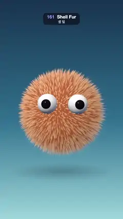

# 161 · Shell Fur · 셸 털



**EN** A peach fuzzball with two googly eyes bobs gently while its fur, 80 stacked shells of soft strand dots, leans in one slow breeze per loop.  
**KO** 눈알 두 개 달린 복숭아색 털뭉치가 살짝 들썩이고, 부드러운 가닥 점을 찍은 껍질 80장을 쌓은 털이 루프마다 한 번 느린 바람에 기운다.

[Video (mp4)](https://sueun-dev.github.io/motion-effects/videos/161-shell-fur.mp4) · [Code](../effects/161-shell-fur.js) · Materials & surface detail · 재질·표면

## Prompt (English)

```text
Create a "Shell Fur" motion effect: a round furry creature whose fur is made of many stacked, slightly larger copies of its body (shells), each one keeping only the dots where a hair passes through, so together they read as soft hairs that sway.

Look
- Body: a geodesic sphere of radius 1.25 (icosahedron detail 40, so there are no poles to pinch) drawn 80 times. Shell k (0 to 1) is pushed out along the normal by 0.32 · k; shell 0 is the solid skin.
- Strands: from the rest direction d of each point, turned by a fixed rotation so the view axis runs along a cube diagonal of the lattice (no lattice axis faces the camera), two offset layers of coarse 3D cells (d · 18 and d · 23 + 17.3). Each cell holds one thick strand jittered anywhere in it (0.1–0.9, seeded), so the hairs never line up in a grid, with its own length factor 0.7–1.0; the 2 × 2 × 2 cells around each point are checked. A shell pixel is covered where its distance to a strand is below r = 0.3 · (1 − (k / length)^1.3) cell; the alpha fades by 1 − smoothstep(0.45, 1, k / length), so tips dissolve softly instead of ending in hard points. Edges are antialiased over min(1.2 · |fwidth(cell position)|, 0.08), and alpha blends the shells inner to outer.
- Colour: root #C9693A to tip #FFD39A (by k^0.8), low contrast between them, times wrapped diffuse 0.35 + 0.85 · max(0.6 · N·L + 0.4, 0) with the light from (−0.5, 0.75, 0.6), roots only a little darker (0.82 + 0.18 k), a Kajiya-Kay style sheen (power 60, 0.18 · k) and a pale blue rim (0.35 · k).
- Two glossy eyes: white spheres of radius 0.3 with black pupils of 0.17, set 1.38 out along (±0.36, 0.22, 1), so they poke out of the fur; hemisphere light 1.4 and a key light 2.2 from (−3, 5, 6).
- A soft blurred shadow disc on the ground at y = −1.95 that follows the ball; background a vertical gradient #16324F → #2E6E8E (55 %) → #9BD3DB.
- Camera: 30° field of view at (0, 0.5, 13.5) looking at (0, 0.1, 0); the ball with its fur is about 800 px wide in the middle of the frame.

Motion (0–5 s), a = 2π · t / 5
- The ball drifts x = 0.03 · sin(a), bobs once per loop y = 0.035 · sin(a + 0.6), turns (0.015 · sin a, 0.05 · sin(a + 0.5), −0.02 · cos a) rad; its ground shadow follows and scales by 1 − 0.06 · sin(a + 0.6).
- One slow sway of the fur per loop: a world-space push lag = (0.07 · sin(a + 1), −0.04 + 0.015 · sin a, 0.04 · cos(a + 1)) circles round once; every shell vertex moves by lag · k² · clump, with clump = 0.85 + 0.15 · sin(2 · d · (1.6, 1.1, 1.3)) varying only slowly over the ball, so tips swing more than roots and neighbouring hairs lean together in broad tufts. Nothing moves faster than about a pixel per frame.

Technique
- three.js: one ShaderMaterial per shell (uniform k), meshes drawn in order with renderOrder, transparent blending.
- The strand pattern is a 3D cell hash on the rest direction, with no UVs at all, so there is no seam or pole anywhere and each hair stays the same hair from root to tip.
- The scene is rendered into a 2160 × 3840 half-float target (4× MSAA) and averaged down to the 1080 × 1920 canvas, so thin tips and the layered shells stay smooth instead of crawling.

Output and rules
- One self-contained HTML file with no external assets (three.js from a CDN is fine if you use it), drawing on a 1080 × 1920 canvas (9:16) scaled to fit the window.
- Write a function renderFrame(t) that draws the frame for time t in seconds, and preview it with requestAnimationFrame. Everything must be a pure function of t and fixed seeds: no Math.random(), Date or state carried between frames, so frame i = renderFrame(i / 30) can be exported to a 30 fps video.
- Loop seamlessly every 5 seconds: renderFrame(5) must look exactly like renderFrame(0).
- No flicker of any kind: no noise or grain that changes from frame to frame, no strobing or blinking, no z-fighting, no shimmering 1 px lines. Any grain or texture stays fixed to the screen or to the object.
- Keep the top 280 px free of important content (a title label goes there) and fill the whole frame with a designed background.
```

## 프롬프트 (한국어)

```text
"셸 털" 모션 효과를 만들어 줘: 몸통보다 조금씩 큰 복사본(껍질)을 여러 겹 쌓고, 각 껍질에는 털이 지나가는 점만 남겨서 모두 합치면 부드러운 털이 흔들리는 것처럼 보이는 동그란 털 생물.

모양
- 몸통: 반지름 1.25 지오데식 구(정이십면체 detail 40, 그래서 찌그러질 극점이 없다)를 80번 그린다. k번째 껍질(0–1)은 법선 방향으로 0.32 · k만큼 밀려나고, 0번 껍질은 꽉 찬 피부다.
- 털 가닥: 각 점의 원래 방향 d를 고정 회전으로 돌려 시선 축이 격자의 정육면체 대각선을 따르게 하고(카메라를 향하는 격자 축이 없다), 서로 어긋난 굵은 3D 격자 두 겹(d · 18, d · 23 + 17.3)을 만든다. 칸마다 굵은 가닥 하나를 칸 안 아무 곳(0.1–0.9, 시드 고정)에나 흔들어 두어 털이 격자로 줄 서지 않게 하고, 길이 비율 0.7–1.0을 준다. 각 점 둘레의 2 × 2 × 2 칸을 확인한다. 껍질 픽셀은 가닥까지 거리가 r = 0.3 · (1 − (k / 길이)^1.3) 칸보다 가까우면 덮이고, 알파를 1 − smoothstep(0.45, 1, k / 길이)로 줄여 털끝이 뾰족하게 끊기지 않고 부드럽게 사라진다. 가장자리는 min(1.2 · |fwidth(칸 좌표)|, 0.08) 폭으로 안티에일리어싱하고, 껍질은 안쪽부터 바깥쪽으로 알파 블렌딩한다.
- 색: 뿌리 #C9693A에서 끝 #FFD39A(k^0.8), 둘 사이 대비는 낮게. 여기에 감싼 확산광 0.35 + 0.85 · max(0.6 · N·L + 0.4, 0)(빛 방향 (−0.5, 0.75, 0.6)), 뿌리는 아주 조금만 어둡게(0.82 + 0.18 k), Kajiya-Kay식 광택(지수 60, 0.18 · k), 옅은 파란 테두리(0.35 · k).
- 반짝이는 눈 두 개: 반지름 0.3 흰 구에 반지름 0.17 검은 눈동자, (±0.36, 0.22, 1) 방향으로 1.38 바깥에 두어 털 밖으로 튀어나온다. 반구광 1.4, 키 라이트 2.2, 위치 (−3, 5, 6).
- 공을 따라다니는 y = −1.95 바닥의 흐린 그림자 원판. 배경은 세로 그라디언트 #16324F → #2E6E8E(55 %) → #9BD3DB.
- 카메라: 시야각 30°, 위치 (0, 0.5, 13.5)에서 (0, 0.1, 0)을 본다. 털까지 합친 공은 화면 가운데에서 폭 약 800 px.

움직임 (0–5초), a = 2π · t / 5
- 공이 x = 0.03 · sin(a)로 떠다니고, 루프마다 한 번 y = 0.035 · sin(a + 0.6)로 들썩이며, (0.015 · sin a, 0.05 · sin(a + 0.5), −0.02 · cos a) rad 돈다. 바닥 그림자는 따라 움직이며 1 − 0.06 · sin(a + 0.6)배로 커졌다 줄어든다.
- 털은 루프마다 한 번 천천히 흔들린다: 월드 공간 밀기 lag = (0.07 · sin(a + 1), −0.04 + 0.015 · sin a, 0.04 · cos(a + 1))가 한 바퀴 돈다. 모든 껍질 꼭짓점이 lag · k² · 뭉침만큼 움직이고, 뭉침 = 0.85 + 0.15 · sin(2 · d · (1.6, 1.1, 1.3))은 공 위에서 천천히만 변해서 털끝이 뿌리보다 더 흔들리고 이웃한 털이 넓은 뭉텅이로 함께 기운다. 어느 것도 프레임당 약 1픽셀보다 빨리 움직이지 않는다.

기법
- three.js: 껍질마다 ShaderMaterial 하나(유니폼 k), renderOrder로 순서대로 그리고 투명 블렌딩.
- 털 무늬는 원래 방향 위의 3D 격자 해시이고 UV를 전혀 쓰지 않아 어디에도 이음매나 극점이 없으며, 한 가닥은 뿌리부터 끝까지 같은 가닥으로 남는다.
- 장면을 2160 × 3840 하프 플로트 타깃(4× MSAA)에 그린 뒤 1080 × 1920 캔버스로 평균 내어 줄인다. 그래서 가는 털끝과 겹친 껍질이 기어다니듯 떨리지 않고 매끄럽다.

출력과 규칙
- 외부 파일 없는 HTML 파일 하나(three.js를 쓴다면 CDN은 괜찮다). 1080 × 1920(9:16) 캔버스에 그리고 창 크기에 맞춰 보이게 한다.
- 시간 t(초)의 프레임을 그리는 renderFrame(t) 함수를 만들고, 미리보기는 requestAnimationFrame으로 돌린다. 모든 것은 t와 고정 시드만으로 정해진다: Math.random(), Date, 프레임 사이에 쌓이는 상태 금지. 그래야 i번째 프레임 = renderFrame(i / 30)으로 30fps 영상을 뽑을 수 있다.
- 5초마다 끊김 없이 반복: renderFrame(5)는 renderFrame(0)과 똑같아 보여야 한다.
- 어떤 깜빡임도 금지: 프레임마다 바뀌는 노이즈·그레인, 번쩍임·깜빡임, z-fighting, 반짝이며 떨리는 1px 선 모두 금지. 그레인·질감은 화면이나 물체에 고정한다.
- 위쪽 280px에는 중요한 내용을 두지 않고(제목 라벨 자리), 화면 전체를 디자인된 배경으로 채운다.
```
