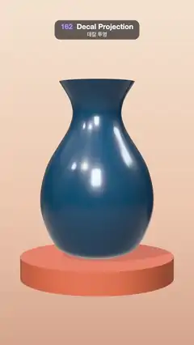

# 162 · Decal Projection · 데칼 투영



**EN** Projector boxes fly onto a glossy navy vase and stamp paint splats and stickers that wrap over its belly, waist and lip, then peel away.  
**KO** 투영 상자가 광택 나는 남색 꽃병으로 날아와 물감 얼룩과 스티커를 찍고, 데칼이 배·허리·입구의 곡면을 감싸며 붙었다가 떨어져 나간다.

[Video (mp4)](https://sueun-dev.github.io/motion-effects/videos/162-decal-projection.mp4) · [Code](../effects/162-decal-projection.js) · Materials & surface detail · 재질·표면

## Prompt (English)

```text
Create a "Decal Projection" motion effect: a box-shaped projector flies onto a curvy vase and stamps a picture; the decal is new geometry cut out of the vase's own triangles, so the picture wraps over every curve.

Look
- The vase: a lathe (220 segments) of a smooth spline through (radius, height) (0.5, −2.0), (0.95, −1.75), (1.28, −0.9), (1.15, 0), (0.62, 0.95), (0.58, 1.45), (0.85, 1.95): a foot, a round belly, a narrow waist and a flared lip. Physical material #173F5F, roughness 0.3, clearcoat 1 (roughness 0.06), double-sided.
- A terracotta plinth #C46A4A (cylinder radius 1.75, height 0.5) under it; background a vertical gradient #F6E3CF → #EFC9AE (60 %) → #D9A88C.
- Six decals, drawn on transparent 512 px canvases: paint splats (a disc, 16 random splashes and droplets, seeded) in #FF2D87, #3EE6B0 and #FFD21F; die-cut stickers with a 44 px white border: a star #FFC51E, a heart #FF3B4E and a round #FF7A1A badge reading "WOW". Splats are glossy (roughness 0.18, clearcoat 1), stickers satin (roughness 0.4).
- Placement (angle around the vase from the front, height, size, spin, stamp time): pink splat (−0.25, −0.8, 1.5, 0.3, 0.45 s), star (0.95, −0.15, 1.0, −0.2, 0.85 s), mint splat over the waist (0.2, 0.95, 1.2, 1.1, 1.25 s), heart (−1.0, 0.25, 0.95, 0.25, 1.65 s), badge (0.5, −1.3, 0.85, −0.15, 2.05 s), yellow splat on the lip (−0.45, 1.65, 0.8, 2.0, 2.45 s). Each projector box is size × size × 0.75 deep, aimed along the surface direction tilted 0.15 upward.
- The projector is drawn as a white 4 px box outline with a faint #CFEFFF fill (opacity 0.16), on top of everything.
- Lighting: a room environment (intensity 0.8), a key light #FFF1E0 at 2.4 from (−4, 7, 6) with a soft shadow; neutral tone mapping.
- Camera: 30° field of view at (0, 0.9, 14.6) looking at (0, −0.1, 0); the vase stands in the middle, about y 430–1440 px.

Motion (0–5 s), a = 2π · t / 5
- The vase and its decals turn together: 0.32 · sin(a) rad.
- Each stamp: in the 0.35 s before its time the projector box flies in from 1.6 units out to the surface (ease-out) while fading in; the decal fades in over 0.16 s as it lands; the box fades out over 0.3 s.
- From 3.7 s the decals fade away one after another (0.12 s apart, 0.4 s each); the vase is bare from about 4.7 s to the next first stamp, so the loop is seamless.

Technique
- three.js DecalGeometry(vase, position, orientation, size): it moves every vase triangle into the projector's box space, clips the triangles against the six box planes and maps the box's x/y to the decal's UVs. Built once with the vase at rest and hung on the vase, so the decals turn with it.
- Decal materials are transparent with depthWrite off and polygonOffset (factor −4, units −4), so they sit exactly on the surface with no z-fighting.
- The projector outline uses LineSegments2 / LineMaterial for clean 4 px lines.

Output and rules
- One self-contained HTML file with no external assets (three.js from a CDN is fine if you use it), drawing on a 1080 × 1920 canvas (9:16) scaled to fit the window.
- Write a function renderFrame(t) that draws the frame for time t in seconds, and preview it with requestAnimationFrame. Everything must be a pure function of t and fixed seeds: no Math.random(), Date or state carried between frames, so frame i = renderFrame(i / 30) can be exported to a 30 fps video.
- Loop seamlessly every 5 seconds: renderFrame(5) must look exactly like renderFrame(0).
- No flicker of any kind: no noise or grain that changes from frame to frame, no strobing or blinking, no z-fighting, no shimmering 1 px lines. Any grain or texture stays fixed to the screen or to the object.
- Keep the top 280 px free of important content (a title label goes there) and fill the whole frame with a designed background.
```

## 프롬프트 (한국어)

```text
"데칼 투영" 모션 효과를 만들어 줘: 상자 모양 투영기가 곡선 꽃병으로 날아와 그림을 찍는다. 데칼은 꽃병 자신의 삼각형을 잘라 만든 새 지오메트리라서 그림이 모든 곡면을 감싼다.

모양
- 꽃병: (반지름, 높이) (0.5, −2.0), (0.95, −1.75), (1.28, −0.9), (1.15, 0), (0.62, 0.95), (0.58, 1.45), (0.85, 1.95)를 지나는 부드러운 스플라인을 220분할로 돌린 선반(lathe) 형태: 굽, 둥근 배, 좁은 허리, 벌어진 입구. 물리 기반 재질 #173F5F, 거칠기 0.3, 클리어코트 1(거칠기 0.06), 양면.
- 아래에 테라코타 받침 #C46A4A(원기둥 반지름 1.75, 높이 0.5). 배경은 세로 그라디언트 #F6E3CF → #EFC9AE(60 %) → #D9A88C.
- 데칼 여섯 개, 투명한 512 px 캔버스에 그린다: 물감 얼룩(원판 하나에 시드 고정 튀김·방울 16개) #FF2D87, #3EE6B0, #FFD21F; 흰 테두리 44 px의 칼선 스티커: 별 #FFC51E, 하트 #FF3B4E, "WOW"라고 쓴 둥근 #FF7A1A 배지. 얼룩은 광택(거칠기 0.18, 클리어코트 1), 스티커는 반광(거칠기 0.4).
- 배치(정면 기준 꽃병 둘레 각도, 높이, 크기, 회전, 찍는 시각): 분홍 얼룩 (−0.25, −0.8, 1.5, 0.3, 0.45초), 별 (0.95, −0.15, 1.0, −0.2, 0.85초), 허리를 덮는 민트 얼룩 (0.2, 0.95, 1.2, 1.1, 1.25초), 하트 (−1.0, 0.25, 0.95, 0.25, 1.65초), 배지 (0.5, −1.3, 0.85, −0.15, 2.05초), 입구의 노란 얼룩 (−0.45, 1.65, 0.8, 2.0, 2.45초). 투영 상자는 크기 × 크기 × 깊이 0.75, 표면 방향에서 위로 0.15 기울여 겨눈다.
- 투영기는 흰 4 px 상자 윤곽선과 옅은 #CFEFFF 채움(불투명도 0.16)으로, 모든 것 위에 그린다.
- 조명: 룸 환경맵(세기 0.8), 키 라이트 #FFF1E0 세기 2.4, 위치 (−4, 7, 6), 부드러운 그림자. 뉴트럴 톤 매핑.
- 카메라: 시야각 30°, 위치 (0, 0.9, 14.6)에서 (0, −0.1, 0)을 본다. 꽃병은 가운데, 대략 y 430–1440 px.

움직임 (0–5초), a = 2π · t / 5
- 꽃병과 데칼이 함께 돈다: 0.32 · sin(a) rad.
- 찍기마다: 찍는 시각 전 0.35초 동안 투영 상자가 1.6 단위 밖에서 표면으로 날아오며(ease-out) 나타나고, 닿는 순간 데칼이 0.16초에 걸쳐 나타나며, 상자는 0.3초에 걸쳐 사라진다.
- 3.7초부터 데칼이 0.12초 간격으로 차례로(각 0.4초) 사라진다. 약 4.7초부터 다음 첫 찍기까지 꽃병이 비어 있어 루프가 끊김 없다.

기법
- three.js DecalGeometry(꽃병, 위치, 방향, 크기): 꽃병의 모든 삼각형을 투영 상자 공간으로 옮겨 상자의 여섯 평면으로 자르고, 상자의 x/y를 데칼 UV로 쓴다. 꽃병이 멈춘 상태에서 한 번 만들고 꽃병에 매달아 함께 돈다.
- 데칼 재질은 투명, depthWrite 끔, polygonOffset(factor −4, units −4)이라 표면에 정확히 붙고 z-fighting이 없다.
- 투영기 윤곽선은 LineSegments2 / LineMaterial로 깔끔한 4 px 선.

출력과 규칙
- 외부 파일 없는 HTML 파일 하나(three.js를 쓴다면 CDN은 괜찮다). 1080 × 1920(9:16) 캔버스에 그리고 창 크기에 맞춰 보이게 한다.
- 시간 t(초)의 프레임을 그리는 renderFrame(t) 함수를 만들고, 미리보기는 requestAnimationFrame으로 돌린다. 모든 것은 t와 고정 시드만으로 정해진다: Math.random(), Date, 프레임 사이에 쌓이는 상태 금지. 그래야 i번째 프레임 = renderFrame(i / 30)으로 30fps 영상을 뽑을 수 있다.
- 5초마다 끊김 없이 반복: renderFrame(5)는 renderFrame(0)과 똑같아 보여야 한다.
- 어떤 깜빡임도 금지: 프레임마다 바뀌는 노이즈·그레인, 번쩍임·깜빡임, z-fighting, 반짝이며 떨리는 1px 선 모두 금지. 그레인·질감은 화면이나 물체에 고정한다.
- 위쪽 280px에는 중요한 내용을 두지 않고(제목 라벨 자리), 화면 전체를 디자인된 배경으로 채운다.
```
