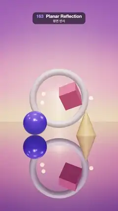

# 163 · Planar Reflection · 평면 반사



**EN** Pastel shapes float over a still salt-flat mirror at sunset: an arch, a spinning cube and glowing orbs are doubled exactly in the glassy ground.  
**KO** 노을 진 잔잔한 소금 사막 거울 위에 파스텔 도형이 떠 있고, 아치와 도는 정육면체, 빛나는 구슬이 유리 같은 바닥에 그대로 두 번 비친다.

[Video (mp4)](https://sueun-dev.github.io/motion-effects/videos/163-planar-reflection.mp4) · [Code](../effects/163-planar-reflection.js) · Reflection, refraction & ray tracing · 반사·굴절·레이 트레이싱

## Prompt (English)

```text
Create a "Planar Reflection" motion effect: a perfectly still mirror floor reflects a small sunset scene, made by rendering the scene a second time from a camera mirrored below the floor.

Look
- Sky: a large sphere (radius 90, back faces) shaded by direction height y: orange (1.0, 0.55, 0.28) at the horizon → rose (0.85, 0.25, 0.42) by y 0.12 → purple (0.30, 0.12, 0.42) by 0.32 → deep indigo (0.06, 0.05, 0.20) by 0.75 (linear colours), plus a low sun glow toward (0, 0.06, −1). It is a mesh, not a screen background, so the mirror shows it flipped correctly.
- Floor: a 160 × 160 mirror (smaller than the sky so its edge never shows) at y = 0, rendered at 1080 × 1920. Its shader multiplies the reflection by #E6E0F0 and by 0.42 + 0.53 · (1 − view·up)⁴, darker straight down and brighter toward the horizon like water, plus a faint (0.012, 0.01, 0.03).
- Objects:
  - an upright ring (torus radius 1.55, tube 0.2) #FFE3D3 at (0, 2.05, −3.2);
  - a violet sphere #7C6CFF (radius 0.62, roughness 0.18, metalness 0.2) resting on the mirror at (−1.25, 0.62, −0.9), touching its own reflection;
  - a coral cube #FF7A8A (0.85) floating near (0.55, 1.75, 0.4);
  - a sand-gold cone #FFC46B (radius 0.5, height 1.3) at (1.35, 0.65, −0.2);
  - three small glowing orbs (radius 0.12, emissive #FFB36B × 3).
- Lights: a warm sun #FFB98A at 2.6 from behind (0, 1.5, −10), hemisphere #B89BFF / #40204A at 0.7, a cool front light #9FB4FF at 0.6 from (3, 4, 8), a room environment at 0.45. ACES Filmic tone mapping.
- Camera: 35° field of view, low over the mirror; the horizon sits a little below the middle, the objects above it and their reflections below.

Motion (0–5 s), a = 2π · t / 5
- The camera drifts sideways: position (1.3 · sin a, 0.85 + 0.1 · sin 2a, 16.5), always looking at (0, 1.55, −1.5), so the reflections slide with true parallax.
- The ring turns 0.45 · sin(a) rad; the cube bobs 0.22 · sin(a + 1) and spins (0.6 + a, a, 0.4) rad (one full turn per loop).
- The orbs circle through the ring: (1.9 cos b, 2.05 + 0.35 sin 2b, −3.2 + 0.9 sin b) with b = a + i · 2π/3.

Technique
- three.js Reflector: before the floor is drawn, a virtual camera mirrored in the floor plane renders the scene (with an oblique clip plane at the floor) into a render target; the floor samples it with projective texture coordinates (textureMatrix), giving an exact, sharp reflection.
- A custom Reflector shader adds the view-angle falloff and keeps tone mapping and sRGB output consistent with the rest of the scene.

Output and rules
- One self-contained HTML file with no external assets (three.js from a CDN is fine if you use it), drawing on a 1080 × 1920 canvas (9:16) scaled to fit the window.
- Write a function renderFrame(t) that draws the frame for time t in seconds, and preview it with requestAnimationFrame. Everything must be a pure function of t and fixed seeds: no Math.random(), Date or state carried between frames, so frame i = renderFrame(i / 30) can be exported to a 30 fps video.
- Loop seamlessly every 5 seconds: renderFrame(5) must look exactly like renderFrame(0).
- No flicker of any kind: no noise or grain that changes from frame to frame, no strobing or blinking, no z-fighting, no shimmering 1 px lines. Any grain or texture stays fixed to the screen or to the object.
- Keep the top 280 px free of important content (a title label goes there) and fill the whole frame with a designed background.
```

## 프롬프트 (한국어)

```text
"평면 반사" 모션 효과를 만들어 줘: 완벽하게 잔잔한 거울 바닥이 작은 노을 장면을 비추는 효과. 바닥 아래로 뒤집은 카메라로 장면을 한 번 더 그려서 만든다.

모양
- 하늘: 큰 구(반지름 90, 뒷면)를 방향의 높이 y로 칠한다: 지평선 주황 (1.0, 0.55, 0.28) → y 0.12까지 장미색 (0.85, 0.25, 0.42) → 0.32까지 보라 (0.30, 0.12, 0.42) → 0.75까지 짙은 남색 (0.06, 0.05, 0.20)(선형 색), 여기에 (0, 0.06, −1) 쪽의 낮은 해 빛무리. 화면 배경이 아니라 메시라서 거울에 올바르게 뒤집혀 비친다.
- 바닥: y = 0의 160 × 160 거울(하늘보다 작아 가장자리가 보이지 않는다), 1080 × 1920으로 렌더링. 셰이더는 반사에 #E6E0F0과 0.42 + 0.53 · (1 − 시선·위)⁴를 곱해 물처럼 바로 아래는 어둡고 지평선 쪽은 밝게 하고, 옅은 (0.012, 0.01, 0.03)을 더한다.
- 물체:
  - 서 있는 고리(토러스 반지름 1.55, 굵기 0.2) #FFE3D3, 위치 (0, 2.05, −3.2);
  - 보라 구 #7C6CFF(반지름 0.62, 거칠기 0.18, 금속성 0.2)가 (−1.25, 0.62, −0.9)에서 거울에 닿아 자기 반사와 맞닿는다;
  - (0.55, 1.75, 0.4) 근처에 떠 있는 산호색 정육면체 #FF7A8A(0.85);
  - 모래 금색 원뿔 #FFC46B(반지름 0.5, 높이 1.3), 위치 (1.35, 0.65, −0.2);
  - 빛나는 작은 구슬 세 개(반지름 0.12, 발광 #FFB36B × 3).
- 조명: 뒤쪽 (0, 1.5, −10)에서 오는 따뜻한 해 #FFB98A 세기 2.6, 반구광 #B89BFF / #40204A 0.7, 앞쪽 (3, 4, 8)의 차가운 빛 #9FB4FF 0.6, 룸 환경맵 0.45. ACES Filmic 톤 매핑.
- 카메라: 시야각 35°, 거울 위 낮은 곳. 지평선은 화면 가운데보다 조금 아래, 물체는 그 위, 반사는 그 아래.

움직임 (0–5초), a = 2π · t / 5
- 카메라가 옆으로 흐른다: 위치 (1.3 · sin a, 0.85 + 0.1 · sin 2a, 16.5), 늘 (0, 1.55, −1.5)을 본다. 그래서 반사가 진짜 시차로 미끄러진다.
- 고리는 0.45 · sin(a) rad 돌고, 정육면체는 0.22 · sin(a + 1)로 떠오르며 (0.6 + a, a, 0.4) rad로 돈다(한 루프에 한 바퀴).
- 구슬은 고리를 통과하며 돈다: (1.9 cos b, 2.05 + 0.35 sin 2b, −3.2 + 0.9 sin b), b = a + i · 2π/3.

기법
- three.js Reflector: 바닥을 그리기 전에 바닥 평면에 대칭인 가상 카메라가 바닥에서 비스듬히 자르는 클립 평면을 걸고 장면을 렌더 타깃에 그린다. 바닥은 투영 텍스처 좌표(textureMatrix)로 그것을 읽어 정확하고 선명한 반사를 얻는다.
- 커스텀 Reflector 셰이더로 시선 각도에 따른 감쇠를 더하고, 톤 매핑과 sRGB 출력을 나머지 장면과 맞춘다.

출력과 규칙
- 외부 파일 없는 HTML 파일 하나(three.js를 쓴다면 CDN은 괜찮다). 1080 × 1920(9:16) 캔버스에 그리고 창 크기에 맞춰 보이게 한다.
- 시간 t(초)의 프레임을 그리는 renderFrame(t) 함수를 만들고, 미리보기는 requestAnimationFrame으로 돌린다. 모든 것은 t와 고정 시드만으로 정해진다: Math.random(), Date, 프레임 사이에 쌓이는 상태 금지. 그래야 i번째 프레임 = renderFrame(i / 30)으로 30fps 영상을 뽑을 수 있다.
- 5초마다 끊김 없이 반복: renderFrame(5)는 renderFrame(0)과 똑같아 보여야 한다.
- 어떤 깜빡임도 금지: 프레임마다 바뀌는 노이즈·그레인, 번쩍임·깜빡임, z-fighting, 반짝이며 떨리는 1px 선 모두 금지. 그레인·질감은 화면이나 물체에 고정한다.
- 위쪽 280px에는 중요한 내용을 두지 않고(제목 라벨 자리), 화면 전체를 디자인된 배경으로 채운다.
```
