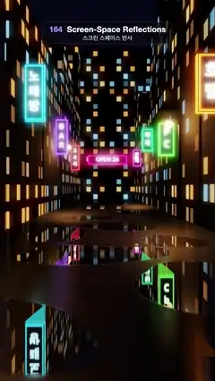

# 164 · Screen-Space Reflections · 스크린 스페이스 반사



**EN** A rain-wet Seoul alley at night: neon signs mirror sharply in the puddles and smear softly across the wet asphalt as the camera glides in and out.  
**KO** 비에 젖은 밤의 서울 골목: 카메라가 들어갔다 나오는 동안 네온 간판이 웅덩이에는 선명하게, 젖은 아스팔트에는 부드럽게 번져 비친다.

[Video (mp4)](https://sueun-dev.github.io/motion-effects/videos/164-screen-space-reflections.mp4) · [Code](../effects/164-screen-space-reflections.js) · Reflection, refraction & ray tracing · 반사·굴절·레이 트레이싱

## Prompt (English)

```text
Create a "Screen-Space Reflections" motion effect: a wet night street whose reflections are found only from what is already on screen, by marching each reflected ray through the depth buffer.

Look
- A narrow street 7.2 wide (x −3.6 to 3.6) running 60 units away from the camera, dark asphalt #16161C (roughness 0.55), lined on both sides by box buildings 6 deep, 5–10 long and 7–19 tall (seeded), dark #1A1820 with emissive window grids (about 38 % of windows lit, warm #FFB86B / #FFD9A0 or cool #9FD8FF, seeded canvas textures); a building with an "OPEN 24" pink neon sign closes the far end at z = −47.
- Eight vertical neon signs sticking out from the facades, 0.85 wide and 0.3 thick: 라멘 #FF3D9A, 호텔 #FF9E3D, 노래방 #3DE8FF, PC #7DFF6A, BAR #B46BFF, 약국 #3DFFB0, 24시 #FF5A5A, 카페 #FF6AD5 — glowing letters on a dark panel, HDR face colour × 3.2, glowing sides.
- Four street lamps (warm bulbs × 4 and point lights #FFC27A, intensity 14, range 14) make pools of light on the road.
- Puddles: eleven hand-placed blobs (each four overlapping ellipses, slightly blurred) from just in front of the camera to 38 units away, stored as a mask in world x/z.
- A soft neon glow from blurred mip levels, ACES tone mapping. Night sky (0.004, 0.006, 0.016).
- Camera: 52° field of view at eye height 1.5, looking down the street toward (0.2 · sin a, 1.25, −30).

Motion (0–5 s), a = 2π · t / 5
- Dolly in and back out: camera z = 6 − 3.5 · (0.5 − 0.5 cos a), x = 0.5 · sin(a). The reflections slide and change with the view, as screen-space reflections do.

Technique
- Pass 1: render the scene into a 2160 × 3840 half-float target with a depth texture and mipmaps.
- Pass 2 (full screen, 1080 × 1920): colour = the 2 × 2 average of pass 1. For pixels on the ground (world y ≈ 0): reconstruct the view-space position from depth, reflect the view ray about the ground normal, and march it in up to 200 steps that grow from 0.02 by × 1.025; at each step project to the screen and compare with the depth buffer. When the ray goes behind a surface, refine the crossing with 7 bisection steps and accept it only if the ray really meets that surface (|Δz| < 0.12 + 0.02 · t); otherwise keep marching.
- Puddles (mask 1) reflect almost like a mirror (strength 0.95, roughness 0.04); wet asphalt (mask 0) reflects at 0.16 with roughness 1: the hit colour is read from a lower mip (lod = roughness · (3 + 0.3 t)) and averaged over 7 taps spread vertically, giving the long streaks of a wet road. Schlick Fresnel raises reflections toward grazing angles; puddle pixels are darkened by 60 % before the reflection is added.
- Rays that leave the screen fade out near the edges (and beyond 30–60 units); rays hidden behind a sign take a blurred colour of that sign; the rest see the night sky. These are the visible limits of the method.

Output and rules
- One self-contained HTML file with no external assets (three.js from a CDN is fine if you use it), drawing on a 1080 × 1920 canvas (9:16) scaled to fit the window.
- Write a function renderFrame(t) that draws the frame for time t in seconds, and preview it with requestAnimationFrame. Everything must be a pure function of t and fixed seeds: no Math.random(), Date or state carried between frames, so frame i = renderFrame(i / 30) can be exported to a 30 fps video.
- Loop seamlessly every 5 seconds: renderFrame(5) must look exactly like renderFrame(0).
- No flicker of any kind: no noise or grain that changes from frame to frame, no strobing or blinking, no z-fighting, no shimmering 1 px lines. Any grain or texture stays fixed to the screen or to the object.
- Keep the top 280 px free of important content (a title label goes there) and fill the whole frame with a designed background.
```

## 프롬프트 (한국어)

```text
"스크린 스페이스 반사" 모션 효과를 만들어 줘: 젖은 밤거리의 반사를 이미 화면에 있는 것만으로 찾는 효과. 반사된 광선마다 깊이 버퍼를 따라 행진시킨다.

모양
- 폭 7.2(x −3.6–3.6)의 좁은 길이 카메라에서 60 단위 멀리 뻗는다. 어두운 아스팔트 #16161C(거칠기 0.55). 양쪽에 깊이 6, 길이 5–10, 높이 7–19(시드 고정)의 상자 건물이 늘어서 있고, 어두운 #1A1820에 발광 창문 격자(창의 약 38 %가 켜짐, 따뜻한 #FFB86B / #FFD9A0 또는 차가운 #9FD8FF, 시드 고정 캔버스 텍스처). 길 끝 z = −47에는 분홍 네온 "OPEN 24" 간판이 달린 건물이 막고 있다.
- 건물에서 튀어나온 세로 네온 간판 여덟 개, 폭 0.85, 두께 0.3: 라멘 #FF3D9A, 호텔 #FF9E3D, 노래방 #3DE8FF, PC #7DFF6A, BAR #B46BFF, 약국 #3DFFB0, 24시 #FF5A5A, 카페 #FF6AD5 — 어두운 판 위에 빛나는 글자, 앞면은 HDR 색 × 3.2, 옆면도 빛난다.
- 가로등 네 개(따뜻한 전구 × 4, 점광원 #FFC27A 세기 14, 거리 14)가 길에 빛 웅덩이를 만든다.
- 물웅덩이: 카메라 바로 앞부터 38 단위까지 손으로 배치한 덩어리 열한 개(각각 겹친 타원 네 개, 살짝 흐리게)를 월드 x/z 마스크로 저장한다.
- 흐린 밉 레벨에서 얻는 부드러운 네온 글로, ACES 톤 매핑. 밤하늘 (0.004, 0.006, 0.016).
- 카메라: 시야각 52°, 눈높이 1.5, 길 아래쪽 (0.2 · sin a, 1.25, −30)을 본다.

움직임 (0–5초), a = 2π · t / 5
- 들어갔다 나오는 돌리: 카메라 z = 6 − 3.5 · (0.5 − 0.5 cos a), x = 0.5 · sin(a). 스크린 스페이스 반사답게 반사가 시점에 따라 미끄러지고 바뀐다.

기법
- 1단계: 장면을 깊이 텍스처와 밉맵이 있는 2160 × 3840 하프 플로트 타깃에 그린다.
- 2단계(전체 화면, 1080 × 1920): 색 = 1단계의 2 × 2 평균. 바닥 픽셀(월드 y ≈ 0)은 깊이로 뷰 공간 위치를 복원하고, 시선을 바닥 법선으로 반사해, 0.02에서 시작해 × 1.025씩 커지는 최대 200 걸음으로 행진한다. 걸음마다 화면에 투영해 깊이 버퍼와 비교한다. 광선이 표면 뒤로 가면 이분법 7번으로 교차점을 다듬고, 광선이 정말 그 표면을 만날 때만(|Δz| < 0.12 + 0.02 · t) 받아들인다. 아니면 계속 행진한다.
- 웅덩이(마스크 1)는 거의 거울처럼 반사(세기 0.95, 거칠기 0.04), 젖은 아스팔트(마스크 0)는 0.16 세기에 거칠기 1: 맞은 색을 낮은 밉(lod = 거칠기 · (3 + 0.3 t))에서 읽고 세로로 퍼진 7개 탭을 평균해 젖은 길의 긴 줄무늬를 만든다. 슐릭 프레넬로 비스듬할수록 반사를 키우고, 웅덩이 픽셀은 반사를 더하기 전에 60 % 어둡게 한다.
- 화면을 벗어나는 광선은 가장자리 근처(그리고 30–60 단위 너머)에서 사라지고, 간판 뒤에 가린 광선은 그 간판의 흐린 색을, 나머지는 밤하늘을 받는다. 이것이 이 방법의 눈에 보이는 한계다.

출력과 규칙
- 외부 파일 없는 HTML 파일 하나(three.js를 쓴다면 CDN은 괜찮다). 1080 × 1920(9:16) 캔버스에 그리고 창 크기에 맞춰 보이게 한다.
- 시간 t(초)의 프레임을 그리는 renderFrame(t) 함수를 만들고, 미리보기는 requestAnimationFrame으로 돌린다. 모든 것은 t와 고정 시드만으로 정해진다: Math.random(), Date, 프레임 사이에 쌓이는 상태 금지. 그래야 i번째 프레임 = renderFrame(i / 30)으로 30fps 영상을 뽑을 수 있다.
- 5초마다 끊김 없이 반복: renderFrame(5)는 renderFrame(0)과 똑같아 보여야 한다.
- 어떤 깜빡임도 금지: 프레임마다 바뀌는 노이즈·그레인, 번쩍임·깜빡임, z-fighting, 반짝이며 떨리는 1px 선 모두 금지. 그레인·질감은 화면이나 물체에 고정한다.
- 위쪽 280px에는 중요한 내용을 두지 않고(제목 라벨 자리), 화면 전체를 디자인된 배경으로 채운다.
```
